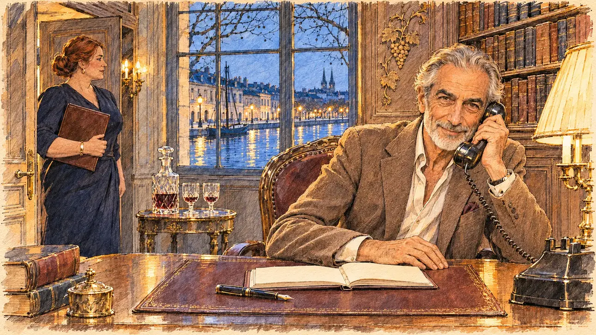

# `patronLoan` · Le prêt du mécène

**Validée par le PO le 22/11/2026**, au premier essai, telle quelle en clair et en sombre : un rendu plus fini et plus brillant que les autres reportages dessinés (le combiné, le bureau verni), accepté.



| Champ | Valeur |
| --- | --- |
| Carte | `patronLoan`, catégorie `campaignFinance` (Finances de campagne), poids 0,3, après un refus de la banque ou avec un budget de 400 k€ ou moins ; une offre piège (seul un parti peut emprunter à un particulier), carte ajoutée par la PR #464 de l'app (Mitchnsun/moi-president#267) |
| Style | Reportage dessiné |
| Ton | Feutré, une confidence |
| Date | 2026-11-22 |
| Outil | ChatGPT Images, modèle GPT 6.2 Astra, effort Light |
| Format rendu | 1672 × 941 (16:9) : export en 1290 × 726 px, WebP de qualité 75, 264 Ko, sans recadrage, fait depuis la copie WebP de la conversation |
| Fichier d'origine | Image de ChatGPT, chez le PO. L'export du dépôt a été fait depuis la copie partagée dans la conversation avec Claude |
| Première édition | `kit-france-2611-0004` |

## Texte de la carte

> **Le prêt du mécène**
>
> Un riche soutien vous appelle : il vous prête trois cent mille euros, à vous, sans intérêt, remboursables quand vous voudrez. « Personne n'a besoin de le savoir. »

## Le moment choisi

Le bureau d'un négociant en vins, dans un hôtel particulier du quartier des Chartrons, à Bordeaux, un soir de février : boiseries, bibliothèque, une carafe, une fenêtre sur les quais de la Garonne. Le mécène, au téléphone, un chéquier ouvert sur le sous-main, regarde le spectateur comme on fait une confidence : c'est le candidat, hors champ, qui est au bout du fil. Personne d'autre dans la pièce ; dans l'embrasure, son assistante attend avec un parapheur. Bordeaux n'avait encore servi à aucune carte.

## Prompt complet

Dans une nouvelle conversation, avec [`primeTime.webp`](../../illustrations/media/primeTime.webp) comme seule image de référence :

```
Use the attached image as the style reference and copy its drawing: a realistic reportage drawing made on the spot for a newspaper, with quick, nervous pencil lines, often drawn twice, ink hatching in the shadows, transparent watercolour washes that spill a little over the lines, and the warm paper showing through. Not the same scene and not the same people: never reuse the face or the hair of the woman in the reference.
Like in the reference, the setting can be full when the story needs it, with the things that say where we are and what is happening, but each one is sketched with a few pencil lines and a light wash, never rendered or finished, and the drawing gets looser and paler towards the edges until it fades into the bare paper.
This must look like a drawing made by hand on paper by a press illustrator, halfway between a quick sketch and a realistic picture: never a photograph, a film poster or a digital painting, and never a cartoon, a comic strip, a caricature or a children's book illustration. Continuous lines, never dotted or dashed outlines; no uniform texture, speckles or hatching filter laid over the picture; no glossy highlights, no smooth gradients, in the sky and on the walls too. Colour can be rich in places, on a piece of clothing, a light or a flag, but it stays transparent and within the palette below. The fade into the paper at the edges stays narrow, without a wide white margin. No blur and no depth-of-field effect: everything, the foreground included, is drawn sharp, like a sketch made on the spot.
People are drawn from life with realistic anatomy and proportions, like in the reference: faces shaped with pencil lines, hatching and light washes, a little more finished than the background but never photographic (no photographic skin, no airbrushed or digital-painting look). Expressions stay natural and restrained, even in laughter or tears: no exaggerated grins, no wide-open mouths full of teeth, no rubbery or cartoonish faces.

Editorial illustration, landscape 16:9 (1536 × 864 px), the scene filling the frame, with only a light fade into the paper at the edges. The office of a wine merchant in an 18th-century townhouse in the Chartrons quarter of Bordeaux, on a February evening in 2027: carved wood panelling, a wall of old books, a crystal decanter and two glasses on a side table, a tall window over the quays of the Garonne with the lamps coming on. The player's candidate stays off-camera, at the other end of the line. At the desk, in the right third, the patron, a slim, elegant man in his seventies of Lebanese descent, with swept-back silver hair, a trimmed white beard, a cashmere jacket and an open shirt, holds an old-fashioned desk phone to his ear and leans forward, looking at the viewer with a confiding, amused half-smile, as if sharing a secret, his face above mid-height; on the leather blotter, an open chequebook and a fountain pen. In the doorway behind him, his assistant, a tall, stocky woman in her forties with red hair in a low bun and a navy dress, waits with a leather folder, looking at him, not at the viewer. Only the patron looks at the viewer. Nothing on the chequebook, the books, the folder or the papers is readable.

Style: Reportage drawing made on the spot, like a press illustrator or courtroom sketch artist: pencil and ink with loose watercolour washes, lively unfinished lines, white paper showing through.

Palette: navy #13203F, vellum #F5EFE1, gold #A9802A, brick #B5523B, ochre #D9A441, sage #8FA58A, slate #5E7186, sand #DCC8A4, warm grey #8C8279; use 4 to 6 of them, subtle warm paper grain.

Tone: hushed and confidential, warm lamplight on the panelling, the blue evening outside the window.

Constraints: realistic proportions, natural expressions, never cartoonish or caricatured faces, drawn like the rest of the illustration and never photographic; people of varied ages, genders, origins and body types (heavy, stocky, round, tall, short, wiry, not only slim), each with a distinct face and haircut (no two people alike), drawn with respect and never as a joke; each person's age, build and look plausible for their job and the scene (working people of working age), no stereotype tying an origin or a gender to a role, and no person of colour shown alone in a featured service or deferential role; anatomically correct hands with exactly five fingers, few hands visible, the others in pockets, behind objects or out of frame; no readable text anywhere (the chequebook, the books, the folder and the papers stay unreadable); no captions or speech bubbles; no logos, no wine label, estate or brand name, no political party colours; no recognisable real person, no lookalike of a real politician; no explicit violence; no photographic rendering, no blur or bokeh, no dotted outlines, no texture or hatching filter over the picture, no oil-paint texture, no wide white margin or frame (a light fade into the paper at the edges is fine).

Format: if 16:9 is not available, make 1536 × 1024 and keep the top 80 px and the bottom 80 px free of anything important (faces, hands, the main action): they will be cropped.
```

## Essais écartés

Aucun.

## Retouches

Aucune.

## Relecture

Faite et validée par le PO le 22/11/2026.

- [x] Aucun texte lisible.
- [x] Aucun sosie d'une personne réelle.
- [x] Le candidat du joueur est hors champ.
- [x] Mains et visages sans défaut visible à 343 px de large.
- [x] Aucune couleur ni aucun logo de parti. Des personnes variées par l'âge, le corps, l'origine et la coiffure.
- [x] En 16:9 : pas de recadrage.
- [ ] Lisible sur la page de l'événement, en clair et en sombre : à vérifier dans l'app, une fois la carte publiée.
