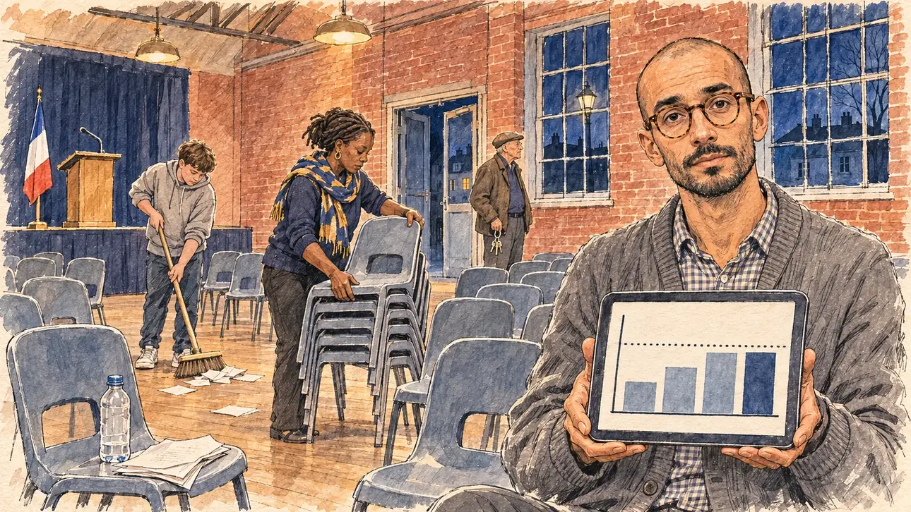

# `refundThreshold` · Le seuil des 5 %

**Validée par le PO le 09/11/2026**, au premier essai. Elle sert telle quelle en clair et en sombre.



| Champ | Valeur |
| --- | --- |
| Carte | `refundThreshold`, catégorie `campaignFinance` (Finances de campagne), poids 0,2, en campagne officielle, à 7 % ou moins du sondage |
| Style | Reportage dessiné |
| Ton | Tendu mais calme, fin de soirée |
| Date | 2026-11-09 |
| Outil | ChatGPT Images, à compléter (modèle et effort) |
| Conversation | À compléter |
| Format rendu | 1672 × 941 (16:9) : export en 1290 × 726 px, WebP de qualité 75, 234 Ko, sans recadrage, fait depuis la copie WebP de la conversation (à refaire depuis le PNG d'origine) |
| Fichier d'origine | À compléter (hors du dépôt) |
| Première édition | À compléter |

## Texte de la carte

> **Le seuil des 5 %**
>
> Sous 5 % des voix, l'État ne remboursera presque rien de vos dépenses. Votre trésorier vous demande de choisir : réduire la campagne ou parier sur le score.

## Le moment choisi

La salle des fêtes en brique rouge d'une petite ville de la Somme, en Picardie, un soir de mars, après un meeting modeste : la moitié des chaises sont restées vides, des bénévoles les empilent. Le candidat reste hors champ : ses feuilles de discours pliées sur une chaise et une bouteille d'eau presque vide. Le trésorier tient une tablette où un graphique en barres s'arrête juste sous la ligne pointillée du seuil, et regarde le spectateur : on réduit, ou on parie ? Une bénévole empile les chaises, un adolescent balaie les tracts, le gardien attend à la porte avec ses clés. Un nouveau trésorier, autre que celui de [`banksRefuse`](banksRefuse.md). La Picardie n'avait encore servi à aucune carte.

## Prompt complet

Dans une nouvelle conversation, avec [`primeTime.webp`](../../illustrations/media/primeTime.webp) comme seule image de référence :

```
Use the attached image as the style reference and copy its drawing: a realistic reportage drawing made on the spot for a newspaper, with quick, nervous pencil lines, often drawn twice, ink hatching in the shadows, transparent watercolour washes that spill a little over the lines, and the warm paper showing through. Not the same scene and not the same people: never reuse the face or the hair of the woman in the reference.
Like in the reference, the setting can be full when the story needs it, with the things that say where we are and what is happening, but each one is sketched with a few pencil lines and a light wash, never rendered or finished, and the drawing gets looser and paler towards the edges until it fades into the bare paper.
This must look like a drawing made by hand on paper by a press illustrator, halfway between a quick sketch and a realistic picture: never a photograph, a film poster or a digital painting, and never a cartoon, a comic strip, a caricature or a children's book illustration. Continuous lines, never dotted or dashed outlines; no uniform texture, speckles or hatching filter laid over the picture; no glossy highlights, no smooth gradients, in the sky and on the walls too. Colour can be rich in places, on a piece of clothing, a light or a flag, but it stays transparent and within the palette below. The fade into the paper at the edges stays narrow, without a wide white margin. No blur and no depth-of-field effect: everything, the foreground included, is drawn sharp, like a sketch made on the spot.
People are drawn from life with realistic anatomy and proportions, like in the reference: faces shaped with pencil lines, hatching and light washes, a little more finished than the background but never photographic (no photographic skin, no airbrushed or digital-painting look). Expressions stay natural and restrained, even in laughter or tears: no exaggerated grins, no wide-open mouths full of teeth, no rubbery or cartoonish faces.

Editorial illustration, landscape 16:9 (1536 × 864 px), the scene filling the frame, with only a light fade into the paper at the edges. The red-brick village hall of a small town in the Somme, in Picardy, on a March evening in 2027, just after a modest campaign rally: a high hall with brick walls, a wooden floor, a small stage with a lectern and a French tricolour flag, rows of plastic chairs of which half stayed empty; through the tall windows, the night and a street lamp. Volunteers fold and stack the chairs. The player's candidate stays off-camera: in the foreground, only the folded pages of a speech left on a chair and a nearly empty water bottle. In the right third, the campaign treasurer, a wiry man in his thirties of Portuguese descent, with a shaved head, round tortoiseshell glasses, a short dark beard and a grey cardigan over a checked shirt, holds a tablet showing a simple bar chart whose last bar stops just under a dotted threshold line, and looks at the viewer with a quiet, open question, cut back or bet on the score, his face above mid-height. Behind him: a tall Black volunteer in her forties, with short locs and a campaign scarf in navy and gold, stacks chairs; a short, round white teenage boy with a fringe and a hoodie sweeps up leaflets; at the back, the elderly caretaker of the hall, a thin white man in his seventies with a flat cap and a ring of keys, waits by the door. Only the treasurer looks at the viewer. Nothing on the tablet, the leaflets, the pages, the stage or the walls is readable, and the chart has no numbers or words.

Style: Reportage drawing made on the spot, like a press illustrator or courtroom sketch artist: pencil and ink with loose watercolour washes, lively unfinished lines, white paper showing through.

Palette: navy #13203F, vellum #F5EFE1, gold #A9802A, brick #B5523B, ochre #D9A441, sage #8FA58A, slate #5E7186, sand #DCC8A4, warm grey #8C8279; use 4 to 6 of them, subtle warm paper grain.

Tone: tense but quiet, the end of an evening, warm tired light from the hall's ceiling lamps on the red brick, the cold night outside the windows.

Constraints: realistic proportions, natural expressions, never cartoonish or caricatured faces, drawn like the rest of the illustration and never photographic; people of varied ages, genders, origins and body types (heavy, stocky, round, tall, short, wiry, not only slim), each with a distinct face and haircut (no two people alike), drawn with respect and never as a joke; each person's age, build and look plausible for their job and the scene (working people of working age), no stereotype tying an origin or a gender to a role, and no person of colour shown alone in a featured service or deferential role; anatomically correct hands with exactly five fingers, few hands visible, the others in pockets, behind objects or out of frame; no readable text anywhere (the tablet, the leaflets, the pages, the stage and the walls stay unreadable, no numbers on the chart); no captions or speech bubbles; no logos or political party colours; no recognisable real person, no lookalike of a real politician; no explicit violence; no photographic rendering, no blur or bokeh, no dotted outlines on the drawing (only the threshold line of the chart is dotted), no texture or hatching filter over the picture, no oil-paint texture, no glow or halo around the lights, no wide white margin or frame (a light fade into the paper at the edges is fine).

Format: if 16:9 is not available, make 1536 × 1024 and keep the top 80 px and the bottom 80 px free of anything important (faces, hands, the main action): they will be cropped.
```

## Décisions prises sur cette image

Validée telle quelle par le PO (09/11/2026). L'écharpe de la bénévole est bleu marine et or, les couleurs de la palette, sans couleur de parti.

## Essais écartés

Aucun.

## Retouches

Aucune.

## Relecture

Faite et validée par le PO le 09/11/2026.

- [x] Aucun texte lisible : les feuilles et les tracts sont vierges, la bouteille n'a pas d'étiquette, le graphique n'a ni chiffre ni mot.
- [x] Aucun sosie d'une personne réelle.
- [x] Le candidat du joueur est hors champ : seuls ses feuilles de discours et sa bouteille, sur une chaise.
- [x] Mains et visages sans défaut visible à 343 px de large : les mains sur la tablette, celles qui empilent les chaises et tiennent le balai, les clés du gardien.
- [x] Aucune couleur ni aucun logo de parti. Des personnes variées par l'âge, le corps, l'origine et la coiffure.
- [x] En 16:9 : pas de recadrage.
- [ ] Lisible sur la page de l'événement, en clair et en sombre : à vérifier dans l'app, une fois la carte publiée.
