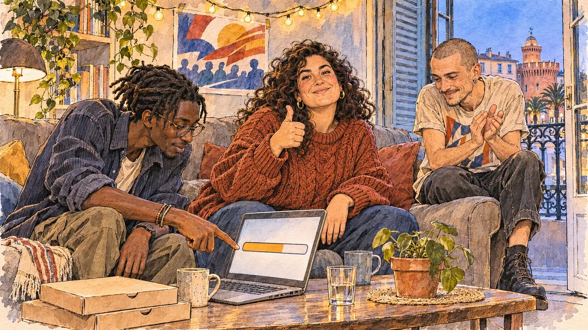

# `rogueFundraiser` · La cagnotte des fans

**Validée le 22/11/2026**, au premier essai. Elle sert telle quelle en clair et en sombre.



| Champ | Valeur |
| --- | --- |
| Carte | `rogueFundraiser`, catégorie `campaignFinance` (Finances de campagne), poids 0,25, une fois la notoriété montée de 5 points ; une offre piège (de l'argent hors du mandataire, des dons au-delà de 4 600 €), carte ajoutée par la PR #464 de l'app (Mitchnsun/moi-president#267) |
| Style | Reportage dessiné |
| Ton | Enthousiaste et naïf |
| Date | 2026-11-22 |
| Outil | ChatGPT Images, modèle GPT 6.2 Astra (effort à compléter) |
| Conversation | À compléter |
| Format rendu | 1672 × 941 (16:9) : export en 1290 × 726 px, WebP de qualité 75, sans recadrage, fait depuis la copie WebP de la conversation (à refaire depuis le PNG d'origine) |
| Fichier d'origine | À compléter (hors du dépôt) |
| Première édition | À compléter |

## Texte de la carte

> **La cagnotte des fans**
>
> Des fans ont ouvert une cagnotte en ligne pour votre campagne : rapide, sans paperasse, et l'argent afflue. Ils proposent de vous verser la somme chaque semaine.

## Le moment choisi

Un appartement d'étudiants à Perpignan, un soir de mars : un salon encombré, un canapé, des pizzas, une affiche de la campagne punaisée au mur, sans texte lisible. Trois fans entourent un ordinateur portable où une jauge de cagnotte monte ; l'une d'elles se retourne vers le spectateur, ravie, le pouce levé. Le candidat est hors champ. Perpignan n'avait encore servi à aucune carte.

## Prompt complet

Dans une nouvelle conversation, avec [`primeTime.webp`](../../illustrations/media/primeTime.webp) comme seule image de référence :

```
Use the attached image as the style reference and copy its drawing: a realistic reportage drawing made on the spot for a newspaper, with quick, nervous pencil lines, often drawn twice, ink hatching in the shadows, transparent watercolour washes that spill a little over the lines, and the warm paper showing through. Not the same scene and not the same people: never reuse the face or the hair of the woman in the reference.
Like in the reference, the setting can be full when the story needs it, with the things that say where we are and what is happening, but each one is sketched with a few pencil lines and a light wash, never rendered or finished, and the drawing gets looser and paler towards the edges until it fades into the bare paper.
This must look like a drawing made by hand on paper by a press illustrator, halfway between a quick sketch and a realistic picture: never a photograph, a film poster or a digital painting, and never a cartoon, a comic strip, a caricature or a children's book illustration. Continuous lines, never dotted or dashed outlines; no uniform texture, speckles or hatching filter laid over the picture; no glossy highlights, no smooth gradients, in the sky and on the walls too. Colour can be rich in places, on a piece of clothing, a light or a flag, but it stays transparent and within the palette below. The fade into the paper at the edges stays narrow, without a wide white margin. No blur and no depth-of-field effect: everything, the foreground included, is drawn sharp, like a sketch made on the spot.
People are drawn from life with realistic anatomy and proportions, like in the reference: faces shaped with pencil lines, hatching and light washes, a little more finished than the background but never photographic (no photographic skin, no airbrushed or digital-painting look). Expressions stay natural and restrained, even in laughter or tears: no exaggerated grins, no wide-open mouths full of teeth, no rubbery or cartoonish faces.

Editorial illustration, landscape 16:9 (1536 × 864 px), the scene filling the frame, with only a light fade into the paper at the edges. The living room of a shared student flat in Perpignan, in the south of France, on a March evening in 2027: a sagging sofa, pizza boxes, string lights, a balcony door open on a warm evening, and a campaign poster pinned to the wall with only shapes of colour and no lettering. The player's candidate does not appear. Around a laptop on the coffee table, three young fans in their early twenties: in the centre, a round, cheerful woman of Catalan descent with thick dark curls and a big knitted jumper turns towards the viewer, delighted, thumb up, her face above mid-height; beside her, a tall, lanky man of Senegalese descent with short locs and glasses points at the screen, where a fundraising gauge fills up as an abstract coloured bar; on the arm of the sofa, a short, wiry white man with a shaved head and a band T-shirt claps, his eyes on the screen. Only the woman in the centre looks at the viewer. Nothing on the laptop screen, the poster, the boxes or the T-shirt is readable: the gauge is a coloured bar with no numbers.

Style: Reportage drawing made on the spot, like a press illustrator or courtroom sketch artist: pencil and ink with loose watercolour washes, lively unfinished lines, white paper showing through.

Palette: navy #13203F, vellum #F5EFE1, gold #A9802A, brick #B5523B, ochre #D9A441, sage #8FA58A, slate #5E7186, sand #DCC8A4, warm grey #8C8279; use 4 to 6 of them, subtle warm paper grain.

Tone: enthusiastic and naive, warm string lights and the glow of the laptop screen, a soft evening blue from the balcony.

Constraints: realistic proportions, natural expressions, never cartoonish or caricatured faces, drawn like the rest of the illustration and never photographic; people of varied ages, genders, origins and body types (heavy, stocky, round, tall, short, wiry, not only slim), each with a distinct face and haircut (no two people alike), drawn with respect and never as a joke; each person's age, build and look plausible for their job and the scene (working people of working age), no stereotype tying an origin or a gender to a role, and no person of colour shown alone in a featured service or deferential role; anatomically correct hands with exactly five fingers, few hands visible, the others in pockets, behind objects or out of frame; no readable text anywhere (the laptop screen, the poster, the pizza boxes and the T-shirt stay unreadable); no captions or speech bubbles; no logos, no platform or app name, no political party colours; no recognisable real person, no lookalike of a real politician; no explicit violence; no photographic rendering, no blur or bokeh, no dotted outlines, no texture or hatching filter over the picture, no oil-paint texture, no wide white margin or frame (a light fade into the paper at the edges is fine).

Format: if 16:9 is not available, make 1536 × 1024 and keep the top 80 px and the bottom 80 px free of anything important (faces, hands, the main action): they will be cropped.
```

## Décisions prises sur cette image

Par la porte du balcon, le Castillet, la porte fortifiée de Perpignan, et des palmiers : la ville se reconnaît sans un mot. L'affiche de la campagne est une composition de formes et d'une foule en silhouettes, sans lettre ; le tee-shirt du fan de droite porte des formes géométriques bleues, rouges et blanches, sans drapeau ni sigle.

## Essais écartés

Aucun.

## Retouches

Aucune.

## Relecture

Faite le 22/11/2026.

- [x] Aucun texte lisible : la jauge est une barre sans chiffre, l'affiche, les boîtes et le tee-shirt sont sans inscription.
- [x] Aucun sosie d'une personne réelle.
- [x] Le candidat du joueur n'apparaît pas.
- [x] Mains et visages sans défaut visible à 343 px de large : le pouce levé, le doigt pointé vers l'écran, les mains qui applaudissent.
- [x] Aucune couleur ni aucun logo de parti. Des personnes variées par l'origine, le corps et la coiffure.
- [x] En 16:9 : pas de recadrage.
- [ ] Lisible sur la page de l'événement, en clair et en sombre : à vérifier dans l'app, une fois la carte publiée.
