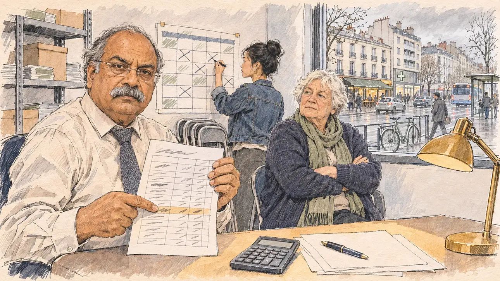

# `spendingCap` · Le plafond approche

**Validée par le PO le 09/11/2026**, au premier essai. Elle sert telle quelle en clair et en sombre.



| Champ | Valeur |
| --- | --- |
| Carte | `spendingCap`, catégorie `campaignFinance` (Finances de campagne), poids 0,2, en campagne officielle |
| Style | Reportage dessiné |
| Ton | Tendu mais calme |
| Date | 2026-11-09 |
| Outil | ChatGPT Images, à compléter (modèle et effort) |
| Conversation | À compléter |
| Format rendu | 1672 × 941 (16:9) : export en 1290 × 726 px, WebP de qualité 75, 194 Ko, sans recadrage, fait depuis la copie WebP de la conversation (à refaire depuis le PNG d'origine) |
| Fichier d'origine | À compléter (hors du dépôt) |
| Première édition | À compléter |

## Texte de la carte

> **Le plafond approche**
>
> Votre expert-comptable vous prévient : au rythme actuel, vos dépenses dépasseront le plafond légal avant le premier tour. Le compte de campagne pourrait être rejeté.

## Le moment choisi

Un local de campagne en rez-de-chaussée, une ancienne boutique d'une rue commerçante d'une ville moyenne, un après-midi gris de mars : par la vitrine, une rue ordinaire sans monument ni bâtiment reconnaissable, des immeubles de styles mêlés, un arrêt de bus, un café, une pharmacie. Le candidat reste hors champ : sa calculatrice et son stylo sur une pile de factures vierges. L'expert-comptable pose le doigt sur une ligne de son tableau et regarde le spectateur, grave ; une bénévole raye des dépenses sur le planning mural ; une militante âgée écoute, les bras croisés.

Deux premiers prompts plaçaient le local à Saint-Denis de La Réunion : le PO a préféré un local de campagne en terrain neutre, une ville sans référence à une ville précise (09/11/2026). La Réunion reste pour une autre carte.

## Prompt complet

Dans une nouvelle conversation, avec [`primeTime.webp`](../../illustrations/media/primeTime.webp) comme seule image de référence :

```
Use the attached image as the style reference and copy its drawing: a realistic reportage drawing made on the spot for a newspaper, with quick, nervous pencil lines, often drawn twice, ink hatching in the shadows, transparent watercolour washes that spill a little over the lines, and the warm paper showing through. Not the same scene and not the same people: never reuse the face or the hair of the woman in the reference.
Like in the reference, the setting can be full when the story needs it, with the things that say where we are and what is happening, but each one is sketched with a few pencil lines and a light wash, never rendered or finished, and the drawing gets looser and paler towards the edges until it fades into the bare paper.
This must look like a drawing made by hand on paper by a press illustrator, halfway between a quick sketch and a realistic picture: never a photograph, a film poster or a digital painting, and never a cartoon, a comic strip, a caricature or a children's book illustration. Continuous lines, never dotted or dashed outlines; no uniform texture, speckles or hatching filter laid over the picture; no glossy highlights, no smooth gradients, in the sky and on the walls too. Colour can be rich in places, on a piece of clothing, a light or a flag, but it stays transparent and within the palette below. The fade into the paper at the edges stays narrow, without a wide white margin. No blur and no depth-of-field effect: everything, the foreground included, is drawn sharp, like a sketch made on the spot.
People are drawn from life with realistic anatomy and proportions, like in the reference: faces shaped with pencil lines, hatching and light washes, a little more finished than the background but never photographic (no photographic skin, no airbrushed or digital-painting look). Expressions stay natural and restrained, even in laughter or tears: no exaggerated grins, no wide-open mouths full of teeth, no rubbery or cartoonish faces.

Editorial illustration, landscape 16:9 (1536 × 864 px), the scene filling the frame, with only a light fade into the paper at the edges. A street-level campaign office in a former shop on a busy street of an ordinary mid-sized French city, on a grey March afternoon in 2027, the day the campaign's accountant warns that spending will exceed the legal cap before the first round: a modest room with white walls, metal shelves with boxes of leaflets, stacked folding chairs, a wall planner of rallies and expenses; through the large shop window, an ordinary city street with no landmark and no recognisable building: four- and five-storey apartment blocks of mixed styles from the 1930s to the 2000s, a bus stop with a bus pulling away, a café and a pharmacy across the street, bicycles, electric cars and passers-by under a damp sky. The player's candidate stays off-camera: in the foreground, only a calculator and a pen lying on a pile of blank invoices on the desk. In the left third, the campaign's chartered accountant, a stocky man in his sixties of South Asian descent, with a thick grey moustache, receding grey hair, rimless glasses, a pale shirt and a knitted tie, holds a printed spreadsheet and points at one line with his finger, looking at the viewer, grave and calm, his face above mid-height. Behind him, a volunteer in her twenties of Chinese descent, slim, with a high bun and a denim jacket, crosses out items on the wall planner with a marker, her back half turned. Near the window, an older activist, a round white woman in her seventies with short white hair, a cardigan and a long scarf, listens with her arms folded and looks at the accountant. Only the accountant looks at the viewer. Nothing on the spreadsheet, the invoices, the planner, the boxes, the leaflets, the shop signs or the bus is readable.

Style: Reportage drawing made on the spot, like a press illustrator or courtroom sketch artist: pencil and ink with loose watercolour washes, lively unfinished lines, white paper showing through.

Palette: navy #13203F, vellum #F5EFE1, gold #A9802A, brick #B5523B, ochre #D9A441, sage #8FA58A, slate #5E7186, sand #DCC8A4, warm grey #8C8279; use 4 to 6 of them, subtle warm paper grain.

Tone: tense but quiet, flat grey afternoon light from the shop window, the warm pool of a desk lamp on the invoices.

Constraints: realistic proportions, natural expressions, never cartoonish or caricatured faces, drawn like the rest of the illustration and never photographic; people of varied ages, genders, origins and body types (heavy, stocky, round, tall, short, wiry, not only slim), each with a distinct face and haircut (no two people alike), drawn with respect and never as a joke; each person's age, build and look plausible for their job and the scene (working people of working age), no stereotype tying an origin or a gender to a role, and no person of colour shown alone in a featured service or deferential role; anatomically correct hands with exactly five fingers, few hands visible, the others in pockets, behind objects or out of frame; no readable text anywhere (the spreadsheet, the invoices, the planner, the boxes, the leaflets, the shop signs and the bus stay unreadable, no figures); no captions or speech bubbles; no logos, no shop or brand names, no political party colours; no recognisable real person, no lookalike of a real politician; no recognisable city or landmark; no explicit violence; no photographic rendering, no blur or bokeh, no dotted outlines, no texture or hatching filter over the picture, no oil-paint texture, no glow or halo around the lights, no wide white margin or frame (a light fade into the paper at the edges is fine).

Format: if 16:9 is not available, make 1536 × 1024 and keep the top 80 px and the bottom 80 px free of anything important (faces, hands, the main action): they will be cropped.
```

## Décisions prises sur cette image

Validée telle quelle par le PO (09/11/2026). Les immeubles à balcons de la rue sont d'un style courant dans les villes françaises, sans repère qui en désigne une. La croix verte de la pharmacie est le signe générique, sans texte.

## Essais écartés

Aucun.

## Retouches

Aucune.

## Relecture

Faite et validée par le PO le 09/11/2026.

- [x] Aucun texte lisible : le tableau ne porte que des traits, l'écran de la calculatrice est vide, les enseignes sont des aplats, le bus est vierge.
- [x] Aucun sosie d'une personne réelle ; aucune ville reconnaissable.
- [x] Le candidat du joueur est hors champ : seuls sa calculatrice et son stylo, sur les factures.
- [x] Mains et visages sans défaut visible à 343 px de large : la main qui pointe la ligne, celle qui tient le tableau, celle de la bénévole au feutre.
- [x] Aucune couleur ni aucun logo de parti. Des personnes variées par l'âge, le corps, l'origine et la coiffure.
- [x] En 16:9 : pas de recadrage.
- [ ] Lisible sur la page de l'événement, en clair et en sombre : à vérifier dans l'app, une fois la carte publiée.
