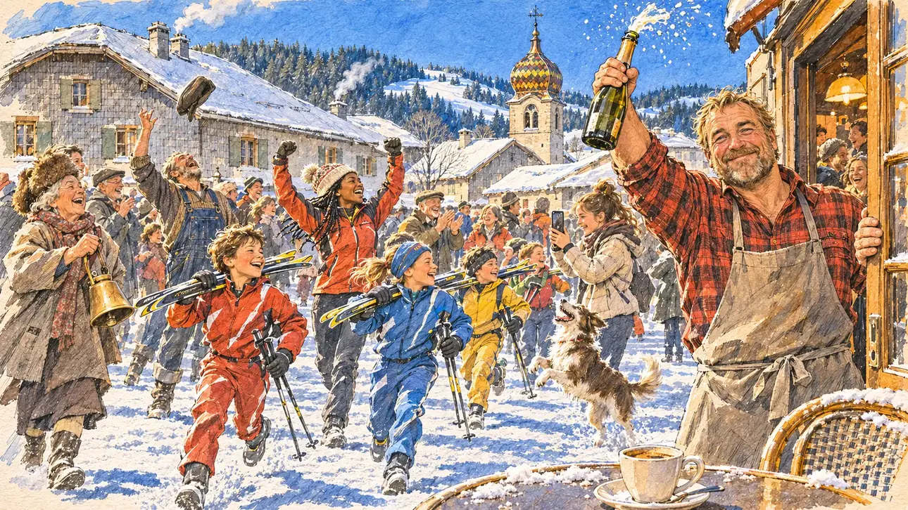

# `biathlonWorlds` · Un titre mondial de biathlon

**À générer.** Prompt prêt le 04/11/2026, pas encore d'image validée.



| Champ | Valeur |
| --- | --- |
| Carte | `biathlonWorlds`, catégorie `chance` (Coup de chance), carte ajoutée par la PR #297 de l'app |
| Style | Reportage dessiné, trait de `primeTime` |
| Ton | Joyeux, chaleureux |
| Date | À remplir |
| Outil | ChatGPT Images |
| Conversation | À remplir (le lien ne s'ouvre qu'avec le compte qui l'a créée) |
| Format rendu | À remplir |
| Fichier d'origine | À remplir |
| Première édition | À remplir |

## Texte de la carte

> **Un titre mondial de biathlon**
>
> Une biathlète française décroche un titre mondial. Vous êtes en visite dans une vallée de montagne, au café du village de la championne, quand la nouvelle tombe. Tout le monde sort sur la place.

## Le moment choisi

La place enneigée d'un village du Haut-Jura, en février, à l'instant où la biathlète du village devient championne du monde, vue depuis la terrasse du café où se tenait le candidat (hors champ) : au premier plan, une tasse de café sur une table de terrasse saupoudrée de neige. Le patron du café, l'oncle de la championne, sort en brandissant une bouteille et regarde le candidat, ému aux larmes. Tout le village déboule sur la place : les enfants du club de ski avec leurs skis, une monitrice, une vieille dame qui agite une cloche de vache, un chien. Derrière : les grosses fermes jurassiennes aux toits bas et aux façades de bardeaux, le clocher comtois à bulbe, les sapins et les pentes enneigées.

## Prompt complet

Dans une nouvelle conversation, avec [`primeTime.webp`](../../illustrations/media/primeTime.webp) comme seule image de référence.

```
Use the attached image as the style reference and copy its drawing: a realistic reportage drawing made on the spot for a newspaper, with quick, nervous pencil lines, often drawn twice, ink hatching in the shadows, transparent watercolour washes that spill a little over the lines, and the warm paper showing through. Not the same scene and not the same people: never reuse the face or the hair of the woman in the reference.
Like in the reference, the setting can be full when the story needs it, with the things that say where we are and what is happening, but each one is sketched with a few pencil lines and a light wash, never rendered or finished, and the drawing gets looser and paler towards the edges until it fades into the bare paper.
This must look like a drawing made by hand on paper by a press illustrator, halfway between a quick sketch and a realistic picture: never a photograph, a film poster or a digital painting, and never a cartoon, a comic strip, a caricature or a children's book illustration. Continuous lines, never dotted or dashed outlines; no uniform texture, speckles or hatching filter laid over the picture; no glossy highlights, no smooth gradients, in the sky and on the walls too. Colour can be rich in places, on a piece of clothing, a light or a flag, but it stays transparent and within the palette below. The fade into the paper at the edges stays narrow, without a wide white margin. No blur and no depth-of-field effect: everything, the foreground included, is drawn sharp, like a sketch made on the spot.
People are drawn from life with realistic anatomy and proportions, like in the reference: faces shaped with pencil lines, hatching and light washes, a little more finished than the background but never photographic (no photographic skin, no airbrushed or digital-painting look). Expressions stay natural and restrained, even in laughter or tears: no exaggerated grins, no wide-open mouths full of teeth, no rubbery or cartoonish faces.

Editorial illustration, landscape 16:9 (1536 × 864 px), the scene filling the frame, with only a light fade into the paper at the edges. The snowy little square of a village in the high Jura mountains, on a bright February afternoon in 2027, at the very moment the village's own biathlete becomes world champion: everybody pours out of the café and the houses onto the square. The scene is seen from the café terrace where the player's candidate was sitting, who stays off-camera: in the foreground, only the edge of a terrace table dusted with snow and a cup of coffee on it. In the right third, the owner of the café, the champion's uncle, a burly man in his fifties with a short blond beard, a red checked flannel shirt and an apron, bursts out of the door raising an unlabelled bottle of sparkling wine and looks at the viewer with tears of joy in his eyes and a huge but natural smile, his face above mid-height. Around him, sketched in pencil and light washes: children from the local ski club in ski suits running with their cross-country skis and poles on their shoulders, no rifles anywhere; their ski instructor, a young Black woman with braids under a woolly hat, cheering with her arms up; an old woman in a fur hat ringing a big cowbell; a farmer in overalls throwing his cap in the air; a teenage girl filming on her phone; a dog jumping in the snow. Behind them, the village of the Jura: big low farmhouses with wide sloping roofs and walls clad in grey wooden shingles, snow on the roofs, smoke from the chimneys, the church with its typical bulb-shaped Franche-Comté bell tower covered in coloured glazed tiles, fir forests and white slopes under a clear blue sky. Only the café owner looks at the viewer. Nothing on the café, the bottle, the ski suits or the phone is readable.

Style: Reportage drawing made on the spot, like a press illustrator or courtroom sketch artist: pencil and ink with loose watercolour washes, lively unfinished lines, white paper showing through.

Palette: navy #13203F, vellum #F5EFE1, gold #A9802A, brick #B5523B, ochre #D9A441, sage #8FA58A, slate #5E7186, sand #DCC8A4, warm grey #8C8279; use 4 to 6 of them, subtle warm paper grain.

Tone: joyful and warm, bright winter sun on the snow, crisp blue shadows, the red of the flannel shirt and the colours of the ski suits as the brightest notes.

Constraints: realistic proportions, natural expressions, never cartoonish or caricatured faces, drawn like the rest of the illustration and never photographic; people of varied ages, genders, origins and body types (heavy, stocky, round, tall, short, wiry, not only slim), each with a distinct face and haircut (no two people alike), drawn with respect and never as a joke; anatomically correct hands with exactly five fingers, few hands visible, the others in pockets, behind objects or out of frame; no readable text anywhere (the café, the bottle, the ski suits and the phone stay unreadable); no captions or speech bubbles; no logos or political party colours; no recognisable real person, no lookalike of a real politician or of a real athlete; no explicit violence; no photographic rendering, no blur or bokeh, no dotted outlines, no texture or hatching filter over the picture, no oil-paint texture, no wide white margin or frame (a light fade into the paper at the edges is fine).

Format: if 16:9 is not available, make 1536 × 1024 and keep the top 80 px and the bottom 80 px free of anything important (faces, hands, the main action): they will be cropped.
```

## Décisions prises sur cette image

Aucune pour l'instant.

## Essais écartés

Aucun pour l'instant.

## Retouches

Aucune.

## Relecture

À faire sur l'image validée.
