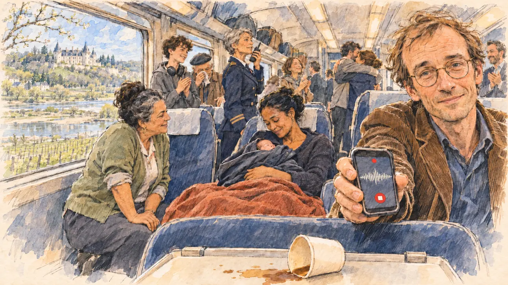

# `campaignBirth` · Une naissance dans le train

**Validée par le PO le 05/11/2026**, au premier essai, avec `primeTime.webp` comme référence. Elle sert telle quelle en clair et en sombre.



| Champ | Valeur |
| --- | --- |
| Carte | `campaignBirth`, catégorie `chance` (Coup de chance), carte ajoutée par la PR #297 de l'app |
| Style | Reportage dessiné, trait de `primeTime` |
| Ton | Chaleureux, ému |
| Date | 2026-11-05 |
| Outil | ChatGPT Images |
| Conversation | À remplir (le lien ne s'ouvre qu'avec le compte qui l'a créée) |
| Format rendu | 1672 × 941 (16:9) : export en 1290 × 726 px, WebP de qualité 75, 164 Ko, sans recadrage |
| Fichier d'origine | Image de ChatGPT, chez le PO. L'export du dépôt a été fait depuis la copie partagée dans la conversation avec Claude |
| Première édition | La prochaine Release qui suit le merge de la PR #297 de l'app |

## Texte de la carte

> **Une naissance dans le train**
>
> Une collaboratrice de votre équipe perd les eaux dans le train de campagne, entre deux gares. Le contrôleur arrête le train, les voyageurs applaudissent le bébé, et un journaliste vous demande un mot.

## Le moment choisi

Une voiture du train de campagne, arrêtée entre deux gares dans la vallée de la Loire, un après-midi de mars, quelques minutes après la naissance. Vu depuis la place du candidat dans l'allée (hors champ) : au premier plan, le dossier d'un siège et un gobelet de café renversé. Un journaliste qui suivait la campagne tend son téléphone vers le candidat et lui demande un mot. Derrière lui : la collaboratrice, assise sous une couverture, le nouveau-né enveloppé contre elle, fatiguée et heureuse ; une voyageuse infirmière qui l'a aidée ; la contrôleuse au talkie-walkie ; les voyageurs debout qui applaudissent. Par les fenêtres : la Loire, les vignes, un château de tuffeau aux toits d'ardoise.

## Prompt complet

Dans une nouvelle conversation, avec [`primeTime.webp`](../../illustrations/media/primeTime.webp) comme seule image de référence.

```
Use the attached image as the style reference and copy its drawing: a realistic reportage drawing made on the spot for a newspaper, with quick, nervous pencil lines, often drawn twice, ink hatching in the shadows, transparent watercolour washes that spill a little over the lines, and the warm paper showing through. Not the same scene and not the same people: never reuse the face or the hair of the woman in the reference.
Like in the reference, the setting can be full when the story needs it, with the things that say where we are and what is happening, but each one is sketched with a few pencil lines and a light wash, never rendered or finished, and the drawing gets looser and paler towards the edges until it fades into the bare paper.
This must look like a drawing made by hand on paper by a press illustrator, halfway between a quick sketch and a realistic picture: never a photograph, a film poster or a digital painting, and never a cartoon, a comic strip, a caricature or a children's book illustration. Continuous lines, never dotted or dashed outlines; no uniform texture, speckles or hatching filter laid over the picture; no glossy highlights, no smooth gradients, in the sky and on the walls too. Colour can be rich in places, on a piece of clothing, a light or a flag, but it stays transparent and within the palette below. The fade into the paper at the edges stays narrow, without a wide white margin. No blur and no depth-of-field effect: everything, the foreground included, is drawn sharp, like a sketch made on the spot.
People are drawn from life with realistic anatomy and proportions, like in the reference: faces shaped with pencil lines, hatching and light washes, a little more finished than the background but never photographic (no photographic skin, no airbrushed or digital-painting look). Expressions stay natural and restrained, even in laughter or tears: no exaggerated grins, no wide-open mouths full of teeth, no rubbery or cartoonish faces.

Editorial illustration, landscape 16:9 (1536 × 864 px), the scene filling the frame, with only a light fade into the paper at the edges. Inside a carriage of the campaign train, stopped between two stations in the Loire valley on a bright March afternoon in 2027, a few minutes after a member of the candidate's team has given birth on board. The scene is seen from the aisle where the player's candidate stands, who stays off-camera: in the foreground, only the top of a seat back and a knocked-over paper cup of coffee on a fold-down table. In the right third, a journalist who was following the campaign, a lanky man in his forties with thinning sandy hair, round glasses and a corduroy jacket, holds out his phone to record and asks the candidate for a word, looking at the viewer with a moved, slightly sheepish smile, his face above mid-height. Behind him, sketched in pencil and light washes, a little further down the carriage: the young campaign aide who has just given birth, a woman in her early thirties of Malagasy origin with her black hair pulled back, sitting across two seats under a blanket, tired and radiant, holding her newborn baby wrapped in a jacket against her chest, fully covered and decent; a passenger who is a nurse, a stout woman in her fifties of Tunisian origin with a cardigan and her sleeves rolled up, kneeling beside her with a calm smile; the train conductor, a tall woman in her fifties with a short grey crop in her dark uniform, speaking into her walkie-talkie; passengers of all ages standing in the aisle and between the seats applauding, a teenager with headphones round his neck, an old man in a beret wiping his glasses, two other members of the campaign team hugging. Through the train windows, the Loire valley in early spring: the wide river with its sandbanks, rows of vines, and on a hill a white tuffeau-stone château with slate roofs and turrets. Only the journalist looks at the viewer. Nothing on the phone, the seats, the windows, the uniform or the cup is readable, and no logo of a real railway company appears.

Style: Reportage drawing made on the spot, like a press illustrator or courtroom sketch artist: pencil and ink with loose watercolour washes, lively unfinished lines, white paper showing through.

Palette: navy #13203F, vellum #F5EFE1, gold #A9802A, brick #B5523B, ochre #D9A441, sage #8FA58A, slate #5E7186, sand #DCC8A4, warm grey #8C8279; use 4 to 6 of them, subtle warm paper grain.

Tone: warm and moving, soft afternoon light pouring through the train windows, the pale greens of the Loire valley and the warm colours of the blanket as the brightest notes.

Constraints: realistic proportions, natural expressions, never cartoonish or caricatured faces, drawn like the rest of the illustration and never photographic; people of varied ages, genders, origins and body types (heavy, stocky, round, tall, short, wiry, not only slim), each with a distinct face and haircut (no two people alike), drawn with respect and never as a joke; anatomically correct hands with exactly five fingers, few hands visible, the others in pockets, behind objects or out of frame; no readable text anywhere (the phone, the seats, the windows, the uniform and the cup stay unreadable); no captions or speech bubbles; no logos or political party colours; no recognisable real person, no lookalike of a real politician or of a real journalist, and no logo of a real railway company; no explicit violence; no photographic rendering, no blur or bokeh, no dotted outlines, no texture or hatching filter over the picture, no oil-paint texture, no wide white margin or frame (a light fade into the paper at the edges is fine).

Format: if 16:9 is not available, make 1536 × 1024 and keep the top 80 px and the bottom 80 px free of anything important (faces, hands, the main action): they will be cropped.
```

## Décisions prises sur cette image

Aucune.

## Essais écartés

Aucun.

## Retouches

Aucune.

## Relecture

Faite et validée par le PO le 05/11/2026.

- [x] Aucun texte lisible : le téléphone du journaliste n'affiche qu'une onde et deux boutons d'enregistrement, rien sur les sièges, l'uniforme ni le gobelet, aucun logo ferroviaire.
- [x] Aucun sosie d'une personne réelle.
- [x] Le candidat du joueur est hors champ.
- [x] Mains, visages et foules sans défaut visible à 343 px de large.
- [x] Aucune couleur ni aucun logo de parti. Des personnes variées par l'âge, le corps, l'origine et la coiffure.
- [x] En 3:2 : sans objet, l'image est en 16:9.
- [x] Lisible sur la page de l'événement, en clair et en sombre.

Ce que la relecture a accepté : l'infirmière assise près de la jeune mère plutôt qu'agenouillée ; un journaliste aux cheveux châtains en bataille plutôt que clairsemés.
