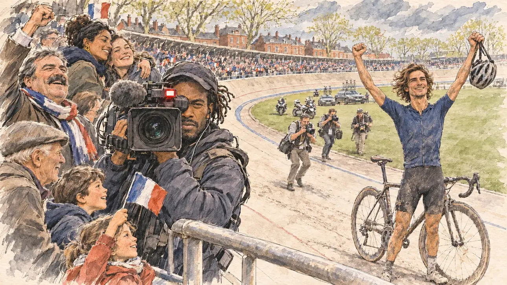

# `cobbledClassic` · La Reine des classiques

**À générer.** Prompt prêt le 04/11/2026, pas encore d'image validée.



| Champ | Valeur |
| --- | --- |
| Carte | `cobbledClassic`, catégorie `chance` (Coup de chance), carte ajoutée par la PR #297 de l'app |
| Style | Reportage dessiné, trait de `primeTime` |
| Ton | Joyeux, électrique |
| Date | À remplir |
| Outil | ChatGPT Images |
| Conversation | À remplir (le lien ne s'ouvre qu'avec le compte qui l'a créée) |
| Format rendu | À remplir |
| Fichier d'origine | À remplir |
| Première édition | À remplir |

## Texte de la carte

> **La Reine des classiques**
>
> Un coureur français remporte l'Enfer du Nord, la reine des classiques. Vous êtes au vélodrome de l'arrivée, à une semaine du vote, quand il lève les bras sur la piste. Les caméras passent du vainqueur aux tribunes.

## Le moment choisi

Le vélodrome en plein air de l'arrivée de la grande classique des pavés, dans le Nord, un dimanche après-midi d'avril, à une semaine du vote, vu depuis les tribunes où se tient le candidat (hors champ) : au premier plan, la rambarde de la tribune. Sur la piste en béton, un coureur français couvert de poussière lève les bras. Dans le tiers droit, un cadreur de la télévision fait pivoter sa caméra du vainqueur vers la tribune et vise le candidat. Autour : les supporters du Nord debout, une famille avec ses enfants, un vieux supporter couvert de poussière, les photographes au bord de la piste, les motos, la pelouse centrale. Derrière : les tribunes, les briques, les platanes et le ciel gris-bleu du Nord.

## Prompt complet

Dans une nouvelle conversation, avec [`primeTime.webp`](../../illustrations/media/primeTime.webp) comme seule image de référence.

```
Use the attached image as the style reference and copy its drawing: a realistic reportage drawing made on the spot for a newspaper, with quick, nervous pencil lines, often drawn twice, ink hatching in the shadows, transparent watercolour washes that spill a little over the lines, and the warm paper showing through. Not the same scene and not the same people: never reuse the face or the hair of the woman in the reference.
Like in the reference, the setting can be full when the story needs it, with the things that say where we are and what is happening, but each one is sketched with a few pencil lines and a light wash, never rendered or finished, and the drawing gets looser and paler towards the edges until it fades into the bare paper.
This must look like a drawing made by hand on paper by a press illustrator, halfway between a quick sketch and a realistic picture: never a photograph, a film poster or a digital painting, and never a cartoon, a comic strip, a caricature or a children's book illustration. Continuous lines, never dotted or dashed outlines; no uniform texture, speckles or hatching filter laid over the picture; no glossy highlights, no smooth gradients, in the sky and on the walls too. Colour can be rich in places, on a piece of clothing, a light or a flag, but it stays transparent and within the palette below. The fade into the paper at the edges stays narrow, without a wide white margin. No blur and no depth-of-field effect: everything, the foreground included, is drawn sharp, like a sketch made on the spot.
People are drawn from life with realistic anatomy and proportions, like in the reference: faces shaped with pencil lines, hatching and light washes, a little more finished than the background but never photographic (no photographic skin, no airbrushed or digital-painting look). Expressions stay natural and restrained, even in laughter or tears: no exaggerated grins, no wide-open mouths full of teeth, no rubbery or cartoonish faces.

Editorial illustration, landscape 16:9 (1536 × 864 px), the scene filling the frame, with only a light fade into the paper at the edges. The open-air concrete velodrome at the finish of the great cobbled spring classic, the 'Hell of the North', in the Nord, on a Sunday afternoon in mid-April 2027, one week before the vote. The scene is seen from the stands where the player's candidate is watching, who stays off-camera: in the foreground, only the metal railing of the stand. Down on the pale, banked concrete track, small in the middle distance, a French rider in a plain jersey with no lettering, his face and legs grey with the dust of the cobbles, crosses the line with both arms raised, a few photographers running after him on the inner lawn. In the right third, a television cameraman, a tall man in his thirties of Caribbean origin, with short dreadlocks under a cap and a padded jacket, has just swung his heavy shoulder camera away from the winner towards the stands and is filming the viewer, one eye at the viewfinder and a small red light on, his face above mid-height. Around him, sketched in pencil and light washes: the fans of the Nord on their feet, a big man in his fifties with a moustache and a scarf in plain colours shouting with joy, a family with two children waving small French flags, an old fan in a flat cap still grey with dust from the roadside, a young woman of Moroccan origin hugging her friend; motorbikes and team cars parked on the inner lawn; photographers crowding the edge of the track. Behind them, the curved stands of the velodrome, red-brick buildings, a few plane trees in fresh leaf and a grey-blue northern sky with fast clouds. Only the cameraman looks at the viewer. Nothing on the jerseys, the camera, the scarves, the barriers or the stands is readable, and no logo of a real race, team or sponsor appears.

Style: Reportage drawing made on the spot, like a press illustrator or courtroom sketch artist: pencil and ink with loose watercolour washes, lively unfinished lines, white paper showing through.

Palette: navy #13203F, vellum #F5EFE1, gold #A9802A, brick #B5523B, ochre #D9A441, sage #8FA58A, slate #5E7186, sand #DCC8A4, warm grey #8C8279; use 4 to 6 of them, subtle warm paper grain.

Tone: joyful and electric, the changing light of a northern spring afternoon, the grey dust of the cobbles, and the colours of the flags and scarves as the brightest notes.

Constraints: realistic proportions, natural expressions, never cartoonish or caricatured faces, drawn like the rest of the illustration and never photographic; people of varied ages, genders, origins and body types (heavy, stocky, round, tall, short, wiry, not only slim), each with a distinct face and haircut (no two people alike), drawn with respect and never as a joke; anatomically correct hands with exactly five fingers, few hands visible, the others in pockets, behind objects or out of frame; no readable text anywhere (the jerseys, the camera, the scarves, the barriers and the stands stay unreadable); no captions or speech bubbles; no logos or political party colours; no recognisable real person, no lookalike of a real politician or of a real cyclist, and no logo of a real race, team or sponsor; no explicit violence; no photographic rendering, no blur or bokeh, no dotted outlines, no texture or hatching filter over the picture, no oil-paint texture, no wide white margin or frame (a light fade into the paper at the edges is fine).

Format: if 16:9 is not available, make 1536 × 1024 and keep the top 80 px and the bottom 80 px free of anything important (faces, hands, the main action): they will be cropped.
```

## Décisions prises sur cette image

Aucune pour l'instant.

## Essais écartés

Aucun pour l'instant.

## Retouches

Aucune.

## Relecture

À faire sur l'image validée.
