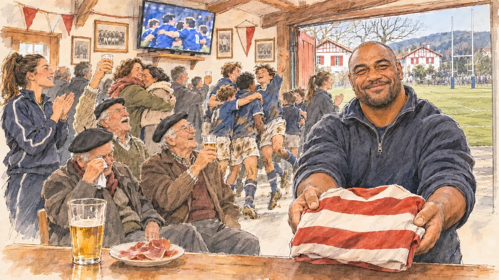

# `crunchWin` · Le Crunch

**À générer.** Prompt prêt le 04/11/2026, pas encore d'image validée.



| Champ | Valeur |
| --- | --- |
| Carte | `crunchWin`, catégorie `chance` (Coup de chance), carte ajoutée par la PR #297 de l'app |
| Style | Reportage dessiné, trait de `primeTime` |
| Ton | Joyeux, bon enfant |
| Date | À remplir |
| Outil | ChatGPT Images |
| Conversation | À remplir (le lien ne s'ouvre qu'avec le compte qui l'a créée) |
| Format rendu | À remplir |
| Fichier d'origine | À remplir |
| Première édition | À remplir |

## Texte de la carte

> **Le Crunch**
>
> Le XV de France l'emporte au Crunch à Twickenham. Vous regardez le match dans le club de rugby d'une commune du Sud-Ouest, entre deux réunions, et l'entraîneur des jeunes vous tend un maillot du club.

## Le moment choisi

Le club-house du club de rugby d'une commune du Pays basque, un dimanche après-midi de février, au coup de sifflet final de la victoire de la France à Twickenham, vu depuis la place du candidat (hors champ) : au premier plan, un verre et une assiette de jambon sur le comptoir. L'entraîneur des jeunes, un colosse d'origine fidjienne, tend au candidat un maillot du club, rayé rouge et blanc, sans écusson ni inscription. Autour : les anciens au béret qui trinquent, les gamins de l'école de rugby en tenue boueuse, des mères, un bénévole au barbecue. Derrière : la télévision où l'on devine les joueurs, les photos d'équipe aux murs, et par la porte le terrain, le fronton de pelote et les maisons blanches aux colombages rouges.

## Prompt complet

Dans une nouvelle conversation, avec [`primeTime.webp`](../../illustrations/media/primeTime.webp) comme seule image de référence.

```
Use the attached image as the style reference and copy its drawing: a realistic reportage drawing made on the spot for a newspaper, with quick, nervous pencil lines, often drawn twice, ink hatching in the shadows, transparent watercolour washes that spill a little over the lines, and the warm paper showing through. Not the same scene and not the same people: never reuse the face or the hair of the woman in the reference.
Like in the reference, the setting can be full when the story needs it, with the things that say where we are and what is happening, but each one is sketched with a few pencil lines and a light wash, never rendered or finished, and the drawing gets looser and paler towards the edges until it fades into the bare paper.
This must look like a drawing made by hand on paper by a press illustrator, halfway between a quick sketch and a realistic picture: never a photograph, a film poster or a digital painting, and never a cartoon, a comic strip, a caricature or a children's book illustration. Continuous lines, never dotted or dashed outlines; no uniform texture, speckles or hatching filter laid over the picture; no glossy highlights, no smooth gradients, in the sky and on the walls too. Colour can be rich in places, on a piece of clothing, a light or a flag, but it stays transparent and within the palette below. The fade into the paper at the edges stays narrow, without a wide white margin. No blur and no depth-of-field effect: everything, the foreground included, is drawn sharp, like a sketch made on the spot.
People are drawn from life with realistic anatomy and proportions, like in the reference: faces shaped with pencil lines, hatching and light washes, a little more finished than the background but never photographic (no photographic skin, no airbrushed or digital-painting look). Expressions stay natural and restrained, even in laughter or tears: no exaggerated grins, no wide-open mouths full of teeth, no rubbery or cartoonish faces.

Editorial illustration, landscape 16:9 (1536 × 864 px), the scene filling the frame, with only a light fade into the paper at the edges. The clubhouse of the rugby club of a small town in the French Basque Country, on a Sunday afternoon in mid-February 2027, at the final whistle of France's victory over England at Twickenham. The scene is seen from the place of the player's candidate, who came between two meetings and stays off-camera: in the foreground, only the edge of the wooden bar with a glass and a small plate of cured ham. In the right third, the youth coach, a huge, broad-shouldered man in his forties of Fijian origin, with a shaved head, a short beard and a club fleece, holds out a folded club jersey with red and white hoops, no crest and no lettering, towards the viewer with a big, warm smile, his face above mid-height. Around him, sketched in pencil and light washes: three old-timers in Basque berets raising their glasses, one of them wiping a tear; children from the rugby school in muddy shorts and socks jumping up and down; two mothers hugging; a stocky volunteer in an apron at a grill by the open door; a young woman player with a ponytail and a club tracksuit clapping. Behind them, the clubhouse: a television high on the wall showing tiny players in blue celebrating, their faces too small to see, old team photographs and pennants on the walls with nothing readable, and through the open door the rugby pitch with its tall H-shaped posts, a Basque pelota wall, and white houses with red half-timbering and red shutters, under a pale February sun. Only the youth coach looks at the viewer. Nothing on the jersey, the pennants, the photographs, the television or the bar is readable, and no crest or logo of a real club or federation appears.

Style: Reportage drawing made on the spot, like a press illustrator or courtroom sketch artist: pencil and ink with loose watercolour washes, lively unfinished lines, white paper showing through.

Palette: navy #13203F, vellum #F5EFE1, gold #A9802A, brick #B5523B, ochre #D9A441, sage #8FA58A, slate #5E7186, sand #DCC8A4, warm grey #8C8279; use 4 to 6 of them, subtle warm paper grain.

Tone: joyful and good-natured, pale February sun through the door, the warm wood of the clubhouse, the red and white of the jersey and of the Basque houses as the brightest notes.

Constraints: realistic proportions, natural expressions, never cartoonish or caricatured faces, drawn like the rest of the illustration and never photographic; people of varied ages, genders, origins and body types (heavy, stocky, round, tall, short, wiry, not only slim), each with a distinct face and haircut (no two people alike), drawn with respect and never as a joke; anatomically correct hands with exactly five fingers, few hands visible, the others in pockets, behind objects or out of frame; no readable text anywhere (the jersey, the pennants, the photographs, the television and the bar stay unreadable); no captions or speech bubbles; no logos or political party colours; no recognisable real person, no lookalike of a real politician or of a real rugby player, and no crest of a real club or federation; no explicit violence; no photographic rendering, no blur or bokeh, no dotted outlines, no texture or hatching filter over the picture, no oil-paint texture, no wide white margin or frame (a light fade into the paper at the edges is fine).

Format: if 16:9 is not available, make 1536 × 1024 and keep the top 80 px and the bottom 80 px free of anything important (faces, hands, the main action): they will be cropped.
```

## Décisions prises sur cette image

Aucune pour l'instant.

## Essais écartés

Aucun pour l'instant.

## Retouches

Aucune.

## Relecture

À faire sur l'image validée.
