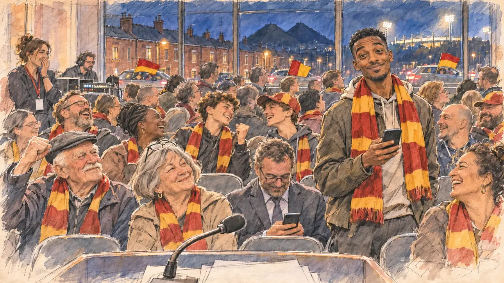

# `europeanCup` · Un club français en demi-finale

**À générer.** Prompt prêt le 04/11/2026, pas encore d'image validée.



| Champ | Valeur |
| --- | --- |
| Carte | `europeanCup`, catégorie `chance` (Coup de chance), carte ajoutée par la PR #297 de l'app |
| Style | Reportage dessiné, trait de `primeTime` |
| Ton | Ironique, bon enfant |
| Date | À remplir |
| Outil | ChatGPT Images |
| Conversation | À remplir (le lien ne s'ouvre qu'avec le compte qui l'a créée) |
| Format rendu | À remplir |
| Fichier d'origine | À remplir |
| Première édition | À remplir |

## Texte de la carte

> **Un club français en demi-finale**
>
> Un club français se qualifie pour les demi-finales de la grande coupe d'Europe des clubs. Vous tenez un meeting dans sa ville ce soir-là : dehors, les klaxons ne s'arrêtent pas. Quelqu'un dans la salle vous demande pour quelle équipe vous êtes.

## Le moment choisi

Un meeting du candidat dans une salle de Lyon, un mardi soir d'avril, au moment où le club de la ville se qualifie pour les demi-finales de la coupe d'Europe, vu depuis le pupitre (hors champ) : au premier plan, le micro et les notes du discours. Un jeune homme du public s'est levé, une écharpe de supporter autour du cou, et demande en souriant pour quelle équipe est le candidat ; autour, la salle rit, des gens regardent le score sur leur téléphone, d'autres applaudissent. Par les hautes fenêtres : les quais de Saône, les voitures qui klaxonnent avec des écharpes aux vitres, les façades pastel du Vieux-Lyon et la basilique de Fourvière illuminée.

## Prompt complet

Dans une nouvelle conversation, avec [`primeTime.webp`](../../illustrations/media/primeTime.webp) comme seule image de référence.

```
Use the attached image as the style reference and copy its drawing: a realistic reportage drawing made on the spot for a newspaper, with quick, nervous pencil lines, often drawn twice, ink hatching in the shadows, transparent watercolour washes that spill a little over the lines, and the warm paper showing through. Not the same scene and not the same people: never reuse the face or the hair of the woman in the reference.
Like in the reference, the setting can be full when the story needs it, with the things that say where we are and what is happening, but each one is sketched with a few pencil lines and a light wash, never rendered or finished, and the drawing gets looser and paler towards the edges until it fades into the bare paper.
This must look like a drawing made by hand on paper by a press illustrator, halfway between a quick sketch and a realistic picture: never a photograph, a film poster or a digital painting, and never a cartoon, a comic strip, a caricature or a children's book illustration. Continuous lines, never dotted or dashed outlines; no uniform texture, speckles or hatching filter laid over the picture; no glossy highlights, no smooth gradients, in the sky and on the walls too. Colour can be rich in places, on a piece of clothing, a light or a flag, but it stays transparent and within the palette below. The fade into the paper at the edges stays narrow, without a wide white margin. No blur and no depth-of-field effect: everything, the foreground included, is drawn sharp, like a sketch made on the spot.
People are drawn from life with realistic anatomy and proportions, like in the reference: faces shaped with pencil lines, hatching and light washes, a little more finished than the background but never photographic (no photographic skin, no airbrushed or digital-painting look). Expressions stay natural and restrained, even in laughter or tears: no exaggerated grins, no wide-open mouths full of teeth, no rubbery or cartoonish faces.

Editorial illustration, landscape 16:9 (1536 × 864 px), the scene filling the frame, with only a light fade into the paper at the edges. A campaign rally of the player's candidate in a hall in Lyon, on a Tuesday evening in mid-April 2027, at the very moment the city's football club qualifies for the semi-finals of the great European club cup: outside, the car horns will not stop. The scene is seen from the lectern where the candidate is speaking, who stays off-camera: in the foreground, only the top of the lectern with a microphone and a few sheets of notes, blank. In the right third, in the first rows of the audience, a young man in his twenties of Comorian origin, slim, with a short fade haircut and a light beard, has stood up with a supporter's scarf around his neck in plain colours that belong to no real club, his phone in one hand, and asks the candidate with a cheeky grin which team the candidate supports, looking straight at the viewer, his face above mid-height. Around him, sketched in pencil and light washes: the audience on folding chairs bursting out laughing, an older woman with a grey bob shaking her head with a smile, a man in a suit looking at the score on his phone, two teenagers punching the air, a campaign volunteer at the side of the stage with her hand over her mouth; a few people turning towards the windows. Behind them, the hall with its rows of chairs and a sound desk, and through the tall windows the quays of the Saône at night, cars driving past honking with scarves out of their windows, the pastel façades of old Lyon and, lit up on its hill, the basilica of Fourvière. Only the young man looks at the viewer. Nothing on the scarves, the notes, the phones or the walls is readable, and no crest, logo or colours of a real club appear.

Style: Reportage drawing made on the spot, like a press illustrator or courtroom sketch artist: pencil and ink with loose watercolour washes, lively unfinished lines, white paper showing through.

Palette: navy #13203F, vellum #F5EFE1, gold #A9802A, brick #B5523B, ochre #D9A441, sage #8FA58A, slate #5E7186, sand #DCC8A4, warm grey #8C8279; use 4 to 6 of them, subtle warm paper grain.

Tone: gently ironic and good-natured, the warm light of the hall against the blue night outside, the headlights of the cars and the lit basilica as the brightest notes.

Constraints: realistic proportions, natural expressions, never cartoonish or caricatured faces, drawn like the rest of the illustration and never photographic; people of varied ages, genders, origins and body types (heavy, stocky, round, tall, short, wiry, not only slim), each with a distinct face and haircut (no two people alike), drawn with respect and never as a joke; anatomically correct hands with exactly five fingers, few hands visible, the others in pockets, behind objects or out of frame; no readable text anywhere (the scarves, the notes, the phones and the walls stay unreadable); no captions or speech bubbles; no logos or political party colours; no recognisable real person, no lookalike of a real politician or of a real footballer, and no crest, logo or colours of a real club; no explicit violence; no photographic rendering, no blur or bokeh, no dotted outlines, no texture or hatching filter over the picture, no oil-paint texture, no wide white margin or frame (a light fade into the paper at the edges is fine).

Format: if 16:9 is not available, make 1536 × 1024 and keep the top 80 px and the bottom 80 px free of anything important (faces, hands, the main action): they will be cropped.
```

## Décisions prises sur cette image

Aucune pour l'instant.

## Essais écartés

Aucun pour l'instant.

## Retouches

Aucune.

## Relecture

À faire sur l'image validée.
