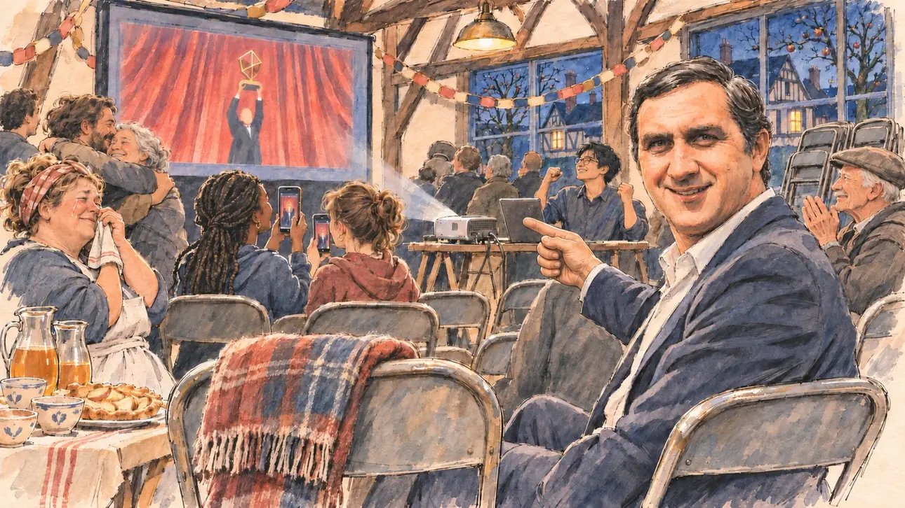

# `filmAward` · Le film de la commune

**À générer.** Prompt prêt le 04/11/2026, pas encore d'image validée.



| Champ | Valeur |
| --- | --- |
| Carte | `filmAward`, catégorie `chance` (Coup de chance), carte ajoutée par la PR #297 de l'app |
| Style | Reportage dessiné, trait de `primeTime` |
| Ton | Chaleureux, joyeux |
| Date | À remplir |
| Outil | ChatGPT Images |
| Conversation | À remplir (le lien ne s'ouvre qu'avec le compte qui l'a créée) |
| Format rendu | À remplir |
| Fichier d'origine | À remplir |
| Première édition | À remplir |

## Texte de la carte

> **Le film de la commune**
>
> Un film tourné dans la commune où vous êtes ce soir-là est primé à la cérémonie. Le maire a ouvert la salle des fêtes pour la retransmission, et on vous a gardé une chaise au premier rang.

## Le moment choisi

La salle des fêtes d'une commune du pays d'Auge, en Normandie, un vendredi soir de fin février, à l'instant où le film tourné dans la commune est primé à la grande cérémonie du cinéma, retransmise sur grand écran. Vu depuis la chaise gardée pour le candidat au premier rang (hors champ) : au premier plan, le dossier de la chaise vide, une couverture pliée dessus. Le maire se retourne vers le candidat, ravi, et lui montre la salle qui explose. Autour : les habitants qui ont fait de la figuration dans le film, la boulangère, des ados, un jeune projectionniste, des bolées de cidre ; sur l'écran, une scène avec un trophée doré générique. Par les fenêtres, les maisons à colombages et les pommiers dans la nuit.

## Prompt complet

Dans une nouvelle conversation, avec deux images jointes, dans cet ordre : [`primeTime.webp`](../../illustrations/media/primeTime.webp) pour le style, puis le portrait dessiné fourni par le PO pour la ressemblance du maire. Le portrait n'est pas dans ce dépôt.

```
Use the first attached image as the style reference and copy its drawing: a realistic reportage drawing made on the spot for a newspaper, with quick, nervous pencil lines, often drawn twice, ink hatching in the shadows, transparent watercolour washes that spill a little over the lines, and the warm paper showing through. Not the same scene and not the same people: never reuse the face or the hair of the woman in the reference.
Like in the reference, the setting can be full when the story needs it, with the things that say where we are and what is happening, but each one is sketched with a few pencil lines and a light wash, never rendered or finished, and the drawing gets looser and paler towards the edges until it fades into the bare paper.
Use the second attached image, a drawn portrait, only as the likeness reference for the mayor: give him this man's broad face, his dark hair combed back, his dark eyebrows and his warm smile, clean-shaven, at the same age as in the portrait, and draw his face with the same pencil lines and washes as the other people in the scene. Keep the likeness through the drawing, never through photographic detail.
This must look like a drawing made by hand on paper by a press illustrator, halfway between a quick sketch and a realistic picture: never a photograph, a film poster or a digital painting, and never a cartoon, a comic strip, a caricature or a children's book illustration. Continuous lines, never dotted or dashed outlines; no uniform texture, speckles or hatching filter laid over the picture; no glossy highlights, no smooth gradients, in the sky and on the walls too. Colour can be rich in places, on a piece of clothing, a light or a flag, but it stays transparent and within the palette below. The fade into the paper at the edges stays narrow, without a wide white margin. No blur and no depth-of-field effect: everything, the foreground included, is drawn sharp, like a sketch made on the spot.
People are drawn from life with realistic anatomy and proportions, like in the reference: faces shaped with pencil lines, hatching and light washes, a little more finished than the background but never photographic (no photographic skin, no airbrushed or digital-painting look). Expressions stay natural and restrained, even in laughter or tears: no exaggerated grins, no wide-open mouths full of teeth, no rubbery or cartoonish faces.

Editorial illustration, landscape 16:9 (1536 × 864 px), the scene filling the frame, with only a light fade into the paper at the edges. The village hall of a small commune of the Pays d'Auge in Normandy, on a Friday evening in late February 2027, at the very moment the film shot in the commune wins a prize at the great national film awards ceremony, broadcast live on a big screen the mayor has put up for the whole village. The scene is seen from the front-row chair kept for the player's candidate, who stays off-camera: in the foreground, only the back of that empty folding chair with a folded blanket on it. In the right third, the mayor, the man from the portrait, of Italian origin, jovial, in a navy blazer over an open-necked white shirt, has turned round from the next chair and points at the screen with one hand, looking at the viewer with delighted pride, his face above mid-height. Around him, sketched in pencil and light washes: the villagers who were extras in the film jumping up and hugging, the baker of the village, a stout woman in her fifties still in her white apron, with tears of joy; two teenage girls, one of them Black with braids, filming the screen with their phones; a young projectionist of Vietnamese origin at a small table with a laptop and a video projector, raising his fists; an old farmer in a flat cap clapping slowly; jugs and bowls of cider and a plate of apple pastries on a trestle table. On the big screen, a stage with red curtains and a generic gold trophy held up by a small, distant figure whose face cannot be seen, not the trophy of any real award. Behind them, the plain village hall with its exposed beams, paper garlands and stacked chairs, and through the windows the half-timbered houses of Normandy and apple trees in the night. Only the mayor looks at the viewer. Nothing on the screen, the walls, the phones or the laptop is readable, and no real film poster, logo or award statuette appears.

Style: Reportage drawing made on the spot, like a press illustrator or courtroom sketch artist: pencil and ink with loose watercolour washes, lively unfinished lines, white paper showing through.

Palette: navy #13203F, vellum #F5EFE1, gold #A9802A, brick #B5523B, ochre #D9A441, sage #8FA58A, slate #5E7186, sand #DCC8A4, warm grey #8C8279; use 4 to 6 of them, subtle warm paper grain.

Tone: warm and joyful, the bluish glow of the big screen mixed with the warm light of the hall, the red of the curtains on screen and the gold of the trophy as the brightest notes.

Constraints: realistic proportions, natural expressions, never cartoonish or caricatured faces, drawn like the rest of the illustration and never photographic; people of varied ages, genders, origins and body types (heavy, stocky, round, tall, short, wiry, not only slim), each with a distinct face and haircut (no two people alike), drawn with respect and never as a joke; anatomically correct hands with exactly five fingers, few hands visible, the others in pockets, behind objects or out of frame; no readable text anywhere (the screen, the walls, the phones and the laptop stay unreadable); no captions or speech bubbles; no logos or political party colours; apart from the mayor, no recognisable real person and no lookalike of a real politician or of a real actor or film director, and no real award statuette; no explicit violence; no photographic rendering, no blur or bokeh, no dotted outlines, no texture or hatching filter over the picture, no oil-paint texture, no wide white margin or frame (a light fade into the paper at the edges is fine).

Format: if 16:9 is not available, make 1536 × 1024 and keep the top 80 px and the bottom 80 px free of anything important (faces, hands, the main action): they will be cropped.
```

## Décisions prises sur cette image

- **Le maire reprend les traits d'un portrait dessiné fourni par le PO** (04/11/2026), peut-être la même personne que le secrétaire d'État de [`ministerResigns`](../crisis/ministerResigns.md), à confirmer par le PO : le visage large, les cheveux bruns coiffés en arrière, rasé de près, à la place des cheveux gris et des lunettes du premier prompt. L'accord de la personne est à confirmer par le PO avant la validation de l'image. Le portrait n'est pas dans ce dépôt, et la fiche ne nomme personne.

## Essais écartés

Aucun pour l'instant.

## Retouches

Aucune.

## Relecture

À faire sur l'image validée.
