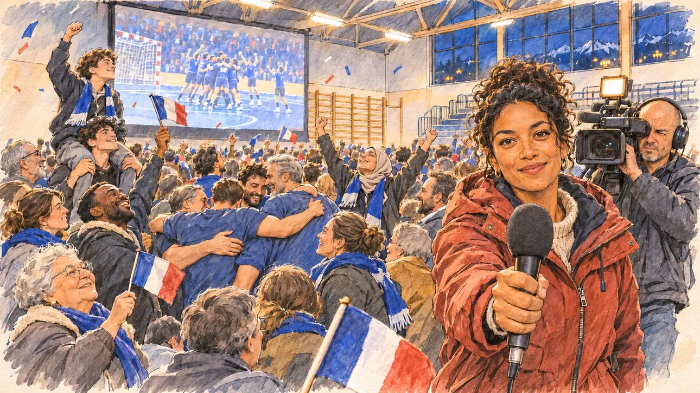

# `handballFinal` · Les Bleus au sommet

**À générer.** Prompt prêt le 04/11/2026, pas encore d'image validée.



| Champ | Valeur |
| --- | --- |
| Carte | `handballFinal`, catégorie `chance` (Coup de chance), carte ajoutée par la PR #297 de l'app |
| Style | Reportage dessiné, trait de `primeTime` |
| Ton | Joyeux, exubérant |
| Date | À remplir |
| Outil | ChatGPT Images |
| Conversation | À remplir (le lien ne s'ouvre qu'avec le compte qui l'a créée) |
| Format rendu | À remplir |
| Fichier d'origine | À remplir |
| Première édition | À remplir |

## Texte de la carte

> **Les Bleus au sommet**
>
> Les Bleus du handball sont champions du monde. Vous regardez la finale avec des militants dans le gymnase d'une commune, et la salle explose. Une chaîne locale cherche quelqu'un à interroger.

## Le moment choisi

Le gymnase d'une commune de Savoie, le soir de la finale du Mondial de handball, fin janvier, à la seconde où la France devient championne du monde, vu depuis la place du candidat (hors champ) : au premier plan, un petit drapeau tricolore sur sa hampe. La salle explose : militants et habitants sautent, s'embrassent, brandissent des drapeaux devant l'écran géant. Une jeune reporter de la télé locale, micro en main, cherche quelqu'un à interroger et vient droit vers le candidat, suivie de son cadreur. Derrière : les espaliers, les buts de handball, les gradins, les drapeaux, les confettis.

## Prompt complet

Dans une nouvelle conversation, avec [`primeTime.webp`](../../illustrations/media/primeTime.webp) comme seule image de référence.

```
Use the attached image as the style reference and copy its drawing: a realistic reportage drawing made on the spot for a newspaper, with quick, nervous pencil lines, often drawn twice, ink hatching in the shadows, transparent watercolour washes that spill a little over the lines, and the warm paper showing through. Not the same scene and not the same people: never reuse the face or the hair of the woman in the reference.
Like in the reference, the setting can be full when the story needs it, with the things that say where we are and what is happening, but each one is sketched with a few pencil lines and a light wash, never rendered or finished, and the drawing gets looser and paler towards the edges until it fades into the bare paper.
This must look like a drawing made by hand on paper by a press illustrator, halfway between a quick sketch and a realistic picture: never a photograph, a film poster or a digital painting, and never a cartoon, a comic strip, a caricature or a children's book illustration. Continuous lines, never dotted or dashed outlines; no uniform texture, speckles or hatching filter laid over the picture; no glossy highlights, no smooth gradients, in the sky and on the walls too. Colour can be rich in places, on a piece of clothing, a light or a flag, but it stays transparent and within the palette below. The fade into the paper at the edges stays narrow, without a wide white margin. No blur and no depth-of-field effect: everything, the foreground included, is drawn sharp, like a sketch made on the spot.
People are drawn from life with realistic anatomy and proportions, like in the reference: faces shaped with pencil lines, hatching and light washes, a little more finished than the background but never photographic (no photographic skin, no airbrushed or digital-painting look). Expressions stay natural and restrained, even in laughter or tears: no exaggerated grins, no wide-open mouths full of teeth, no rubbery or cartoonish faces.

Editorial illustration, landscape 16:9 (1536 × 864 px), the scene filling the frame, with only a light fade into the paper at the edges. The sports hall of a small town in Savoie, on a late January evening in 2027, at the very second France becomes handball world champion: the final is projected on a giant screen, and the hall, full of campaign activists and local people, explodes with joy. The scene is seen from the place of the player's candidate, who stays off-camera: in the foreground, only a small French flag on a stick held at the bottom edge of the picture. In the right third, a young reporter from the local television channel, a woman in her late twenties of Réunion Island origin, with curly hair tied up, a red parka and a microphone in her hand, has spotted the viewer in the crowd and comes straight towards the camera, smiling and already holding out her microphone, her face above mid-height; behind her, her cameraman, a tall bald man in his forties with a camera on his shoulder, follows her. Around them, sketched in pencil and light washes: activists and townspeople of all ages and origins jumping, hugging and shouting, a stout grandmother waving a flag, two teenagers on each other's shoulders, a Black father lifting his little son in the air, a young woman in a headscarf with her arms raised, a group of men in plain blue shirts with no numbers or names hugging; small French flags and blue scarves everywhere, a few streamers and confetti in the air. Behind them, the giant projection screen showing tiny distant players in blue celebrating, their faces too small to see, and the hall itself: wooden wall bars, handball goals pushed to the side, folding bleachers, ceiling lights, and through the high windows the night. Only the reporter looks at the viewer. Nothing on the screen, the scarves, the shirts, the walls or the camera is readable, and no logo of a real team or federation appears.

Style: Reportage drawing made on the spot, like a press illustrator or courtroom sketch artist: pencil and ink with loose watercolour washes, lively unfinished lines, white paper showing through.

Palette: navy #13203F, vellum #F5EFE1, gold #A9802A, brick #B5523B, ochre #D9A441, sage #8FA58A, slate #5E7186, sand #DCC8A4, warm grey #8C8279; use 4 to 6 of them, subtle warm paper grain.

Tone: joyful and exuberant, the bright white light of the sports hall, the blue, white and red of the flags and scarves as the strongest colours.

Constraints: realistic proportions, natural expressions, never cartoonish or caricatured faces, drawn like the rest of the illustration and never photographic; people of varied ages, genders, origins and body types (heavy, stocky, round, tall, short, wiry, not only slim), each with a distinct face and haircut (no two people alike), drawn with respect and never as a joke; anatomically correct hands with exactly five fingers, few hands visible, the others in pockets, behind objects or out of frame; no readable text anywhere (the screen, the scarves, the shirts, the walls and the camera stay unreadable); no captions or speech bubbles; no logos or political party colours; no recognisable real person, no lookalike of a real politician or of a real handball player or TV reporter, and no logo of a real team or federation; no explicit violence; no photographic rendering, no blur or bokeh, no dotted outlines, no texture or hatching filter over the picture, no oil-paint texture, no wide white margin or frame (a light fade into the paper at the edges is fine).

Format: if 16:9 is not available, make 1536 × 1024 and keep the top 80 px and the bottom 80 px free of anything important (faces, hands, the main action): they will be cropped.
```

## Décisions prises sur cette image

Aucune pour l'instant.

## Essais écartés

Aucun pour l'instant.

## Retouches

Aucune.

## Relecture

À faire sur l'image validée.
