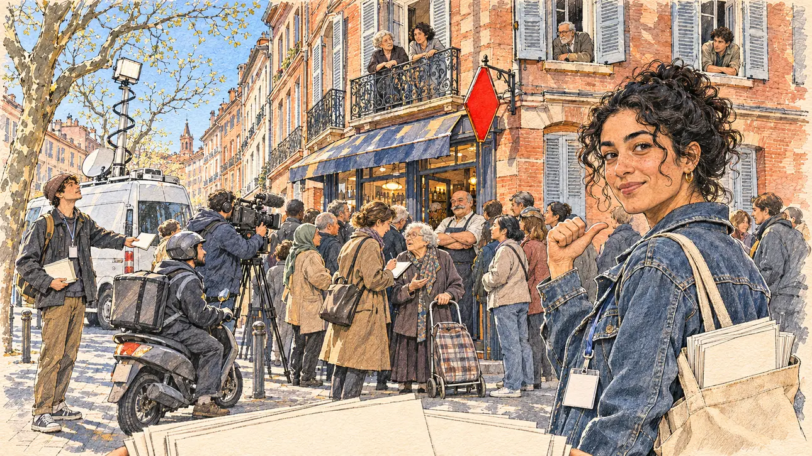

# `lotteryJackpot` · Le gros lot de la rue d'à côté

**À générer.** Prompt prêt le 04/11/2026, pas encore d'image validée.



| Champ | Valeur |
| --- | --- |
| Carte | `lotteryJackpot`, catégorie `chance` (Coup de chance), carte ajoutée par la PR #297 de l'app |
| Style | Reportage dessiné, trait de `primeTime` |
| Ton | Ironique, animé |
| Date | À remplir |
| Outil | ChatGPT Images |
| Conversation | À remplir (le lien ne s'ouvre qu'avec le compte qui l'a créée) |
| Format rendu | À remplir |
| Fichier d'origine | À remplir |
| Première édition | À remplir |

## Texte de la carte

> **Le gros lot de la rue d'à côté**
>
> Le gros lot du loto est tombé dans la ville où vous faites campagne. La presse locale cherche le gagnant, la rue est pleine de curieux, et vous êtes dans la rue d'à côté, avec votre équipe.

## Le moment choisi

Une rue de brique rose de Toulouse, un matin de semaine, le lendemain du tirage : le gros lot a été validé dans le bar-tabac du coin. Vue depuis l'angle de la rue d'à côté, où le candidat (hors champ) distribue des tracts avec son équipe : au premier plan, une pile de tracts vierges. Une jeune militante de l'équipe se retourne vers le candidat, l'air complice, et montre du pouce la foule au coin de la rue. Derrière elle : les curieux devant le bar-tabac à la carotte rouge, le patron sur le pas de sa porte, une journaliste de la presse locale qui interroge les passants, une camionnette de télévision, des voisins aux balcons, et un militant de l'équipe qui distribue ses tracts dans le vide.

## Prompt complet

Dans une nouvelle conversation, avec [`primeTime.webp`](../../illustrations/media/primeTime.webp) comme seule image de référence.

```
Use the attached image as the style reference and copy its drawing: a realistic reportage drawing made on the spot for a newspaper, with quick, nervous pencil lines, often drawn twice, ink hatching in the shadows, transparent watercolour washes that spill a little over the lines, and the warm paper showing through. Not the same scene and not the same people: never reuse the face or the hair of the woman in the reference.
Like in the reference, the setting can be full when the story needs it, with the things that say where we are and what is happening, but each one is sketched with a few pencil lines and a light wash, never rendered or finished, and the drawing gets looser and paler towards the edges until it fades into the bare paper.
This must look like a drawing made by hand on paper by a press illustrator, halfway between a quick sketch and a realistic picture: never a photograph, a film poster or a digital painting, and never a cartoon, a comic strip, a caricature or a children's book illustration. Continuous lines, never dotted or dashed outlines; no uniform texture, speckles or hatching filter laid over the picture; no glossy highlights, no smooth gradients, in the sky and on the walls too. Colour can be rich in places, on a piece of clothing, a light or a flag, but it stays transparent and within the palette below. The fade into the paper at the edges stays narrow, without a wide white margin. No blur and no depth-of-field effect: everything, the foreground included, is drawn sharp, like a sketch made on the spot.
People are drawn from life with realistic anatomy and proportions, like in the reference: faces shaped with pencil lines, hatching and light washes, a little more finished than the background but never photographic (no photographic skin, no airbrushed or digital-painting look). Expressions stay natural and restrained, even in laughter or tears: no exaggerated grins, no wide-open mouths full of teeth, no rubbery or cartoonish faces.

Editorial illustration, landscape 16:9 (1536 × 864 px), the scene filling the frame, with only a light fade into the paper at the edges. A street of pink brick houses in the centre of Toulouse, on a weekday morning in March 2027, the day after the draw: the national lottery jackpot was won with a ticket bought at the bar-tabac on the corner, and the local press is looking for the winner. The scene is seen from the corner of the next street, where the player's candidate is handing out leaflets with the campaign team and stays off-camera: in the foreground, only a pile of blank leaflets held at the bottom edge of the picture. In the right third, a young campaign volunteer in her twenties of Algerian origin, with curly black hair in a loose bun, a denim jacket, a lanyard and a canvas bag full of leaflets, has turned back towards the viewer with an excited, conspiratorial look and points with her thumb at the crowd around the corner, her face above mid-height. Behind her, sketched in pencil and light washes: a crowd of curious people of all ages and origins in front of the bar-tabac, whose red diamond-shaped tobacconist's sign hangs over the door with no lettering; the owner, a stout bald man in his sixties with a grey moustache, standing in his doorway with his arms crossed and a mysterious smile; a local newspaper journalist with a notebook questioning an elderly lady with a shopping trolley; a television van with a raised mast and a cameraman filming the shop front; neighbours leaning out of the windows and wrought-iron balconies; a delivery rider on a scooter stopped to look; and, a little apart, a second volunteer of the team, a tall young man with a beanie, handing out leaflets to nobody. The street itself: the warm pink brick façades of Toulouse with tall shuttered windows, plane trees in pale early leaf and a bright blue sky. Only the volunteer looks at the viewer. Nothing on the leaflets, the shop front, the sign, the van or the notebook is readable, and no logo of the real national lottery appears.

Style: Reportage drawing made on the spot, like a press illustrator or courtroom sketch artist: pencil and ink with loose watercolour washes, lively unfinished lines, white paper showing through.

Palette: navy #13203F, vellum #F5EFE1, gold #A9802A, brick #B5523B, ochre #D9A441, sage #8FA58A, slate #5E7186, sand #DCC8A4, warm grey #8C8279; use 4 to 6 of them, subtle warm paper grain.

Tone: gently ironic and lively, bright March morning light on the pink brick, the red of the tobacconist's sign as the brightest note.

Constraints: realistic proportions, natural expressions, never cartoonish or caricatured faces, drawn like the rest of the illustration and never photographic; people of varied ages, genders, origins and body types (heavy, stocky, round, tall, short, wiry, not only slim), each with a distinct face and haircut (no two people alike), drawn with respect and never as a joke; anatomically correct hands with exactly five fingers, few hands visible, the others in pockets, behind objects or out of frame; no readable text anywhere (the leaflets, the shop front, the sign, the van and the notebook stay unreadable); no captions or speech bubbles; no logos or political party colours; no recognisable real person, no lookalike of a real politician, and no logo of the real national lottery; no explicit violence; no photographic rendering, no blur or bokeh, no dotted outlines, no texture or hatching filter over the picture, no oil-paint texture, no wide white margin or frame (a light fade into the paper at the edges is fine).

Format: if 16:9 is not available, make 1536 × 1024 and keep the top 80 px and the bottom 80 px free of anything important (faces, hands, the main action): they will be cropped.
```

## Décisions prises sur cette image

Aucune pour l'instant.

## Essais écartés

Aucun pour l'instant.

## Retouches

Aucune.

## Relecture

À faire sur l'image validée.
