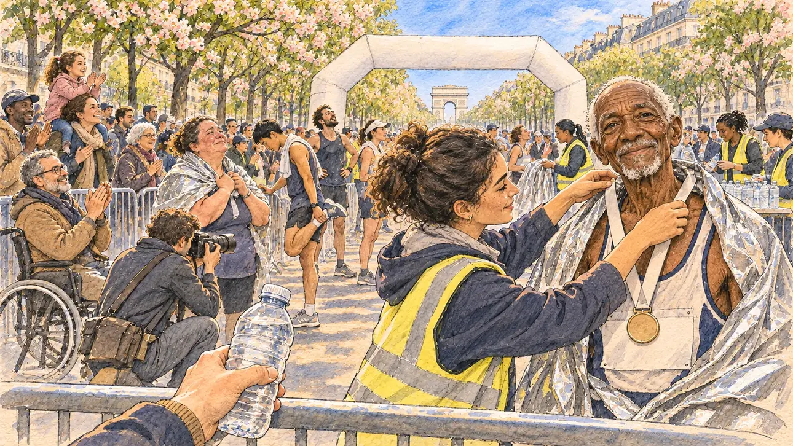

# `parisMarathon` · Le doyen du marathon

**À générer.** Prompt prêt le 04/11/2026, pas encore d'image validée.



| Champ | Valeur |
| --- | --- |
| Carte | `parisMarathon`, catégorie `chance` (Coup de chance), carte ajoutée par la PR #297 de l'app |
| Style | Reportage dessiné, trait de `primeTime` |
| Ton | Chaleureux, ému |
| Date | À remplir |
| Outil | ChatGPT Images |
| Conversation | À remplir (le lien ne s'ouvre qu'avec le compte qui l'a créée) |
| Format rendu | À remplir |
| Fichier d'origine | À remplir |
| Première édition | À remplir |

## Texte de la carte

> **Le doyen du marathon**
>
> Au marathon de Paris, vous attendez à l'arrivée un proche qui court. Un coureur de 78 ans, qui n'a jamais manqué une édition, passe la ligne devant vous, et la foule se tourne vers vous.

## Le moment choisi

L'arrivée du marathon de Paris, avenue Foch, un dimanche matin d'avril, vue depuis les barrières où le candidat attend un proche (hors champ) : au premier plan, le haut d'une barrière et une bouteille d'eau tendue. Le doyen de la course, 92 ans, vient de passer la ligne, une couverture de survie sur les épaules, et regarde le candidat avec un sourire fier et fatigué ; une bénévole lui passe une médaille vierge au cou. Autour : les coureurs qui finissent, les bénévoles en gilet, la foule derrière les barrières qui se tourne vers le candidat, un photographe. Derrière : l'arche d'arrivée sans inscription, les marronniers en fleurs de l'avenue, les façades haussmanniennes, l'Arc de triomphe au loin.

## Prompt complet

Dans une nouvelle conversation, avec [`primeTime.webp`](../../illustrations/media/primeTime.webp) comme seule image de référence.

```
Use the attached image as the style reference and copy its drawing: a realistic reportage drawing made on the spot for a newspaper, with quick, nervous pencil lines, often drawn twice, ink hatching in the shadows, transparent watercolour washes that spill a little over the lines, and the warm paper showing through. Not the same scene and not the same people: never reuse the face or the hair of the woman in the reference.
Like in the reference, the setting can be full when the story needs it, with the things that say where we are and what is happening, but each one is sketched with a few pencil lines and a light wash, never rendered or finished, and the drawing gets looser and paler towards the edges until it fades into the bare paper.
This must look like a drawing made by hand on paper by a press illustrator, halfway between a quick sketch and a realistic picture: never a photograph, a film poster or a digital painting, and never a cartoon, a comic strip, a caricature or a children's book illustration. Continuous lines, never dotted or dashed outlines; no uniform texture, speckles or hatching filter laid over the picture; no glossy highlights, no smooth gradients, in the sky and on the walls too. Colour can be rich in places, on a piece of clothing, a light or a flag, but it stays transparent and within the palette below. The fade into the paper at the edges stays narrow, without a wide white margin. No blur and no depth-of-field effect: everything, the foreground included, is drawn sharp, like a sketch made on the spot.
People are drawn from life with realistic anatomy and proportions, like in the reference: faces shaped with pencil lines, hatching and light washes, a little more finished than the background but never photographic (no photographic skin, no airbrushed or digital-painting look). Expressions stay natural and restrained, even in laughter or tears: no exaggerated grins, no wide-open mouths full of teeth, no rubbery or cartoonish faces.

Editorial illustration, landscape 16:9 (1536 × 864 px), the scene filling the frame, with only a light fade into the paper at the edges. The finish of the Paris marathon on the avenue Foch, on a bright Sunday morning in early April 2027. The player's candidate is waiting at the barriers for a relative who is running, and stays off-camera: in the foreground, only the top of a crowd barrier and a bottle of water held out over it. In the right third, the oldest runner of the race, a small, slightly stooped but sprightly man of ninety-two of Senegalese origin, with sparse short white hair, a white goatee, a deeply lined face, a running vest and a plain bib with no number, a silver survival blanket over his shoulders, has just crossed the line: he looks at the viewer with a proud, tired, gentle smile, his face above mid-height, while a young volunteer in a high-visibility vest hangs a plain medal with a blank ribbon around his neck. Around them, sketched in pencil and light washes: other runners finishing, exhausted or triumphant, a heavy-set woman in her fifties in tears of joy, a young man of East Asian origin stretching his calves; volunteers handing out water and blankets; behind the barriers, the crowd of families and friends, many of them turning towards the viewer, a girl on her mother's shoulders, a man in a wheelchair applauding; a press photographer kneeling. Behind them, the inflatable finish arch left blank, the double row of chestnut trees of the avenue in pink and white bloom, the pale Haussmann façades of Paris, and far away at the end of the avenue the Arc de Triomphe under a spring sky. Only the old runner looks at the viewer. Nothing on the bibs, the arch, the medal, the vests, the barriers or the bottle is readable, and no logo of a real race or sponsor appears.

Style: Reportage drawing made on the spot, like a press illustrator or courtroom sketch artist: pencil and ink with loose watercolour washes, lively unfinished lines, white paper showing through.

Palette: navy #13203F, vellum #F5EFE1, gold #A9802A, brick #B5523B, ochre #D9A441, sage #8FA58A, slate #5E7186, sand #DCC8A4, warm grey #8C8279; use 4 to 6 of them, subtle warm paper grain.

Tone: warm and moving, fresh April morning light, the silver of the survival blankets and the pink of the chestnut blossom as the brightest notes.

Constraints: realistic proportions, natural expressions, never cartoonish or caricatured faces, drawn like the rest of the illustration and never photographic; people of varied ages, genders, origins and body types (heavy, stocky, round, tall, short, wiry, not only slim), each with a distinct face and haircut (no two people alike), drawn with respect and never as a joke; anatomically correct hands with exactly five fingers, few hands visible, the others in pockets, behind objects or out of frame; no readable text anywhere (the bibs, the arch, the medal, the vests, the barriers and the bottle stay unreadable); no captions or speech bubbles; no logos or political party colours; no recognisable real person, no lookalike of a real politician or of a real runner, and no logo of a real race or sponsor; no explicit violence; no photographic rendering, no blur or bokeh, no dotted outlines, no texture or hatching filter over the picture, no oil-paint texture, no wide white margin or frame (a light fade into the paper at the edges is fine).

Format: if 16:9 is not available, make 1536 × 1024 and keep the top 80 px and the bottom 80 px free of anything important (faces, hands, the main action): they will be cropped.
```

## Décisions prises sur cette image

- **Le doyen a 92 ans** (PO, 04/11/2026) : en 2026, le doyen réel du marathon de Paris avait 92 ans ; l'image suit cet âge, plus juste que les 78 ans du texte de la carte.

## Essais écartés

Aucun pour l'instant.

## Retouches

Aucune.

## Relecture

À faire sur l'image validée.
