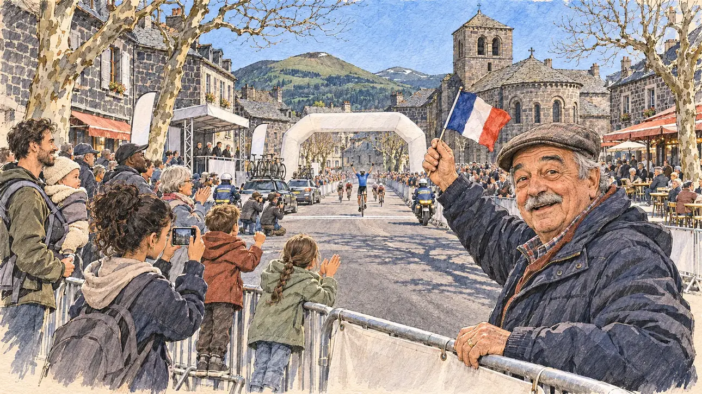

# `raceStage` · Une arrivée d'étape sous vos yeux

**Validée par le PO le 04/11/2026**, au premier essai, avec `primeTime.webp` comme référence. Elle sert telle quelle en clair et en sombre.



| Champ | Valeur |
| --- | --- |
| Carte | `raceStage`, catégorie `chance` (Coup de chance), carte ajoutée par la PR #297 de l'app |
| Style | Reportage dessiné, trait de `primeTime` |
| Ton | Joyeux, surpris |
| Date | 2026-11-04 |
| Outil | ChatGPT Images |
| Conversation | À remplir (le lien ne s'ouvre qu'avec le compte qui l'a créée) |
| Format rendu | 1672 × 941 (16:9) : export en 1290 × 726 px, WebP de qualité 75, 268 Ko, sans recadrage |
| Fichier d'origine | Image de ChatGPT, chez le PO. L'export du dépôt a été fait depuis la copie partagée dans la conversation avec Claude |
| Première édition | La prochaine Release qui suit le merge de la PR #297 de l'app |

## Texte de la carte

> **Une arrivée d'étape sous vos yeux**
>
> Une étape de la « course au soleil », la grande course cycliste vers la Méditerranée, arrive dans la ville où vous êtes ce jour-là. Un coureur français lève les bras sur la ligne, en bas de la rue, et la place se remplit d'une foule qui ne vous attendait pas.

## Le moment choisi

Une petite ville d'Auvergne en pierre volcanique, un après-midi de mars, à l'arrivée d'une étape de la grande course cycliste de printemps, vue depuis les barrières où se tient le candidat (hors champ) : au premier plan, le haut d'une barrière vierge. En bas de la rue, un coureur français lève les bras sur la ligne. Sur la place qui se remplit, un retraité passionné de vélo, casquette et petit drapeau, se retourne et découvre avec surprise qu'un candidat est là. Autour : les enfants sur les barrières, les photographes à moto, les voitures d'équipe, le podium et l'arche d'arrivée sans inscription. Derrière : les maisons de pierre sombre aux toits de lauzes, l'église romane, les puys au loin.

## Prompt complet

Dans une nouvelle conversation, avec [`primeTime.webp`](../../illustrations/media/primeTime.webp) comme seule image de référence.

```
Use the attached image as the style reference and copy its drawing: a realistic reportage drawing made on the spot for a newspaper, with quick, nervous pencil lines, often drawn twice, ink hatching in the shadows, transparent watercolour washes that spill a little over the lines, and the warm paper showing through. Not the same scene and not the same people: never reuse the face or the hair of the woman in the reference.
Like in the reference, the setting can be full when the story needs it, with the things that say where we are and what is happening, but each one is sketched with a few pencil lines and a light wash, never rendered or finished, and the drawing gets looser and paler towards the edges until it fades into the bare paper.
This must look like a drawing made by hand on paper by a press illustrator, halfway between a quick sketch and a realistic picture: never a photograph, a film poster or a digital painting, and never a cartoon, a comic strip, a caricature or a children's book illustration. Continuous lines, never dotted or dashed outlines; no uniform texture, speckles or hatching filter laid over the picture; no glossy highlights, no smooth gradients, in the sky and on the walls too. Colour can be rich in places, on a piece of clothing, a light or a flag, but it stays transparent and within the palette below. The fade into the paper at the edges stays narrow, without a wide white margin. No blur and no depth-of-field effect: everything, the foreground included, is drawn sharp, like a sketch made on the spot.
People are drawn from life with realistic anatomy and proportions, like in the reference: faces shaped with pencil lines, hatching and light washes, a little more finished than the background but never photographic (no photographic skin, no airbrushed or digital-painting look). Expressions stay natural and restrained, even in laughter or tears: no exaggerated grins, no wide-open mouths full of teeth, no rubbery or cartoonish faces.

Editorial illustration, landscape 16:9 (1536 × 864 px), the scene filling the frame, with only a light fade into the paper at the edges. The main street and little square of a small town of the Auvergne, built of dark volcanic stone, on a bright, cold afternoon in early March 2027, at the finish of a stage of the great spring cycle race to the Mediterranean, the 'race to the sun'. The scene is seen from the barriers where the player's candidate happens to stand, who stays off-camera: in the foreground, only the top of a plain metal crowd barrier with a blank cover. At the bottom of the street, small and in the distance, a French rider in a plain blue jersey with no lettering crosses the line with both arms raised under a finish arch left blank, the next riders a few lengths behind. In the right third, a retired cycling fan in his seventies of Portuguese origin, short and stocky, with a flat cap, a grey moustache and a padded jacket, waving a small French flag, has just turned round and discovers the viewer, a candidate he never expected here, with a delighted, astonished smile, his face above mid-height. Around him, sketched in pencil and light washes: children standing on the barriers and shouting, a teenage girl of North African origin filming the finish on her phone, a young father with a baby in a carrier, two gendarmes on motorbikes, press photographers kneeling by the line, team cars with bikes on their roofs and no logos, a small podium with blank banners. Behind them, the town of the Auvergne: tall houses of dark grey volcanic stone with stone-slab roofs, a Romanesque church of dark stone, café terraces, plane trees still bare, and in the distance the rounded green volcanic hills of the puys under a clear blue March sky. Only the retired fan looks at the viewer. Nothing on the barriers, the arch, the banners, the jerseys, the cars or the phone is readable, and no logo of a real race, team or sponsor appears.

Style: Reportage drawing made on the spot, like a press illustrator or courtroom sketch artist: pencil and ink with loose watercolour washes, lively unfinished lines, white paper showing through.

Palette: navy #13203F, vellum #F5EFE1, gold #A9802A, brick #B5523B, ochre #D9A441, sage #8FA58A, slate #5E7186, sand #DCC8A4, warm grey #8C8279; use 4 to 6 of them, subtle warm paper grain.

Tone: joyful and surprised, bright cold March sun, the dark stone of the town against the blue sky, the coloured jerseys and the French flag as the brightest notes.

Constraints: realistic proportions, natural expressions, never cartoonish or caricatured faces, drawn like the rest of the illustration and never photographic; people of varied ages, genders, origins and body types (heavy, stocky, round, tall, short, wiry, not only slim), each with a distinct face and haircut (no two people alike), drawn with respect and never as a joke; anatomically correct hands with exactly five fingers, few hands visible, the others in pockets, behind objects or out of frame; no readable text anywhere (the barriers, the arch, the banners, the jerseys, the cars and the phone stay unreadable); no captions or speech bubbles; no logos or political party colours; no recognisable real person, no lookalike of a real politician or of a real cyclist, and no logo of a real race, team or sponsor; no explicit violence; no photographic rendering, no blur or bokeh, no dotted outlines, no texture or hatching filter over the picture, no oil-paint texture, no wide white margin or frame (a light fade into the paper at the edges is fine).

Format: if 16:9 is not available, make 1536 × 1024 and keep the top 80 px and the bottom 80 px free of anything important (faces, hands, the main action): they will be cropped.
```

## Décisions prises sur cette image

Aucune.

## Essais écartés

Aucun.

## Retouches

Aucune.

## Relecture

Faite et validée par le PO le 04/11/2026.

- [x] Aucun texte lisible : l'arche, les barrières et les drapeaux du podium sont vierges, aucun logo de course ni d'équipe ; le dos d'un gendarme porte une bande de pseudo-lettres, sans mot lisible.
- [x] Aucun sosie d'une personne réelle.
- [x] Le candidat du joueur est hors champ.
- [x] Mains, visages et foules sans défaut visible à 343 px de large.
- [x] Aucune couleur ni aucun logo de parti. Des personnes variées par l'âge, le corps, l'origine et la coiffure.
- [x] En 3:2 : sans objet, l'image est en 16:9.
- [x] Lisible sur la page de l'événement, en clair et en sombre.

Ce que la relecture a accepté : la ville compte des platanes à côté de la pierre volcanique, comme beaucoup de villes d'Auvergne ; la ligne d'arrivée plus proche que « en bas de la rue ».
