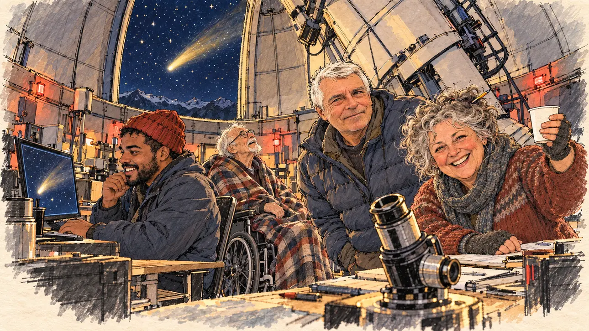

# `comet` · Une comète à votre nom

**Validée par le PO le 01/11/2026**, à l'essai 2. Elle sert telle quelle en clair et en sombre.



| Champ | Valeur |
| --- | --- |
| Carte | `comet`, catégorie `farFetched` (Incroyable) |
| Style | Reportage dessiné ; visages un peu plus finis que le reste ; le dessin s'efface légèrement dans le papier aux bords |
| Ton | Émerveillé, chaleureux et un peu comique |
| Date | 2026-11-01 |
| Outil | ChatGPT, ChatGPT Images 2.5 ; mode et effort : non précisés |
| Conversation | À remplir (le lien ne s'ouvre qu'avec le compte qui l'a créée) |
| Format rendu | 1672 × 941 (16:9) : export en 1290 × 726 px depuis le PNG d'origine, WebP de qualité 75, 218 Ko, sans recadrage |
| Fichier d'origine | PNG de ChatGPT, chez le PO, partagé aussi dans la conversation avec Claude |
| Première édition | À remplir |

## Texte de la carte

> **Une comète à votre nom**
>
> Des astronomes donnent votre nom à une comète tout juste découverte. Elle passera au plus près de la Terre le soir du scrutin.

## Le moment choisi

La nuit, sous la coupole d'un observatoire des Pyrénées. Les astronomes ont invité le candidat pour lui annoncer qu'ils donnent son nom à la comète, qui passe dans la fente de la coupole au-dessus des montagnes. La cheffe d'équipe trinque avec un gobelet de chocolat chaud, un astronome sourit, le technicien regarde la comète à l'écran, l'astronome émérite lève les yeux vers le ciel. Le candidat est hors champ : au premier plan, l'oculaire d'une lunette l'attend.

## Prompt complet

Deux messages, dans une seule conversation, avec deux images jointes au premier : [`oldTweet.webp`](oldTweet.webp) pour le style, puis un portrait dessiné d'après une photo de famille du PO pour la ressemblance de l'astronome à côté de la cheffe d'équipe. Le premier prompt a donné l'essai 1 :

```
Use the first attached image as the style reference: the same pencil and ink drawing with loose watercolour washes and warm paper grain. Not the same scene.
Use the second attached image, a drawn portrait, only as the likeness reference for the astronomer next to the head of the team: give him this man's features, short grey-white hair and light stubble, and draw his face with the same ink lines and washes as the other people in the scene. Keep the likeness through the drawing, never through photographic detail.
This must look like a drawing made by hand on paper, never like a photograph or a film poster: the people are drawn with ink lines and flat washes, not modelled; the background is only suggested with a few pencil lines and light, transparent washes, so that the warm paper shows through; the drawing may fade lightly into the bare paper at the edges and in the corners, as on a sketchbook page, without a wide white margin. Lighter and less saturated than a painting: no dense colour, no glossy highlights, no hatching filter laid over a finished image.
Faces are drawn exactly like the clothes and the background: ink outlines, a few hatching strokes and flat watercolour washes for the skin, with the same level of detail as the rest of the drawing. No photographic skin, no realistic wrinkles or pores, no airbrushed or digital-painting look on the faces.

Editorial illustration, landscape 16:9 (1536 × 864 px), the scene filling the frame, with only a light fade into the paper at the edges. Inside the dome of a mountain observatory in the French Pyrenees, late at night in 2027. The astronomers who have just discovered a comet have invited the player's candidate to tell them they are naming it after the candidate. The candidate stays off-camera: in the foreground, only the eyepiece of a small telescope turned towards the viewer, waiting to be looked through. Through the open slit of the dome, the starry night sky and the comet, a bright head with a long, luminous golden tail. Under the big telescope, the dome is lit only by dim red night-lights and the glow of the screens. In the right third, the head of the team, a short, round woman in her sixties with wild grey curls held up by a pencil, a thick woollen jumper and fingerless gloves, beams at the viewer and raises a paper cup of hot chocolate in a toast, her face above mid-height. Next to her, an astronomer of the team, the man from the portrait, in his sixties, in a down jacket, also smiles at the viewer, warm and a little proud. At the computer, a stocky young technician in his twenties with dark skin, a red woollen beanie and a short beard grins at a screen showing a blurry image of the comet. Wrapped in a plaid blanket in his wheelchair, an emeritus astronomer, a thin man in his eighties with a white goatee, looks up at the comet through the slit in wonder. Nothing on the screens, the notes, the star charts or the cups is readable.

Style: Reportage drawing made on the spot, like a press illustrator or courtroom sketch artist: pencil and ink with loose watercolour washes, lively unfinished lines, white paper showing through.

Palette: navy #13203F, vellum #F5EFE1, gold #A9802A, brick #B5523B, ochre #D9A441, sage #8FA58A, slate #5E7186, sand #DCC8A4, warm grey #8C8279; use 4 to 6 of them, subtle warm paper grain.

Tone: wonder, warm and gently comic, the deep blue night, the dim red lights of the dome and the golden glow of the comet.

Constraints: realistic proportions, expressive but not caricatured faces, drawn like the rest of the illustration and never photographic; people of varied ages, genders, origins and body types (heavy, stocky, round, tall, short, wiry, not only slim), each with a distinct face and haircut (no two people alike), drawn with respect and never as a joke; anatomically correct hands with exactly five fingers, few hands visible, the others in pockets, behind objects or out of frame; no readable text anywhere (screens, notes, star charts, cups and signs stay unreadable); no captions or speech bubbles; no logos or political party colours; apart from the astronomer from the portrait, no recognisable real person and no lookalike of a real politician or scientist; no explicit violence; no photographic rendering, no hatching filter over a finished digital painting, no oil-paint texture, no wide white margin or frame (a light fade into the paper at the edges is fine).

Format: if 16:9 is not available, make 1536 × 1024 and keep the top 80 px and the bottom 80 px free of anything important (faces, hands, the main action): they will be cropped.
```

### Prompt revu

Envoyé en entier après l'essai 1, dans la même conversation, sans rejoindre d'image ; il a donné l'image retenue :

```
Use the first attached image as the style reference: the same pencil and ink drawing with loose watercolour washes and warm paper grain. Not the same scene.
Use the second attached image, a drawn portrait, only as the likeness reference for the astronomer next to the head of the team: give him this man's features, short grey-white hair and light stubble, and draw his face with the same ink lines and washes as the other people in the scene. Keep the likeness through the drawing, never through photographic detail.
This must look like a drawing made by hand on paper, never like a photograph or a film poster: the people are drawn with ink lines and flat washes, not modelled; the background is only suggested with a few pencil lines and light, transparent washes, so that the warm paper shows through; the drawing may fade lightly into the bare paper at the edges and in the corners, as on a sketchbook page, the fade staying narrow, without a wide white margin. Lighter and less saturated than a painting: no dense colour, no glossy highlights, no hatching filter laid over a finished image. No blur and no depth-of-field effect: everything, the foreground included, is drawn sharp with ink lines, like a sketch made on the spot.
Faces are drawn exactly like the clothes and the background: ink outlines, a few hatching strokes and flat watercolour washes for the skin, with the same level of detail as the rest of the drawing. No photographic skin, no realistic wrinkles or pores, no airbrushed or digital-painting look on the faces.

Editorial illustration, landscape 16:9 (1536 × 864 px), the scene filling the frame, with only a light fade into the paper at the edges. Inside the dome of a mountain observatory in the French Pyrenees, late at night in 2027. The astronomers who have just discovered a comet have invited the player's candidate to tell them they are naming it after the candidate. The candidate stays off-camera: in the foreground, only the eyepiece of a small telescope turned towards the viewer, waiting to be looked through, drawn in a few clear ink lines. Through the open slit of the dome, the starry night sky and the comet, a bright head with a long, luminous golden tail. Under the big telescope, the dome is lit only by dim red night-lights and the glow of the screens. In the right third, the head of the team, a short, round woman in her sixties with wild grey curls held up by a pencil, a thick woollen jumper and fingerless gloves, beams at the viewer and raises a paper cup of hot chocolate in a toast, her face above mid-height. Next to her, an astronomer of the team, the man from the portrait, in his sixties, in a down jacket, also smiles at the viewer, warm and a little proud. At the computer, a stocky young technician in his twenties with dark skin, a red woollen beanie and a short beard grins at a screen showing a small picture of the comet. Wrapped in a plaid blanket in his wheelchair, an emeritus astronomer, a thin man in his eighties with a white goatee, looks up at the comet through the slit in wonder. Nothing on the screens, the notes, the star charts or the cups is readable.

Style: Reportage drawing made on the spot, like a press illustrator or courtroom sketch artist: pencil and ink with loose watercolour washes, lively unfinished lines, white paper showing through.

Palette: navy #13203F, vellum #F5EFE1, gold #A9802A, brick #B5523B, ochre #D9A441, sage #8FA58A, slate #5E7186, sand #DCC8A4, warm grey #8C8279; use 4 to 6 of them, subtle warm paper grain.

Tone: wonder, warm and gently comic, the deep blue night, the dim red lights of the dome and the golden glow of the comet.

Constraints: realistic proportions, expressive but not caricatured faces, drawn like the rest of the illustration and never photographic; people of varied ages, genders, origins and body types (heavy, stocky, round, tall, short, wiry, not only slim), each with a distinct face and haircut (no two people alike), drawn with respect and never as a joke; anatomically correct hands with exactly five fingers, few hands visible, the others in pockets, behind objects or out of frame; no readable text anywhere (screens, notes, star charts, cups and signs stay unreadable); no captions or speech bubbles; no logos or political party colours; apart from the astronomer from the portrait, no recognisable real person and no lookalike of a real politician or scientist; no explicit violence; no photographic rendering, no blur or bokeh, no hatching filter over a finished digital painting, no oil-paint texture, no wide white margin or frame (a light fade into the paper at the edges is fine).

Format: if 16:9 is not available, make 1536 × 1024 and keep the top 80 px and the bottom 80 px free of anything important (faces, hands, the main action): they will be cropped.
```

## Décisions prises sur cette image

- **L'astronome à côté de la cheffe d'équipe reprend les traits d'une photo de famille fournie par le PO**, avec l'accord de la personne, confirmé par le PO (01/11/2026). Ni la photo ni le portrait dessiné ne sont dans ce dépôt.
- **Le doctorant du premier prompt devient un astronome de la soixantaine,** pour suivre l'âge de la personne ; « grand et sec » est retiré, pour ne pas imposer de silhouette à une personne réelle. Le technicien rajeunit et change d'origine, pour garder une équipe variée.
- **Pas de flou ni de profondeur de champ :** à l'essai 1, l'oculaire du premier plan était flou comme sur une photo. Le prompt revu demande que tout soit tracé net à l'encre, premier plan compris.

## Essais écartés

- **Essai 1** (01/11/2026) : la scène et les ressemblances étaient justes, mais le rendu tenait de la peinture sous un filtre de hachures, saturée, avec un premier plan flou comme sur une photo et une marge de papier large dans les coins.

Le tout premier prompt, avec un doctorant sans ressemblance voulue, a été remplacé avant génération :

```
Use the attached image as the style reference: the same pencil and ink drawing with loose watercolour washes and warm paper grain. Not the same scene.
This must look like a drawing made by hand on paper, never like a photograph or a film poster: the people are drawn with ink lines and flat washes, not modelled; the background is only suggested with a few pencil lines and light, transparent washes, so that the warm paper shows through; the drawing may fade lightly into the bare paper at the edges and in the corners, as on a sketchbook page, without a wide white margin. Lighter and less saturated than a painting: no dense colour, no glossy highlights, no hatching filter laid over a finished image.
Faces are drawn exactly like the clothes and the background: ink outlines, a few hatching strokes and flat watercolour washes for the skin, with the same level of detail as the rest of the drawing. No photographic skin, no realistic wrinkles or pores, no airbrushed or digital-painting look on the faces.

Editorial illustration, landscape 16:9 (1536 × 864 px), the scene filling the frame, with only a light fade into the paper at the edges. Inside the dome of a mountain observatory in the French Pyrenees, late at night in 2027. The astronomers who have just discovered a comet have invited the player's candidate to tell them they are naming it after the candidate. The candidate stays off-camera: in the foreground, only the eyepiece of a small telescope turned towards the viewer, waiting to be looked through. Through the open slit of the dome, the starry night sky and the comet, a bright head with a long, luminous golden tail. Under the big telescope, the dome is lit only by dim red night-lights and the glow of the screens. In the right third, the head of the team, a short, round woman in her sixties with wild grey curls held up by a pencil, a thick woollen jumper and fingerless gloves, beams at the viewer and raises a paper cup of hot chocolate in a toast, her face above mid-height. Next to her, a tall, wiry PhD student with a shaved head and a neat black beard, in a down jacket, also smiles at the viewer, a little intimidated. At the computer, a stocky technician in his forties with a red woollen beanie and a thick ginger beard grins at a screen showing a blurry image of the comet. Wrapped in a plaid blanket in his wheelchair, an emeritus astronomer, a thin man in his eighties with a white goatee, looks up at the comet through the slit in wonder. Nothing on the screens, the notes, the star charts or the cups is readable.

Style: Reportage drawing made on the spot, like a press illustrator or courtroom sketch artist: pencil and ink with loose watercolour washes, lively unfinished lines, white paper showing through.

Palette: navy #13203F, vellum #F5EFE1, gold #A9802A, brick #B5523B, ochre #D9A441, sage #8FA58A, slate #5E7186, sand #DCC8A4, warm grey #8C8279; use 4 to 6 of them, subtle warm paper grain.

Tone: wonder, warm and gently comic, the deep blue night, the dim red lights of the dome and the golden glow of the comet.

Constraints: realistic proportions, expressive but not caricatured faces, drawn like the rest of the illustration and never photographic; people of varied ages, genders, origins and body types (heavy, stocky, round, tall, short, wiry, not only slim), each with a distinct face and haircut (no two people alike), drawn with respect and never as a joke; anatomically correct hands with exactly five fingers, few hands visible, the others in pockets, behind objects or out of frame; no readable text anywhere (screens, notes, star charts, cups and signs stay unreadable); no captions or speech bubbles; no logos or political party colours; no recognisable real person, no lookalike of a real politician or scientist; no explicit violence; no photographic rendering, no hatching filter over a finished digital painting, no oil-paint texture, no wide white margin or frame (a light fade into the paper at the edges is fine).

Format: if 16:9 is not available, make 1536 × 1024 and keep the top 80 px and the bottom 80 px free of anything important (faces, hands, the main action): they will be cropped.
```

## Retouches

Aucune.

## Relecture

Faite et validée par le PO le 01/11/2026, sur l'essai 2.

- [x] Aucun texte lisible : ni sur les écrans, ni sur les notes, ni sur les gobelets.
- [x] Aucun sosie d'une personne réelle, hors la ressemblance voulue de l'astronome.
- [x] Le candidat du joueur est hors champ.
- [x] Mains, visages et foules sans défaut visible à 343 px de large.
- [x] Aucune couleur de parti, aucun symbole officiel. Des personnes variées par l'âge, le corps, l'origine et la mobilité.
- [x] En 3:2 : rien d'important dans les 80 px du haut et du bas. Sans objet ici : l'image est en 16:9.
- [x] Lisible sur la page de l'événement, en clair et en sombre.
