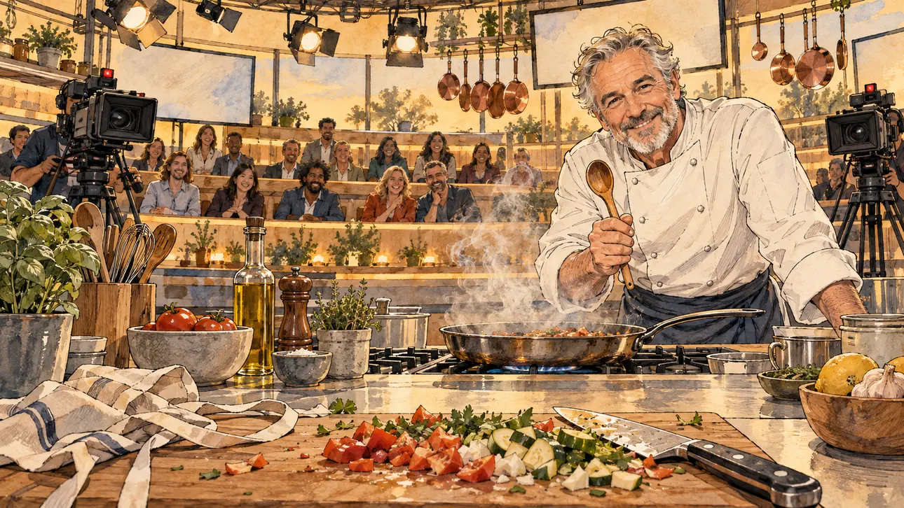

# `cookingShow` · Une émission de cuisine

**Validée par le PO le 31/10/2026**, au premier essai. Elle sert telle quelle en clair et en sombre.



| Champ | Valeur |
| --- | --- |
| Carte | `cookingShow`, catégorie `media` (Opportunité médiatique) |
| Style | Reportage dessiné |
| Ton | Chaleureux, avec une pointe d'ironie |
| Date | 2026-10-31 |
| Outil | ChatGPT avec le modèle GPT Sol 6.1 en effort « light », et ChatGPT Images 2.5 |
| Conversation | À remplir (le lien ne s'ouvre qu'avec le compte qui l'a créée) |
| Format rendu | 1672 × 941 (16:9) : export en 1290 × 726 px depuis le PNG d'origine, WebP de qualité 75, 206 Ko, sans recadrage ; réexportée le 01/11/2026, après une première version en qualité 60 pour tenir 180 Ko |
| Fichier d'origine | PNG de ChatGPT, chez le PO, partagé aussi dans la conversation avec Claude |
| Première édition | À remplir |

## Texte de la carte

> **Une émission de cuisine**
>
> Une émission culinaire très suivie vous invite à cuisiner en direct avec un grand chef. Le public adore voir les politiques en tablier.

## Le moment choisi

Le plateau vu depuis le plan de travail du candidat, hors champ : une planche aux légumes coupés n'importe comment, le couteau posé et un tablier froissé. En face, le grand chef tend sa cuillère en bois avec un sourire amusé ; entre eux, une poêle fume un peu trop. Derrière, le public rit et les caméras visent le candidat.

## Prompt complet

Dans une nouvelle conversation, avec [`oldTweet.webp`](oldTweet.webp) comme seule image de référence :

```
Use the attached image as the style reference: the same pencil and ink drawing with loose watercolour washes and warm paper grain. Faces, hands and objects are drawn with visible ink lines, never photographic. Not the same scene.

Editorial illustration, landscape 16:9 (1536 × 864 px), filling the whole frame edge to edge. The set of a popular cooking show, live, in 2027, seen from the place of the player's candidate at the cooking counter, who stays off-camera: in the foreground, only a cutting board with clumsily chopped vegetables, a knife laid down and a slightly crumpled apron string. In the right third, the star chef, a broad-shouldered man in his sixties in a white chef's jacket, leans on the counter with a wooden spoon in one hand and looks at the viewer with an amused, encouraging grin, his face above mid-height. On the stove between them, a pan smokes a little too much. Behind, a small studio audience on tiered benches laughs and watches the viewer, two cameras point at the viewer, and copper pans hang under warm lights. Nothing on the set, the screens or the jars is readable.

Style: Reportage drawing made on the spot, like a press illustrator or courtroom sketch artist: pencil and ink with loose watercolour washes, lively unfinished lines, white paper showing through.

Palette: navy #13203F, vellum #F5EFE1, gold #A9802A, brick #B5523B, ochre #D9A441, sage #8FA58A, slate #5E7186, sand #DCC8A4, warm grey #8C8279; use 4 to 6 of them, subtle warm paper grain.

Tone: warm and gently ironic, soft afternoon-like studio light, warm pastels.

Constraints: realistic proportions, expressive but not caricatured faces, people of varied ages, genders and origins; anatomically correct hands with exactly five fingers, few hands visible, the others in pockets, behind objects or out of frame; no readable text anywhere (signs, banners, labels and screens stay blank); no captions or speech bubbles; no logos, flags or political party colours; no recognisable real person, no lookalike of a real politician or television chef; no explicit violence; no oil-paint texture, no white or ragged border.

Format: if 16:9 is not available, make 1536 × 1024 and keep the top 80 px and the bottom 80 px free of anything important (faces, hands, the main action): they will be cropped.
```

## Essais écartés

Aucun.

## Retouches

Aucune.

## Relecture

Faite et validée par le PO le 31/10/2026.

- [x] Aucun texte lisible : ni étiquette sur la bouteille et les bocaux, ni écran.
- [x] Aucun sosie d'une personne réelle. Ici surtout : le chef, à côté des vrais chefs de télévision.
- [x] Le candidat du joueur est hors champ.
- [x] Mains, visages et foules sans défaut visible à 343 px de large.
- [x] Aucune couleur de parti, aucun symbole officiel. Des personnes variées.
- [x] En 3:2 : rien d'important dans les 80 px du haut et du bas. Sans objet ici : l'image est en 16:9.
- [x] Lisible sur la page de l'événement, en clair et en sombre.
