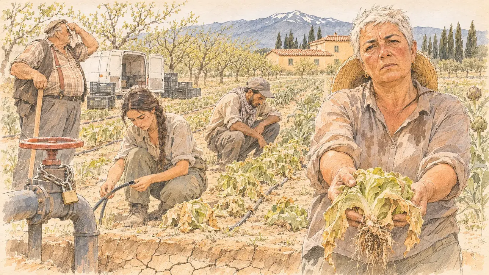

# `aprilHeat` · Trente degrés en avril

**Validée par le PO le 05/11/2026**, au premier essai, avec `primeTime.webp` comme référence. Elle sert telle quelle en clair et en sombre.



| Champ | Valeur |
| --- | --- |
| Carte | `aprilHeat`, catégorie `crisis` (Crise), carte ajoutée par la PR #297 de l'app |
| Style | Reportage dessiné, trait de `primeTime` |
| Ton | Lourd et inquiet |
| Date | 2026-11-05 |
| Outil | ChatGPT Images |
| Conversation | À remplir (le lien ne s'ouvre qu'avec le compte qui l'a créée) |
| Format rendu | 1672 × 941 (16:9) : export en 1290 × 726 px, WebP de qualité 75, 236 Ko, sans recadrage |
| Fichier d'origine | Image de ChatGPT, chez le PO. L'export du dépôt a été fait depuis la copie partagée dans la conversation avec Claude |
| Première édition | La prochaine Release qui suit le merge de la PR #297 de l'app |

## Texte de la carte

> **Trente degrés en avril**
>
> Trente degrés en plein avril : records de chaleur, cultures qui souffrent, premières restrictions d'eau dans le Sud. Le climat s'invite dans la campagne à l'approche du vote.

## Le moment choisi

Un champ de maraîchage de la plaine du Roussillon, près de Perpignan, par un après-midi écrasant de la mi-avril, vu depuis le bout d'un rang où le candidat (hors champ) est venu rencontrer les producteurs : au premier plan, le bord d'un fossé d'irrigation à sec, la boue craquelée au fond. Une maraîchère, chapeau de paille repoussé sur la nuque, tend au candidat une salade flétrie arrachée de la terre sèche. Autour : les rangs de salades et d'artichauts qui fanent, un saisonnier accroupi, une jeune agricultrice devant un tuyau de goutte-à-goutte vide, une vanne cadenassée, un vieux maraîcher appuyé sur sa binette. Derrière : les vergers de pêchers, une haie de cyprès, un mas aux murs ocre, et à l'horizon le Canigou avec quelques traînées de neige sous un ciel blanc de chaleur.

## Prompt complet

Dans une nouvelle conversation, avec [`primeTime.webp`](../../illustrations/media/primeTime.webp) comme seule image de référence.

```
Use the attached image as the style reference and copy its drawing: a realistic reportage drawing made on the spot for a newspaper, with quick, nervous pencil lines, often drawn twice, ink hatching in the shadows, transparent watercolour washes that spill a little over the lines, and the warm paper showing through. Not the same scene and not the same people: never reuse the face or the hair of the woman in the reference.
Like in the reference, the setting can be full when the story needs it, with the things that say where we are and what is happening, but each one is sketched with a few pencil lines and a light wash, never rendered or finished, and the drawing gets looser and paler towards the edges until it fades into the bare paper.
This must look like a drawing made by hand on paper by a press illustrator, halfway between a quick sketch and a realistic picture: never a photograph, a film poster or a digital painting, and never a cartoon, a comic strip, a caricature or a children's book illustration. Continuous lines, never dotted or dashed outlines; no uniform texture, speckles or hatching filter laid over the picture; no glossy highlights, no smooth gradients, in the sky and on the walls too. Colour can be rich in places, on a piece of clothing, a light or a flag, but it stays transparent and within the palette below. The fade into the paper at the edges stays narrow, without a wide white margin. No blur and no depth-of-field effect: everything, the foreground included, is drawn sharp, like a sketch made on the spot.
People are drawn from life with realistic anatomy and proportions, like in the reference: faces shaped with pencil lines, hatching and light washes, a little more finished than the background but never photographic (no photographic skin, no airbrushed or digital-painting look). Expressions stay natural and restrained, even in laughter or tears: no exaggerated grins, no wide-open mouths full of teeth, no rubbery or cartoonish faces.

Editorial illustration, landscape 16:9 (1536 × 864 px), the scene filling the frame, with only a light fade into the paper at the edges. A market garden on the Roussillon plain near Perpignan, in the far South, on a scorching afternoon in mid-April 2027: thirty degrees in April, heat records, crops suffering and the first water restrictions in the South. The scene is seen from the end of a row where the player's candidate has come to meet the growers, who stays off-camera: in the foreground, only the edge of a dried-up irrigation ditch, with cracked mud at the bottom. In the right third, a market gardener in her fifties of Spanish origin, stocky and sunburnt, with short cropped white hair, a straw hat pushed back on her neck and a sweat-stained shirt with rolled-up sleeves, holds out towards the viewer a wilted lettuce she has just pulled from the dry earth, with a weary, worried, accusing look, her face above mid-height. Around her, sketched in pencil and light washes: long rows of lettuces and artichokes wilting in pale, cracked soil; a seasonal worker of Moroccan origin in his thirties, wiry, with a cap and a scarf around his neck, crouching in a dry row; a young woman farmer with a long dark plait looking down at an empty black drip-irrigation pipe; a big valve on a water pipe closed with a padlock and a chain; an old, heavy grower in a vest and braces leaning on his hoe and wiping his forehead; stacks of empty plastic crates and a small white van with its doors open. Behind them, peach orchards in young leaf, a tall windbreak of cypress trees, a Catalan farmhouse with ochre walls and round red tiles, and on the horizon the high peak of the Canigou with only a few thin streaks of snow left, under a pale, white-hot sky. Only the market gardener looks straight at the viewer. Nothing on the valve, the crates, the van, the farmhouse or the clothes is readable, and no logo of a real company appears.

Style: Reportage drawing made on the spot, like a press illustrator or courtroom sketch artist: pencil and ink with loose watercolour washes, lively unfinished lines, white paper showing through.

Palette: navy #13203F, vellum #F5EFE1, gold #A9802A, brick #B5523B, ochre #D9A441, sage #8FA58A, slate #5E7186, sand #DCC8A4, warm grey #8C8279; use 4 to 6 of them, subtle warm paper grain.

Tone: heavy and worried, the harsh white light of an early heatwave with short hard shadows, the ochre of the dry earth and the farmhouse, the pale dusty green of the wilting crops, and the few streaks of snow on the Canigou as the one cool patch.

Constraints: realistic proportions, natural expressions, never cartoonish or caricatured faces, drawn like the rest of the illustration and never photographic; people of varied ages, genders, origins and body types (heavy, stocky, round, tall, short, wiry, not only slim), each with a distinct face and haircut (no two people alike), drawn with respect and never as a joke; anatomically correct hands with exactly five fingers, few hands visible, the others in pockets, behind objects or out of frame; no readable text anywhere (the valve, the crates, the van, the farmhouse and the clothes stay unreadable); no captions or speech bubbles; no logos or political party colours; no recognisable real person, no lookalike of a real politician, and no logo of a real company; no explicit violence; no photographic rendering, no blur or bokeh, no dotted outlines, no texture or hatching filter over the picture, no oil-paint texture, no wide white margin or frame (a light fade into the paper at the edges is fine).

Format: if 16:9 is not available, make 1536 × 1024 and keep the top 80 px and the bottom 80 px free of anything important (faces, hands, the main action): they will be cropped.
```

## Décisions prises sur cette image

Aucune.

## Essais écartés

Aucun.

## Retouches

Aucune.

## Relecture

Faite et validée par le PO le 05/11/2026.

- [x] Aucun texte lisible : rien n'est lisible sur la vanne, les cagettes, la camionnette, le mas ni les vêtements.
- [x] Aucun sosie d'une personne réelle.
- [x] Le candidat du joueur est hors champ.
- [x] Mains, visages et foules sans défaut visible à 343 px de large.
- [x] Aucune couleur ni aucun logo de parti. Des personnes variées par l'âge, le corps, l'origine et la coiffure.
- [x] En 3:2 : sans objet, l'image est en 16:9.
- [x] Lisible sur la page de l'événement, en clair et en sombre.

Ce que la relecture a accepté : le vieux maraîcher porte une casquette plate, comme le doyen de `farmersBlockade`.
