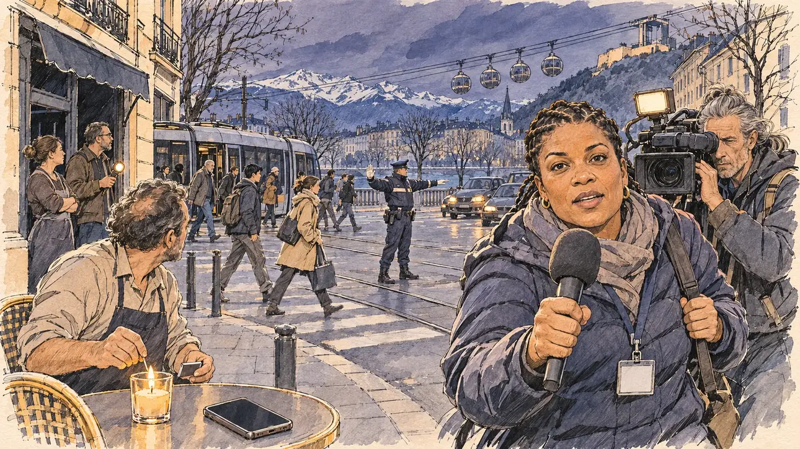

# `bigBlackout` · La grande panne

**Validée par le PO le 10/11/2026**, au premier essai. Elle sert telle quelle en clair et en sombre.



| Champ | Valeur |
| --- | --- |
| Carte | `bigBlackout`, catégorie `crisis` (Crise), poids 0,2, toute semaine ; un pari gagné sur une faiblesse (refuser les caméras, sur une proximité basse) |
| Style | Reportage dessiné |
| Ton | Tendu et pressé, crépuscule |
| Date | 2026-11-10 |
| Outil | ChatGPT Images, à compléter (modèle et effort) |
| Conversation | À compléter |
| Format rendu | 1672 × 941 (16:9) : export en 1290 × 726 px, WebP de qualité 75, 241 Ko, sans recadrage, fait depuis la copie WebP de la conversation (à refaire depuis le PNG d'origine) |
| Fichier d'origine | À compléter (hors du dépôt) |
| Première édition | À compléter |

## Texte de la carte

> **La grande panne**
>
> Une panne géante plonge un tiers du pays dans le noir : trains arrêtés, feux de circulation éteints, téléphones muets. Toutes les campagnes se précipitent devant les caméras.

## Le moment choisi

Un carrefour du centre de Grenoble, à la tombée du jour, pendant la panne : les feux éteints, un tramway immobilisé dont les passagers repartent à pied le long des rails, et au-dessus de l'Isère les bulles du téléphérique de la Bastille, arrêtées devant les montagnes. Le candidat reste hors champ, sur le trottoir : son téléphone muet, sur la table d'une terrasse, à côté d'une bougie que le cafetier vient d'allumer. Une journaliste de télévision arrive en courant avec son cadreur et tend son micro vers le spectateur : un mot sur la panne ? C'est la ruée de la carte. Autour, un policier règle la circulation à la main, des commerçants attendent sur le pas de leur porte. La nuit de [`poleReversal`](../farFetched/poleReversal.md), à Marseille, était déjà sans courant : ici, le crépuscule et la ville arrêtée.

## Prompt complet

Dans une nouvelle conversation, avec [`primeTime.webp`](../../illustrations/media/primeTime.webp) comme seule image de référence :

```
Use the attached image as the style reference and copy its drawing: a realistic reportage drawing made on the spot for a newspaper, with quick, nervous pencil lines, often drawn twice, ink hatching in the shadows, transparent watercolour washes that spill a little over the lines, and the warm paper showing through. Not the same scene and not the same people: never reuse the face or the hair of the woman in the reference.
Like in the reference, the setting can be full when the story needs it, with the things that say where we are and what is happening, but each one is sketched with a few pencil lines and a light wash, never rendered or finished, and the drawing gets looser and paler towards the edges until it fades into the bare paper.
This must look like a drawing made by hand on paper by a press illustrator, halfway between a quick sketch and a realistic picture: never a photograph, a film poster or a digital painting, and never a cartoon, a comic strip, a caricature or a children's book illustration. Continuous lines, never dotted or dashed outlines; no uniform texture, speckles or hatching filter laid over the picture; no glossy highlights, no smooth gradients, in the sky and on the walls too. Colour can be rich in places, on a piece of clothing, a light or a flag, but it stays transparent and within the palette below. The fade into the paper at the edges stays narrow, without a wide white margin. No blur and no depth-of-field effect: everything, the foreground included, is drawn sharp, like a sketch made on the spot.
People are drawn from life with realistic anatomy and proportions, like in the reference: faces shaped with pencil lines, hatching and light washes, a little more finished than the background but never photographic (no photographic skin, no airbrushed or digital-painting look). Expressions stay natural and restrained, even in laughter or tears: no exaggerated grins, no wide-open mouths full of teeth, no rubbery or cartoonish faces.

Editorial illustration, landscape 16:9 (1536 × 864 px), the scene filling the frame, with only a light fade into the paper at the edges. A crossroads in the centre of Grenoble, in the Alps, at dusk on a day in March 2027, during a giant power cut that has plunged a third of the country into darkness: the traffic lights are dark, a tram stands still in the middle of the street and its passengers walk away along the tracks, cars wait with their headlights on, and above the river Isère the round cable-car cabins of the Bastille hang motionless on their cable in front of the mountains, under a cold violet-grey sky. The player's candidate stays off-camera, on the pavement: in the foreground, only the candidate's silent phone, its screen dark, on a café terrace table next to a candle the café owner has just lit. In the right third, a television reporter rushing up with her camera operator, a stocky woman in her thirties of Guadeloupean descent with short braids, a puffer jacket and a press badge with no writing, holds her microphone out towards the viewer, out of breath and eager, a word on the blackout?, her face above mid-height; behind her, her camera operator, a tall, wiry man in his fifties with a grey ponytail, films with a small battery light on his camera. Around them: a police officer in the middle of the crossroads directs the traffic by hand; a few shopkeepers wait on the doorsteps of their dark shops, one holding a torch. Only the reporter looks at the viewer. Nothing on the tram, the shop fronts, the microphone, the camera, the phone or the street signs is readable.

Style: Reportage drawing made on the spot, like a press illustrator or courtroom sketch artist: pencil and ink with loose watercolour washes, lively unfinished lines, white paper showing through.

Palette: navy #13203F, vellum #F5EFE1, gold #A9802A, brick #B5523B, ochre #D9A441, sage #8FA58A, slate #5E7186, sand #DCC8A4, warm grey #8C8279; use 4 to 6 of them, subtle warm paper grain.

Tone: tense and hurried, the cold blue-grey dusk of a city without electricity, the few warm points of the candle, the headlights and the camera light, the press already running.

Constraints: realistic proportions, natural expressions, never cartoonish or caricatured faces, drawn like the rest of the illustration and never photographic; people of varied ages, genders, origins and body types (heavy, stocky, round, tall, short, wiry, not only slim), each with a distinct face and haircut (no two people alike), drawn with respect and never as a joke; each person's age, build and look plausible for their job and the scene (working people of working age), no stereotype tying an origin or a gender to a role, and no person of colour shown alone in a featured service or deferential role; anatomically correct hands with exactly five fingers, few hands visible, the others in pockets, behind objects or out of frame; no readable text anywhere (the tram, the shop fronts, the microphone, the camera, the phone and the street signs stay unreadable, no channel name on the microphone); no captions or speech bubbles; no logos, no television channel logo, no tram company logo, no political party colours; no recognisable real person, no lookalike of a real politician or journalist; no explicit violence, no accident; no photographic rendering, no blur or bokeh, every outline a continuous pencil or ink line with no dotted or dashed outlines, no mottled, crackled or speckled texture over the faces, the clothes, the walls or the sky, no hatching filter over the picture, no oil-paint texture, no glow, halo or light beams around the candle, the headlights or the camera light, no wide white margin or frame (a light fade into the paper at the edges is fine).

Format: if 16:9 is not available, make 1536 × 1024 and keep the top 80 px and the bottom 80 px free of anything important (faces, hands, the main action): they will be cropped.
```

## Décisions prises sur cette image

Validée telle quelle par le PO (10/11/2026). Les voitures du fond portent un petit écusson en losange qui peut évoquer une marque, minuscule et invisible à la taille de la carte ; la journaliste a de longues tresses au lieu de tresses courtes : gardés.

## Essais écartés

Aucun.

## Retouches

Aucune.

## Relecture

Faite et validée par le PO le 10/11/2026.

- [x] Aucun texte lisible : ni sur le tramway, ni sur les vitrines, ni sur le micro, le badge ou l'uniforme du policier (voir les décisions pour les voitures).
- [x] Aucun sosie d'une personne réelle.
- [x] Le candidat du joueur est hors champ : seul son téléphone éteint, sur la table de la terrasse.
- [x] Mains et visages sans défaut visible à 343 px de large : les mains de la journaliste sur le micro et la sangle, celles du cafetier qui allume la bougie, les mains du policier.
- [x] Aucune couleur ni aucun logo de parti. Des personnes variées par l'âge, le corps, l'origine et la coiffure.
- [x] En 16:9 : pas de recadrage.
- [ ] Lisible sur la page de l'événement, en clair et en sombre : à vérifier dans l'app, une fois la carte publiée.
