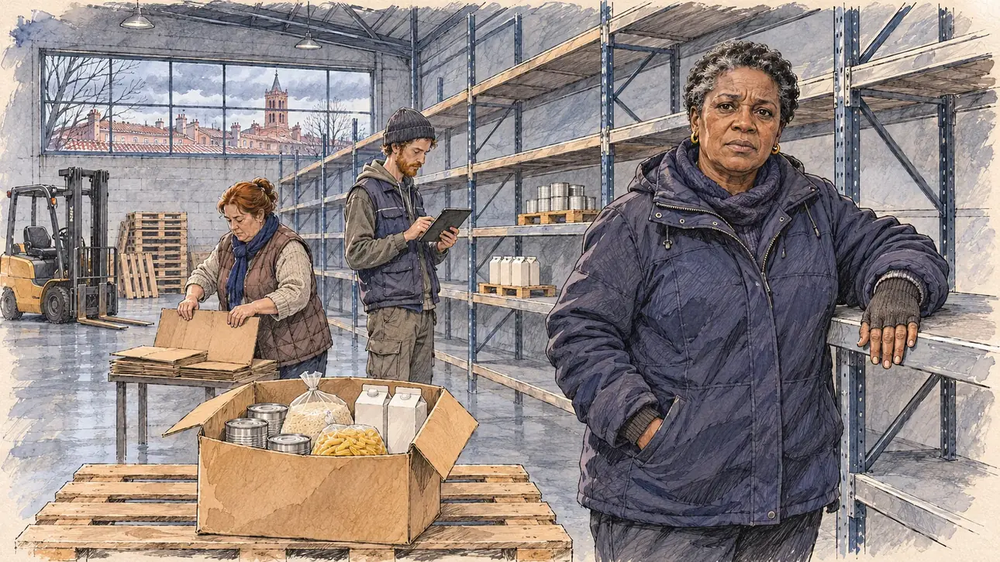

# `charityAlarm` · « Et si on fermait ? »

**Retenue par le PO le 19/11/2026** : l'image envoyée dans la session de l'app, sans retouche. Le nombre d'essais et les messages de correction sont à compléter. Elle sert telle quelle en clair et en sombre.



| Champ | Valeur |
| --- | --- |
| Carte | `charityAlarm`, catégorie `crisis` (Crise), poids 0,15, toute semaine, au tirage l'économie pèse +0,02 (Mitchnsun/moi-president, PO, 19/11/2026) |
| Style | Reportage dessiné |
| Ton | Tendu, la lumière froide d'un matin d'hiver sur des rayonnages vides, la brique rose et le carton les seules notes chaudes |
| Date | 2026-11-19 |
| Outil | ChatGPT Images |
| Conversation | À remplir (le lien ne s'ouvre qu'avec le compte qui l'a créée) |
| Format rendu | 1672 × 941 (16:9) : export en 1290 × 726 px, WebP de qualité 75, 204 Ko, sans recadrage, fait depuis la copie WebP reçue |
| Fichier d'origine | Image de ChatGPT, chez le PO. L'export du dépôt a été fait depuis la copie partagée dans la conversation avec Claude |
| Première édition | À compléter |

## Texte de la carte

> **« Et si on fermait ? »**
>
> Au journal de 20 heures, le président d'un grand réseau d'aide alimentaire prévient : faute de dons, il devra refuser des familles cet hiver, et pourrait fermer dans trois ans. Le pays découvre que ses entrepôts se vident. On vous demande ce que vous feriez.

## Le moment choisi

L'entrepôt régional d'un réseau d'aide alimentaire près de Toulouse, un matin gris d'hiver : des racks presque vides, quelques palettes de conserves et de lait, un chariot élévateur, et par une haute fenêtre les toits de brique rose et un clocher. Plutôt que le plateau du journal, l'entrepôt qui se vide : le président du réseau n'y est pas, pour qu'il ne ressemble à aucun dirigeant réel. Le candidat reste hors champ : seul le carton de dons qu'il vient de poser sur une palette. La responsable de l'entrepôt, d'origine sénégalaise, la main sur une étagère vide, le regarde, inquiète. Le précédent est l'alerte des Restos du Cœur du 3 septembre 2023.

## Prompt complet

Dans une nouvelle conversation, avec [`primeTime.webp`](../../illustrations/media/primeTime.webp) comme seule image de référence :

```
Use the attached image as the style reference and copy its drawing: a realistic reportage drawing made on the spot for a newspaper, with quick, nervous pencil lines, often drawn twice, ink hatching in the shadows, transparent watercolour washes that spill a little over the lines, and the warm paper showing through. Not the same scene and not the same people: never reuse the face or the hair of the woman in the reference.
Like in the reference, the setting can be full when the story needs it, with the things that say where we are and what is happening, but each one is sketched with a few pencil lines and a light wash, never rendered or finished, and the drawing gets looser and paler towards the edges until it fades into the bare paper.
This must look like a drawing made by hand on paper by a press illustrator, halfway between a quick sketch and a realistic picture: never a photograph, a film poster or a digital painting, and never a cartoon, a comic strip, a caricature or a children's book illustration. Continuous lines, never dotted or dashed outlines; no uniform texture, speckles or hatching filter laid over the picture; no glossy highlights, no smooth gradients, in the sky and on the walls too. Colour can be rich in places, on a piece of clothing, a light or a flag, but it stays transparent and within the palette below. The fade into the paper at the edges stays narrow, without a wide white margin. No blur and no depth-of-field effect: everything, the foreground included, is drawn sharp, like a sketch made on the spot.
People are drawn from life with realistic anatomy and proportions, like in the reference: faces shaped with pencil lines, hatching and light washes, a little more finished than the background but never photographic (no photographic skin, no airbrushed or digital-painting look). Expressions stay natural and restrained, even in laughter or tears: no exaggerated grins, no wide-open mouths full of teeth, no rubbery or cartoonish faces.

Editorial illustration, landscape 16:9 (1536 × 864 px), the scene filling the frame, with only a light fade into the paper at the edges. Inside the regional warehouse of a food aid network near Toulouse, in the south-west of France, on a grey winter morning in 2027: long metal racks almost empty, a few lonely pallets of tins and milk cartons, bare wooden pallets stacked against the wall, a forklift parked with its forks down, and through a high window the pink-brick roofs and a church tower of the Toulouse area under low clouds. The player's candidate stays off-camera: in the foreground, only a single cardboard box of donated groceries the candidate has just set down on an empty pallet, at the bottom edge of the frame. In the right third, the warehouse manager, a stocky woman in her fifties of Senegalese descent, with short natural grey-streaked hair, small gold earrings, a padded work jacket and fingerless gloves, stands in front of the empty racks with one hand resting on a bare shelf and looks at the viewer, worried and direct, her face above mid-height. Behind her, a tall, wiry white volunteer in his late twenties with a red beard and a beanie counts the few remaining pallets on a tablet; a round, short volunteer in her sixties of Portuguese descent, with dyed auburn hair in a bun and a quilted vest, folds empty boxes. Only the manager looks at the viewer; the others go on with their work. Nothing on the boxes, the tins, the tablet, the racks or the walls is readable.

Style: Reportage drawing made on the spot, like a press illustrator or courtroom sketch artist: pencil and ink with loose watercolour washes, lively unfinished lines, white paper showing through.

Palette: navy #13203F, vellum #F5EFE1, gold #A9802A, brick #B5523B, ochre #D9A441, sage #8FA58A, slate #5E7186, sand #DCC8A4, warm grey #8C8279; use 4 to 6 of them, subtle warm paper grain.

Tone: tense, cold grey-blue morning light falling on the empty shelves, the pink brick outside and the single donation box the only warm notes.

Constraints: realistic proportions, natural expressions, never cartoonish or caricatured faces, drawn like the rest of the illustration and never photographic; people of varied ages, genders, origins and body types (heavy, stocky, round, tall, short, wiry, not only slim), each with a distinct face and haircut (no two people alike), drawn with respect and never as a joke; each person's age, build and look plausible for their job and the scene (working people of working age), no stereotype tying an origin or a gender to a role, and no person of colour shown alone in a featured service or deferential role; anatomically correct hands with exactly five fingers, few hands visible, the others in pockets, behind objects or out of frame; no readable text anywhere (the boxes, the tins, the cartons, the tablet and the racks stay unreadable, no brand, no charity name); no captions or speech bubbles; no logos, no charity logo or heart emblem, no political party colours; no recognisable real person, no lookalike of a real politician or of a real charity leader; no explicit violence; no photographic rendering, no blur or bokeh, no dotted outlines, no texture or hatching filter over the picture, no oil-paint texture, no wide white margin or frame (a light fade into the paper at the edges is fine).

Format: if 16:9 is not available, make 1536 × 1024 and keep the top 80 px and the bottom 80 px free of anything important (faces, hands, the main action): they will be cropped.
```

## Décisions prises sur cette image

Retenue par le PO (19/11/2026).

## Essais écartés

À compléter.

## Retouches

Aucune.

## Relecture

Faite le 19/11/2026 sur l'image reçue, zoomée sur le texte possible et les mains ; retenue par le PO le même jour.

- [x] Aucun texte lisible : cartons, conserves, briques de lait, tablette et chariot élévateur sans inscription ni marque.
- [x] Le candidat du joueur est hors champ : seul le carton de dons, sur la palette au premier plan.
- [x] Le rendu le plus proche de la référence des quatre cartes de l'aide alimentaire : traits nets, lavis clairs, sans grain craquelé.
- [x] Aucun sosie d'une personne réelle repéré.
- [x] Mains sans défaut visible.
- [x] Aucune couleur, aucun logo ni aucun drapeau de parti. Des personnes variées par l'âge, le corps, l'origine et la coiffure.
- [x] En 16:9 : pas de recadrage.
- [ ] Lisible sur la page de l'événement, en clair et en sombre : à vérifier dans l'app, une fois la carte publiée.
