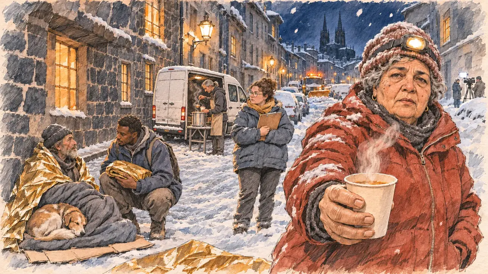

# `coldSnap` · Vague de froid

**À générer.** Prompt prêt le 05/11/2026, pas encore d'image validée.



| Champ | Valeur |
| --- | --- |
| Carte | `coldSnap`, catégorie `crisis` (Crise), carte ajoutée par la PR #297 de l'app |
| Style | Reportage dessiné, trait de `primeTime` |
| Ton | Tendu et sobre |
| Date | À remplir |
| Outil | ChatGPT Images |
| Conversation | À remplir (le lien ne s'ouvre qu'avec le compte qui l'a créée) |
| Format rendu | À remplir |
| Fichier d'origine | À remplir |
| Première édition | À remplir |

## Texte de la carte

> **Vague de froid**
>
> Une vague de froid saisit le pays : routes bloquées par la neige, sans-abri en danger, factures de chauffage qui s'envolent. Les médias veulent savoir où vous êtes.

## Le moment choisi

Une rue de la vieille ville de Clermont-Ferrand sous la neige, par une nuit glaciale de fin janvier, vue depuis le trottoir où le candidat (hors champ) rejoint l'équipe d'une maraude : au premier plan, une couverture de survie dorée à moitié dépliée dans la neige. Une bénévole de la maraude tend au candidat un gobelet de soupe fumante. Autour : un homme sans abri dans son duvet sous un porche, son chien contre lui, d'autres bénévoles qui servent la soupe à l'arrière d'une camionnette ; au bout de la rue, un chasse-neige arrêté derrière des voitures bloquées, et au coin, minuscule, la lumière d'une caméra de télévision. Derrière : les flèches de la cathédrale en pierre de lave noire dans la nuit enneigée.

## Prompt complet

Dans une nouvelle conversation, avec [`primeTime.webp`](../../illustrations/media/primeTime.webp) comme seule image de référence.

```
Use the attached image as the style reference and copy its drawing: a realistic reportage drawing made on the spot for a newspaper, with quick, nervous pencil lines, often drawn twice, ink hatching in the shadows, transparent watercolour washes that spill a little over the lines, and the warm paper showing through. Not the same scene and not the same people: never reuse the face or the hair of the woman in the reference.
Like in the reference, the setting can be full when the story needs it, with the things that say where we are and what is happening, but each one is sketched with a few pencil lines and a light wash, never rendered or finished, and the drawing gets looser and paler towards the edges until it fades into the bare paper.
This must look like a drawing made by hand on paper by a press illustrator, halfway between a quick sketch and a realistic picture: never a photograph, a film poster or a digital painting, and never a cartoon, a comic strip, a caricature or a children's book illustration. Continuous lines, never dotted or dashed outlines; no uniform texture, speckles or hatching filter laid over the picture; no glossy highlights, no smooth gradients, in the sky and on the walls too. Colour can be rich in places, on a piece of clothing, a light or a flag, but it stays transparent and within the palette below. The fade into the paper at the edges stays narrow, without a wide white margin. No blur and no depth-of-field effect: everything, the foreground included, is drawn sharp, like a sketch made on the spot.
People are drawn from life with realistic anatomy and proportions, like in the reference: faces shaped with pencil lines, hatching and light washes, a little more finished than the background but never photographic (no photographic skin, no airbrushed or digital-painting look). Expressions stay natural and restrained, even in laughter or tears: no exaggerated grins, no wide-open mouths full of teeth, no rubbery or cartoonish faces.

Editorial illustration, landscape 16:9 (1536 × 864 px), the scene filling the frame, with only a light fade into the paper at the edges. An old-town street of Clermont-Ferrand, in Auvergne, on a freezing night at the end of January 2027, during a cold snap that grips the whole country: snow has blocked the roads, homeless people are in danger, heating bills are soaring, and the media want to know where the candidate is. The scene is seen from the pavement where the player's candidate joins a night outreach team, who stays off-camera: in the foreground, only a gold survival blanket half unfolded on the snow. In the right third, an outreach volunteer in her sixties of Algerian origin, short and round, in a big red padded jacket and a wool hat with a head torch, grey curls showing under it, holds out a steaming paper cup of soup towards the viewer with a tired, serious, urgent look, her face above mid-height. Around her, sketched in pencil and light washes: a homeless man in his fifties with a thick beard, in a sleeping bag on flattened cardboard under the porch of an old building, a survival blanket over his shoulders and his dog curled up against him, drawn with dignity; a young volunteer of Senegalese origin crouching beside him with a folded blanket; a tall, thin volunteer with a grey ponytail ladling soup from a big pot at the open side door of a plain white van; a stocky young woman with glasses holding a clipboard against her chest; breath steaming in the cold air, a few big snowflakes falling, drawn one by one. Behind them, the narrow street of houses in dark volcanic stone, with snow on their window ledges and a few lit windows, and at the end of the street a snowplough stopped with its orange lights flashing behind cars stuck in the snow; at the corner, small and far off, the white light of a TV crew's camera. Above the roofs, the dark Gothic spires of the black lava-stone cathedral of Clermont-Ferrand against the snowy night sky. Only the volunteer with the soup looks straight at the viewer. Nothing on the van, the clipboard, the cardboard, the jackets, the snowplough or the camera is readable, and no logo of a real charity or TV channel appears.

Style: Reportage drawing made on the spot, like a press illustrator or courtroom sketch artist: pencil and ink with loose watercolour washes, lively unfinished lines, white paper showing through.

Palette: navy #13203F, vellum #F5EFE1, gold #A9802A, brick #B5523B, ochre #D9A441, sage #8FA58A, slate #5E7186, sand #DCC8A4, warm grey #8C8279; use 4 to 6 of them, subtle warm paper grain.

Tone: tense and sober, the deep blue of the snowy night, the orange glow of the street lamps on the snow, the red jacket and the gold survival blanket as the warm patches, the steam of the soup.

Constraints: realistic proportions, natural expressions, never cartoonish or caricatured faces, drawn like the rest of the illustration and never photographic; people of varied ages, genders, origins and body types (heavy, stocky, round, tall, short, wiry, not only slim), each with a distinct face and haircut (no two people alike), drawn with respect and never as a joke; anatomically correct hands with exactly five fingers, few hands visible, the others in pockets, behind objects or out of frame; no readable text anywhere (the van, the clipboard, the cardboard, the jackets, the snowplough and the camera stay unreadable); no captions or speech bubbles; no logos or political party colours; no recognisable real person, no lookalike of a real politician, and no logo of a real charity or TV channel; no explicit violence; no photographic rendering, no blur or bokeh, no dotted outlines, no texture or hatching filter over the picture, no oil-paint texture, no wide white margin or frame (a light fade into the paper at the edges is fine).

Format: if 16:9 is not available, make 1536 × 1024 and keep the top 80 px and the bottom 80 px free of anything important (faces, hands, the main action): they will be cropped.
```

## Décisions prises sur cette image

Aucune pour l'instant.

## Essais écartés

Aucun pour l'instant.

## Retouches

Aucune.

## Relecture

À faire sur l'image validée.
