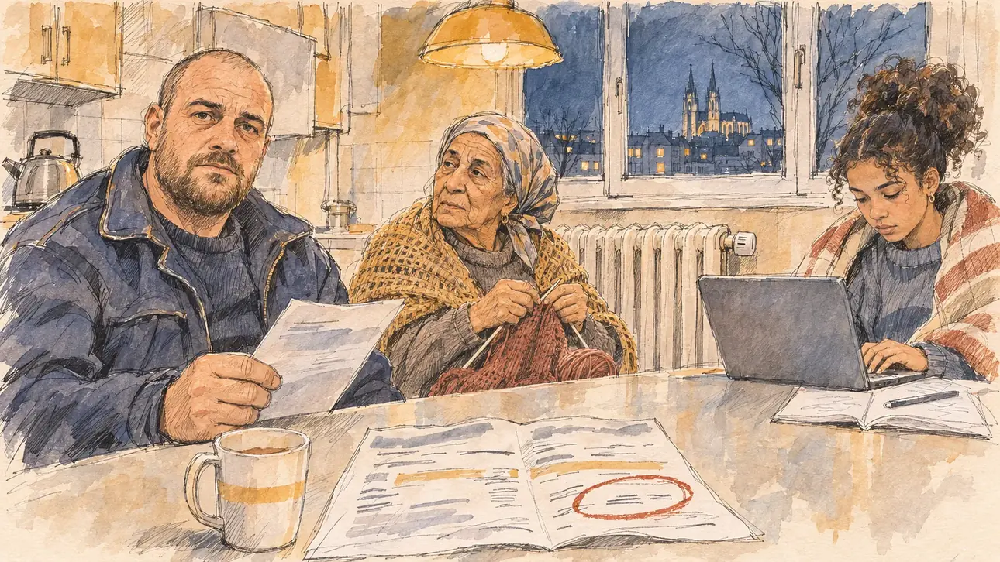

# `energySpike` · L'énergie flambe

**Validée par le PO le 10/11/2026**, au premier essai. Elle sert telle quelle en clair et en sombre.



| Champ | Valeur |
| --- | --- |
| Carte | `energySpike`, catégorie `crisis` (Crise), poids 0,2, toute semaine, son histoire (`energyBills`) à la une de la revue de presse |
| Style | Reportage dessiné |
| Ton | Tendu et intime, soir d'hiver |
| Date | 2026-11-10 |
| Outil | ChatGPT Images, à compléter (modèle et effort) |
| Conversation | À compléter |
| Format rendu | 1672 × 941 (16:9) : export en 1290 × 726 px, WebP de qualité 75, 191 Ko, sans recadrage, fait depuis la copie WebP de la conversation (à refaire depuis le PNG d'origine) |
| Fichier d'origine | À compléter (hors du dépôt) |
| Première édition | À compléter |

## Texte de la carte

> **L'énergie flambe**
>
> Un détroit est bloqué à l'autre bout du monde : le prix du gaz et de l'électricité s'envole, et les factures de l'hiver doublent pour des millions de foyers.

## Le moment choisi

La cuisine d'une famille dans une tour des années 1970 à Orléans, un soir froid de janvier, pendant la visite du candidat : tout le monde en pull, le thermostat du radiateur au plus bas, les flèches de la cathédrale par la fenêtre. Le candidat reste hors champ, assis à la table : sa tasse de thé à côté de la facture d'énergie ouverte, le total entouré de rouge. Le père tient l'autre page de la facture et regarde le spectateur : ça a doublé. La grand-mère tricote près du radiateur, l'adolescente fait ses devoirs sous une couverture. Orléans n'avait encore servi à aucune carte.

## Prompt complet

Dans une nouvelle conversation, avec [`primeTime.webp`](../../illustrations/media/primeTime.webp) comme seule image de référence :

```
Use the attached image as the style reference and copy its drawing: a realistic reportage drawing made on the spot for a newspaper, with quick, nervous pencil lines, often drawn twice, ink hatching in the shadows, transparent watercolour washes that spill a little over the lines, and the warm paper showing through. Not the same scene and not the same people: never reuse the face or the hair of the woman in the reference.
Like in the reference, the setting can be full when the story needs it, with the things that say where we are and what is happening, but each one is sketched with a few pencil lines and a light wash, never rendered or finished, and the drawing gets looser and paler towards the edges until it fades into the bare paper.
This must look like a drawing made by hand on paper by a press illustrator, halfway between a quick sketch and a realistic picture: never a photograph, a film poster or a digital painting, and never a cartoon, a comic strip, a caricature or a children's book illustration. Continuous lines, never dotted or dashed outlines; no uniform texture, speckles or hatching filter laid over the picture; no glossy highlights, no smooth gradients, in the sky and on the walls too. Colour can be rich in places, on a piece of clothing, a light or a flag, but it stays transparent and within the palette below. The fade into the paper at the edges stays narrow, without a wide white margin. No blur and no depth-of-field effect: everything, the foreground included, is drawn sharp, like a sketch made on the spot.
People are drawn from life with realistic anatomy and proportions, like in the reference: faces shaped with pencil lines, hatching and light washes, a little more finished than the background but never photographic (no photographic skin, no airbrushed or digital-painting look). Expressions stay natural and restrained, even in laughter or tears: no exaggerated grins, no wide-open mouths full of teeth, no rubbery or cartoonish faces.

Editorial illustration, landscape 16:9 (1536 × 864 px), the scene filling the frame, with only a light fade into the paper at the edges. The small kitchen of a family flat in a 1970s tower block in Orléans, on a cold January evening in 2027, during the candidate's visit, the week gas and electricity prices soar and winter bills double: a formica table, a kettle, a radiator under the window with its thermostat knob turned to the lowest setting, and through the window, at night, the city lights and the twin spires of the cathedral in the distance. Everyone wears jumpers indoors. The player's candidate stays off-camera, sitting at the table: in the foreground, only a mug of tea on the table, next to an opened energy bill whose figures are unreadable, with one total circled in red pen. In the left third, the father, a heavy-set white man in his forties with a shaved head, a short brown beard and the navy jacket of a city bus driver's uniform, holds the other page of the bill and looks at the viewer, weary and frank, it has doubled, his face above mid-height. Next to him, the grandmother, a small woman in her seventies of Moroccan descent, with a knitted shawl and a headscarf tied at the nape, knits by the radiator and looks at her son; at the end of the table, a teenage girl of fifteen, mixed race, with curly hair in a high puff, does her homework on a laptop with a blanket around her shoulders. Only the father looks at the viewer. Nothing on the bill, the laptop or the walls is readable, and no energy company name or logo appears.

Style: Reportage drawing made on the spot, like a press illustrator or courtroom sketch artist: pencil and ink with loose watercolour washes, lively unfinished lines, white paper showing through.

Palette: navy #13203F, vellum #F5EFE1, gold #A9802A, brick #B5523B, ochre #D9A441, sage #8FA58A, slate #5E7186, sand #DCC8A4, warm grey #8C8279; use 4 to 6 of them, subtle warm paper grain.

Tone: tense and intimate, the warm yellow light of the kitchen lamp against the cold blue night outside, the red circle on the bill as the one bright mark.

Constraints: realistic proportions, natural expressions, never cartoonish or caricatured faces, drawn like the rest of the illustration and never photographic; people of varied ages, genders, origins and body types (heavy, stocky, round, tall, short, wiry, not only slim), each with a distinct face and haircut (no two people alike), drawn with respect and never as a joke; each person's age, build and look plausible for their job and the scene (working people of working age), no stereotype tying an origin or a gender to a role, and no person of colour shown alone in a featured service or deferential role; anatomically correct hands with exactly five fingers, few hands visible, the others in pockets, behind objects or out of frame; no readable text anywhere (the bill, the laptop and the walls stay unreadable, no figures); no captions or speech bubbles; no logos, no energy company name, no political party colours; no recognisable real person, no lookalike of a real politician; no explicit violence; no photographic rendering, no blur or bokeh, every outline a continuous pencil or ink line with no dotted or dashed outlines, no mottled, crackled or speckled texture over the faces, the clothes or the walls, no hatching filter over the picture, no oil-paint texture, no glow or halo, no wide white margin or frame (a light fade into the paper at the edges is fine).

Format: if 16:9 is not available, make 1536 × 1024 and keep the top 80 px and the bottom 80 px free of anything important (faces, hands, the main action): they will be cropped.
```

## Décisions prises sur cette image

Validée telle quelle par le PO (10/11/2026). La veste du père tient plus du blouson de travail que de la tenue de conducteur de bus : le métier ne se lit pas, la scène n'en a pas besoin.

## Essais écartés

Aucun.

## Retouches

Aucune.

## Relecture

Faite et validée par le PO le 10/11/2026.

- [x] Aucun texte lisible : la facture ne porte que des traits et des surlignages, sans chiffre ni nom de fournisseur ; le cahier et l'ordinateur sont illisibles.
- [x] Aucun sosie d'une personne réelle.
- [x] Le candidat du joueur est hors champ : seules sa tasse et la facture, sur la table.
- [x] Mains et visages sans défaut visible à 343 px de large : les mains de la grand-mère sur les aiguilles, celle du père sur la facture, celles de l'adolescente au clavier.
- [x] Aucune couleur ni aucun logo de parti. Des personnes variées par l'âge, le corps, l'origine et la coiffure.
- [x] En 16:9 : pas de recadrage.
- [ ] Lisible sur la page de l'événement, en clair et en sombre : à vérifier dans l'app, une fois la carte publiée.
