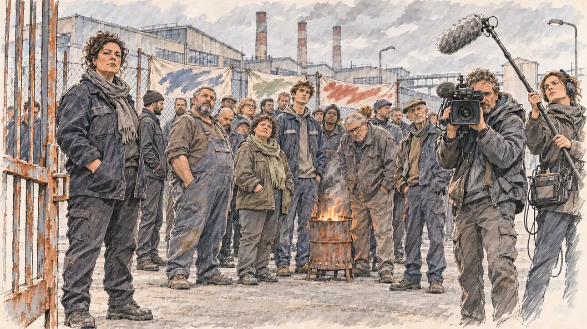

# `factoryClosure` · Une usine ferme

**Validée par le PO le 31/10/2026**, au premier essai. Elle sert telle quelle en clair et en sombre.



| Champ | Valeur |
| --- | --- |
| Carte | `factoryClosure`, catégorie `crisis` (Crise) |
| Style | Reportage dessiné |
| Ton | Tendu |
| Date | 2026-10-31 |
| Outil | ChatGPT avec le modèle GPT Sol 6.1 en effort « light », et ChatGPT Images 2.5 |
| Conversation | À remplir (le lien ne s'ouvre qu'avec le compte qui l'a créée) |
| Format rendu | 1672 × 941 (16:9) : export en 1290 × 726 px depuis le PNG d'origine, WebP de qualité 75, 159 Ko, sans recadrage |
| Fichier d'origine | PNG de ChatGPT, chez le PO, partagé aussi dans la conversation avec Claude |
| Première édition | `kit-france-2611-0001` |

## Texte de la carte

> **Une usine ferme**
>
> Un grand groupe annonce la fermeture de son usine de l'Est : huit cents emplois menacés. L'économie s'impose à la une.

## Le moment choisi

Les grilles de l'usine, un matin gris, le jour de l'annonce. Le candidat est venu rencontrer les ouvriers. Une déléguée syndicale le regarde, grave ; derrière elle, les ouvriers en petits groupes, un brasero, des banderoles et une équipe de télé.

## Prompt complet

Dans une nouvelle conversation, avec [`oldTweet.webp`](../../illustrations/polemic/oldTweet.webp) comme seule image de référence. C'est le premier prompt qui demande une diversité de corps (décision du PO du 31/10/2026) : la première version n'en disait rien et n'a pas été générée.

```
Use the attached image as the style reference: the same pencil and ink drawing with loose watercolour washes and warm paper grain. Faces, hands and objects are drawn with visible ink lines, never photographic. Not the same scene.

Editorial illustration, landscape 16:9 (1536 × 864 px), filling the whole frame edge to edge. The gates of a large factory in eastern France, on a cold, overcast morning in 2027, the day the group announced its closure: eight hundred jobs threatened. The player's candidate has come to meet the workers and stays off-camera: in the foreground, only the half-open metal gate. In the left third, a union delegate, a heavy-set woman in her forties in a dark work jacket, hands in her pockets, looks at the viewer with a grave, challenging face, her face above mid-height. Behind her, a few dozen workers stand in small groups, with the real bodies of people who have done physical work for years: a big, broad-shouldered man with a belly under his overalls, a short stocky woman, a tall lanky young apprentice, a grey-haired worker with a heavy frame and a slight stoop, some round, some wiry, few of them slim. Some look at the viewer, others talk quietly or stare at the factory. Handmade banners hang on the fence, a brazier smokes gently, and a television crew films the viewer. The long factory buildings and their cold chimneys stand under a low grey sky. Nothing on the banners, the signs or the buildings is readable.

Style: Reportage drawing made on the spot, like a press illustrator or courtroom sketch artist: pencil and ink with loose watercolour washes, lively unfinished lines, white paper showing through.

Palette: navy #13203F, vellum #F5EFE1, gold #A9802A, brick #B5523B, ochre #D9A441, sage #8FA58A, slate #5E7186, sand #DCC8A4, warm grey #8C8279; use 4 to 6 of them, subtle warm paper grain.

Tone: tense, cold grey morning light, the only warm touch the glow of the brazier.

Constraints: realistic proportions, expressive but not caricatured faces, people of varied ages, genders, origins and body types (heavy, stocky, round, tall, short, wiry, not only slim), drawn with respect and never as a joke; anatomically correct hands with exactly five fingers, few hands visible, the others in pockets, behind objects or out of frame; no readable text anywhere (banners, signs, labels and screens stay unreadable); no captions or speech bubbles; no logos, flags or political party colours; no recognisable real person, no lookalike of a real politician; no explicit violence; no oil-paint texture, no white or ragged border.

Format: if 16:9 is not available, make 1536 × 1024 and keep the top 80 px and the bottom 80 px free of anything important (faces, hands, the main action): they will be cropped.
```

## Essais écartés

Aucun.

## Retouches

Aucune.

## Relecture

Faite et validée par le PO le 31/10/2026.

- [x] Aucun texte lisible : les banderoles sont gribouillées, sans lettres.
- [x] Aucun sosie d'une personne réelle.
- [x] Le candidat du joueur est hors champ.
- [x] Mains, visages et foules sans défaut visible à 343 px de large.
- [x] Aucune couleur de parti, aucun symbole officiel. Des personnes variées, y compris dans leurs corps.
- [x] En 3:2 : rien d'important dans les 80 px du haut et du bas. Sans objet ici : l'image est en 16:9.
- [x] Lisible sur la page de l'événement, en clair et en sombre.

## Régénération demandée (04/11/2026)

**Pourquoi.** La revue de la première série note le style à 3/3 et les détails à 2/3 : c'est un autre style, une photo à peine retouchée, avec le visage de la déléguée syndicale photographique, des bâtiments, des cheminées et un ciel rendus comme une photo, un sol mouillé aux reflets et la fumée du brasero, sans lavis transparent ni papier. Une vingtaine d'ouvriers sont dessinés en entier, avec banderoles, grille, usine et cheminées, gyrophare et équipe de télé avec perche : la foule est le sujet, mais tout le fond est détaillé. Le PO a décidé de régénérer l'image.

**Ce qui reste.** La scène et le moment : les grilles de l'usine un matin gris, la déléguée syndicale du tiers gauche, corpulente, mains dans les poches, qui regarde le spectateur avec gravité, le brasero, la banderole, l'équipe de télé. Les corps variés, que la revue juge réussis, sont gardés et nommés un par un : le grand barbu au ventre, la petite trapue, l'apprenti dégingandé, l'ouvrier voûté aux cheveux gris.

**Ce qui change.** La foule passe d'une vingtaine d'ouvriers à huit, en deux ou trois petits groupes, tracés à l'encre sous un lavis plat. L'usine est esquissée en quelques traits (un bâtiment bas, deux cheminées) sous un ciel de lavis gris ; plus de gyrophare, de sol mouillé aux reflets ni de grille détaillée ; une seule banderole ; l'équipe de télé se réduit à un cameraman et sa perche.

### Prompt de régénération

Dans une nouvelle conversation, avec [`oldTweet.webp`](../../illustrations/polemic/oldTweet.webp) comme seule image de référence.

```
Use the attached image as the style reference and copy its drawing: quick, nervous pencil lines, often drawn twice, loose ink hatching in the shadows, transparent watercolour washes that spill a little over the lines, and the warm paper showing through everywhere. Not the same scene.
Like in the reference, the setting can be full when the story needs it, with the things that say where we are and what is happening, but each one is sketched with a few pencil lines and a light wash, never rendered or finished, and the drawing gets looser and paler towards the edges until it fades into the bare paper.
This must look like a drawing made by hand on paper, never like a photograph, a film poster or a digital painting: the people are drawn with pencil and ink lines and washes, not modelled; continuous lines, never dotted or dashed outlines; no uniform texture, speckles or hatching filter laid over the picture; no dense colour, no glossy highlights, no smooth gradients, in the sky and on the walls too. The fade into the paper at the edges stays narrow, without a wide white margin. No blur and no depth-of-field effect: everything, the foreground included, is drawn sharp, like a sketch made on the spot.
Faces are drawn exactly like the clothes and the background: ink outlines, a few hatching strokes and flat watercolour washes for the skin, with the same level of detail as the rest of the drawing. No photographic skin, no realistic wrinkles or pores, no airbrushed or digital-painting look on the faces.

Editorial illustration, landscape 16:9 (1536 × 864 px), the scene filling the frame, with only a light fade into the paper at the edges. The gates of a large factory in eastern France, on a cold, overcast morning in 2027, the day the group announced its closure: eight hundred jobs threatened. The player's candidate has come to meet the workers and stays off-camera: in the foreground, only the half-open metal gate, drawn with a few straight ink lines and a rust-coloured wash. In the left third, a union delegate, a heavy-set woman in her forties with dark curly hair pinned up, in a dark work jacket and a grey scarf, hands in her pockets, looks at the viewer with a grave, challenging face, her face above mid-height. Behind her, only eight workers stand in two or three small groups, drawn with loose ink lines and flat washes, with the real bodies of people who have done physical work for years: a big, broad-shouldered bearded man with a belly under his overalls, a short stocky woman with a green scarf, a tall lanky young apprentice, a grey-haired worker with a heavy frame and a slight stoop, one slim older man in a cap; some look at the viewer, others talk quietly or stare at the factory. Next to them, a rusty brazier smokes gently, its glow the only warm touch. On the fence, a single handmade banner, daubed with loose strokes and no letters. On the right, a television cameraman films the viewer, a boom microphone above him. The factory is only suggested: a long low building and two cold chimneys in a few pencil lines under a pale grey wash for the sky, the paper bare below. Nothing on the banner or the building is readable.

Style: Reportage drawing made on the spot, like a press illustrator or courtroom sketch artist: pencil and ink with loose watercolour washes, lively unfinished lines, white paper showing through.

Palette: navy #13203F, vellum #F5EFE1, gold #A9802A, brick #B5523B, ochre #D9A441, sage #8FA58A, slate #5E7186, sand #DCC8A4, warm grey #8C8279; use 4 to 6 of them, subtle warm paper grain.

Tone: tense, cold grey morning light, the only warm touch the glow of the brazier.

Constraints: realistic proportions, expressive but not caricatured faces, drawn like the rest of the illustration and never photographic; people of varied ages, genders, origins and body types (heavy, stocky, round, tall, short, wiry, not only slim), each with a distinct face and haircut (no two people alike), drawn with respect and never as a joke; anatomically correct hands with exactly five fingers, few hands visible, the others in pockets, behind objects or out of frame; no readable text anywhere (the banner and the building stay unreadable); no captions or speech bubbles; no logos or political party colours; no recognisable real person, no lookalike of a real politician; no explicit violence; no photographic rendering, no blur or bokeh, no dotted outlines, no texture or hatching filter over the picture, no oil-paint texture, no wide white margin or frame (a light fade into the paper at the edges is fine).

Format: if 16:9 is not available, make 1536 × 1024 and keep the top 80 px and the bottom 80 px free of anything important (faces, hands, the main action): they will be cropped.
```
