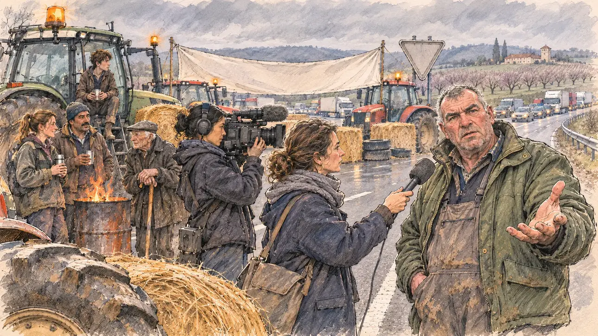

# `farmersBlockade` · Les tracteurs sur l'autoroute

**Validée par le PO le 05/11/2026**, au premier essai, avec `primeTime.webp` comme référence. Elle sert telle quelle en clair et en sombre.



| Champ | Valeur |
| --- | --- |
| Carte | `farmersBlockade`, catégorie `crisis` (Crise), carte ajoutée par la PR #297 de l'app |
| Style | Reportage dessiné, trait de `primeTime` |
| Ton | Tendu et sobre |
| Date | 2026-11-05 |
| Outil | ChatGPT Images |
| Conversation | À remplir (le lien ne s'ouvre qu'avec le compte qui l'a créée) |
| Format rendu | 1672 × 941 (16:9) : export en 1290 × 726 px, WebP de qualité 75, 219 Ko, sans recadrage |
| Fichier d'origine | Image de ChatGPT, chez le PO. L'export du dépôt a été fait depuis la copie partagée dans la conversation avec Claude |
| Première édition | La prochaine Release qui suit le merge de la PR #297 de l'app |

## Texte de la carte

> **Les tracteurs sur l'autoroute**
>
> Des tracteurs bloquent une autoroute et encerclent une préfecture : les agriculteurs dénoncent les normes, les prix et la concurrence étrangère. Un éleveur vous interpelle en direct : « Et vous, vous feriez quoi ? »

## Le moment choisi

L'autoroute A62 près d'Agen, dans la vallée de la Garonne, par un matin gris et froid de début février, vue depuis la bande d'arrêt d'urgence où le candidat (hors champ) est venu rencontrer les manifestants : au premier plan, une botte de paille et la grosse roue boueuse d'un tracteur. Un éleveur, veste de travail et cotte maculée de boue, interpelle le candidat, filmé en direct par une équipe de télévision. Autour : les tracteurs en travers des voies, gyrophares allumés, les bottes de paille et les pneus entassés, les agriculteurs autour d'un brasero, une banderole et un panneau retourné. Derrière : la longue file de voitures et de camions bloqués, et à l'horizon les coteaux de la Garonne, les vergers de pruniers nus et un pigeonnier.

## Prompt complet

Dans une nouvelle conversation, avec [`primeTime.webp`](../../illustrations/media/primeTime.webp) comme seule image de référence.

```
Use the attached image as the style reference and copy its drawing: a realistic reportage drawing made on the spot for a newspaper, with quick, nervous pencil lines, often drawn twice, ink hatching in the shadows, transparent watercolour washes that spill a little over the lines, and the warm paper showing through. Not the same scene and not the same people: never reuse the face or the hair of the woman in the reference.
Like in the reference, the setting can be full when the story needs it, with the things that say where we are and what is happening, but each one is sketched with a few pencil lines and a light wash, never rendered or finished, and the drawing gets looser and paler towards the edges until it fades into the bare paper.
This must look like a drawing made by hand on paper by a press illustrator, halfway between a quick sketch and a realistic picture: never a photograph, a film poster or a digital painting, and never a cartoon, a comic strip, a caricature or a children's book illustration. Continuous lines, never dotted or dashed outlines; no uniform texture, speckles or hatching filter laid over the picture; no glossy highlights, no smooth gradients, in the sky and on the walls too. Colour can be rich in places, on a piece of clothing, a light or a flag, but it stays transparent and within the palette below. The fade into the paper at the edges stays narrow, without a wide white margin. No blur and no depth-of-field effect: everything, the foreground included, is drawn sharp, like a sketch made on the spot.
People are drawn from life with realistic anatomy and proportions, like in the reference: faces shaped with pencil lines, hatching and light washes, a little more finished than the background but never photographic (no photographic skin, no airbrushed or digital-painting look). Expressions stay natural and restrained, even in laughter or tears: no exaggerated grins, no wide-open mouths full of teeth, no rubbery or cartoonish faces.

Editorial illustration, landscape 16:9 (1536 × 864 px), the scene filling the frame, with only a light fade into the paper at the edges. The A62 motorway near Agen, in the Garonne valley in the South-West, on a cold, grey morning at the beginning of February 2027: tractors block the motorway, farmers protest against regulations, prices and foreign competition, and a livestock farmer calls out to the player's candidate live on television, asking what the candidate would do. The scene is seen from the hard shoulder where the candidate has come to meet the protesters, who stays off-camera: in the foreground, only a round straw bale and the huge muddy wheel of a tractor. In the right third, a cattle farmer in his fifties, broad and heavy, with a weathered ruddy face, thick grey eyebrows and short grey hair, in a green padded work jacket over mud-stained overalls, one open hand held out towards the viewer, the other in his pocket, challenges the viewer with an angry but restrained, demanding look, his face above mid-height. Just behind him, a TV camerawoman of Cambodian origin films him live, the camera on her shoulder, beside a reporter holding out a microphone with a plain foam cover. Around them, sketched in pencil and light washes: big tractors parked across all the lanes, their orange beacons turning; round straw bales and old tyres piled across the motorway; farmers standing around a brazier made from an oil drum, drinking coffee from thermos cups: a young woman dairy farmer with a ponytail and rosy cheeks, a market gardener of Moroccan origin in his forties with a wool hat and a moustache, a very old farmer leaning on a cane in a flat cap, a lanky teenager sitting on the step of a tractor cab; a big blank banner tied between two tractors, a road sign turned upside down. Behind them, a long queue of cars and lorries stuck under the low grey sky, and on the horizon the gentle hills of the Garonne valley with rows of bare plum orchards and a red-tiled farmhouse with its square dovecote tower. Only the cattle farmer looks straight at the viewer. Nothing on the banner, the upside-down sign, the tractors, the lorries, the camera, the microphone or the jackets is readable, and no union flag, union cap or logo of a real union, tractor brand or TV channel appears.

Style: Reportage drawing made on the spot, like a press illustrator or courtroom sketch artist: pencil and ink with loose watercolour washes, lively unfinished lines, white paper showing through.

Palette: navy #13203F, vellum #F5EFE1, gold #A9802A, brick #B5523B, ochre #D9A441, sage #8FA58A, slate #5E7186, sand #DCC8A4, warm grey #8C8279; use 4 to 6 of them, subtle warm paper grain.

Tone: tense and sober, the cold grey morning light over the valley, the orange beacons of the tractors and the glow of the brazier as the warm patches, mud on the boots and the wheels.

Constraints: realistic proportions, natural expressions, never cartoonish or caricatured faces, drawn like the rest of the illustration and never photographic; people of varied ages, genders, origins and body types (heavy, stocky, round, tall, short, wiry, not only slim), each with a distinct face and haircut (no two people alike), drawn with respect and never as a joke; anatomically correct hands with exactly five fingers, few hands visible, the others in pockets, behind objects or out of frame; no readable text anywhere (the banner, the upside-down sign, the tractors, the lorries, the camera, the microphone and the jackets stay unreadable); no captions or speech bubbles; no logos or political party colours; no recognisable real person, no lookalike of a real politician, and no union flag, union cap or logo of a real union, tractor brand or TV channel; no explicit violence; no photographic rendering, no blur or bokeh, no dotted outlines, no texture or hatching filter over the picture, no oil-paint texture, no wide white margin or frame (a light fade into the paper at the edges is fine).

Format: if 16:9 is not available, make 1536 × 1024 and keep the top 80 px and the bottom 80 px free of anything important (faces, hands, the main action): they will be cropped.
```

## Décisions prises sur cette image

Aucune.

## Essais écartés

Aucun.

## Retouches

Aucune.

## Relecture

Faite et validée par le PO le 05/11/2026.

- [x] Aucun texte lisible : la banderole et le panneau sont vides ; rien n'est lisible sur les tracteurs, les camions, la caméra, le micro ni les vestes, et le petit insigne du casque de la cadreuse est illisible à la taille de l'app.
- [x] Aucun sosie d'une personne réelle.
- [x] Le candidat du joueur est hors champ.
- [x] Mains, visages et foules sans défaut visible à 343 px de large.
- [x] Aucune couleur ni aucun logo de parti. Des personnes variées par l'âge, le corps, l'origine et la coiffure.
- [x] En 3:2 : sans objet, l'image est en 16:9.
- [x] Lisible sur la page de l'événement, en clair et en sombre.

Ce que la relecture a accepté : les vergers sont en fleurs roses et non nus, un peu tôt pour février ; le panneau triangulaire pointe vers le bas et se lit comme un « cédez le passage » plutôt que comme un panneau retourné.
