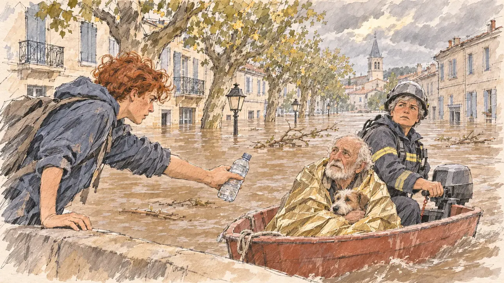

# `floods` · Crues historiques

**Validée par le PO le 31/10/2026**, au premier essai. Elle sert telle quelle en clair et en sombre.



| Champ | Valeur |
| --- | --- |
| Carte | `floods`, catégorie `crisis` (Crise) |
| Style | Reportage dessiné |
| Ton | Tendu et sobre |
| Date | 2026-10-31 |
| Outil | ChatGPT avec le modèle GPT Sol 6.1 en effort « light », et ChatGPT Images 2.5 |
| Conversation | À remplir (le lien ne s'ouvre qu'avec le compte qui l'a créée) |
| Format rendu | 1673 × 940 (16:9) : export en 1290 × 726 px, WebP de qualité 75, 239 Ko, sans recadrage ; réexportée le 01/11/2026, après une première version en qualité 45 pour tenir 180 Ko |
| Fichier d'origine | PNG de ChatGPT, chez le PO. L'export du dépôt a été fait depuis la copie partagée dans la conversation avec Claude |
| Première édition | `kit-france-2611-0001` |

## Texte de la carte

> **Crues historiques**
>
> Des crues historiques noient plusieurs villages du Sud-Ouest. Les images tournent en boucle et le climat revient au cœur du débat.

## Le moment choisi

Un village du Sud-Ouest, le matin qui suit la crue, vu depuis le vieux pont où l'eau s'arrête. Un bateau de secours orange arrive : une pompière à la barre, un vieil homme dans une couverture de survie qui serre son chien. Sur le pont, un bénévole tend une bouteille d'eau.

## Prompt complet

Dans une nouvelle conversation, avec [`oldTweet.webp`](../../illustrations/polemic/oldTweet.webp) comme seule image de référence :

```
Use the attached image as the style reference: the same pencil and ink drawing with loose watercolour washes and warm paper grain. Faces, hands and objects are drawn with visible ink lines, never photographic. Not the same scene.

Editorial illustration, landscape 16:9 (1536 × 864 px), filling the whole frame edge to edge. A village in south-western France, the morning after historic floods in 2027. The main street has become a brown river up to the ground-floor windows of the old stone houses; plane trees and the church tower rise from the water under a heavy, clearing sky. The scene is seen from the old stone bridge where the water stops, the player's candidate staying off-camera: in the foreground, only the wet parapet of the bridge. In the right third, an orange rescue boat comes towards the bridge: at the motor, a sturdy firefighter in her forties with short grey hair under her helmet glances up at the viewer, her face above mid-height; in the boat, a frail old man with a white beard, wrapped in a survival blanket, holds a small dog. On a first-floor balcony, a round, bald man in braces and a woman with a long grey plait wait their turn. On the bridge, a lanky young volunteer with red curly hair hands out bottles of water, and a drone hovers above the street, filming. Nothing on the houses, the boat or the signs is readable.

Style: Reportage drawing made on the spot, like a press illustrator or courtroom sketch artist: pencil and ink with loose watercolour washes, lively unfinished lines, white paper showing through.

Palette: navy #13203F, vellum #F5EFE1, gold #A9802A, brick #B5523B, ochre #D9A441, sage #8FA58A, slate #5E7186, sand #DCC8A4, warm grey #8C8279; use 4 to 6 of them, subtle warm paper grain.

Tone: tense and sober, grey morning light breaking through the clouds, reflections on the muddy water.

Constraints: realistic proportions, expressive but not caricatured faces, people of varied ages, genders, origins and body types (heavy, stocky, round, tall, short, wiry, not only slim), each with a distinct face and haircut (no two people alike), drawn with respect and never as a joke; anatomically correct hands with exactly five fingers, few hands visible, the others in pockets, behind objects or out of frame; no readable text anywhere (houses, signs, labels and screens stay unreadable); no captions or speech bubbles; no logos, flags or political party colours; no recognisable real person, no lookalike of a real politician; no explicit violence, no injured person; no oil-paint texture, no white or ragged border.

Format: if 16:9 is not available, make 1536 × 1024 and keep the top 80 px and the bottom 80 px free of anything important (faces, hands, the main action): they will be cropped.
```

Le générateur n'a dessiné ni le couple au balcon ni le drone. Le PO garde l'image sans eux.

## Essais écartés

Aucun.

## Retouches

Aucune.

## Relecture

Faite et validée par le PO le 31/10/2026.

- [x] Aucun texte lisible : ni sur les maisons, ni sur le bateau.
- [x] Aucun sosie d'une personne réelle.
- [x] Le candidat du joueur est hors champ.
- [x] Mains, visages et foules sans défaut visible à 343 px de large.
- [x] Aucune couleur de parti, aucun symbole officiel. Pas de blessé.
- [x] En 3:2 : rien d'important dans les 80 px du haut et du bas. Sans objet ici : l'image est en 16:9.
- [x] Lisible sur la page de l'événement, en clair et en sombre.

## Régénération demandée (04/11/2026)

**Pourquoi.** La revue de la première série note le style à 2/3 et les détails à 2/3 : la scène est claire, mais c'est une peinture numérique finie sous une texture en pointillés (le muret du premier plan est fait de petits carreaux réguliers, comme un filtre), avec un ciel dramatique peint, une couverture de survie brillante et des visages modelés. Le canot est d'un orange vif hors palette, sans équivalent dans les neuf couleurs du gabarit. Toute la rue du village est peinte jusqu'au fond (platanes, façades et balcons, réverbères, clocher, cyprès, collines, débris dans l'eau) : le fond n'est jamais suggéré. Le PO a décidé de régénérer l'image.

**Ce qui reste.** Le moment : le matin après la crue, vu depuis le vieux pont, le canot de secours qui arrive vers la droite, la pompière à la barre qui lève les yeux vers le spectateur, le vieil homme à la barbe blanche enveloppé dans une couverture de survie avec son chien, le bénévole roux qui tend une bouteille d'eau depuis le pont.

**Ce qui change.** Le canot devient brique (`#B5523B`), plus orange. Le village se réduit à un clocher, trois ou quatre façades et des platanes, en quelques traits ; sortent du décor les balcons, réverbères, cyprès, collines et débris. Le muret du premier plan est tracé en longues lignes sous un lavis, sans carreaux réguliers ni pointillés ; l'eau et le ciel sont des lavis plats ; la couverture de survie est d'un or pâle, sans reflet.

### Prompt de régénération

Dans une nouvelle conversation, avec [`oldTweet.webp`](../../illustrations/polemic/oldTweet.webp) comme seule image de référence.

```
Use the attached image as the style reference and copy its drawing: a realistic reportage drawing made on the spot for a newspaper, with quick, nervous pencil lines, often drawn twice, ink hatching in the shadows, transparent watercolour washes that spill a little over the lines, and the warm paper showing through. Not the same scene.
Like in the reference, the setting can be full when the story needs it, with the things that say where we are and what is happening, but each one is sketched with a few pencil lines and a light wash, never rendered or finished, and the drawing gets looser and paler towards the edges until it fades into the bare paper.
This must look like a drawing made by hand on paper by a press illustrator, halfway between a quick sketch and a realistic picture: never a photograph, a film poster or a digital painting, and never a cartoon, a comic strip, a caricature or a children's book illustration. Continuous lines, never dotted or dashed outlines; no uniform texture, speckles or hatching filter laid over the picture; no glossy highlights, no smooth gradients, in the sky and on the walls too. Colour can be rich in places, on a piece of clothing, a light or a flag, but it stays transparent and within the palette below. The fade into the paper at the edges stays narrow, without a wide white margin. No blur and no depth-of-field effect: everything, the foreground included, is drawn sharp, like a sketch made on the spot.
People are drawn from life with realistic anatomy and proportions, like in the reference: faces shaped with pencil lines, hatching and light washes, a little more finished than the background but never photographic (no photographic skin, no airbrushed or digital-painting look). Expressions stay natural and restrained, even in laughter or tears: no exaggerated grins, no wide-open mouths full of teeth, no rubbery or cartoonish faces.

Editorial illustration, landscape 16:9 (1536 × 864 px), the scene filling the frame, with only a light fade into the paper at the edges. A village in south-western France, the morning after historic floods in 2027. The main street has become a brown river up to the ground-floor windows; the village is only suggested, in a few pencil lines and pale washes, with the paper left bare: a church tower, three or four stone façades with shutters and a row of plane trees, no more. The scene is seen from the old stone bridge where the water stops, the player's candidate staying off-camera: in the foreground, only the wet stone parapet of the bridge, drawn with a few long ink lines and one flat wash, no regular tile pattern and no dotted texture. In the right third, a rescue boat in brick red (#B5523B), not bright orange, comes towards the bridge: at the motor, a sturdy firefighter in her forties with short grey hair under a slate-grey helmet glances up at the viewer, her face above mid-height; in the boat, a frail old man with a white beard, wrapped in a pale gold survival blanket, holds a small dog. On the bridge, on the left, a lanky young volunteer with red curly hair leans over the parapet and hands out a bottle of water. The water is a flat wash of sand and warm grey with a few horizontal ink lines, the sky a light grey-blue wash. Nothing on the houses or the boat is readable.

Style: Reportage drawing made on the spot, like a press illustrator or courtroom sketch artist: pencil and ink with loose watercolour washes, lively unfinished lines, white paper showing through.

Palette: navy #13203F, vellum #F5EFE1, gold #A9802A, brick #B5523B, ochre #D9A441, sage #8FA58A, slate #5E7186, sand #DCC8A4, warm grey #8C8279; use 4 to 6 of them, subtle warm paper grain.

Tone: tense and sober, grey morning light breaking through the clouds.

Constraints: realistic proportions, natural expressions, never cartoonish or caricatured faces, drawn like the rest of the illustration and never photographic; people of varied ages, genders, origins and body types (heavy, stocky, round, tall, short, wiry, not only slim), each with a distinct face and haircut (no two people alike), drawn with respect and never as a joke; anatomically correct hands with exactly five fingers, few hands visible, the others in pockets, behind objects or out of frame; no readable text anywhere (the houses and the boat stay unreadable); no captions or speech bubbles; no logos or political party colours; no recognisable real person, no lookalike of a real politician; no explicit violence, no injured person; no photographic rendering, no blur or bokeh, no dotted outlines, no texture or hatching filter over the picture, no oil-paint texture, no wide white margin or frame (a light fade into the paper at the edges is fine).

Format: if 16:9 is not available, make 1536 × 1024 and keep the top 80 px and the bottom 80 px free of anything important (faces, hands, the main action): they will be cropped.
```
