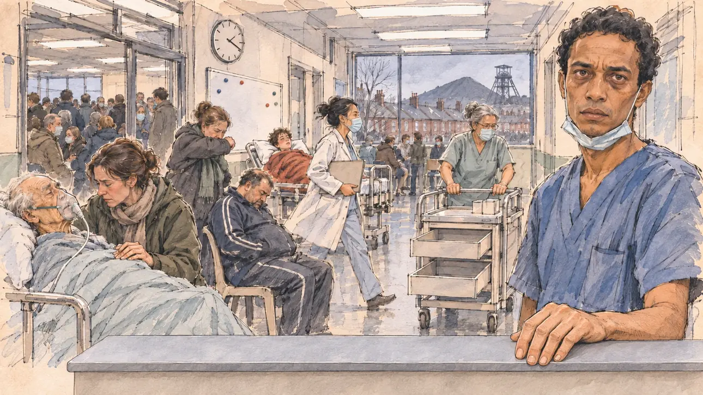

# `fluSurge` · Grippe : les urgences débordent

**Validée par le PO le 05/11/2026**, au premier essai, avec `primeTime.webp` comme référence. Elle sert telle quelle en clair et en sombre.



| Champ | Valeur |
| --- | --- |
| Carte | `fluSurge`, catégorie `crisis` (Crise), carte ajoutée par la PR #297 de l'app |
| Style | Reportage dessiné, trait de `primeTime` |
| Ton | Tendu et sobre |
| Date | 2026-11-05 |
| Outil | ChatGPT Images |
| Conversation | À remplir (le lien ne s'ouvre qu'avec le compte qui l'a créée) |
| Format rendu | 1672 × 941 (16:9) : export en 1290 × 726 px, WebP de qualité 75, 150 Ko, sans recadrage |
| Fichier d'origine | Image de ChatGPT, chez le PO. L'export du dépôt a été fait depuis la copie partagée dans la conversation avec Claude |
| Première édition | La prochaine Release qui suit le merge de la PR #297 de l'app |

## Texte de la carte

> **Grippe : les urgences débordent**
>
> L'épidémie de grippe sature les urgences : brancards dans les couloirs, pharmacies à court de médicaments, soignants épuisés. Vos propres permanences se vident de leurs bénévoles malades.

## Le moment choisi

Le couloir des urgences d'un hôpital de Valenciennes, à la fin d'un après-midi gris de février, vu depuis le bout du couloir où le candidat (hors champ) vient en visite : au premier plan, le bord d'un brancard et une couverture pliée. Un infirmier épuisé, le masque baissé sous le menton, regarde le candidat. Autour : les brancards alignés le long du mur, des patients sous des couvertures, une médecin qui passe en courant, un chariot de médicaments aux tiroirs vides, la salle d'attente pleine. Par la fenêtre : les maisons de brique en rangée, un terril et le chevalement d'un ancien puits de mine sous le ciel bas.

## Prompt complet

Dans une nouvelle conversation, avec [`primeTime.webp`](../../illustrations/media/primeTime.webp) comme seule image de référence.

```
Use the attached image as the style reference and copy its drawing: a realistic reportage drawing made on the spot for a newspaper, with quick, nervous pencil lines, often drawn twice, ink hatching in the shadows, transparent watercolour washes that spill a little over the lines, and the warm paper showing through. Not the same scene and not the same people: never reuse the face or the hair of the woman in the reference.
Like in the reference, the setting can be full when the story needs it, with the things that say where we are and what is happening, but each one is sketched with a few pencil lines and a light wash, never rendered or finished, and the drawing gets looser and paler towards the edges until it fades into the bare paper.
This must look like a drawing made by hand on paper by a press illustrator, halfway between a quick sketch and a realistic picture: never a photograph, a film poster or a digital painting, and never a cartoon, a comic strip, a caricature or a children's book illustration. Continuous lines, never dotted or dashed outlines; no uniform texture, speckles or hatching filter laid over the picture; no glossy highlights, no smooth gradients, in the sky and on the walls too. Colour can be rich in places, on a piece of clothing, a light or a flag, but it stays transparent and within the palette below. The fade into the paper at the edges stays narrow, without a wide white margin. No blur and no depth-of-field effect: everything, the foreground included, is drawn sharp, like a sketch made on the spot.
People are drawn from life with realistic anatomy and proportions, like in the reference: faces shaped with pencil lines, hatching and light washes, a little more finished than the background but never photographic (no photographic skin, no airbrushed or digital-painting look). Expressions stay natural and restrained, even in laughter or tears: no exaggerated grins, no wide-open mouths full of teeth, no rubbery or cartoonish faces.

Editorial illustration, landscape 16:9 (1536 × 864 px), the scene filling the frame, with only a light fade into the paper at the edges. The corridor of the emergency department of a hospital in Valenciennes, in the Nord, at the end of a grey afternoon in February 2027, at the peak of a flu epidemic that saturates the emergency rooms: stretchers in the corridors, pharmacies running out of medicines, exhausted carers. The scene is seen from the end of the corridor where the player's candidate comes for a visit, who stays off-camera: in the foreground, only the metal edge of an empty stretcher with a folded pale blue blanket on it. In the right third, an emergency nurse in his thirties of Malagasy origin, slim, with short curly black hair and dark circles under his eyes, in a blue scrub top with a surgical mask pulled down under his chin, one hand resting on the rail of a stretcher, looks straight at the viewer with an exhausted, reproachful look, his face above mid-height. Around him, sketched in pencil and light washes: stretchers lined up along the wall of the corridor with patients under blankets: a very old man with an oxygen mask and his daughter holding his hand, a woman in her forties coughing into her elbow, a heavy-set man in a tracksuit dozing on a plastic chair, a teenager with a feverish face wrapped in a red blanket; a young woman doctor of Chinese origin with her hair tied up, hurrying past with a file under her arm; a nurse in her fifties with a grey bun, a mask on her face, pushing a medicine trolley with its drawers half open and empty; further away, through a glass door, the waiting room packed with people in coats, some wearing masks; a whiteboard covered with coloured magnets and a wall clock. Through a big window at the end of the corridor, the Nord: rows of red-brick terraced miners' houses with their chimneys, the dark cone of a slag heap and the steel headframe of an old mine shaft under a low grey sky. Only the nurse looks straight at the viewer. Nothing on the whiteboard, the files, the wristbands, the signs, the trolley or the scrubs is readable, and no logo of a real hospital appears.

Style: Reportage drawing made on the spot, like a press illustrator or courtroom sketch artist: pencil and ink with loose watercolour washes, lively unfinished lines, white paper showing through.

Palette: navy #13203F, vellum #F5EFE1, gold #A9802A, brick #B5523B, ochre #D9A441, sage #8FA58A, slate #5E7186, sand #DCC8A4, warm grey #8C8279; use 4 to 6 of them, subtle warm paper grain.

Tone: tense and sober, the harsh white neon light of the corridor, the pale blue and green of the scrubs and the blankets, the low grey sky over the red brick through the window, and the red blanket of the teenager as the one warm patch.

Constraints: realistic proportions, natural expressions, never cartoonish or caricatured faces, drawn like the rest of the illustration and never photographic; people of varied ages, genders, origins and body types (heavy, stocky, round, tall, short, wiry, not only slim), each with a distinct face and haircut (no two people alike), drawn with respect and never as a joke; anatomically correct hands with exactly five fingers, few hands visible, the others in pockets, behind objects or out of frame; no readable text anywhere (the whiteboard, the files, the wristbands, the signs, the trolley and the scrubs stay unreadable); no captions or speech bubbles; no logos or political party colours; no recognisable real person, no lookalike of a real politician, and no logo of a real hospital; no explicit violence; no photographic rendering, no blur or bokeh, no dotted outlines, no texture or hatching filter over the picture, no oil-paint texture, no wide white margin or frame (a light fade into the paper at the edges is fine).

Format: if 16:9 is not available, make 1536 × 1024 and keep the top 80 px and the bottom 80 px free of anything important (faces, hands, the main action): they will be cropped.
```

## Décisions prises sur cette image

Aucune.

## Essais écartés

Aucun.

## Retouches

Aucune.

## Relecture

Faite et validée par le PO le 05/11/2026.

- [x] Aucun texte lisible : l'horloge n'a pas de chiffres, le tableau blanc n'a que des aimants ; rien n'est lisible sur les dossiers, les bracelets, les panneaux, le chariot ni les tenues.
- [x] Aucun sosie d'une personne réelle.
- [x] Le candidat du joueur est hors champ.
- [x] Mains, visages et foules sans défaut visible à 343 px de large.
- [x] Aucune couleur ni aucun logo de parti. Des personnes variées par l'âge, le corps, l'origine et la coiffure.
- [x] En 3:2 : sans objet, l'image est en 16:9.
- [x] Lisible sur la page de l'événement, en clair et en sombre.

Ce que la relecture a accepté : au premier plan, un bord gris de comptoir ou de brancard, sans la couverture pliée, sur lequel l'infirmier pose la main ; le survêtement de l'homme assoupi n'a que deux bandes, aucune marque.
