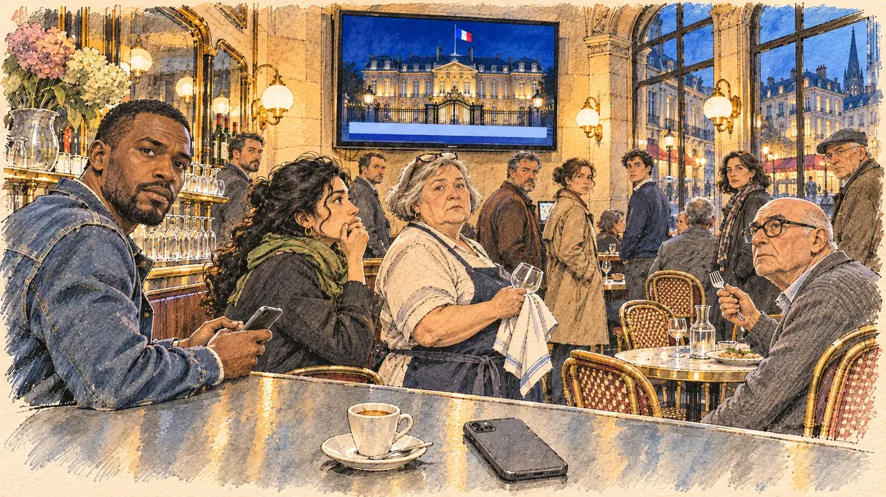

# `militiaArticle16` · L'article 16

**Proposée au PO le 25/11/2026**, au premier essai, avec `primeTime.webp` comme référence et le prompt mis à jour le même jour sur les visages. Elle sert telle quelle en clair et en sombre.



| Champ | Valeur |
| --- | --- |
| Carte | `militiaArticle16`, catégorie `crisis` (Crise), troisième et dernier jour de la crise des milices, carte ajoutée par la PR #533 de l'app (Mitchnsun/moi-president#205) |
| Style | Reportage dessiné, trait de `primeTime`, visages dessinés ; un léger moucheté sur toute l'image |
| Ton | Grave et silencieux |
| Date | 2026-11-25 |
| Outil | ChatGPT Images |
| Format rendu | 1672 × 941 (16:9) : export en 1290 × 726 px, WebP de qualité 75, 255 Ko, sans recadrage |
| Fichier d'origine | Image de ChatGPT, chez le PO. L'export du dépôt a été fait depuis la copie partagée dans la conversation avec Claude |
| Première édition | La prochaine Release qui suit le merge de la PR #533 de l'app |

## Texte de la carte

> **L'article 16**
>
> Le président sortant consulte le Premier ministre, les présidents des assemblées et le Conseil constitutionnel, puis invoque l'article 16 et suspend le processus électoral. Le premier tour n'aura pas lieu, et il reste à l'Élysée au-delà de la fin de son mandat.

Réponses : « S'adresser à la nation » (jet de Charisme) et « Aller sur les barrages » (jet de Proximité), chacun de difficulté 18 − 15 × la part d'extrême droite dans l'électorat du joueur, entre 11 et 18 ; « Se taire », sans jet. Une réussite apaise la crise et le vote aura lieu ; sinon, la campagne s'arrête sur « Pays paralysé ». La carte n'est jamais tirée au hasard : elle suit le jour 2 (`militiaEmergency`) quand il n'a pas apaisé la crise, la même semaine.

## Le moment choisi

À 20 heures, dans une brasserie de Bordeaux, pierre blonde, miroirs et zinc. Toute la salle s'est levée devant l'écran, qui ne montre que la façade de l'Élysée la nuit sous un bandeau d'alerte. Puis les clients se tournent vers le candidat, venu boire un verre avec son équipe : un homme qui tient son téléphone, la patronne qui a cessé d'essuyer un verre, un vieil homme figé, la fourchette en l'air. Au premier plan, l'expresso du candidat et son téléphone retourné sur le zinc.

## Prompt complet

Dans une nouvelle conversation, avec [`primeTime.webp`](../../illustrations/media/primeTime.webp) comme seule image de référence :

```
Use the attached image as the style reference and copy its drawing: a realistic reportage drawing made on the spot for a newspaper, with quick, nervous pencil lines, often drawn twice, ink hatching in the shadows, transparent watercolour washes that spill a little over the lines, and the warm paper showing through. Take from the reference its line, its washes and its paper, not the finish of the presenter's face, which is the most finished and almost photographic part of it: every face here stays a drawing. Not the same scene and not the same people: never reuse the face or the hair of the woman in the reference.
Like in the reference, the setting can be full when the story needs it, with the things that say where we are and what is happening, but each one is sketched with a few pencil lines and a light wash, never rendered or finished, and the drawing gets looser and paler towards the edges until it fades into the bare paper.
This must look like a drawing made by hand on paper by a press illustrator, halfway between a quick sketch and a realistic picture: never a photograph, a film poster or a digital painting, and never a cartoon, a comic strip, a caricature or a children's book illustration. Continuous lines, never dotted or dashed outlines; the paper grain is the paper itself, never a mottled texture, speckles or hatching filter laid over the picture; no glossy highlights, no smooth gradients, in the sky and on the walls too. Colour can be rich in places, on a piece of clothing, a light or a flag, but it stays transparent and within the palette below. The fade into the paper at the edges stays narrow, without a wide white margin. No blur and no depth-of-field effect: everything, the foreground included, is drawn sharp, like a sketch made on the spot.
People are drawn from life with realistic anatomy and proportions: each face is drawn with the same visible pencil and ink lines, hatching and transparent washes as the clothes and the room, looser and sketchier than the presenter's face in the reference, with realistic features but never photographic (no photographic skin, no smooth shading, no airbrushed or digital-painting look). Expressions stay natural and restrained, even in laughter or tears: no exaggerated grins, no wide-open mouths full of teeth, no rubbery or cartoonish faces.

Editorial illustration, landscape 16:9 (1536 × 864 px), the scene filling the frame, with only a light fade into the paper at the edges. An evening in spring 2027, at 8 p.m., in a traditional brasserie in Bordeaux, with blond limestone walls, mirrors, a long zinc bar and bistro tables, and through the windows the blond stone facades of the city under the street lamps: everyone has stood up to watch a television above the bar, where the outgoing president has just invoked article 16 and suspended the election. The screen shows only the illuminated facade of the Élysée Palace at night, with the French flag over its gate, and a plain news banner, unreadable; nobody on the screen. The player's candidate, who was having a drink there with the team, stays off-camera, the scene seen from their place at the bar: in the foreground, only a small espresso cup on its saucer and the candidate's phone lying face down on the zinc. In the left third, the main character, a tall man in his thirties of Haitian origin, with a short beard and close-cropped hair, in a denim jacket, has turned from the screen towards the viewer, his phone in his hand, and looks at the viewer with a stunned, expectant face, his face above mid-height. Beside him, a young woman of Kurdish origin with long black curls, in a green scarf, holds her hand to her mouth, her eyes still on the screen. Behind the bar, the owner, a heavy-set woman in her sixties with a short grey bob and glasses on her head, has stopped drying a glass and looks at the viewer. At a table, an older man of Portuguese origin, bald, with thick-rimmed glasses and a grey cardigan, sits very still, his fork in the air, watching the screen. Most of the room turns towards the viewer, the centre of attention, without posing. Every object is held by a visible person or rests on a surface; nothing floats. No crowd fighting, no weapon, no party colours. Nothing on the screen, the banner, the menus, the bottles or the mirrors is readable.

Style: Reportage drawing made on the spot, like a press illustrator or courtroom sketch artist: pencil and ink with loose watercolour washes, lively unfinished lines, white paper showing through.

Palette: navy #13203F, vellum #F5EFE1, gold #A9802A, brick #B5523B, ochre #D9A441, sage #8FA58A, slate #5E7186, sand #DCC8A4, warm grey #8C8279; use 4 to 6 of them, subtle warm paper grain.

Tone: grave and silent, the warm golden light of the brasserie against the cold blue glow of the television, a whole room frozen by the news.

Constraints: realistic proportions, natural expressions, never cartoonish or caricatured faces, drawn like the rest of the illustration and never photographic; people of varied ages, genders, origins and body types (heavy, stocky, round, tall, short, wiry, not only slim), each with a distinct face and haircut (no two people alike), drawn with respect and never as a joke; each person's age, build and look plausible for their job and the scene (working people of working age), no stereotype tying an origin or a gender to a role, and no person of colour shown alone in a featured service or deferential role; anatomically correct hands with exactly five fingers, few hands visible, the others in pockets, behind objects or out of frame; every object is held by a visible person or rests on a surface, nothing floats in the air and no hand comes in from the edges of the picture; no readable text anywhere (the screen, the banner, the menus, the bottles and the mirrors stay unreadable, no channel logo); no captions or speech bubbles; no logos or political party colours; no recognisable real person, no lookalike of a real politician, and no person at all on the television screen; no explicit violence; no photographic rendering, no blur or bokeh, no dotted outlines, no texture or hatching filter over the picture, no oil-paint texture, no wide white margin or frame (a light fade into the paper at the edges is fine).

Format: if 16:9 is not available, make 1536 × 1024 and keep the top 80 px and the bottom 80 px free of anything important (faces, hands, the main action): they will be cropped.

```

## Décisions prises sur cette image

- Le président sortant n'est jamais nommé ni montré (#205) : l'écran ne montre que l'Élysée, un monument réel.
- Une salle qui regarde le candidat, sa règle du gabarit pour les scènes de foule autour du candidat (PO, 25/11/2026).
- Bordeaux, une ville que la série n'avait pas encore montrée.

## Essais écartés

Aucun.

## Retouches

Aucune.

## Relecture

Faite par Claude le 25/11/2026, à valider par le PO.

- [x] Aucun texte lisible : le bandeau de l'écran n'a que deux barres de couleur, les bouteilles et les miroirs n'ont rien d'écrit ; une pseudo-marque minuscule sur le cadre du téléviseur, illisible à 343 px.
- [x] Personne à l'écran, aucun sosie d'une personne réelle, aucun responsable politique.
- [x] Le candidat du joueur est hors champ ; son expresso et son téléphone retourné sont au premier plan.
- [x] Mains et visages sans défaut visible à 343 px de large : le téléphone, le verre et le torchon, la fourchette.
- [x] Aucune couleur ni aucun logo de parti ; le drapeau tricolore signale l'Élysée.
- [ ] Un léger moucheté blanc couvre toute l'image : à juger par le PO.
- [x] En 3:2 : sans objet, l'image est en 16:9.
- [x] Lisible sur la page de l'événement, en clair et en sombre : vérifié dans l'app web de la PR #533 (Chromium, 420 px), le kit servi en local, le 25/11/2026.
