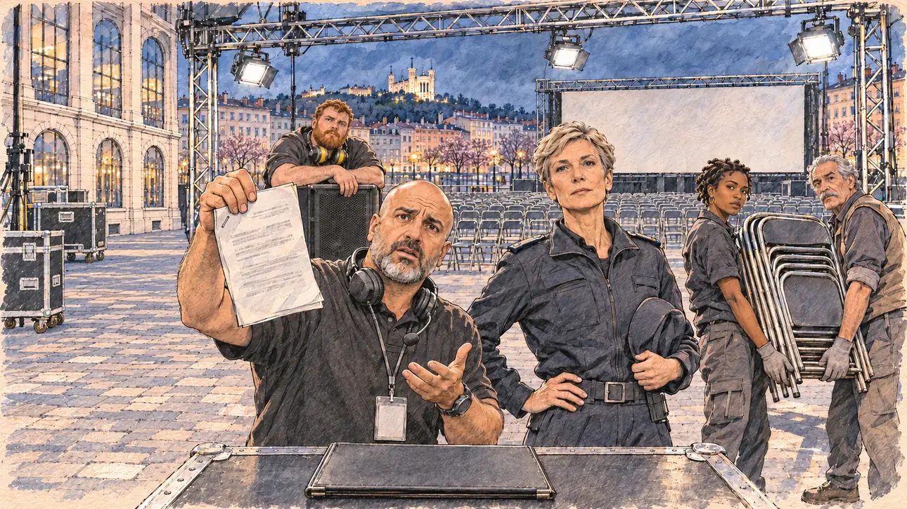

# `militiaEmergency` · L'état d'urgence

**Proposée au PO le 25/11/2026**, au premier essai, avec `primeTime.webp` comme référence et le prompt mis à jour le même jour sur les visages. Elle sert telle quelle en clair et en sombre.



| Champ | Valeur |
| --- | --- |
| Carte | `militiaEmergency`, catégorie `crisis` (Crise), deuxième jour de la crise des milices, carte ajoutée par la PR #533 de l'app (Mitchnsun/moi-president#205) |
| Style | Reportage dessiné, trait de `primeTime`, visages dessinés |
| Ton | Tendu |
| Date | 2026-11-25 |
| Outil | ChatGPT Images |
| Conversation | À remplir (le lien ne s'ouvre qu'avec le compte qui l'a créée) |
| Format rendu | 1672 × 941 (16:9) : export en 1290 × 726 px, WebP de qualité 75, 218 Ko, sans recadrage |
| Fichier d'origine | Image de ChatGPT, chez le PO. L'export du dépôt a été fait depuis la copie partagée dans la conversation avec Claude |
| Première édition | La prochaine Release qui suit le merge de la PR #533 de l'app |

## Texte de la carte

> **L'état d'urgence**
>
> L'état d'urgence est décrété en Conseil des ministres. Couvre-feu, rassemblements et meetings sont interdits dans les départements touchés. Le pays est au bord de la guerre civile.

Réponses : « Respecter l'état d'urgence » (jet d'Intégrité) et « Saisir le Conseil d'État » (jet d'Expertise), chacun de difficulté 18 − 15 × la part d'extrême droite dans l'électorat du joueur, entre 11 et 18 ; « Maintenir ses meetings », sans jet, qui relance les heurts. Une réussite apaise la crise ; sinon, le jour 3 suit (`militiaArticle16`). La carte n'est jamais tirée au hasard : elle suit le jour 1 (`militiaRiots`) quand il n'a pas apaisé la crise, la même semaine.

## Le moment choisi

À Lyon, quelques heures avant le meeting du soir, la colline de Fourvière derrière la scène. Une commissaire de police vient d'apporter l'arrêté qui interdit le rassemblement : le responsable de l'événement le brandit vers le candidat, sur scène ; l'équipe technique et les bénévoles s'arrêtent et le regardent. Au premier plan, le discours du candidat dans son classeur fermé, posé sur une flight-case.

## Prompt complet

Dans une nouvelle conversation, avec [`primeTime.webp`](../../illustrations/media/primeTime.webp) comme seule image de référence :

```
Use the attached image as the style reference and copy its drawing: a realistic reportage drawing made on the spot for a newspaper, with quick, nervous pencil lines, often drawn twice, ink hatching in the shadows, transparent watercolour washes that spill a little over the lines, and the warm paper showing through. Take from the reference its line, its washes and its paper, not the finish of the presenter's face, which is the most finished and almost photographic part of it: every face here stays a drawing. Not the same scene and not the same people: never reuse the face or the hair of the woman in the reference.
Like in the reference, the setting can be full when the story needs it, with the things that say where we are and what is happening, but each one is sketched with a few pencil lines and a light wash, never rendered or finished, and the drawing gets looser and paler towards the edges until it fades into the bare paper.
This must look like a drawing made by hand on paper by a press illustrator, halfway between a quick sketch and a realistic picture: never a photograph, a film poster or a digital painting, and never a cartoon, a comic strip, a caricature or a children's book illustration. Continuous lines, never dotted or dashed outlines; the paper grain is the paper itself, never a mottled texture, speckles or hatching filter laid over the picture; no glossy highlights, no smooth gradients, in the sky and on the walls too. Colour can be rich in places, on a piece of clothing, a light or a flag, but it stays transparent and within the palette below. The fade into the paper at the edges stays narrow, without a wide white margin. No blur and no depth-of-field effect: everything, the foreground included, is drawn sharp, like a sketch made on the spot.
People are drawn from life with realistic anatomy and proportions: each face is drawn with the same visible pencil and ink lines, hatching and transparent washes as the clothes and the room, looser and sketchier than the presenter's face in the reference, with realistic features but never photographic (no photographic skin, no smooth shading, no airbrushed or digital-painting look). Expressions stay natural and restrained, even in laughter or tears: no exaggerated grins, no wide-open mouths full of teeth, no rubbery or cartoonish faces.

Editorial illustration, landscape 16:9 (1536 × 864 px), the scene filling the frame, with only a light fade into the paper at the edges. Late afternoon in spring 2027, in a large concert hall in Lyon being set up for the player's candidate's evening rally, a few hours before the doors open: rows of empty folding chairs, a lighting truss half raised, flight cases, cables on the floor, a big blank screen at the back, and through the high windows the pastel facades of Lyon and the hill of Fourvière under a heavy sky. The state of emergency has just been declared: rallies are banned and a curfew starts tonight. The player's candidate stays off-camera, on the stage, the scene seen from their place: in the foreground, only the edge of the stage with the candidate's speech in a closed black binder resting on a flight case, nothing readable. In the middle of the scene, just below the stage, the main character, the event manager of the campaign, a round man in his forties of Lebanese origin, bald, with a trimmed grey beard and a headset around his neck, in a black polo shirt, holds up a stapled official order in his own hand, its text unreadable, and looks at the viewer with a dismayed, questioning face, his face above mid-height. Beside him, the police commissioner who brought the order, a tall woman in her fifties with short ash-blond hair, in a dark uniform with her cap under her arm, waits with a calm, firm face, looking at the viewer. Around them, the crew has stopped working and looks towards the viewer: a young lighting technician of Peruvian origin, slim, with a long black ponytail, on a stepladder, a coil of cable on her shoulder; a stocky sound technician in his thirties with a red beard and ear defenders around his neck, his hands on a speaker cabinet; two volunteers holding a stack of chairs between them, a young woman of Guadeloupean origin with short twists and an older man with a grey moustache. Most people look at the viewer, the centre of attention, without posing. Every object is held by a visible person or rests on a surface; nothing floats. No crowd, no fighting, no weapon, no party colours, no banner with a slogan. Nothing on the order, the binder, the flight cases, the screen or the uniforms is readable.

Style: Reportage drawing made on the spot, like a press illustrator or courtroom sketch artist: pencil and ink with loose watercolour washes, lively unfinished lines, white paper showing through.

Palette: navy #13203F, vellum #F5EFE1, gold #A9802A, brick #B5523B, ochre #D9A441, sage #8FA58A, slate #5E7186, sand #DCC8A4, warm grey #8C8279; use 4 to 6 of them, subtle warm paper grain.

Tone: tense, the cold work lights of the empty hall against the stormy late-afternoon sky in the windows, hard shadows, a show stopped before it began.

Constraints: realistic proportions, natural expressions, never cartoonish or caricatured faces, drawn like the rest of the illustration and never photographic; people of varied ages, genders, origins and body types (heavy, stocky, round, tall, short, wiry, not only slim), each with a distinct face and haircut (no two people alike), drawn with respect and never as a joke; each person's age, build and look plausible for their job and the scene (working people of working age), no stereotype tying an origin or a gender to a role, and no person of colour shown alone in a featured service or deferential role; anatomically correct hands with exactly five fingers, few hands visible, the others in pockets, behind objects or out of frame; every object is held by a visible person or rests on a surface, nothing floats in the air and no hand comes in from the edges of the picture; no readable text anywhere (the order, the binder, the flight cases, the screen and the uniforms stay unreadable, no police lettering); no captions or speech bubbles; no logos, flags of a party, emblems or political party colours; no recognisable real person, no lookalike of a real politician; no explicit violence, no fighting, no weapon drawn; no photographic rendering, no blur or bokeh, no dotted outlines, no texture or hatching filter over the picture, no oil-paint texture, no wide white margin or frame (a light fade into the paper at the edges is fine).

Format: if 16:9 is not available, make 1536 × 1024 and keep the top 80 px and the bottom 80 px free of anything important (faces, hands, the main action): they will be cropped.

```

## Décisions prises sur cette image

- Une scène de meeting : presque tout le monde regarde le candidat, sa règle du gabarit (PO, 25/11/2026).
- L'interdiction dite par l'arrêté brandi et la commissaire, sans affrontement ni arme sortie.
- Lyon, une ville que la série des cartes de l'inéligibilité n'avait pas encore montrée.

## Essais écartés

Aucun.

## Retouches

Aucune.

## Relecture

Faite par Claude le 25/11/2026, à valider par le PO.

- [x] Aucun texte lisible : l'arrêté ne porte que des lignes grises, le badge est blanc, l'uniforme n'a aucune inscription.
- [x] Aucun sosie d'une personne réelle, aucun responsable politique dans l'image.
- [x] Le candidat du joueur est hors champ ; son classeur est au premier plan.
- [x] Mains et visages sans défaut visible à 343 px de large : le responsable tient l'arrêté et ouvre l'autre main, cinq doigts ; la commissaire tient sa casquette.
- [x] Aucune couleur ni aucun logo de parti, aucune arme sortie (un étui fermé à la ceinture).
- [ ] La salle de concert demandée est devenue une scène en plein air sur une place, et la technicienne sur l'escabeau n'est pas dessinée : à juger par le PO.
- [x] En 3:2 : sans objet, l'image est en 16:9.
- [ ] Lisible sur la page de l'événement, en clair et en sombre : à vérifier dans l'app, le kit installé.
