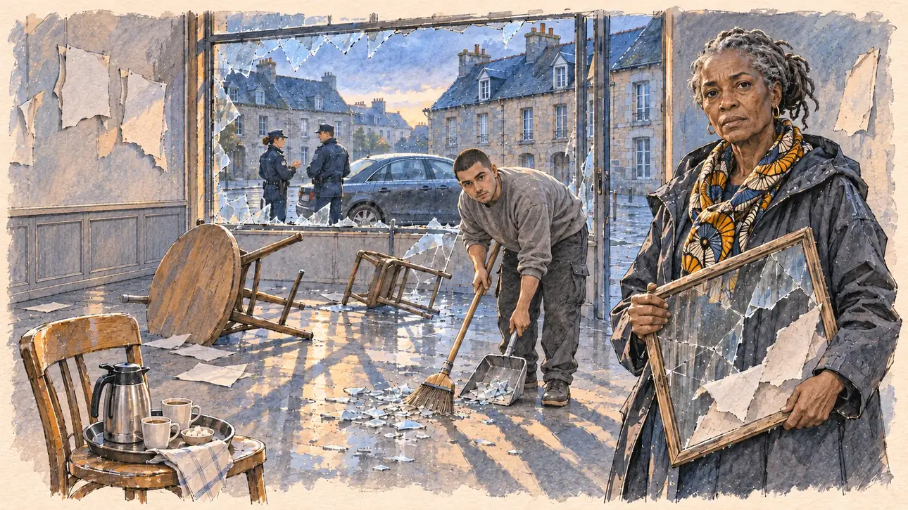

# `militiaRiots` · Les milices

**Proposée au PO le 25/11/2026**, au premier essai de la permanence saccagée, avec `primeTime.webp` comme référence et le prompt mis à jour le même jour sur les visages. Elle sert telle quelle en clair et en sombre.



| Champ | Valeur |
| --- | --- |
| Carte | `militiaRiots`, catégorie `crisis` (Crise), premier jour de la crise des milices, carte ajoutée par la PR #533 de l'app (Mitchnsun/moi-president#205) |
| Style | Reportage dessiné, trait de `primeTime`, visages dessinés ; un léger moucheté sur toute l'image |
| Ton | Tendu et sobre |
| Date | 2026-11-25 |
| Outil | ChatGPT Images |
| Conversation | À remplir (le lien ne s'ouvre qu'avec le compte qui l'a créée) |
| Format rendu | 1672 × 941 (16:9) : export en 1290 × 726 px, WebP de qualité 75, 197 Ko, sans recadrage |
| Fichier d'origine | Image de ChatGPT, chez le PO. L'export du dépôt a été fait depuis la copie partagée dans la conversation avec Claude |
| Première édition | La prochaine Release qui suit le merge de la PR #533 de l'app |

## Texte de la carte

> **Les milices**
>
> Martine La Peine ne pourra pas être candidate. Le Rassemblement Hexagonal refuse la décision et dénonce un « coup d'État des juges ». Des appels à « défendre le vote » circulent. Des groupes d'ultradroite bloquent des ronds-points, saccagent des permanences et organisent des « patrouilles » dans les centres-villes. Des vidéos montrent des policiers qui laissent faire ; le ministère de l'Intérieur dément toute complaisance.

Réponses : « Appeler au calme » (jet de Sang-froid) et « Réunir maires et syndicats » (jet de Réseau), chacun de difficulté 18 − 15 × la part d'extrême droite dans l'électorat du joueur, entre 11 et 18 ; « Comprendre la colère », sans jet, qui étend la crise. Une réussite apaise la crise ; sinon, le jour 2 suit (`militiaEmergency`). La carte n'est jamais tirée au hasard : elle suit la carte de la décision, la même semaine, dans un tiers des parties où l'inéligibilité frappe après le dépôt des parrainages (environ 1 % des parties).

## Le moment choisi

Au petit matin, la permanence locale du candidat dans une ville bretonne, saccagée dans la nuit : vitrine brisée, table renversée, affiches arrachées, tracts au sol. La responsable de l'équipe tient un cadre brisé et regarde le candidat, arrivé sur le seuil avec des cafés ; un jeune bénévole balaie le verre. Dehors, deux policiers discutent près de leur voiture sans regarder. Les miliciens ne sont pas montrés : seulement leurs traces.

## Prompt complet

Dans une nouvelle conversation, avec [`primeTime.webp`](../../illustrations/media/primeTime.webp) comme seule image de référence :

```
Use the attached image as the style reference and copy its drawing: a realistic reportage drawing made on the spot for a newspaper, with quick, nervous pencil lines, often drawn twice, ink hatching in the shadows, transparent watercolour washes that spill a little over the lines, and the warm paper showing through. Take from the reference its line, its washes and its paper, not the finish of the presenter's face, which is the most finished and almost photographic part of it: every face here stays a drawing. Not the same scene and not the same people: never reuse the face or the hair of the woman in the reference.
Like in the reference, the setting can be full when the story needs it, with the things that say where we are and what is happening, but each one is sketched with a few pencil lines and a light wash, never rendered or finished, and the drawing gets looser and paler towards the edges until it fades into the bare paper.
This must look like a drawing made by hand on paper by a press illustrator, halfway between a quick sketch and a realistic picture: never a photograph, a film poster or a digital painting, and never a cartoon, a comic strip, a caricature or a children's book illustration. Continuous lines, never dotted or dashed outlines; the paper grain is the paper itself, never a mottled texture, speckles or hatching filter laid over the picture; no glossy highlights, no smooth gradients, in the sky and on the walls too. Colour can be rich in places, on a piece of clothing, a light or a flag, but it stays transparent and within the palette below. The fade into the paper at the edges stays narrow, without a wide white margin. No blur and no depth-of-field effect: everything, the foreground included, is drawn sharp, like a sketch made on the spot.
People are drawn from life with realistic anatomy and proportions: each face is drawn with the same visible pencil and ink lines, hatching and transparent washes as the clothes and the room, looser and sketchier than the presenter's face in the reference, with realistic features but never photographic (no photographic skin, no smooth shading, no airbrushed or digital-painting look). Expressions stay natural and restrained, even in laughter or tears: no exaggerated grins, no wide-open mouths full of teeth, no rubbery or cartoonish faces.

Editorial illustration, landscape 16:9 (1536 × 864 px), the scene filling the frame, with only a light fade into the paper at the edges. Early morning in spring 2027, in the local campaign office of the player's candidate, a small shopfront office on the main street of a town in Brittany, with granite walls and a slate-roofed street outside: during the night, a group of anonymous militants has ransacked it. The large front window is smashed, broken glass glitters on the floor, a table is overturned, chairs knocked down, posters torn from the walls hang in shreds with nothing on them, and leaflets are scattered everywhere. The player's candidate stays off-camera, standing on the threshold, the scene seen from their place: in the foreground, only a cardboard tray of takeaway coffees for the team, set on a chair by the door, nothing readable on the cups. In the right third, the main character, the head of the local team, a tall woman in her fifties of Senegalese origin, with grey locs tied back and a wax-print scarf, in a dark raincoat, stands in the middle of the mess holding a broken poster frame in her own hands and looks at the viewer with a shaken, steady face, her face above mid-height. Behind her, a young volunteer of Moroccan origin, short and stocky, with a buzz cut and a grey sweatshirt, sweeps the broken glass into a dustpan and looks up at the viewer. Near the wall, an older volunteer in his late sixties, round and bald with a white goatee, in a wool cardigan, picks up the scattered leaflets, his back half turned. Through the smashed window, in the street, two police officers stand by their car, chatting, without looking at the office. Only the head of the team and the young volunteer look at the viewer. Every object is held by a visible person or rests on a surface; nothing floats. No graffiti, no slogan, no symbol, no flag anywhere; no injured person, no fire. Nothing on the posters, the leaflets, the cups, the police car or the shop signs of the street is readable.

Style: Reportage drawing made on the spot, like a press illustrator or courtroom sketch artist: pencil and ink with loose watercolour washes, lively unfinished lines, white paper showing through.

Palette: navy #13203F, vellum #F5EFE1, gold #A9802A, brick #B5523B, ochre #D9A441, sage #8FA58A, slate #5E7186, sand #DCC8A4, warm grey #8C8279; use 4 to 6 of them, subtle warm paper grain.

Tone: tense and sober, the cold grey light of an early morning after rain coming through the broken window, long shadows, the silence after the night.

Constraints: realistic proportions, natural expressions, never cartoonish or caricatured faces, drawn like the rest of the illustration and never photographic; people of varied ages, genders, origins and body types (heavy, stocky, round, tall, short, wiry, not only slim), each with a distinct face and haircut (no two people alike), drawn with respect and never as a joke; each person's age, build and look plausible for their job and the scene (working people of working age), no stereotype tying an origin or a gender to a role, and no person of colour shown alone in a featured service or deferential role; anatomically correct hands with exactly five fingers, few hands visible, the others in pockets, behind objects or out of frame; every object is held by a visible person or rests on a surface, nothing floats in the air and no hand comes in from the edges of the picture; no readable text anywhere (the posters, the leaflets, the cups, the police car and the shop signs stay unreadable); no captions or speech bubbles; no logos, flags, emblems, insignia, graffiti or political party colours, and no extremist symbol of any kind; no recognisable real person, no lookalike of a real politician; no explicit violence, no injured person, no fire, no weapon; no photographic rendering, no blur or bokeh, no dotted outlines, no texture or hatching filter over the picture, no oil-paint texture, no wide white margin or frame (a light fade into the paper at the edges is fine).

Format: if 16:9 is not available, make 1536 × 1024 and keep the top 80 px and the bottom 80 px free of anything important (faces, hands, the main action): they will be cropped.

```

## Décisions prises sur cette image

- Les règles de fiction de la crise (#205) : les milices sont des groupes anonymes, jamais le Rassemblement Hexagonal ni ses figures ; la complaisance de la police, deux policiers qui ne regardent pas.
- Ni tag, ni slogan, ni symbole, ni drapeau : une permanence saccagée en appelle, et un symbole extrémiste serait le pire défaut de la carte.
- Pas l'intérieur d'une voiture, rarement bien dessiné (PO, 25/11/2026) : la première scène proposée, un rond-point bloqué vu depuis la voiture du candidat, n'a pas été générée.

## Essais écartés

Aucun.

## Retouches

Aucune.

## Relecture

Faite par Claude le 25/11/2026, à valider par le PO.

- [x] Aucun texte lisible : les affiches arrachées et les tracts sont blancs, la voiture et la rue n'ont rien d'écrit.
- [x] Aucun tag, aucun symbole, aucun drapeau, aucun insigne.
- [x] Aucun sosie d'une personne réelle, aucun responsable politique dans l'image.
- [x] Le candidat du joueur est hors champ ; le plateau de cafés est au premier plan (une cafetière et des tasses plutôt que des gobelets).
- [x] Mains et visages sans défaut visible à 343 px de large : la responsable tient le cadre, le bénévole son balai et sa pelle.
- [x] Aucune couleur ni aucun logo de parti. Le bénévole âgé demandé n'est pas dessiné.
- [ ] Un léger moucheté blanc couvre toute l'image : à juger par le PO.
- [x] En 3:2 : sans objet, l'image est en 16:9.
- [ ] Lisible sur la page de l'événement, en clair et en sombre : à vérifier dans l'app, le kit installé.
