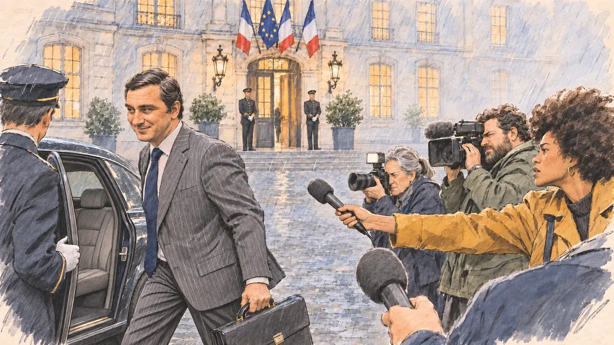

# `ministerResigns` · Démission au gouvernement

**Validée par le PO le 31/10/2026**, au premier essai. Elle sert telle quelle en clair et en sombre.



| Champ | Valeur |
| --- | --- |
| Carte | `ministerResigns`, catégorie `crisis` (Crise) |
| Style | Reportage dessiné ; certains visages restent presque photographiques |
| Ton | Tendu |
| Date | 2026-10-31 |
| Outil | ChatGPT avec le modèle GPT Sol 6.1 en effort « light », et ChatGPT Images 2.5 |
| Conversation | À remplir (le lien ne s'ouvre qu'avec le compte qui l'a créée) |
| Format rendu | 1670 × 941 (16:9) : export en 1290 × 726 px, WebP de qualité 75, 196 Ko, sans recadrage ; réexportée le 01/11/2026, après une première version en qualité 65 pour tenir 180 Ko |
| Fichier d'origine | PNG de ChatGPT, chez le PO. L'export du dépôt a été fait depuis la copie partagée dans la conversation avec Claude |
| Première édition | `kit-france-2611-0001` |

## Texte de la carte

> **Démission au gouvernement**
>
> Un secrétaire d'État démissionne, soupçonné d'avoir favorisé ses amis dans des marchés publics. La défiance envers les élites explose.

## Le moment choisi

La cour pavée d'un ministère, un soir de pluie, vue depuis la mêlée des journalistes. Le secrétaire d'État file vers la voiture officielle, serviette à la main, avec un sourire forcé ; une reporter lui tend son micro, un cadreur et une photographe le mitraillent. Derrière les grilles, des passants hostiles. Personne ne regarde le candidat, qui n'est pas acteur de la scène.

## Prompt complet

Dans une nouvelle conversation, avec deux images jointes : [`oldTweet.webp`](../../illustrations/polemic/oldTweet.webp) pour le style, puis une photo de famille du PO pour la ressemblance du secrétaire d'État.

```
Use the first attached image as the style reference: the same pencil and ink drawing with loose watercolour washes and warm paper grain. Faces, hands and objects are drawn with visible ink lines, never photographic. Not the same scene.
Use the second attached image, an old photograph, only as the likeness reference for the junior minister: give him this man's face, hairstyle and build, at the same age as in the photograph, drawn in the same style as everyone else.

Editorial illustration, landscape 16:9 (1536 × 864 px), filling the whole frame edge to edge. The paved courtyard of a Paris ministry, an old private mansion with tall windows, on a rainy evening in 2027. Two French flags and a European flag hang above the entrance, so that the building is clearly an official one. A junior minister has just resigned, suspected of favouring his friends in public contracts. The scene is seen from inside the crowd of journalists: in the foreground, only the blurred back of a reporter's shoulder and a microphone. In the left third, the junior minister, the man from the photograph, in a grey pinstripe suit and a wide navy tie like in the photograph, walks quickly towards a black official car with its door held open, a briefcase in his hand, forcing a tight smile while looking away from the cameras, his face above mid-height. Around him, the press scrum: a young reporter with a voluminous afro holds out her microphone, a heavy-set bearded cameraman films, a short older photographer with a grey ponytail fires her flash. Behind the tall railings of the gate, passers-by watch with hostile faces: an elderly woman with a cane, a delivery cyclist with his helmet on, a stocky man in a raincoat filming with his phone. Nobody looks at the viewer. Nothing on the car, the building or the screens is readable.

Style: Reportage drawing made on the spot, like a press illustrator or courtroom sketch artist: pencil and ink with loose watercolour washes, lively unfinished lines, white paper showing through.

Palette: navy #13203F, vellum #F5EFE1, gold #A9802A, brick #B5523B, ochre #D9A441, sage #8FA58A, slate #5E7186, sand #DCC8A4, warm grey #8C8279; use 4 to 6 of them, subtle warm paper grain, with the blue, white and red of the flags as the only saturated colours.

Tone: tense, wet blue evening light on the paving stones, harsh white camera flashes.

Constraints: realistic proportions, expressive but not caricatured faces, people of varied ages, genders, origins and body types (heavy, stocky, round, tall, short, wiry, not only slim), each with a distinct face and haircut (no two people alike), drawn with respect and never as a joke; anatomically correct hands with exactly five fingers, few hands visible, the others in pockets, behind objects or out of frame; no readable text anywhere (signs, plates, labels and screens stay unreadable); no captions or speech bubbles; no logos or political party colours; apart from the junior minister, no recognisable real person and no lookalike of a real politician; no explicit violence; no oil-paint texture, no white or ragged border.

Format: if 16:9 is not available, make 1536 × 1024 and keep the top 80 px and the bottom 80 px free of anything important (faces, hands, the main action): they will be cropped.
```

## Décisions prises sur cette image

- **Les drapeaux** (deux tricolores et un européen) sont permis pour qu'on reconnaisse un bâtiment officiel (PO, 31/10/2026).
- **Le secrétaire d'État reprend les traits d'une photo de famille fournie par le PO**, avec l'accord de la famille (31/10/2026). La photo n'est pas dans ce dépôt.
- **Les visages** : ils ont souvent un rendu presque photographique à côté du reste du dessin. Les prompts suivants le corrigent.

## Essais écartés

Aucun.

## Retouches

Aucune.

## Relecture

Faite et validée par le PO le 31/10/2026.

- [x] Aucun texte lisible : ni sur la voiture, ni sur le bâtiment.
- [x] Aucun sosie d'une personne réelle, hors la ressemblance voulue du secrétaire d'État.
- [x] Le candidat du joueur est hors champ.
- [x] Mains, visages et foules sans défaut visible à 343 px de large.
- [x] Aucune couleur de parti. Les drapeaux sont permis ici.
- [x] En 3:2 : rien d'important dans les 80 px du haut et du bas. Sans objet ici : l'image est en 16:9.
- [x] Lisible sur la page de l'événement, en clair et en sombre.

## Régénération demandée (04/11/2026)

**Pourquoi.** La revue de la première série note le style à 3/3 et les détails à 2/3 : c'est un autre style, une peinture numérique dense sous un filtre de pluie en hachures, avec l'allure d'une image de film. La berline et les pavés mouillés ont des reflets dorés brillants, il y a un éclair de flash, et les visages sont modelés et presque photographiques (le cadreur barbu, la photographe). Le décor est complet pour un seul geste : façade avec trois drapeaux, lanternes et huissiers, grilles avec trois passants, berline, trois journalistes et leur matériel. La photo de famille jointe directement à la scène a tiré l'image vers le réalisme. Le PO a décidé de régénérer l'image.

**Ce qui reste.** La cour pavée d'un ministère un soir de pluie : le secrétaire d'État qui file vers la voiture officielle, serviette à la main, avec un sourire forcé, en costume gris à rayures et large cravate marine, détournant le regard ; la reporter à l'afro qui lui tend son micro, le cadreur barbu, la photographe aux cheveux gris et son flash ; derrière les grilles, des passants hostiles. Les drapeaux (deux tricolores, un européen) restent, pour qu'on reconnaisse un bâtiment officiel. Personne ne regarde le candidat.

**Ce qui change.** Le rendu : traits d'encre et lavis légers, la pluie suggérée par quelques traits de crayon en diagonale au lieu d'un filtre de hachures, les pavés mouillés en papier nu avec quelques traits, sans reflets dorés. **Le secrétaire d'État reprend les traits d'une photo de famille du PO, mais la scène ne voit plus jamais la photo** : une seule étape, avec le portrait dessiné déjà fait pour `pundit`, et le prompt demande son visage aussi simple que celui de la reporter. Le décor est allégé : la façade se réduit à ses trois drapeaux et à une porte esquissée, plus de lanternes ni de huissiers, la berline reste avec sa portière ouverte, et il ne reste que deux passants derrière les grilles (la vieille dame à la canne et l'homme qui filme).

### Prompt de régénération

Dans une nouvelle conversation, avec deux images jointes : [`oldTweet.webp`](../../illustrations/polemic/oldTweet.webp) pour le style, puis le portrait dessiné déjà fait pour [`pundit`](../attack/pundit.md), d'après une photo de famille du PO, pour la ressemblance du secrétaire d'État. Le portrait n'est pas dans ce dépôt.

```
Use the first attached image as the style reference and copy its drawing: a realistic reportage drawing made on the spot for a newspaper, with quick, nervous pencil lines, often drawn twice, ink hatching in the shadows, transparent watercolour washes that spill a little over the lines, and the warm paper showing through. Not the same scene.
Like in the reference, the setting can be full when the story needs it, with the things that say where we are and what is happening, but each one is sketched with a few pencil lines and a light wash, never rendered or finished, and the drawing gets looser and paler towards the edges until it fades into the bare paper.
Use the second attached image, a drawn portrait, only as the likeness reference for the junior minister: give him this man's features and wavy dark hair going grey, clean-shaven, at the same age as in the portrait, and draw his face exactly like the other people in the scene, as simply as the reporter's face. Keep the likeness through the drawing, never through photographic detail.
This must look like a drawing made by hand on paper by a press illustrator, halfway between a quick sketch and a realistic picture: never a photograph, a film poster or a digital painting, and never a cartoon, a comic strip, a caricature or a children's book illustration. Continuous lines, never dotted or dashed outlines; no uniform texture, speckles or hatching filter laid over the picture; no glossy highlights, no smooth gradients, in the sky and on the walls too. Colour can be rich in places, on a piece of clothing, a light or a flag, but it stays transparent and within the palette below. The fade into the paper at the edges stays narrow, without a wide white margin. No blur and no depth-of-field effect: everything, the foreground included, is drawn sharp, like a sketch made on the spot.
People are drawn from life with realistic anatomy and proportions, like in the reference: faces shaped with pencil lines, hatching and light washes, a little more finished than the background but never photographic (no photographic skin, no airbrushed or digital-painting look). Expressions stay natural and restrained, even in laughter or tears: no exaggerated grins, no wide-open mouths full of teeth, no rubbery or cartoonish faces.

Editorial illustration, landscape 16:9 (1536 × 864 px), the scene filling the frame, with only a light fade into the paper at the edges. The paved courtyard of a Paris ministry, an old private mansion, on a rainy evening in 2027, only suggested: a pale façade with a few tall windows and an entrance, and above it two French flags and a European flag, so that the building is clearly an official one. A junior minister has just resigned, suspected of favouring his friends in public contracts. The scene is seen from inside the crowd of journalists: in the foreground, only the sharp outline of a reporter's shoulder and a microphone. In the left third, the junior minister, the man from the portrait, in a grey pinstripe suit and a wide navy tie, walks quickly towards a black official car with its door held open by a chauffeur seen from behind, a briefcase in his hand, forcing a tight smile while looking away from the cameras, his face above mid-height. In the right half, the press scrum: a young reporter with a voluminous afro and a mustard coat holds out her microphone, a heavy-set bearded cameraman in a green parka films, a short older photographer with a grey ponytail fires her flash. Behind the tall railings of the gate, two passers-by watch with hostile faces: an elderly woman with a cane, and a stocky man in a raincoat filming with his phone. The rain is only a few light diagonal pencil lines, the wet paving a few strokes on bare paper. Nobody looks at the viewer. Nothing on the car, the building or the phone is readable.

Style: Reportage drawing made on the spot, like a press illustrator or courtroom sketch artist: pencil and ink with loose watercolour washes, lively unfinished lines, white paper showing through.

Palette: navy #13203F, vellum #F5EFE1, gold #A9802A, brick #B5523B, ochre #D9A441, sage #8FA58A, slate #5E7186, sand #DCC8A4, warm grey #8C8279; use 4 to 6 of them, subtle warm paper grain. The blue, white and red of the flags are the only saturated colours.

Tone: tense, pale wet blue evening light, one white camera flash.

Constraints: realistic proportions, natural expressions, never cartoonish or caricatured faces, drawn like the rest of the illustration and never photographic; people of varied ages, genders, origins and body types (heavy, stocky, round, tall, short, wiry, not only slim), each with a distinct face and haircut (no two people alike), drawn with respect and never as a joke; anatomically correct hands with exactly five fingers, few hands visible, the others in pockets, behind objects or out of frame; no readable text anywhere (the car, the building and the phone stay unreadable); no captions or speech bubbles; no logos or political party colours; apart from the junior minister, no recognisable real person and no lookalike of a real politician or journalist; no explicit violence; no photographic rendering, no blur or bokeh, no dotted outlines, no texture or hatching filter over the picture, no oil-paint texture, no wide white margin or frame (a light fade into the paper at the edges is fine).

Format: if 16:9 is not available, make 1536 × 1024 and keep the top 80 px and the bottom 80 px free of anything important (faces, hands, the main action): they will be cropped.
```
