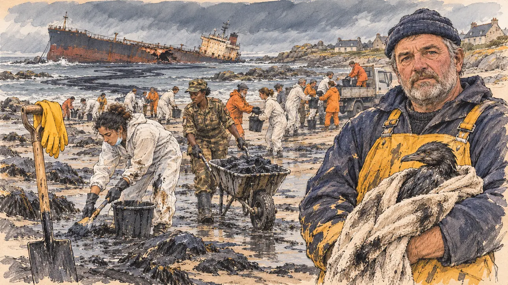

# `oilSpill` · Marée noire

**Validée par le PO le 11/11/2026**, au premier essai. Elle sert telle quelle en clair et en sombre.



| Champ | Valeur |
| --- | --- |
| Carte | `oilSpill`, catégorie `crisis` (Crise), poids 0,15, du 1er novembre au 21 mars (la saison des tempêtes) ; son histoire à la une de la revue de presse, sur le cas de l'Erika |
| Style | Reportage dessiné |
| Ton | Tendu et sobre, lumière froide d'après la tempête |
| Date | 2026-11-11 |
| Outil | ChatGPT Images, à compléter (modèle et effort) |
| Conversation | À compléter |
| Format rendu | 1672 × 941 (16:9) : export en 1290 × 726 px, WebP de qualité 75, 261 Ko, sans recadrage, fait depuis la copie de la conversation (à refaire depuis le PNG d'origine) |
| Fichier d'origine | À compléter (hors du dépôt) |
| Première édition | À compléter |

## Texte de la carte

> **Marée noire**
>
> Un vieux pétrolier sous pavillon de complaisance perd son gouvernail dans la tempête et s'échoue sur les récifs du Finistère. Le brut noircit les plages bretonnes comme au temps de l'Amoco Cadiz, et la dépendance au pétrole s'invite dans la campagne.

## Le moment choisi

Une crique de granit du nord du Finistère, un matin gris de février, au lendemain de la tempête : à marée basse, les rochers et le sable sont couverts de brut, et au large, sur les récifs, un vieux pétrolier rouillé gît échoué et gîté, la coque ouverte, une longue nappe partant vers la plage. Le modèle est l'Amoco Cadiz à Portsall (16 mars 1978), dont la poupe et la passerelle restaient hors de l'eau. Le candidat reste hors champ : sa pelle plantée dans le sable mazouté, une paire de gants neufs accrochée au manche, au premier plan. Dans le tiers droit, un ostréiculteur serre contre lui un oiseau mazouté enveloppé dans une vieille serviette et regarde le spectateur, las et grave. Autour, chacun au nettoyage : une bénévole en combinaison blanche, une soldate qui pousse une brouette de mazout, et au fond une chaîne de seaux vers un petit camion, comme les 14 000 personnes, dont 7 000 militaires, de 1978. Les maisons basses en granit et ardoise disent la Bretagne, la région de la carte.

## Prompt complet

Dans une nouvelle conversation, avec [`primeTime.webp`](../../illustrations/media/primeTime.webp) comme seule image de référence :

```
Use the attached image as the style reference and copy its drawing: a realistic reportage drawing made on the spot for a newspaper, with quick, nervous pencil lines, often drawn twice, ink hatching in the shadows, transparent watercolour washes that spill a little over the lines, and the warm paper showing through. Not the same scene and not the same people: never reuse the face or the hair of the woman in the reference.
Like in the reference, the setting can be full when the story needs it, with the things that say where we are and what is happening, but each one is sketched with a few pencil lines and a light wash, never rendered or finished, and the drawing gets looser and paler towards the edges until it fades into the bare paper.
This must look like a drawing made by hand on paper by a press illustrator, halfway between a quick sketch and a realistic picture: never a photograph, a film poster or a digital painting, and never a cartoon, a comic strip, a caricature or a children's book illustration. Continuous lines, never dotted or dashed outlines; no uniform texture, speckles or hatching filter laid over the picture; no glossy highlights, no smooth gradients, in the sky and on the walls too. Colour can be rich in places, on a piece of clothing, a light or a flag, but it stays transparent and within the palette below. The fade into the paper at the edges stays narrow, without a wide white margin. No blur and no depth-of-field effect: everything, the foreground included, is drawn sharp, like a sketch made on the spot.
People are drawn from life with realistic anatomy and proportions, like in the reference: faces shaped with pencil lines, hatching and light washes, a little more finished than the background but never photographic (no photographic skin, no airbrushed or digital-painting look). Expressions stay natural and restrained, even in laughter or tears: no exaggerated grins, no wide-open mouths full of teeth, no rubbery or cartoonish faces.

Editorial illustration, landscape 16:9 (1536 × 864 px), the scene filling the frame, with only a light fade into the paper at the edges. A small granite cove of the north coast of Finistère, in Brittany, on a grey morning in February 2027, the day after a storm: at low tide, the rocks and the sand are coated with thick black crude oil, and offshore, on the reefs, an old rust-streaked oil tanker lies aground and listing, its hull broken, a long dark slick spreading from it under a heavy slate sky. On the shore behind, a few low granite houses with slate roofs. The player's candidate stays off-camera: in the foreground, only the candidate's shovel planted upright in the oily sand, a pair of new rubber gloves hanging from its handle. In the right third, an oyster farmer in his fifties, heavy-set, with a weathered face, a short grey beard and a navy woollen cap, in yellow oilskin bib overalls smeared with black oil, holds an oiled seabird wrapped in an old towel against his chest and looks at the viewer, tired and grave, his face above mid-height. Around him, each busy with the clean-up and not looking at the viewer: a young volunteer of North African descent with curly black hair tied back, in a white protective coverall with her mask pulled down to her chin, scrapes the oil into a bucket; a tall soldier of Senegalese descent, a woman in her thirties with short hair under a camouflage cap, pushes a wheelbarrow full of black sludge; further along the beach, a line of volunteers in white coveralls and orange oilskins passes buckets from hand to hand towards a small truck. Nothing on the tanker, the coveralls, the buckets, the truck or the uniform is readable.

Style: Reportage drawing made on the spot, like a press illustrator or courtroom sketch artist: pencil and ink with loose watercolour washes, lively unfinished lines, white paper showing through.

Palette: navy #13203F, vellum #F5EFE1, gold #A9802A, brick #B5523B, ochre #D9A441, sage #8FA58A, slate #5E7186, sand #DCC8A4, warm grey #8C8279; use 4 to 6 of them, subtle warm paper grain.

Tone: tense and sober, the cold grey light after a storm, the black of the oil on the granite and the sand, a few warm points of yellow and orange oilskins.

Constraints: realistic proportions, natural expressions, never cartoonish or caricatured faces, drawn like the rest of the illustration and never photographic; people of varied ages, genders, origins and body types (heavy, stocky, round, tall, short, wiry, not only slim), each with a distinct face and haircut (no two people alike), drawn with respect and never as a joke; each person's age, build and look plausible for their job and the scene (working people of working age), no stereotype tying an origin or a gender to a role, and no person of colour shown alone in a featured service or deferential role; anatomically correct hands with exactly five fingers, few hands visible, the others in pockets, behind objects or out of frame; no readable text anywhere (the tanker's name and hull, the coveralls, the buckets, the truck and the uniform stay unreadable, no ship name, no flag on the tanker); no captions or speech bubbles; no logos, no oil company logo, no political party colours; no recognisable real person, no lookalike of a real politician; no explicit violence, no dead animals in detail; no photographic rendering, no blur or bokeh, every outline a continuous pencil or ink line with no dotted or dashed outlines, no mottled, crackled or speckled texture over the faces, the clothes, the rocks or the sky, no hatching filter over the picture, no oil-paint texture, no glossy shine on the oil, no wide white margin or frame (a light fade into the paper at the edges is fine).

Format: if 16:9 is not available, make 1536 × 1024 and keep the top 80 px and the bottom 80 px free of anything important (faces, hands, the main action): they will be cropped.
```

## Décisions prises sur cette image

Validée telle quelle par le PO (11/11/2026). Gardés :

- deux petits écussons d'épaule de la soldate, illisibles, dont l'un peut évoquer un drapeau (permis) ;
- une petite plaque blanche sur la passerelle du pétrolier et une autre à l'arrière du camion, illisibles ;
- la main de l'ostréiculteur sous la serviette, dont on ne voit que le poing, les doigts cachés : à la taille de la carte, une main qui serre la serviette ;
- son visage, plus fini que le reste, entre le dessin et la peinture, jamais photographique ; aucune ressemblance relevée avec une personne connue ;
- un rendu d'ensemble un peu plus chargé et détaillé que `primeTime`, sans basculer dans la photo ni la BD.

## Essais écartés

Aucun.

## Retouches

Aucune.

## Relecture

Faite et validée par le PO le 11/11/2026.

- [x] Aucun texte lisible : ni nom sur la coque, ni rien sur le camion, les seaux, les combinaisons ou l'uniforme (voir les décisions pour les écussons et les plaques).
- [x] Aucun sosie d'une personne réelle.
- [x] Le candidat du joueur est hors champ : seule sa pelle, plantée au premier plan avec ses gants.
- [x] Mains et visages sans défaut visible à 343 px de large : les mains gantées de la bénévole et de la soldate, la main de l'ostréiculteur sous la serviette (voir les décisions).
- [x] Aucune couleur ni aucun logo de parti ou de compagnie pétrolière. Des personnes variées par l'âge, le corps, l'origine et la coiffure.
- [x] Pas d'animal mort en détail : l'oiseau mazouté est vivant.
- [x] En 16:9 : pas de recadrage.
- [ ] Lisible sur la page de l'événement, en clair et en sombre : à vérifier dans l'app, une fois la carte publiée.
