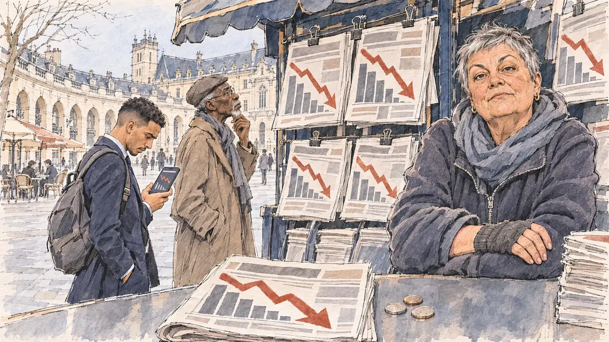

# `ratingCut` · La note du pays dégradée

**Validée par le PO le 10/11/2026**, au premier essai. Elle sert telle quelle en clair et en sombre.



| Champ | Valeur |
| --- | --- |
| Carte | `ratingCut`, catégorie `crisis` (Crise), poids 0,2, toute semaine, son histoire à la une de la revue de presse |
| Style | Reportage dessiné |
| Ton | Tendu sous l'ironie, matin froid |
| Date | 2026-11-10 |
| Outil | ChatGPT Images, à compléter (modèle et effort) |
| Conversation | À compléter |
| Format rendu | 1672 × 941 (16:9) : export en 1290 × 726 px, WebP de qualité 75, 206 Ko, sans recadrage, fait depuis la copie WebP de la conversation (à refaire depuis le PNG d'origine) |
| Fichier d'origine | À compléter (hors du dépôt) |
| Première édition | À compléter |

## Texte de la carte

> **La note du pays dégradée**
>
> Une agence de notation retire au pays sa meilleure note. Les taux d'emprunt montent, le gouvernement promet des réformes, et l'économie s'impose à la une.

## Le moment choisi

Le kiosque à journaux de la place de la Libération, à Dijon, tôt un matin froid de mars : la place en demi-lune, ses arcades et le palais des ducs. Toutes les unes suspendues montrent la même flèche qui plonge sur un graphique en barres, sans un mot. Le candidat reste hors champ : son journal plié et quelques pièces sur le comptoir. La kiosquière, mitaines aux mains, regarde le spectateur, pince-sans-rire : ça va vous coûter cher, tout ça. Un jeune employé de banque fixe la même courbe sur son téléphone ; un retraité lit une une, inquiet. Dijon n'avait encore servi à aucune carte.

## Prompt complet

Dans une nouvelle conversation, avec [`primeTime.webp`](../../illustrations/media/primeTime.webp) comme seule image de référence :

```
Use the attached image as the style reference and copy its drawing: a realistic reportage drawing made on the spot for a newspaper, with quick, nervous pencil lines, often drawn twice, ink hatching in the shadows, transparent watercolour washes that spill a little over the lines, and the warm paper showing through. Not the same scene and not the same people: never reuse the face or the hair of the woman in the reference.
Like in the reference, the setting can be full when the story needs it, with the things that say where we are and what is happening, but each one is sketched with a few pencil lines and a light wash, never rendered or finished, and the drawing gets looser and paler towards the edges until it fades into the bare paper.
This must look like a drawing made by hand on paper by a press illustrator, halfway between a quick sketch and a realistic picture: never a photograph, a film poster or a digital painting, and never a cartoon, a comic strip, a caricature or a children's book illustration. Continuous lines, never dotted or dashed outlines; no uniform texture, speckles or hatching filter laid over the picture; no glossy highlights, no smooth gradients, in the sky and on the walls too. Colour can be rich in places, on a piece of clothing, a light or a flag, but it stays transparent and within the palette below. The fade into the paper at the edges stays narrow, without a wide white margin. No blur and no depth-of-field effect: everything, the foreground included, is drawn sharp, like a sketch made on the spot.
People are drawn from life with realistic anatomy and proportions, like in the reference: faces shaped with pencil lines, hatching and light washes, a little more finished than the background but never photographic (no photographic skin, no airbrushed or digital-painting look). Expressions stay natural and restrained, even in laughter or tears: no exaggerated grins, no wide-open mouths full of teeth, no rubbery or cartoonish faces.

Editorial illustration, landscape 16:9 (1536 × 864 px), the scene filling the frame, with only a light fade into the paper at the edges. A newspaper kiosk on the Place de la Libération in Dijon, in Burgundy, early on a cold March morning in 2027, the day a rating agency strips the country of its top credit rating: the half-moon square with its pale stone arcades and the Palace of the Dukes behind, a few café terraces opening. On the kiosk, the day's newspapers hang on their clips, and every front page shows the same big plunging arrow and a crumbling bar chart, with no words, no titles and no numbers. The player's candidate stays off-camera: in the foreground, only a folded newspaper and a few coins on the kiosk's counter. In the right third, the kiosk vendor, a stocky white woman in her sixties with a short grey crop, a thick scarf, fingerless gloves and a fleece, leans on her counter and looks at the viewer with a deadpan, wry look, this is going to cost you dearly, her face above mid-height. Next to the kiosk, a young bank employee in his twenties of Algerian descent, slim, with a neat fade haircut, a navy suit and a backpack, frowns at the interest rates on his phone; an elderly man of Senegalese descent, tall and thin, with a grey goatee, a long coat and a flat cap, reads one of the front pages, worried. Only the vendor looks at the viewer. Nothing on the newspapers, the phone, the kiosk or the café fronts is readable, and no newspaper title or logo appears.

Style: Reportage drawing made on the spot, like a press illustrator or courtroom sketch artist: pencil and ink with loose watercolour washes, lively unfinished lines, white paper showing through.

Palette: navy #13203F, vellum #F5EFE1, gold #A9802A, brick #B5523B, ochre #D9A441, sage #8FA58A, slate #5E7186, sand #DCC8A4, warm grey #8C8279; use 4 to 6 of them, subtle warm paper grain.

Tone: tense under a wry surface, cold early-morning light on the pale stone, the plunging arrows in brick red repeated on every front page.

Constraints: realistic proportions, natural expressions, never cartoonish or caricatured faces, drawn like the rest of the illustration and never photographic; people of varied ages, genders, origins and body types (heavy, stocky, round, tall, short, wiry, not only slim), each with a distinct face and haircut (no two people alike), drawn with respect and never as a joke; each person's age, build and look plausible for their job and the scene (working people of working age), no stereotype tying an origin or a gender to a role, and no person of colour shown alone in a featured service or deferential role; anatomically correct hands with exactly five fingers, few hands visible, the others in pockets, behind objects or out of frame; no readable text anywhere (the newspapers, the phone, the kiosk and the café fronts stay unreadable, no titles, no numbers); no captions or speech bubbles; no logos, no newspaper names, no rating agency names, no political party colours; no recognisable real person, no lookalike of a real politician; no explicit violence; no photographic rendering, no blur or bokeh, every outline a continuous pencil or ink line with no dotted or dashed outlines, no mottled, crackled or speckled texture over the faces, the clothes or the walls, no hatching filter over the picture, no oil-paint texture, no glow or halo, no wide white margin or frame (a light fade into the paper at the edges is fine).

Format: if 16:9 is not available, make 1536 × 1024 and keep the top 80 px and the bottom 80 px free of anything important (faces, hands, the main action): they will be cropped.
```

## Décisions prises sur cette image

Validée telle quelle par le PO (10/11/2026).

## Essais écartés

Aucun.

## Retouches

Aucune.

## Relecture

Faite et validée par le PO le 10/11/2026.

- [x] Aucun texte lisible : les unes ne portent que la flèche et des barres, sans titre ni chiffre ; aucun nom de journal ni d'agence.
- [x] Aucun sosie d'une personne réelle.
- [x] Le candidat du joueur est hors champ : seuls son journal plié et ses pièces, sur le comptoir.
- [x] Mains et visages sans défaut visible à 343 px de large : les mains croisées de la kiosquière (mitaines), celle qui tient le téléphone, la main au menton.
- [x] Aucune couleur ni aucun logo de parti. Des personnes variées par l'âge, le corps, l'origine et la coiffure.
- [x] En 16:9 : pas de recadrage.
- [ ] Lisible sur la page de l'événement, en clair et en sombre : à vérifier dans l'app, une fois la carte publiée.
