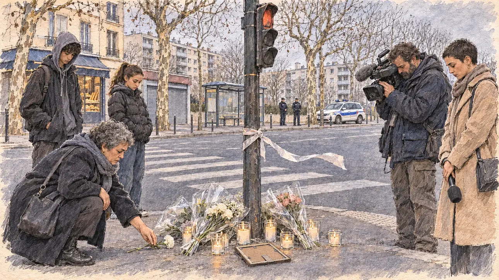

# `refusalToStop` · Un tir lors d'un contrôle

**Validée par le PO le 23/11/2026**, au premier essai, dans le trait d'`oldTweet`. Elle sert telle quelle en clair et en sombre.



| Champ | Valeur |
| --- | --- |
| Carte | `refusalToStop`, catégorie `crisis` (Crise), carte ajoutée par la PR #480 de l'app |
| Style | Reportage dessiné, trait d'`oldTweet` |
| Ton | Grave et sobre |
| Date | 2026-11-23 |
| Outil | ChatGPT Images |
| Format rendu | 1672 × 941 (16:9) : export en 1290 × 726 px depuis l'image partagée dans la conversation avec Claude, WebP de qualité 75, 270 Ko, sans recadrage |
| Fichier d'origine | Image de ChatGPT, chez le PO. L'export du dépôt a été fait depuis la copie partagée dans la conversation avec Claude |
| Première édition | `kit-france-2611-0004` |

## Texte de la carte

> **Un tir lors d'un contrôle**
>
> Lors d'un refus d'obtempérer, un policier a tiré sur une voiture : le conducteur est mort. Une enquête est confiée à l'inspection, et le pays se divise.

## Le moment choisi

Le lendemain matin, comme pour [`riots`](riots.md) : ni le tir, ni la voiture, ni le corps. Un carrefour de banlieue sous un ciel gris d'hiver ; au pied d'un feu tricolore, des bouquets, quelques bougies et une photo encadrée retournée, dont on ne voit que le dos. Une femme dépose une fleur, deux adolescents restent à l'écart, une équipe de télé filme les fleurs ; plus loin, une voiture de police garée et ses deux agents, bras le long du corps. Le candidat est hors champ et personne ne regarde le lecteur. Aucune image d'un drame réel (`docs/STORE_LISTING.md` de l'app, Apple 1.1.7).

## Prompt complet

Dans une nouvelle conversation, avec [`oldTweet.webp`](../../illustrations/polemic/oldTweet.webp) comme seule image de référence.

```
Use the attached image as the style reference and copy its drawing: a realistic reportage drawing made on the spot for a newspaper, with quick, nervous pencil lines, often drawn twice, ink hatching in the shadows, transparent watercolour washes that spill a little over the lines, and the warm paper showing through. Not the same scene.
Like in the reference, the setting can be full when the story needs it, with the things that say where we are and what is happening, but each one is sketched with a few pencil lines and a light wash, never rendered or finished, and the drawing gets looser and paler towards the edges until it fades into the bare paper.
This must look like a drawing made by hand on paper by a press illustrator, halfway between a quick sketch and a realistic picture: never a photograph, a film poster or a digital painting, and never a cartoon, a comic strip, a caricature or a children's book illustration. Continuous lines, never dotted or dashed outlines; no uniform texture, speckles or hatching filter laid over the picture; no glossy highlights, no smooth gradients, in the sky and on the walls too. Colour can be rich in places, on a piece of clothing, a light or a flag, but it stays transparent and within the palette below. The fade into the paper at the edges stays narrow, without a wide white margin. No blur and no depth-of-field effect: everything, the foreground included, is drawn sharp, like a sketch made on the spot.
People are drawn from life with realistic anatomy and proportions, like in the reference: faces shaped with pencil lines, hatching and light washes, a little more finished than the background but never photographic (no photographic skin, no airbrushed or digital-painting look). Expressions stay natural and restrained, even in grief: no exaggerated expressions, no wide-open mouths, no rubbery or cartoonish faces.

Editorial illustration, landscape 16:9 (1536 × 864 px), the scene filling the frame, with only a light fade into the paper at the edges. A crossroads on the outskirts of a French city, on a grey winter morning in 2027, the day after a police officer shot at a car whose driver had refused to stop: the driver died. No car, no shooting, no body, no blood, no weapon drawn: only the place the morning after. The player's candidate has come and stays off-camera. In the centre, at the foot of a traffic light, a small pile of bouquets in cellophane, a few lit candles in glass jars and one framed photo turned face down, showing only its back. Tied to the traffic light post, a loose length of plain barrier tape with no lettering flutters in the wind. In the left third, a woman in her fifties, stocky, with short grey curly hair and a dark wool coat, bends to lay a single white flower, her face above mid-height, eyes lowered. A little behind her, two teenagers, a tall thin boy in a hooded jacket and a shorter girl with a ponytail and a puffer jacket, stand apart, hands in their pockets, looking at the flowers. In the right third, a television crew: a heavy-set cameraman in his forties with a beard films the flowers with a shoulder camera, a young reporter with cropped hair in a beige coat waits beside him, microphone lowered. Further back, a police car parked at the kerb, its two officers standing beside it, arms by their sides, small and sketched. Behind, sketched loosely in pencil and light washes: a wide road with a pedestrian crossing, a bakery and a closed shutter, a bus stop, mid-rise blocks of flats, bare plane trees. Nobody looks at the viewer. Nothing on the shops, the tape, the car, the photo or the camera is readable.

Style: Reportage drawing made on the spot, like a press illustrator or courtroom sketch artist: pencil and ink with loose watercolour washes, lively unfinished lines, white paper showing through.

Palette: navy #13203F, vellum #F5EFE1, gold #A9802A, brick #B5523B, ochre #D9A441, sage #8FA58A, slate #5E7186, sand #DCC8A4, warm grey #8C8279; use 4 to 6 of them, subtle warm paper grain.

Tone: grave and sober, cold grey morning light, the small warm glow of the candles the only bright spot, the ground dry.

Constraints: realistic proportions, natural expressions, never cartoonish or caricatured faces, drawn like the rest of the illustration and never photographic; people of varied ages, genders, origins and body types (heavy, stocky, round, tall, short, wiry, not only slim), each with a distinct face and haircut (no two people alike), drawn with respect and never as a joke; anatomically correct hands with exactly five fingers, few hands visible, the others in pockets, behind objects or out of frame; no readable text anywhere (the shops, the tape, the car, the photo and the camera stay unreadable); no captions or speech bubbles; no logos or political party colours; no recognisable real person and no lookalike of a real politician; no explicit violence, no weapon, no damaged car, no injured or dead person; no photographic rendering, no blur or bokeh, no dotted outlines, no texture or hatching filter over the picture, no oil-paint texture, no wide white margin or frame (a light fade into the paper at the edges is fine).

Format: if 16:9 is not available, make 1536 × 1024 and keep the top 80 px and the bottom 80 px free of anything important (faces, hands, the main action): they will be cropped.
```

## Décisions prises sur cette image

- Un ruban blanc noué au poteau remplace la rubalise du prompt : il évoque une marche blanche plutôt qu'une scène de crime, et ne porte aucune inscription.
- La femme qui dépose la fleur paraît avoir la soixantaine plutôt que la cinquantaine du prompt.

## Essais écartés

Aucun.

## Retouches

Aucune.

## Relecture

Faite par Claude et validée par le PO le 23/11/2026.

- [x] Aucun texte lisible : l'enseigne de l'abribus n'est qu'un gribouillis, la voiture de police n'a aucune inscription, le dos du cadre est vide.
- [x] Aucun sosie d'une personne réelle.
- [x] Le candidat du joueur est hors champ.
- [x] Mains, visages et foules sans défaut visible à 343 px de large.
- [x] Aucune couleur ni aucun logo de parti ; la livrée de la voiture de police signale seulement les forces de l'ordre. Des personnes variées par l'âge, le corps, l'origine et la coiffure. Ni arme, ni voiture accidentée, ni blessé ; la photo reste retournée ; les policiers sont neutres.
- [x] En 3:2 : sans objet, l'image est en 16:9.
- [x] Lisible sur la page de l'événement, en clair et en sombre.
