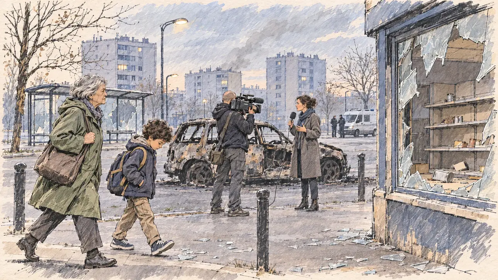

# `riots` · Nuits d'émeutes

**Validée par le PO le 31/10/2026**, après une retouche du PO. Elle sert telle quelle en clair et en sombre.



| Champ | Valeur |
| --- | --- |
| Carte | `riots`, catégorie `crisis` (Crise) |
| Style | Reportage dessiné |
| Ton | Tendu et sobre |
| Date | 2026-10-31 |
| Outil | ChatGPT avec le modèle GPT Sol 6.1 en effort « light », et ChatGPT Images 2.5 |
| Conversation | À remplir (le lien ne s'ouvre qu'avec le compte qui l'a créée) |
| Format rendu | 1672 × 941 (16:9) : export en 1290 × 726 px depuis le PNG d'origine, WebP de qualité 75, 210 Ko, sans recadrage ; réexportée le 01/11/2026, après une première version en qualité 60 pour tenir 180 Ko |
| Fichier d'origine | PNG de ChatGPT, chez le PO, partagé aussi dans la conversation avec Claude |
| Première édition | `kit-france-2611-0001` |

## Texte de la carte

> **Nuits d'émeutes**
>
> Plusieurs nuits d'émeutes dans des quartiers de banlieue : la sécurité écrase tous les autres sujets.

## Le moment choisi

Le lendemain matin, à l'aube, dans une cité : pas de feu, pas d'affrontement, pas de blessé, seulement les traces. La vitrine brisée d'une épicerie, la carcasse noircie d'une voiture, un abribus sans vitres, un fourgon de police au loin. Une grand-mère presse un enfant vers l'école, et une équipe de télé tourne devant la voiture.

## Prompt complet

Dans une nouvelle conversation, avec [`oldTweet.webp`](../../illustrations/polemic/oldTweet.webp) comme seule image de référence :

```
Use the attached image as the style reference: the same pencil and ink drawing with loose watercolour washes and warm paper grain. Faces, hands and objects are drawn with visible ink lines, never photographic. Not the same scene.

Editorial illustration, landscape 16:9 (1536 × 864 px), filling the whole frame edge to edge. A housing estate on the outskirts of a French city, at dawn in 2027, after several nights of riots. The player's candidate has come the morning after and stays off-camera: in the foreground, only a few shards of glass on the pavement. In the right third, the owner of the corner grocery, a heavy-set man in his sixties, bald, with a thick white moustache and a cardigan, leans on his broom in front of his shattered shop window and looks up at the viewer with tired eyes, his face above mid-height. Nearby, a youth worker, a tall woman in her thirties with long box braids and a tracksuit jacket, arms crossed, also looks at the viewer, waiting to see what the candidate will say. Behind them, the blackened shell of a burnt car, a bus shelter without its glass, a police van parked at a distance; a short, round woman with a grey bob and a raincoat hurries a small boy with a backpack to school; a lanky reporter with a shaved head films the burnt car. Tower blocks with lit windows rise in the morning haze. No fire, no fighting, no injured person: only the aftermath. Nothing on the walls, the shop or the van is readable.

Style: Reportage drawing made on the spot, like a press illustrator or courtroom sketch artist: pencil and ink with loose watercolour washes, lively unfinished lines, white paper showing through.

Palette: navy #13203F, vellum #F5EFE1, gold #A9802A, brick #B5523B, ochre #D9A441, sage #8FA58A, slate #5E7186, sand #DCC8A4, warm grey #8C8279; use 4 to 6 of them, subtle warm paper grain.

Tone: tense and sober, cold grey dawn light, a thin haze of old smoke.

Constraints: realistic proportions, expressive but not caricatured faces, people of varied ages, genders, origins and body types (heavy, stocky, round, tall, short, wiry, not only slim), each with a distinct face and haircut (no two people alike), drawn with respect and never as a joke; anatomically correct hands with exactly five fingers, few hands visible, the others in pockets, behind objects or out of frame; no readable text anywhere (walls, signs, labels and screens stay unreadable); no captions or speech bubbles; no logos, flags or political party colours; no recognisable real person, no lookalike of a real politician; no explicit violence; no oil-paint texture, no white or ragged border.

Format: if 16:9 is not available, make 1536 × 1024 and keep the top 80 px and the bottom 80 px free of anything important (faces, hands, the main action): they will be cropped.
```

## Retouches

Le PO a retiré les deux personnages du premier plan, l'épicier et l'animatrice de quartier, qui regardaient le candidat. La scène montre le quartier au lendemain, sans personne qui interpelle le candidat.

## Relecture

Faite et validée par le PO le 31/10/2026, après la retouche.

- [x] Aucun texte lisible : ni sur les murs, ni dans l'épicerie, ni sur le fourgon.
- [x] Aucun sosie d'une personne réelle.
- [x] Le candidat du joueur est hors champ.
- [x] Mains, visages et foules sans défaut visible à 343 px de large.
- [x] Aucune couleur de parti, aucun symbole officiel. Pas de violence explicite ni de blessé.
- [x] En 3:2 : rien d'important dans les 80 px du haut et du bas. Sans objet ici : l'image est en 16:9.
- [x] Lisible sur la page de l'événement, en clair et en sombre.

## Régénération demandée (04/11/2026)

**Pourquoi.** La revue de la première série note le style à 3/3 et les détails à 3/3 : l'image se lit comme une photo sous un léger voile peint, avec trottoir mouillé aux reflets, brume en profondeur de champ et éclats de verre en mosaïque régulière. Le décor est l'un des plus chargés de la série : rayonnages d'épicerie pleins sur tout le tiers droit, centaines d'éclats, abribus, fourgon, passants, tours, réverbères et arbres. Le PO a décidé de régénérer l'image, avec ce commentaire : « Il faut garder tout de même la vitrine cassée ».

**Ce qui reste.** Le lendemain matin, à l'aube : la vitrine brisée de l'épicerie, bien visible, la carcasse noircie de la voiture, la grand-mère qui presse l'enfant vers l'école, l'équipe de télé devant la voiture. Personne ne regarde le candidat, hors champ, avec quelques éclats de verre au premier plan.

**Ce qui change.** Le rendu, en dessin de presse réaliste dans le trait d'[`oldTweet`](../polemic/oldTweet.md) (PO, 04/11/2026), sans reflets mouillés ni brume en profondeur de champ. La vitrine cassée reste au centre, comme le PO l'a demandé, et l'épicerie garde ses rayonnages à moitié vidés, quelques produits renversés, esquissés sans bouteilles ni fruits détaillés. Le quartier reste, esquissé au crayon et au lavis : l'abribus aux vitres brisées, trois ou quatre tours aux fenêtres allumées, des réverbères et quelques arbres nus, un fourgon de police garé plus loin avec deux silhouettes. L'équipe de télé retrouve sa reporter au micro à côté du cadreur. Les éclats de verre sont des formes d'encre inégales, jamais une mosaïque régulière. Une première version de cette section, écrite avec la règle de « trois ou quatre objets au plus », vidait l'épicerie et le quartier ; elle a été reprise quand le PO a demandé de ne pas trop simplifier les scènes.

### Prompt de régénération

Dans une nouvelle conversation, avec [`oldTweet.webp`](../../illustrations/polemic/oldTweet.webp) comme seule image de référence.

```
Use the attached image as the style reference and copy its drawing: a realistic reportage drawing made on the spot for a newspaper, with quick, nervous pencil lines, often drawn twice, ink hatching in the shadows, transparent watercolour washes that spill a little over the lines, and the warm paper showing through. Not the same scene.
Like in the reference, the setting can be full when the story needs it, with the things that say where we are and what is happening, but each one is sketched with a few pencil lines and a light wash, never rendered or finished, and the drawing gets looser and paler towards the edges until it fades into the bare paper.
This must look like a drawing made by hand on paper by a press illustrator, halfway between a quick sketch and a realistic picture: never a photograph, a film poster or a digital painting, and never a cartoon, a comic strip, a caricature or a children's book illustration. Continuous lines, never dotted or dashed outlines; no uniform texture, speckles or hatching filter laid over the picture; no glossy highlights, no smooth gradients, in the sky and on the walls too. Colour can be rich in places, on a piece of clothing, a light or a flag, but it stays transparent and within the palette below. The fade into the paper at the edges stays narrow, without a wide white margin. No blur and no depth-of-field effect: everything, the foreground included, is drawn sharp, like a sketch made on the spot.
People are drawn from life with realistic anatomy and proportions, like in the reference: faces shaped with pencil lines, hatching and light washes, a little more finished than the background but never photographic (no photographic skin, no airbrushed or digital-painting look). Expressions stay natural and restrained, even in laughter or tears: no exaggerated grins, no wide-open mouths full of teeth, no rubbery or cartoonish faces.

Editorial illustration, landscape 16:9 (1536 × 864 px), the scene filling the frame, with only a light fade into the paper at the edges. A housing estate on the outskirts of a French city at dawn in 2027, the morning after several nights of riots: no fire, no fighting, no injured person, only the aftermath. The player's candidate has come and stays off-camera: in the foreground, only shards of glass on the pavement, drawn as a few irregular ink shapes, never a regular mosaic. In the right third, the large shattered window of a corner grocery, drawn big and clear, the glass broken into jagged pieces still hanging in the frame, inside, the shop's shelves half emptied and a few goods knocked over, sketched in pencil and light washes. In the left third, a short, round woman in her seventies with a grey bob and a green raincoat hurries a small boy of seven, with curly dark hair and a backpack, along the pavement towards school; she looks straight ahead, her face above mid-height, and the boy looks down at the shards. In the middle, the blackened shell of a burnt car, and in front of it a television crew: a lanky man in his forties with a shaved head and a dark jacket films with a shoulder camera, and a reporter in her thirties in a grey coat speaks into her microphone beside the car, facing her cameraman. Behind them, the estate, sketched loosely in pencil and light washes: a bus shelter with its glass smashed, three or four tower blocks with a few lit windows, street lamps and a few bare trees, and further away a police van parked with two small standing figures. Nobody looks at the viewer. Nothing on the shop, the walls, the van or the camera is readable.

Style: Reportage drawing made on the spot, like a press illustrator or courtroom sketch artist: pencil and ink with loose watercolour washes, lively unfinished lines, white paper showing through.

Palette: navy #13203F, vellum #F5EFE1, gold #A9802A, brick #B5523B, ochre #D9A441, sage #8FA58A, slate #5E7186, sand #DCC8A4, warm grey #8C8279; use 4 to 6 of them, subtle warm paper grain.

Tone: tense and sober, cold grey dawn light, a thin haze of old smoke drawn as a light wash, no misty depth of field, the ground dry.

Constraints: realistic proportions, natural expressions, never cartoonish or caricatured faces, drawn like the rest of the illustration and never photographic; people of varied ages, genders, origins and body types (heavy, stocky, round, tall, short, wiry, not only slim), each with a distinct face and haircut (no two people alike), drawn with respect and never as a joke; anatomically correct hands with exactly five fingers, few hands visible, the others in pockets, behind objects or out of frame; no readable text anywhere (the shop, the walls, the van and the camera stay unreadable); no captions or speech bubbles; no logos or political party colours; no recognisable real person and no lookalike of a real politician; no explicit violence; no photographic rendering, no blur or bokeh, no dotted outlines, no texture or hatching filter over the picture, no oil-paint texture, no wide white margin or frame (a light fade into the paper at the edges is fine).

Format: if 16:9 is not available, make 1536 × 1024 and keep the top 80 px and the bottom 80 px free of anything important (faces, hands, the main action): they will be cropped.
```
