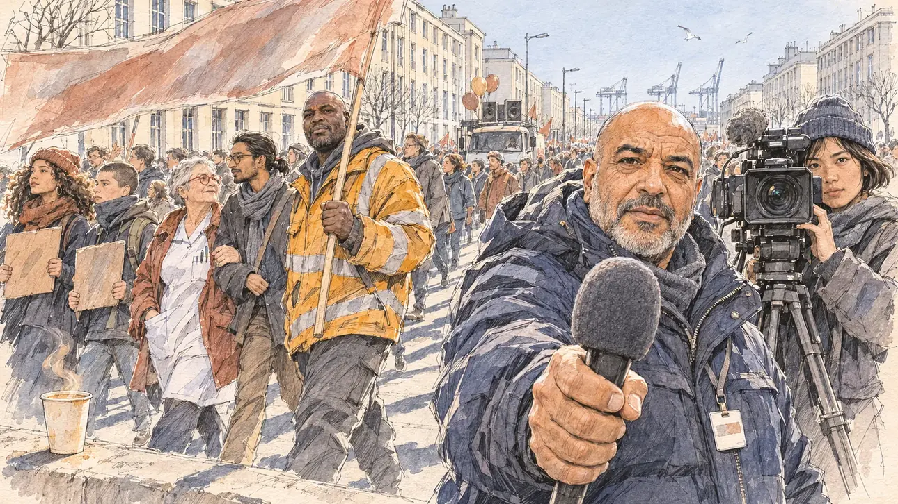

# `wageStrike` · Grève pour les salaires

**Validée par le PO le 07/11/2026**, au premier essai. Elle sert telle quelle en clair et en sombre.



| Champ | Valeur |
| --- | --- |
| Carte | `wageStrike`, catégorie `crisis` (Crise) |
| Style | Reportage dessiné |
| Ton | Observateur et déterminé |
| Date | 2026-11-07 |
| Outil | ChatGPT Images, à compléter (modèle et effort) |
| Conversation | À compléter |
| Format rendu | 1672 × 941 (16:9) : export en 1290 × 726 px, WebP de qualité 75, 231 Ko, sans recadrage, fait depuis la copie WebP de la conversation (à refaire depuis le PNG d'origine) |
| Fichier d'origine | À compléter (hors du dépôt) |
| Première édition | À compléter |

## Texte de la carte

> **Grève pour les salaires**
>
> Syndicats unis, lycéens, agents publics : des centaines de milliers de personnes défilent dans tout le pays pour les salaires. Sur les pancartes, un mot revient : dignité. Les micros se tendent vers vous.

## Le moment choisi

Un grand défilé pour les salaires au Havre, sur une large avenue bordée des immeubles de béton clair de la Reconstruction, les grues du port au loin, un matin d'hiver froid et lumineux. Le candidat se tient au bord du cortège, hors champ : son gobelet de café fume sur un muret. Un reporter radio lui tend son micro, une caméraman le filme ; derrière eux passent un docker, une infirmière, un enseignant et deux lycéens. Le Havre n'avait encore servi à aucune carte.

## Prompt complet

Dans une nouvelle conversation, avec [`primeTime.webp`](../../illustrations/media/primeTime.webp) comme seule image de référence :

```
Use the attached image as the style reference and copy its drawing: a realistic reportage drawing made on the spot for a newspaper, with quick, nervous pencil lines, often drawn twice, ink hatching in the shadows, transparent watercolour washes that spill a little over the lines, and the warm paper showing through. Not the same scene and not the same people: never reuse the face or the hair of the woman in the reference.
Like in the reference, the setting can be full when the story needs it, with the things that say where we are and what is happening, but each one is sketched with a few pencil lines and a light wash, never rendered or finished, and the drawing gets looser and paler towards the edges until it fades into the bare paper.
This must look like a drawing made by hand on paper by a press illustrator, halfway between a quick sketch and a realistic picture: never a photograph, a film poster or a digital painting, and never a cartoon, a comic strip, a caricature or a children's book illustration. Continuous lines, never dotted or dashed outlines; no uniform texture, speckles or hatching filter laid over the picture; no glossy highlights, no smooth gradients, in the sky and on the walls too. Colour can be rich in places, on a piece of clothing, a light or a flag, but it stays transparent and within the palette below. The fade into the paper at the edges stays narrow, without a wide white margin. No blur and no depth-of-field effect: everything, the foreground included, is drawn sharp, like a sketch made on the spot.
People are drawn from life with realistic anatomy and proportions, like in the reference: faces shaped with pencil lines, hatching and light washes, a little more finished than the background but never photographic (no photographic skin, no airbrushed or digital-painting look). Expressions stay natural and restrained, even in laughter or tears: no exaggerated grins, no wide-open mouths full of teeth, no rubbery or cartoonish faces.

Editorial illustration, landscape 16:9 (1536 × 864 px), the scene filling the frame, with only a light fade into the paper at the edges. A huge, peaceful march for wages in Le Havre, on a cold, bright winter morning in 2027: the procession fills a wide avenue lined with the pale concrete buildings of the post-war reconstruction, their tall regular windows and flat roofs, with the cranes of the port far behind under a clear sky and a few seagulls. The player's candidate stands at the edge of the march and stays off-camera: in the foreground, only a paper cup of coffee steaming on a low concrete wall. In the right third, a radio reporter in his fifties, of North African descent, stocky, bald with a close-cropped grey beard, in a padded navy parka with a press badge, holds out a microphone with a foam windscreen towards the viewer and looks at the viewer, his face above mid-height; behind his shoulder, a camerawoman in her twenties, of Vietnamese descent, slim, with a short bob and a beanie, films the viewer. Behind them the procession goes by: a tall, heavy-set Black docker in his forties, with a shaved head and a high-visibility jacket over a hoodie, carries one pole of a long banner and glances at the viewer; a short, round white woman in her sixties, with cropped silver hair and red-framed glasses, a nurse's tunic under her open coat, walks arm in arm with a wiry teacher in his thirties, of Indian descent, with a ponytail and round glasses, both looking ahead; two high-school pupils hold up cardboard placards, a lanky sixteen-year-old girl of mixed origin with a mass of curly hair under a woollen hat, and a short boy with a buzz cut and a scarf over his chin. Further back, a sound truck with a few balloons, and the crowd sketched into the distance. Nobody poses: only the reporter, the camerawoman and the docker look at the viewer. Nothing on the banners, the placards, the badge or the truck is readable, and no vest, flag or banner carries a trade union's colours or logo.

Style: Reportage drawing made on the spot, like a press illustrator or courtroom sketch artist: pencil and ink with loose watercolour washes, lively unfinished lines, white paper showing through.

Palette: navy #13203F, vellum #F5EFE1, gold #A9802A, brick #B5523B, ochre #D9A441, sage #8FA58A, slate #5E7186, sand #DCC8A4, warm grey #8C8279; use 4 to 6 of them, subtle warm paper grain.

Tone: observant and determined, cold bright winter light with long shadows on the concrete, the warm touches the high-visibility jacket and the steam of the coffee.

Constraints: realistic proportions, natural expressions, never cartoonish or caricatured faces, drawn like the rest of the illustration and never photographic; people of varied ages, genders, origins and body types (heavy, stocky, round, tall, short, wiry, not only slim), each with a distinct face and haircut (no two people alike), drawn with respect and never as a joke; the marchers chant or talk with closed or barely open mouths, never shouting; anatomically correct hands with exactly five fingers, few hands visible, the others in pockets, behind objects or out of frame; no readable text anywhere (banners, placards, badges and the truck stay unreadable); no captions or speech bubbles; no logos, no trade-union or political party colours; no recognisable real person, no lookalike of a real politician, trade-union leader or journalist; no explicit violence; no photographic rendering, no blur or bokeh, no dotted outlines, no texture or hatching filter over the picture, no oil-paint texture, no wide white margin or frame (a light fade into the paper at the edges is fine).

Format: if 16:9 is not available, make 1536 × 1024 and keep the top 80 px and the bottom 80 px free of anything important (faces, hands, the main action): they will be cropped.
```

## Décisions prises sur cette image

Validée telle quelle par le PO (07/11/2026), avec les deux points relevés à la relecture : le grand drapeau brique et les fanions orange du cortège, sans logo et dans la palette, restent ; la texture de hachures de la parka et de la main du reporter, visible seulement au zoom, aussi.

## Essais écartés

Aucun.

## Retouches

Aucune.

## Relecture

Faite et validée par le PO le 07/11/2026.

- [x] Aucun texte lisible : la banderole est faite de lavis, les pancartes sont en carton nu, le badge du reporter est vierge, rien ne se lit sur le camion sono ni sur la caméra.
- [x] Aucun sosie d'une personne réelle.
- [x] Le candidat du joueur est hors champ : seul son gobelet de café, sur le muret.
- [x] Mains, visages et foules sans défaut visible à 343 px de large, la main du reporter au micro comprise.
- [x] Aucune couleur ni aucun logo de parti : aucun logo ; le grand drapeau brique et les fanions orange du fond sont dans la palette (voir les décisions). Des personnes variées par l'âge, le corps, l'origine et la coiffure.
- [x] En 16:9 : pas de recadrage.
- [ ] Lisible sur la page de l'événement, en clair et en sombre : à vérifier dans l'app, une fois la carte publiée.
- Au zoom, la parka et la main du reporter portent une texture de hachures assez uniforme, proche du filtre que le gabarit écarte ; invisible à la taille de la carte, gardée par le PO.
