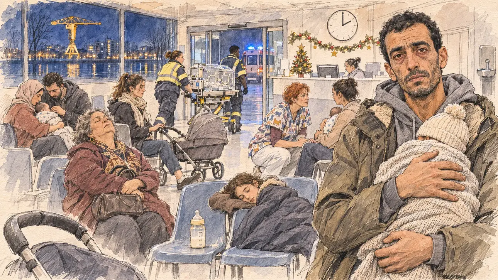

# `winterVirus` · L'épidémie d'hiver

**Validée par le PO le 05/11/2026**, au premier essai, avec `primeTime.webp` comme référence. Elle sert telle quelle en clair et en sombre.



| Champ | Valeur |
| --- | --- |
| Carte | `winterVirus`, catégorie `crisis` (Crise), carte ajoutée par la PR #297 de l'app |
| Style | Reportage dessiné, trait de `primeTime` |
| Ton | Inquiet et las |
| Date | 2026-11-05 |
| Outil | ChatGPT Images |
| Conversation | À remplir (le lien ne s'ouvre qu'avec le compte qui l'a créée) |
| Format rendu | 1672 × 941 (16:9) : export en 1290 × 726 px, WebP de qualité 75, 248 Ko, sans recadrage |
| Fichier d'origine | Image de ChatGPT, chez le PO. L'export du dépôt a été fait depuis la copie partagée dans la conversation avec Claude |
| Première édition | La prochaine Release qui suit le merge de la PR #297 de l'app |

## Texte de la carte

> **L'épidémie d'hiver**
>
> La bronchiolite sature les urgences pédiatriques : des services transfèrent des nourrissons dans d'autres régions, et des parents racontent des nuits d'attente.

## Le moment choisi

La salle d'attente des urgences pédiatriques d'un hôpital de Nantes, à deux heures du matin, une nuit de décembre, vue depuis la porte où le candidat (hors champ) entre pour une visite de nuit : au premier plan, la poignée d'une poussette vide et un biberon posé sur une chaise. Un père épuisé, son bébé endormi contre la poitrine, regarde le candidat. Autour : les parents qui attendent sur les chaises en plastique, une grand-mère qui somnole, une infirmière accroupie près d'une mère, deux ambulanciers qui poussent une couveuse de transport vers la sortie, où attend une ambulance au gyrophare bleu ; une guirlande de Noël fatiguée au-dessus de l'accueil. Par la vitre : la Loire la nuit, les lumières de l'île de Nantes et la grande grue jaune des anciens chantiers navals.

## Prompt complet

Dans une nouvelle conversation, avec [`primeTime.webp`](../../illustrations/media/primeTime.webp) comme seule image de référence.

```
Use the attached image as the style reference and copy its drawing: a realistic reportage drawing made on the spot for a newspaper, with quick, nervous pencil lines, often drawn twice, ink hatching in the shadows, transparent watercolour washes that spill a little over the lines, and the warm paper showing through. Not the same scene and not the same people: never reuse the face or the hair of the woman in the reference.
Like in the reference, the setting can be full when the story needs it, with the things that say where we are and what is happening, but each one is sketched with a few pencil lines and a light wash, never rendered or finished, and the drawing gets looser and paler towards the edges until it fades into the bare paper.
This must look like a drawing made by hand on paper by a press illustrator, halfway between a quick sketch and a realistic picture: never a photograph, a film poster or a digital painting, and never a cartoon, a comic strip, a caricature or a children's book illustration. Continuous lines, never dotted or dashed outlines; no uniform texture, speckles or hatching filter laid over the picture; no glossy highlights, no smooth gradients, in the sky and on the walls too. Colour can be rich in places, on a piece of clothing, a light or a flag, but it stays transparent and within the palette below. The fade into the paper at the edges stays narrow, without a wide white margin. No blur and no depth-of-field effect: everything, the foreground included, is drawn sharp, like a sketch made on the spot.
People are drawn from life with realistic anatomy and proportions, like in the reference: faces shaped with pencil lines, hatching and light washes, a little more finished than the background but never photographic (no photographic skin, no airbrushed or digital-painting look). Expressions stay natural and restrained, even in laughter or tears: no exaggerated grins, no wide-open mouths full of teeth, no rubbery or cartoonish faces.

Editorial illustration, landscape 16:9 (1536 × 864 px), the scene filling the frame, with only a light fade into the paper at the edges. The waiting room of the paediatric emergency department of a hospital in Nantes, in the West, at two in the morning on a night in mid-December 2026: bronchiolitis saturates the children's emergency rooms, some departments transfer babies to other regions, and parents tell of nights of waiting. The scene is seen from the doorway where the player's candidate comes in for a night visit, who stays off-camera: in the foreground, only the handle of an empty pushchair and a baby bottle left on a plastic chair. In the right third, a father in his thirties of Tunisian origin, tall and thin, unshaven, with tired red eyes and short black hair, in a grey hoodie under an open parka, holds his sleeping baby against his chest, wrapped in a knitted blanket with only a little wool hat showing, one hand under the baby and the other on its back, and looks straight at the viewer with an exhausted, pleading look, his face above mid-height. Around him, sketched in pencil and light washes: parents waiting on rows of plastic chairs: a young mother with a ponytail rocking a pram with one foot, a couple, the woman in a headscarf and the man with a beard, leaning over the baby on her lap, a round grandmother of Portuguese origin dozing upright with her handbag on her knees, a big sister of ten asleep across two chairs under a coat; a paediatric nurse in her forties with short red hair and a patterned scrub top, crouching beside a mother to speak to her quietly; two paramedics, a stocky woman and a young man of Senegalese origin, pushing a transport incubator on its trolley towards the glass doors, where an ambulance waits with its blue lights turning; above the reception desk, a tired paper Christmas garland and a small plastic tree, a wall clock, a water fountain and a toy box. Through the big window, the Loire at night, the lights of the Île de Nantes reflected in the dark water, and the tall yellow crane of the old shipyards lit up. Only the father looks straight at the viewer. Nothing on the reception desk, the posters, the wristbands, the incubator, the ambulance or the clothes is readable, and no logo of a real hospital appears.

Style: Reportage drawing made on the spot, like a press illustrator or courtroom sketch artist: pencil and ink with loose watercolour washes, lively unfinished lines, white paper showing through.

Palette: navy #13203F, vellum #F5EFE1, gold #A9802A, brick #B5523B, ochre #D9A441, sage #8FA58A, slate #5E7186, sand #DCC8A4, warm grey #8C8279; use 4 to 6 of them, subtle warm paper grain.

Tone: worried and weary, the dim blue night light of the waiting room, the white glow of the reception desk, the blue lights of the ambulance through the glass doors, and the little coloured Christmas garland and the yellow crane as the warm patches.

Constraints: realistic proportions, natural expressions, never cartoonish or caricatured faces, drawn like the rest of the illustration and never photographic; people of varied ages, genders, origins and body types (heavy, stocky, round, tall, short, wiry, not only slim), each with a distinct face and haircut (no two people alike), drawn with respect and never as a joke; anatomically correct hands with exactly five fingers, few hands visible, the others in pockets, behind objects or out of frame; no readable text anywhere (the reception desk, the posters, the wristbands, the incubator, the ambulance and the clothes stay unreadable); no captions or speech bubbles; no logos or political party colours; no recognisable real person, no lookalike of a real politician, and no logo of a real hospital; no explicit violence; no photographic rendering, no blur or bokeh, no dotted outlines, no texture or hatching filter over the picture, no oil-paint texture, no wide white margin or frame (a light fade into the paper at the edges is fine).

Format: if 16:9 is not available, make 1536 × 1024 and keep the top 80 px and the bottom 80 px free of anything important (faces, hands, the main action): they will be cropped.
```

## Décisions prises sur cette image

Aucune.

## Essais écartés

Aucun.

## Retouches

Aucune.

## Relecture

Faite et validée par le PO le 05/11/2026.

- [x] Aucun texte lisible : l'horloge n'a pas de chiffres, le biberon n'a que des traits de graduation ; rien n'est lisible sur l'accueil, la couveuse, l'ambulance, les gilets des ambulanciers ni les vêtements.
- [x] Aucun sosie d'une personne réelle.
- [x] Le candidat du joueur est hors champ.
- [x] Mains, visages et foules sans défaut visible à 343 px de large.
- [x] Aucune couleur ni aucun logo de parti. Des personnes variées par l'âge, le corps, l'origine et la coiffure.
- [x] En 3:2 : sans objet, l'image est en 16:9.
- [x] Lisible sur la page de l'événement, en clair et en sombre.

Ce que la relecture a accepté : le visage du bébé du père est caché par le bonnet et la couverture, ceux des autres bébés sont tournés vers leurs parents ; la grande sœur paraît un peu plus âgée que dix ans.
