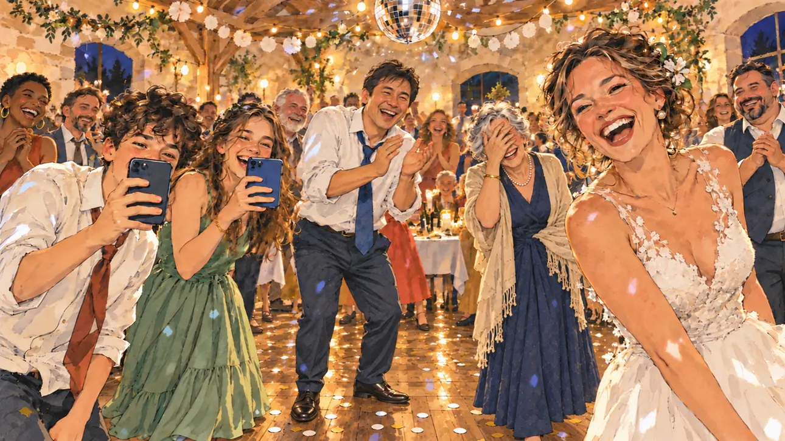

# `danceVideo` · Une danse virale

**Validée par le PO le 31/10/2026**, à l'essai 2. Elle sert telle quelle en clair et en sombre.



| Champ | Valeur |
| --- | --- |
| Carte | `danceVideo`, catégorie `buzz` (Buzz) |
| Style | Reportage dessiné |
| Ton | Chaleureux et ironique |
| Date | 2026-10-31 |
| Outil | ChatGPT, ChatGPT Images 2.5 ; mode et effort : non précisés |
| Conversation | À remplir (le lien ne s'ouvre qu'avec le compte qui l'a créée) |
| Format rendu | 1672 × 941 (16:9) : export en 1290 × 726 px depuis le PNG d'origine, WebP de qualité 75, 143 Ko, sans recadrage |
| Fichier d'origine | PNG de ChatGPT, chez le PO, partagé aussi dans la conversation avec Claude |
| Première édition | À remplir |

## Texte de la carte

> **Une danse virale**
>
> Une vidéo de vous dansant, très maladroitement, au mariage d'un cousin devient virale. Des millions de vues en une nuit.

## Le moment choisi

Le candidat ne peut pas apparaître : la scène est vue depuis la piste de danse, à sa place, au moment où la vidéo se tourne. La mariée, sa cousine, rit aux éclats ; deux ados filment, un oncle applaudit, une vieille tante se cache les yeux, et toute la salle rit. Ici, que tout le monde regarde le candidat est naturel : ils regardent la danse.

## Prompt complet

Dans une nouvelle conversation, avec [`oldTweet.webp`](oldTweet.webp) comme seule image de référence :

```
Use the attached image as the style reference: the same pencil and ink drawing with loose watercolour washes and warm paper grain. Faces, hands and objects are drawn with visible ink lines, never photographic. Not the same scene.

Editorial illustration, landscape 16:9 (1536 × 864 px), filling the whole frame edge to edge. A family wedding party in a village hall in France, late at night in 2027. The scene is seen from the middle of the dance floor, where the player's candidate is dancing very clumsily and stays off-camera: in the foreground, only the wooden floor and a few scattered confetti. In the right third, the bride, the candidate's cousin, in her thirties, laughs out loud and looks at the viewer, her face above mid-height. Around the dance floor, the guests form a circle: two teenagers film the viewer with their smartphones, an uncle with his tie loosened claps, an elderly aunt hides her eyes in mock embarrassment, and a few guests laugh at their tables. String lights, a small disco ball and paper garlands hang above them. Nothing on the screens, banners or decorations is readable.

Style: Reportage drawing made on the spot, like a press illustrator or courtroom sketch artist: pencil and ink with loose watercolour washes, lively unfinished lines, white paper showing through.

Palette: navy #13203F, vellum #F5EFE1, gold #A9802A, brick #B5523B, ochre #D9A441, sage #8FA58A, slate #5E7186, sand #DCC8A4, warm grey #8C8279; use 4 to 6 of them, subtle warm paper grain.

Tone: warm and gently ironic, festive night light from string lights and a disco ball, warm pastels.

Constraints: realistic proportions, expressive but not caricatured faces, people of varied ages, genders and origins; anatomically correct hands with exactly five fingers, few hands visible, the others in pockets, behind objects or out of frame; no readable text anywhere (signs, banners, labels and screens stay blank or unreadable); no captions or speech bubbles; no logos, flags or political party colours; no recognisable real person, no lookalike of a real politician; no explicit violence; no oil-paint texture, no white or ragged border.

Format: if 16:9 is not available, make 1536 × 1024 and keep the top 80 px and the bottom 80 px free of anything important (faces, hands, the main action): they will be cropped.
```

## Essais écartés

- **Essai 1** (31/10/2026) : la même scène, mais le premier plan montrait une estrade ronde en bois au lieu du parquet de la piste. L'essai 2, refait par le PO, montre la piste en entier.

## Retouches

Aucune.

## Relecture

Faite et validée par le PO le 31/10/2026, sur l'essai 2.

- [x] Aucun texte lisible : ni sur les téléphones, ni dans les décorations.
- [x] Aucun sosie d'une personne réelle.
- [x] Le candidat du joueur est hors champ.
- [x] Mains, visages et foules sans défaut visible à 343 px de large. Il y a beaucoup de mains, toutes correctes.
- [x] Aucune couleur de parti, aucun symbole officiel. Des personnes variées.
- [x] En 3:2 : rien d'important dans les 80 px du haut et du bas. Sans objet ici : l'image est en 16:9.
- [x] Lisible sur la page de l'événement, en clair et en sombre.
