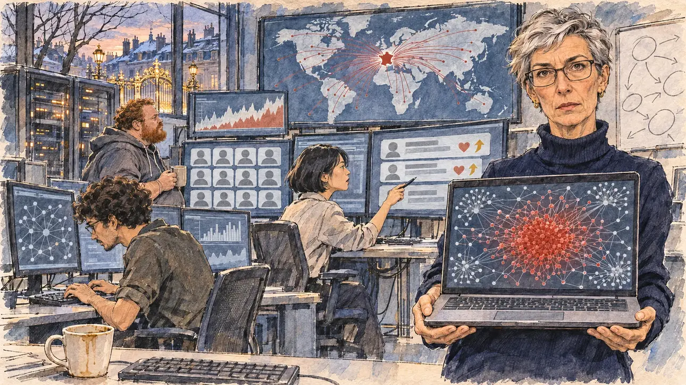

# `botNetwork` · Un réseau de faux comptes

**À générer.** Prompt prêt le 05/11/2026, pas encore d'image validée.



| Champ | Valeur |
| --- | --- |
| Carte | `botNetwork`, catégorie `disinformation` (Désinformation), carte ajoutée par la PR #297 de l'app |
| Style | Reportage dessiné, trait de `primeTime` |
| Ton | Inquiet et tendu |
| Date | À remplir |
| Outil | ChatGPT Images |
| Conversation | À remplir (le lien ne s'ouvre qu'avec le compte qui l'a créée) |
| Format rendu | À remplir |
| Fichier d'origine | À remplir |
| Première édition | À remplir |

## Texte de la carte

> **Un réseau de faux comptes**
>
> Des chercheurs repèrent des milliers de faux comptes, pilotés depuis l'étranger, qui diffusent de fausses informations sur l'élection : un scrutin décalé, des bureaux de vote déplacés. Certains publient aussi des messages flatteurs à votre sujet, qui font monter vos chiffres.

## Le moment choisi

Le laboratoire d'une équipe de chercheurs de l'université de Nancy, en fin d'après-midi, vu depuis la porte où le candidat (hors champ) arrive pour une visite : au premier plan, une tasse de café oubliée à côté d'un clavier. La directrice de l'équipe tend au candidat un ordinateur portable : le graphe du réseau, une toile de points et de traits avec un amas rouge. Autour : les écrans couverts de graphes, une carte du monde où des traits convergent vers la France, des rangées de faux profils aux avatars gris identiques, des messages flatteurs réduits à des cœurs et des flèches qui montent ; une doctorante qui pointe l'écran, un ingénieur barbu, un étudiant penché sur son clavier. Par la fenêtre : les toits de Nancy et, au loin, les grilles dorées de la place Stanislas.

## Prompt complet

Dans une nouvelle conversation, avec [`primeTime.webp`](../../illustrations/media/primeTime.webp) comme seule image de référence.

```
Use the attached image as the style reference and copy its drawing: a realistic reportage drawing made on the spot for a newspaper, with quick, nervous pencil lines, often drawn twice, ink hatching in the shadows, transparent watercolour washes that spill a little over the lines, and the warm paper showing through. Not the same scene and not the same people: never reuse the face or the hair of the woman in the reference.
Like in the reference, the setting can be full when the story needs it, with the things that say where we are and what is happening, but each one is sketched with a few pencil lines and a light wash, never rendered or finished, and the drawing gets looser and paler towards the edges until it fades into the bare paper.
This must look like a drawing made by hand on paper by a press illustrator, halfway between a quick sketch and a realistic picture: never a photograph, a film poster or a digital painting, and never a cartoon, a comic strip, a caricature or a children's book illustration. Continuous lines, never dotted or dashed outlines; no uniform texture, speckles or hatching filter laid over the picture; no glossy highlights, no smooth gradients, in the sky and on the walls too. Colour can be rich in places, on a piece of clothing, a light or a flag, but it stays transparent and within the palette below. The fade into the paper at the edges stays narrow, without a wide white margin. No blur and no depth-of-field effect: everything, the foreground included, is drawn sharp, like a sketch made on the spot.
People are drawn from life with realistic anatomy and proportions, like in the reference: faces shaped with pencil lines, hatching and light washes, a little more finished than the background but never photographic (no photographic skin, no airbrushed or digital-painting look). Expressions stay natural and restrained, even in laughter or tears: no exaggerated grins, no wide-open mouths full of teeth, no rubbery or cartoonish faces.

Editorial illustration, landscape 16:9 (1536 × 864 px), the scene filling the frame, with only a light fade into the paper at the edges. The lab of a university research team in Nancy, in Lorraine, at the end of a winter afternoon in early 2027: the researchers have spotted thousands of fake accounts, run from abroad, spreading false information about the election, a postponed vote, polling stations moved, and some of them also post flattering messages about the player's candidate that push the candidate's numbers up. The scene is seen from the door where the candidate arrives for a visit, who stays off-camera: in the foreground, only a forgotten cup of coffee next to a keyboard on the edge of a desk. In the right third, the head of the team, a researcher in her fifties of Polish origin, wiry, with short silver hair, rectangular glasses and a dark polo-neck jumper, holds out an open laptop towards the viewer with a grave, worried look, her face above mid-height. On the laptop: the graph of the network, a dense web of small dots and thin lines with one big red cluster in the middle, and no readable word or figure. Around her, sketched in pencil and light washes: a wall of monitors covered with graphs and webs of dots; a big world map on a screen with thin red lines converging towards France, with no flag and no name; rows of fake profiles shown as identical grey default avatars, plain round heads and shoulders with no face; flattering posts shown only as grey boxes with little hearts and upward arrows; a PhD student of Korean origin with a short bob, pointing at a screen with a pen; a heavy-set engineer in his forties with a red beard and a hoodie, holding a mug; a lanky student of Brazilian origin with curly hair, hunched over his keyboard; whiteboards covered with diagrams of arrows and circles, cables, server lights blinking in a glass cabinet. Through the tall window, the slate roofs of Nancy at dusk and, in the distance, the gilded wrought-iron gates and lanterns of the place Stanislas catching the last light. Only the head of the team looks straight at the viewer. Nothing on the laptop, the screens, the map, the whiteboards or the posters is readable, there is no photo or portrait of the candidate, and no logo of a real social network, university or company appears.

Style: Reportage drawing made on the spot, like a press illustrator or courtroom sketch artist: pencil and ink with loose watercolour washes, lively unfinished lines, white paper showing through.

Palette: navy #13203F, vellum #F5EFE1, gold #A9802A, brick #B5523B, ochre #D9A441, sage #8FA58A, slate #5E7186, sand #DCC8A4, warm grey #8C8279; use 4 to 6 of them, subtle warm paper grain.

Tone: uneasy and tense, the cold blue glow of the screens in the dim lab, the red cluster of the network as the loudest note, and the gold of the gates of the place Stanislas through the window as the one warm patch.

Constraints: realistic proportions, natural expressions, never cartoonish or caricatured faces, drawn like the rest of the illustration and never photographic; people of varied ages, genders, origins and body types (heavy, stocky, round, tall, short, wiry, not only slim), each with a distinct face and haircut (no two people alike), drawn with respect and never as a joke; anatomically correct hands with exactly five fingers, few hands visible, the others in pockets, behind objects or out of frame; no readable text anywhere (the laptop, the screens, the map, the whiteboards and the posters stay unreadable); no captions or speech bubbles; no logos or political party colours; no recognisable real person, no lookalike of a real politician, and no logo of a real social network, university or company; no explicit violence; no photographic rendering, no blur or bokeh, no dotted outlines, no texture or hatching filter over the picture, no oil-paint texture, no wide white margin or frame (a light fade into the paper at the edges is fine).

Format: if 16:9 is not available, make 1536 × 1024 and keep the top 80 px and the bottom 80 px free of anything important (faces, hands, the main action): they will be cropped.
```

## Décisions prises sur cette image

Aucune pour l'instant.

## Essais écartés

Aucun pour l'instant.

## Retouches

Aucune.

## Relecture

À faire sur l'image validée.
