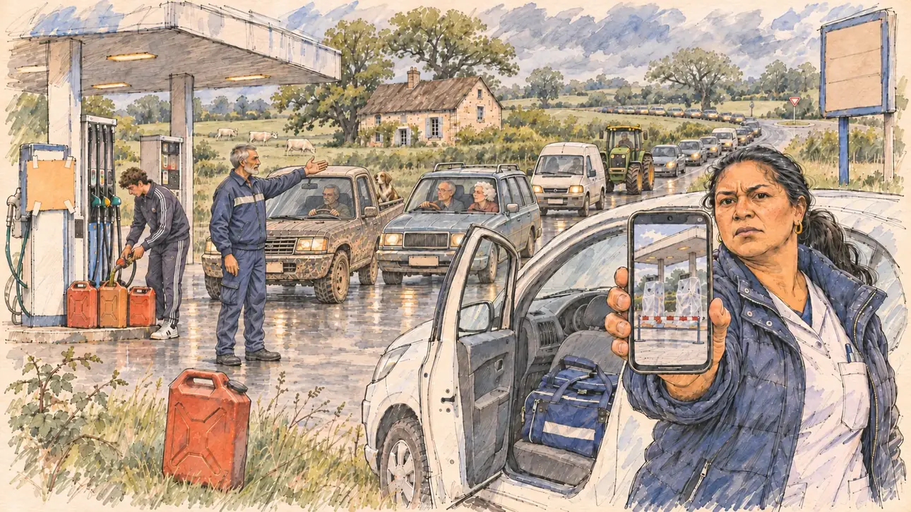

# `fuelPhoto` · Des stations-service à sec

**Validée par le PO le 05/11/2026**, au premier essai, avec `primeTime.webp` comme référence. Elle sert telle quelle en clair et en sombre.



| Champ | Valeur |
| --- | --- |
| Carte | `fuelPhoto`, catégorie `disinformation` (Désinformation), carte ajoutée par la PR #297 de l'app |
| Style | Reportage dessiné, trait de `primeTime` |
| Ton | Inquiet et tendu |
| Date | 2026-11-05 |
| Outil | ChatGPT Images |
| Conversation | À remplir (le lien ne s'ouvre qu'avec le compte qui l'a créée) |
| Format rendu | 1672 × 941 (16:9) : export en 1290 × 726 px, WebP de qualité 75, 182 Ko, sans recadrage |
| Fichier d'origine | Image de ChatGPT, chez le PO. L'export du dépôt a été fait depuis la copie partagée dans la conversation avec Claude |
| Première édition | La prochaine Release qui suit le merge de la PR #297 de l'app |

## Texte de la carte

> **Des stations-service à sec**
>
> Une photo de stations-service vides circule sur les réseaux, avec l'annonce d'une pénurie de carburant imminente. La photo date d'un conflit social de l'an dernier, mais des files se forment déjà devant les pompes.

## Le moment choisi

La station-service d'une petite ville du Berry, dans l'Indre, un matin gris, vue depuis le bord de la route où le candidat (hors champ) longe la file des voitures : au premier plan, un jerrican rouge posé dans l'herbe du bas-côté. Une infirmière libérale, debout près de sa petite voiture portière ouverte, tend au candidat son téléphone : la vieille photo de pompes emballées dans des sacs plastique derrière une barrière. Autour : la file de voitures, de camionnettes et d'un tracteur jusqu'au rond-point, un agriculteur dans son pick-up avec son chien, un couple de retraités dans une vieille voiture, un jeune homme qui remplit des jerricans, le pompiste qui fait des signes, un carton sans mots scotché sur une pompe. Derrière : le bocage, les haies, des vaches blanches dans un pré et une ferme de pierre claire aux tuiles brunes.

## Prompt complet

Dans une nouvelle conversation, avec [`primeTime.webp`](../../illustrations/media/primeTime.webp) comme seule image de référence.

```
Use the attached image as the style reference and copy its drawing: a realistic reportage drawing made on the spot for a newspaper, with quick, nervous pencil lines, often drawn twice, ink hatching in the shadows, transparent watercolour washes that spill a little over the lines, and the warm paper showing through. Not the same scene and not the same people: never reuse the face or the hair of the woman in the reference.
Like in the reference, the setting can be full when the story needs it, with the things that say where we are and what is happening, but each one is sketched with a few pencil lines and a light wash, never rendered or finished, and the drawing gets looser and paler towards the edges until it fades into the bare paper.
This must look like a drawing made by hand on paper by a press illustrator, halfway between a quick sketch and a realistic picture: never a photograph, a film poster or a digital painting, and never a cartoon, a comic strip, a caricature or a children's book illustration. Continuous lines, never dotted or dashed outlines; no uniform texture, speckles or hatching filter laid over the picture; no glossy highlights, no smooth gradients, in the sky and on the walls too. Colour can be rich in places, on a piece of clothing, a light or a flag, but it stays transparent and within the palette below. The fade into the paper at the edges stays narrow, without a wide white margin. No blur and no depth-of-field effect: everything, the foreground included, is drawn sharp, like a sketch made on the spot.
People are drawn from life with realistic anatomy and proportions, like in the reference: faces shaped with pencil lines, hatching and light washes, a little more finished than the background but never photographic (no photographic skin, no airbrushed or digital-painting look). Expressions stay natural and restrained, even in laughter or tears: no exaggerated grins, no wide-open mouths full of teeth, no rubbery or cartoonish faces.

Editorial illustration, landscape 16:9 (1536 × 864 px), the scene filling the frame, with only a light fade into the paper at the edges. The petrol station of a small market town in the Berry, in the Indre, in the heart of France, on a grey, mild morning in early 2027: a photo of empty petrol stations is going round on social media with the announcement of an imminent fuel shortage; the photo dates from a strike last year, but queues are already forming at the pumps. The scene is seen from the roadside where the player's candidate walks along the queue of cars, who stays off-camera: in the foreground, only a red jerrycan standing in the grass of the verge. In the right third, a home-visit nurse in her forties of Réunionese origin, round and energetic, with long black hair in a low ponytail, a padded jacket over her nurse's tunic, standing by her small white car with its door open and her medical bag on the passenger seat, holds out her phone towards the viewer with an exasperated, worried look, her face above mid-height. On the phone: the old photo, petrol pumps wrapped in plastic bags behind a red and white barrier, with no readable word. Around her, sketched in pencil and light washes: a long queue of small cars, vans and a tractor stretching back to the roundabout; a farmer in his fifties, bare-headed, with a thick grey moustache, at the wheel of a muddy pick-up with a dog on the back; a retired couple, bare-headed, in an old estate car, the woman with white curls leaning to look; a young man in a tracksuit filling three jerrycans at a pump; the petrol station attendant, a tall man of Moroccan origin in his sixties with a grey beard, waving the cars forward; a piece of cardboard taped to a pump, with no words on it; the price board of the station blank. Behind them, the gentle bocage of the Berry: hedgerows, pastures with white cows, big oak trees, a farmhouse of pale limestone with a brown tiled roof, and the low grey sky. Only the nurse looks straight at the viewer. Nothing on the phone, the pumps, the price board, the cardboard, the cars or the jerrycans is readable, and no logo of a real oil company or brand appears.

Style: Reportage drawing made on the spot, like a press illustrator or courtroom sketch artist: pencil and ink with loose watercolour washes, lively unfinished lines, white paper showing through.

Palette: navy #13203F, vellum #F5EFE1, gold #A9802A, brick #B5523B, ochre #D9A441, sage #8FA58A, slate #5E7186, sand #DCC8A4, warm grey #8C8279; use 4 to 6 of them, subtle warm paper grain.

Tone: uneasy and tense, the flat grey light of a mild morning in the countryside, the green of the hedgerows, the red of the jerrycan and of the barrier on the phone as the loudest notes.

Constraints: realistic proportions, natural expressions, never cartoonish or caricatured faces, drawn like the rest of the illustration and never photographic; people of varied ages, genders, origins and body types (heavy, stocky, round, tall, short, wiry, not only slim), each with a distinct face and haircut (no two people alike), drawn with respect and never as a joke; anatomically correct hands with exactly five fingers, few hands visible, the others in pockets, behind objects or out of frame; no readable text anywhere (the phone, the pumps, the price board, the cardboard, the cars and the jerrycans stay unreadable); no captions or speech bubbles; no logos or political party colours; no recognisable real person, no lookalike of a real politician, and no logo of a real oil company or brand; no explicit violence; no photographic rendering, no blur or bokeh, no dotted outlines, no texture or hatching filter over the picture, no oil-paint texture, no wide white margin or frame (a light fade into the paper at the edges is fine).

Format: if 16:9 is not available, make 1536 × 1024 and keep the top 80 px and the bottom 80 px free of anything important (faces, hands, the main action): they will be cropped.
```

## Décisions prises sur cette image

Aucune.

## Essais écartés

Aucun.

## Retouches

Aucune.

## Relecture

Faite et validée par le PO le 05/11/2026.

- [x] Aucun texte lisible : le panneau des prix et le carton scotché sont vides ; rien n'est lisible sur le téléphone, les pompes, les voitures ni les jerricans.
- [x] Aucun sosie d'une personne réelle.
- [x] Le candidat du joueur est hors champ.
- [x] Mains, visages et foules sans défaut visible à 343 px de large.
- [x] Aucune couleur ni aucun logo de parti. Des personnes variées par l'âge, le corps, l'origine et la coiffure.
- [x] En 3:2 : sans objet, l'image est en 16:9.
- [x] Lisible sur la page de l'événement, en clair et en sombre.

Ce que la relecture a accepté : trois évocations de marques, minuscules à la taille de l'app et signalées au PO : un petit ovale sur la calandre du pick-up, les trois bandes et un petit écusson sur le survêtement du jeune homme, le vert et le jaune du tracteur ; un « cédez le passage » au rond-point.
