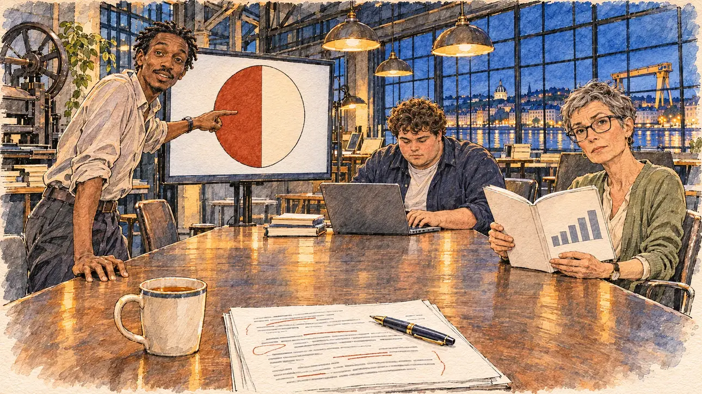

# `funderReport` · Le chiffre d'un cigarettier

**Validée par le PO le 24/11/2026**, au premier essai, dans le trait de `primeTime`. Elle sert telle quelle en clair et en sombre.



| Champ | Valeur |
| --- | --- |
| Carte | `funderReport`, catégorie `disinformation` (Désinformation) ; carte ajoutée par la PR #510 de l'app |
| Style | Reportage dessiné, trait de `primeTime` |
| Ton | Légèrement ironique |
| Date | 2026-11-24 |
| Outil | ChatGPT Images |
| Conversation | À remplir (le lien ne s'ouvre qu'avec le compte qui l'a créée) |
| Format rendu | 1672 × 941 (16:9) : export en 1290 × 726 px depuis l'image partagée dans la conversation avec Claude, WebP de qualité 75, 237 Ko, sans recadrage |
| Fichier d'origine | Image de ChatGPT, chez le PO. L'export du dépôt a été fait depuis la copie partagée dans la conversation avec Claude |
| Première édition | La prochaine Release qui suit le merge de la PR #510 de l'app |

## Texte de la carte

> **Le chiffre d'un cigarettier**
>
> Votre équipe veut ouvrir votre discours sur la contrebande par un chiffre choc : « près d'une cigarette sur deux » échapperait au réseau légal. Il vient d'un rapport financé par un cigarettier, et il compte aussi les achats légaux faits à l'étranger. Les estimations publiques disent 10 à 20 %.

Les réponses : retirer le chiffre du discours (sans jet) ; garder le chiffre (charisme 12) ; citer les estimations publiques et expliquer l'écart en direct (expertise 14, le pari).

## Le moment choisi

Au QG, tard le soir, pendant la relecture du discours : la plume de l'équipe montre sur grand écran un camembert rempli à moitié, sans chiffre, et la conseillère chargée de vérifier les chiffres tient le rapport ouvert, réservée. Le désaccord tient dans leurs deux regards vers le candidat, hors champ, dont on ne voit que la tasse et le stylo. Le chiffre réel (le rapport de KPMG commandé par Philip Morris, les estimations publiques) est dans `docs/NEWS_SOURCES.md` de l'app et dans les Dossiers (`tobaccoSales`).

## Prompt complet

Dans une nouvelle conversation, avec [`primeTime.webp`](../../illustrations/media/primeTime.webp) comme seule image de référence.

```
Use the attached image as the style reference and copy its drawing: a realistic reportage drawing made on the spot for a newspaper, with quick, nervous pencil lines, often drawn twice, ink hatching in the shadows, transparent watercolour washes that spill a little over the lines, and the warm paper showing through. Not the same scene and not the same people: never reuse the face or the hair of the woman in the reference.
Like in the reference, the setting can be full when the story needs it, with the things that say where we are and what is happening, but each one is sketched with a few pencil lines and a light wash, never rendered or finished, and the drawing gets looser and paler towards the edges until it fades into the bare paper.
This must look like a drawing made by hand on paper by a press illustrator, halfway between a quick sketch and a realistic picture: never a photograph, a film poster or a digital painting, and never a cartoon, a comic strip, a caricature or a children's book illustration. Continuous lines, never dotted or dashed outlines; no uniform texture, speckles or hatching filter laid over the picture; no glossy highlights, no smooth gradients, in the sky and on the walls too. Colour can be rich in places, on a piece of clothing, a light or a flag, but it stays transparent and within the palette below. The fade into the paper at the edges stays narrow, without a wide white margin. No blur and no depth-of-field effect: everything, the foreground included, is drawn sharp, like a sketch made on the spot.
People are drawn from life with realistic anatomy and proportions, like in the reference: faces shaped with pencil lines, hatching and light washes, a little more finished than the background but never photographic (no photographic skin, no airbrushed or digital-painting look). Expressions stay natural and restrained, even in laughter or tears: no exaggerated grins, no wide-open mouths full of teeth, no rubbery or cartoonish faces.

Editorial illustration, landscape 16:9 (1536 × 864 px), the scene filling the frame, with only a light fade into the paper at the edges. A campaign headquarters in an old print works in Nantes, late in the evening in 2027: a long work table under hanging lamps, laptops, printed drafts covered with pencil corrections, a large screen on a stand, tall industrial windows with the dark city outside. The team is rehearsing the candidate's speech on tobacco smuggling and wants to open it with a striking figure that comes from a report funded by a tobacco company. The player's candidate sits at the end of the table and stays off-camera: in the foreground, only the candidate's mug of tea and a pen lying on a printed draft. In the left third, the main character, the team's speechwriter, a man in his thirties of Cameroonian descent, tall and lanky, with short twists and a thin moustache, in a rolled-up shirt, points at the large screen showing a single slide: one big pie chart filled exactly half in brick red, with no number and no word; he looks at the viewer with an eager, convinced look, his face above mid-height. In the right third, the team's fact-checking adviser, a woman in her fifties, white, short and wiry, with a grey pixie cut and thin rectangular glasses, in a sage cardigan, holds open a thick report with a blank cover on a page showing only a bar chart, and looks at the viewer with a doubtful, reserved look. Between them, a young volunteer in his twenties, round-faced and heavy-set, with a mop of curly hair, types on a laptop without looking up. Only the speechwriter and the adviser look at the viewer. Nothing on the screen, the report, the drafts, the laptops or the mug is readable.

Style: Reportage drawing made on the spot, like a press illustrator or courtroom sketch artist: pencil and ink with loose watercolour washes, lively unfinished lines, white paper showing through.

Palette: navy #13203F, vellum #F5EFE1, gold #A9802A, brick #B5523B, ochre #D9A441, sage #8FA58A, slate #5E7186, sand #DCC8A4, warm grey #8C8279; use 4 to 6 of them, subtle warm paper grain.

Tone: gently ironic, postures slightly exaggerated but never the faces, warm lamplight on the table against the dark windows.

Constraints: realistic proportions, natural expressions, never cartoonish or caricatured faces, drawn like the rest of the illustration and never photographic; people of varied ages, genders, origins and body types (heavy, stocky, round, tall, short, wiry, not only slim), each with a distinct face and haircut (no two people alike), drawn with respect and never as a joke; each person's age, build and look plausible for their job and the scene (working people of working age), no stereotype tying an origin or a gender to a role, and no person of colour shown alone in a featured service or deferential role; anatomically correct hands with exactly five fingers, few hands visible, the others in pockets, behind objects or out of frame; no readable text anywhere (the screen, the report, the drafts, the laptops and the mug stay unreadable, no number on the pie chart); no captions or speech bubbles; no logos, no political party colours; no cigarettes, no cigarette packs, no smoke and no tobacco brand; no recognisable real person, no lookalike of a real politician; no explicit violence; no photographic rendering, no blur or bokeh, every outline a continuous pencil or ink line with no dotted or dashed outlines, no mottled, crackled or speckled texture over the faces, the clothes, the table or the walls, no hatching filter over the picture, no oil-paint texture, no glow or halo, no wide white margin or frame (a light fade into the paper at the edges is fine).

Format: if 16:9 is not available, make 1536 × 1024 and keep the top 80 px and the bottom 80 px free of anything important (faces, hands, the main action): they will be cropped.
```

## Décisions prises sur cette image

- Les fenêtres donnent sur la Loire et la ville de nuit, avec une grue jaune de chantier naval qui rappelle la grue Titan de Nantes : gardée, elle situe le QG sans texte.
- Le QG garde une presse d'imprimerie ancienne et une plante dans le coin gauche, que le prompt ne demandait pas.
- Le rendu est un peu texturé, comme les deux images précédentes du lot, mais plus proche de `primeTime`.

## Essais écartés

Aucun.

## Retouches

Aucune.

## Relecture

Faite par Claude et validée par le PO le 24/11/2026.

- [x] Aucun texte lisible : le camembert n'a ni chiffre ni légende, le rapport ne montre que des barres, le brouillon n'a que des lignes et des corrections au crayon rouge.
- [x] Aucun sosie d'une personne réelle.
- [x] Le candidat du joueur est hors champ (sa tasse et son stylo au premier plan).
- [x] Mains et visages sans défaut visible à 343 px de large ; la main qui montre l'écran et celles qui tiennent le rapport ont cinq doigts.
- [x] Aucune couleur ni aucun logo de parti, aucune cigarette ni fumée ni marque de tabac. Des personnes variées par l'âge, le corps, l'origine et la coiffure.
- [x] En 3:2 : sans objet, l'image est en 16:9.
- [x] Lisible sur la page de l'événement, en clair et en sombre.
