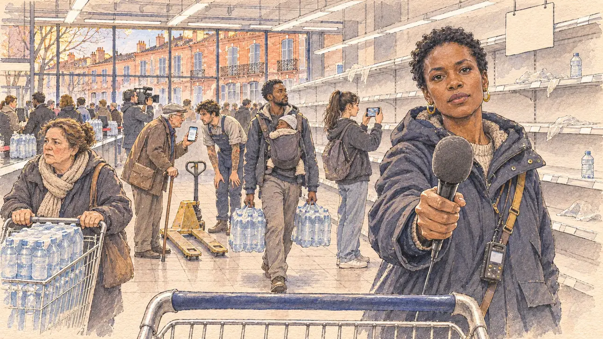

# `tapWaterRumour` · Une rumeur sur l'eau du robinet

**Validée par le PO le 05/11/2026**, au premier essai, avec `primeTime.webp` comme référence. Elle sert telle quelle en clair et en sombre.



| Champ | Valeur |
| --- | --- |
| Carte | `tapWaterRumour`, catégorie `disinformation` (Désinformation), carte ajoutée par la PR #297 de l'app |
| Style | Reportage dessiné, trait de `primeTime` |
| Ton | Inquiet et tendu |
| Date | 2026-11-05 |
| Outil | ChatGPT Images |
| Conversation | À remplir (le lien ne s'ouvre qu'avec le compte qui l'a créée) |
| Format rendu | 1672 × 941 (16:9) : export en 1290 × 726 px, WebP de qualité 75, 210 Ko, sans recadrage |
| Fichier d'origine | Image de ChatGPT, chez le PO. L'export du dépôt a été fait depuis la copie partagée dans la conversation avec Claude |
| Première édition | La prochaine Release qui suit le merge de la PR #297 de l'app |

## Texte de la carte

> **Une rumeur sur l'eau du robinet**
>
> Un message anonyme affirme que l'eau du robinet est contaminée dans une grande ville. Les autorités la disent potable, mais les rayons d'eau en bouteille sont vides et les habitants s'inquiètent. Les journalistes demandent à chaque camp ce qu'il en pense.

## Le moment choisi

Un supermarché du centre de Toulouse, en fin d'après-midi, vu depuis le rayon où le candidat (hors champ) s'arrête pendant une visite : au premier plan, la poignée d'un caddie vide. Une journaliste de radio tend son micro au candidat devant les étagères d'eau en bouteille vidées. Autour : une cliente au caddie chargé de packs d'eau, un vieil homme qui montre le message anonyme sur son téléphone à un employé, un jeune père avec deux packs, une adolescente qui filme les rayons vides, un cadreur. Par la vitrine : la rue bordée de façades de brique rose aux balcons en fer forgé.

## Prompt complet

Dans une nouvelle conversation, avec [`primeTime.webp`](../../illustrations/media/primeTime.webp) comme seule image de référence.

```
Use the attached image as the style reference and copy its drawing: a realistic reportage drawing made on the spot for a newspaper, with quick, nervous pencil lines, often drawn twice, ink hatching in the shadows, transparent watercolour washes that spill a little over the lines, and the warm paper showing through. Not the same scene and not the same people: never reuse the face or the hair of the woman in the reference.
Like in the reference, the setting can be full when the story needs it, with the things that say where we are and what is happening, but each one is sketched with a few pencil lines and a light wash, never rendered or finished, and the drawing gets looser and paler towards the edges until it fades into the bare paper.
This must look like a drawing made by hand on paper by a press illustrator, halfway between a quick sketch and a realistic picture: never a photograph, a film poster or a digital painting, and never a cartoon, a comic strip, a caricature or a children's book illustration. Continuous lines, never dotted or dashed outlines; no uniform texture, speckles or hatching filter laid over the picture; no glossy highlights, no smooth gradients, in the sky and on the walls too. Colour can be rich in places, on a piece of clothing, a light or a flag, but it stays transparent and within the palette below. The fade into the paper at the edges stays narrow, without a wide white margin. No blur and no depth-of-field effect: everything, the foreground included, is drawn sharp, like a sketch made on the spot.
People are drawn from life with realistic anatomy and proportions, like in the reference: faces shaped with pencil lines, hatching and light washes, a little more finished than the background but never photographic (no photographic skin, no airbrushed or digital-painting look). Expressions stay natural and restrained, even in laughter or tears: no exaggerated grins, no wide-open mouths full of teeth, no rubbery or cartoonish faces.

Editorial illustration, landscape 16:9 (1536 × 864 px), the scene filling the frame, with only a light fade into the paper at the edges. A city-centre supermarket in Toulouse, in the South-West, at the end of an afternoon in early 2027: an anonymous message claims that the tap water is contaminated in the city; the authorities say it is safe to drink, but the bottled-water shelves are empty, residents are worried, and journalists ask the candidates what they think. The scene is seen from the aisle where the player's candidate stops during a visit, who stays off-camera: in the foreground, only the handle of an empty shopping trolley. In the right third, a local radio journalist in her thirties of Congolese origin, tall, with short natural hair, gold hoop earrings and a parka, a recorder on a strap over her shoulder, holds out a microphone with a plain foam cover towards the viewer with a serious, insistent look, waiting for the answer, her face above mid-height. Behind her, the long bottled-water aisle stripped bare: empty white shelves, torn plastic wrapping, a few lonely bottles, and a shop-made sign with no readable words. Around her, sketched in pencil and light washes: a stocky woman in her fifties pushing a trolley piled high with packs of water; an elderly man with a walking stick showing the anonymous message on his phone to a young shelf-stacker with tattooed forearms and an empty pallet truck; a young father of Senegalese origin with a baby carrier on his chest and a pack of water in each hand; a teenage girl with a high ponytail filming the empty shelves with her phone; further back, a cameraman with a camera on his shoulder; the checkouts with their queues of customers carrying water. Through the big glass front of the shop, the street outside, lined with pink brick façades with tall shuttered windows and wrought-iron balconies, in the soft light of the end of the day. Only the journalist looks straight at the viewer. Nothing on the shelves, the sign, the bottles, the packs, the phone, the microphone, the camera or the shop front is readable, and no logo of a real supermarket, water brand, radio or TV channel appears.

Style: Reportage drawing made on the spot, like a press illustrator or courtroom sketch artist: pencil and ink with loose watercolour washes, lively unfinished lines, white paper showing through.

Palette: navy #13203F, vellum #F5EFE1, gold #A9802A, brick #B5523B, ochre #D9A441, sage #8FA58A, slate #5E7186, sand #DCC8A4, warm grey #8C8279; use 4 to 6 of them, subtle warm paper grain.

Tone: uneasy and tense, the flat white light of the supermarket's neon tubes on the empty white shelves, the pale blue of the water packs, and the warm pink brick of Toulouse through the glass front as the warm patch.

Constraints: realistic proportions, natural expressions, never cartoonish or caricatured faces, drawn like the rest of the illustration and never photographic; people of varied ages, genders, origins and body types (heavy, stocky, round, tall, short, wiry, not only slim), each with a distinct face and haircut (no two people alike), drawn with respect and never as a joke; anatomically correct hands with exactly five fingers, few hands visible, the others in pockets, behind objects or out of frame; no readable text anywhere (the shelves, the sign, the bottles, the packs, the phone, the microphone, the camera and the shop front stay unreadable); no captions or speech bubbles; no logos or political party colours; no recognisable real person, no lookalike of a real politician, and no logo of a real supermarket, water brand, radio or TV channel; no explicit violence; no photographic rendering, no blur or bokeh, no dotted outlines, no texture or hatching filter over the picture, no oil-paint texture, no wide white margin or frame (a light fade into the paper at the edges is fine).

Format: if 16:9 is not available, make 1536 × 1024 and keep the top 80 px and the bottom 80 px free of anything important (faces, hands, the main action): they will be cropped.
```

## Décisions prises sur cette image

Aucune.

## Essais écartés

Aucun.

## Retouches

Aucune.

## Relecture

Faite et validée par le PO le 05/11/2026.

- [x] Aucun texte lisible : la pancarte du rayon est vide, le message du téléphone n'est que des bulles grises ; rien n'est lisible sur les bouteilles, les packs, le micro, l'enregistreur, la caméra ni la vitrine.
- [x] Aucun sosie d'une personne réelle.
- [x] Le candidat du joueur est hors champ.
- [x] Mains, visages et foules sans défaut visible à 343 px de large.
- [x] Aucune couleur ni aucun logo de parti. Des personnes variées par l'âge, le corps, l'origine et la coiffure.
- [x] En 3:2 : sans objet, l'image est en 16:9.
- [x] Lisible sur la page de l'événement, en clair et en sombre.

Ce que la relecture a accepté : le vieil homme porte une casquette plate ; un grain moucheté un peu régulier sur les manteaux et le sol ; le cadreur est au fond, près des caisses.
