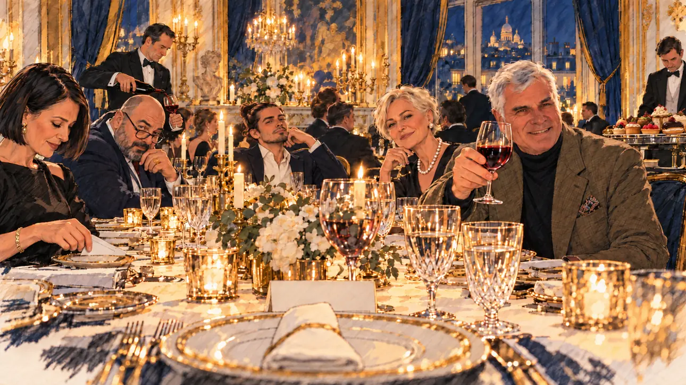

# `donorsDinner` · Un dîner de donateurs

**Validée par le PO le 31/10/2026**, au premier essai. Elle sert telle quelle en clair et en sombre.



| Champ | Valeur |
| --- | --- |
| Carte | `donorsDinner`, catégorie `support` (Offre de soutien) |
| Style | Reportage dessiné, rendu très réaliste : visages presque photographiques, comme [`primeTime`](primeTime.md) |
| Ton | Ironique |
| Date | 2026-10-31 |
| Outil | ChatGPT avec le modèle GPT Sol 6.1 en effort « light », et ChatGPT Images 2.5 |
| Conversation | À remplir (le lien ne s'ouvre qu'avec le compte qui l'a créée) |
| Format rendu | 1672 × 941 (16:9) : export en 1290 × 726 px depuis le PNG d'origine, WebP de qualité 75, 156 Ko, sans recadrage |
| Fichier d'origine | PNG de ChatGPT, chez le PO, partagé aussi dans la conversation avec Claude |
| Première édition | À remplir |

## Texte de la carte

> **Un dîner de donateurs**
>
> Un riche homme d'affaires organise un dîner de levée de fonds en votre honneur. Les chèques s'annoncent généreux, les invités très discrets.

## Le moment choisi

Un dîner privé aux chandelles dans le salon d'un hôtel particulier parisien. Le candidat est en bout de table : son assiette, sa serviette, un marque-place vierge. L'hôte lève son verre vers lui ; autour de la table, des invités élégants et discrets, dont une femme qui glisse un chèque sous sa soucoupe.

## Prompt complet

Dans une nouvelle conversation, avec deux images jointes : [`oldTweet.webp`](oldTweet.webp) pour le style, puis une photo de famille du PO pour la ressemblance de l'hôte.

```
Use the first attached image as the style reference: the same pencil and ink drawing with loose watercolour washes and warm paper grain. Not the same scene.
Use the second attached image, a family photograph, only as the likeness reference for the host: give him the face, the short white hair and the build of the white-haired man on the right of the photograph, at the same age, drawn in the same style as everyone else. Ignore the other people in the photograph.
Faces are drawn exactly like the clothes and the background: ink outlines, a few hatching strokes and flat watercolour washes for the skin, with the same level of detail as the rest of the drawing. No photographic skin, no realistic shading, no airbrushed or digital-painting look on the faces.

Editorial illustration, landscape 16:9 (1536 × 864 px), filling the whole frame edge to edge. A private fundraising dinner in the candlelit salon of a Paris mansion, late in the evening in 2027, given in honour of the player's candidate. The candidate sits at the head of the long table and stays off-camera: in the foreground, only the candidate's plate, a folded napkin, a crystal glass and a blank place card. In the right third, the host, a rich businessman, the white-haired man from the photograph, in a cashmere jacket over a black turtleneck, raises his glass towards the viewer with a satisfied smile, his face above mid-height. Along the table, the guests are elegant and very discreet: a woman in her sixties with a short platinum crop and pearls smiles politely at the viewer; a young heir with a man bun and a hoodie under his blazer leans back; a heavy-set man with a shaved head and a signet ring looks at the viewer over his glasses; a woman in her fifties with a sleek black bob and a black dress, looking down, slips a folded cheque under her saucer. A butler pours wine. Near the door, a silver tray holds the guests' smartphones, collected at the entrance, and the heavy curtains are drawn. Nothing on the cheque, the place card or the walls is readable.

Style: Reportage drawing made on the spot, like a press illustrator or courtroom sketch artist: pencil and ink with loose watercolour washes, lively unfinished lines, white paper showing through.

Palette: navy #13203F, vellum #F5EFE1, gold #A9802A, brick #B5523B, ochre #D9A441, sage #8FA58A, slate #5E7186, sand #DCC8A4, warm grey #8C8279; use 4 to 6 of them, subtle warm paper grain.

Tone: gently ironic, warm candlelight and gold reflections, everything a little too smooth.

Constraints: realistic proportions, expressive but not caricatured faces, drawn like the rest of the illustration and never photographic; people of varied ages, genders, origins and body types (heavy, stocky, round, tall, short, wiry, not only slim), each with a distinct face and haircut (no two people alike), drawn with respect and never as a joke; anatomically correct hands with exactly five fingers, few hands visible, the others in pockets, behind objects or out of frame; no readable text anywhere (cheques, cards, labels and screens stay unreadable); no captions or speech bubbles; no logos or political party colours; apart from the host, no recognisable real person and no lookalike of a real politician or businessman; no explicit violence; no oil-paint texture, no white or ragged border.

Format: if 16:9 is not available, make 1536 × 1024 and keep the top 80 px and the bottom 80 px free of anything important (faces, hands, the main action): they will be cropped.
```

## Décisions prises sur cette image

- **L'hôte reprend les traits d'une photo de famille fournie par le PO**, avec l'accord de la famille (31/10/2026). La photo n'est pas dans ce dépôt.
- **Le rendu, très réaliste,** est accepté par le PO. La photo de famille jointe tire sans doute le générateur vers le réalisme.

## Essais écartés

Aucun.

## Retouches

Aucune.

## Relecture

Faite et validée par le PO le 31/10/2026.

- [x] Aucun texte lisible : ni sur le chèque, ni sur le marque-place.
- [x] Aucun sosie d'une personne réelle, hors la ressemblance voulue de l'hôte.
- [x] Le candidat du joueur est hors champ.
- [x] Mains, visages et foules sans défaut visible à 343 px de large.
- [x] Aucune couleur de parti, aucun symbole officiel.
- [x] En 3:2 : rien d'important dans les 80 px du haut et du bas. Sans objet ici : l'image est en 16:9.
- [x] Lisible sur la page de l'événement, en clair et en sombre.
