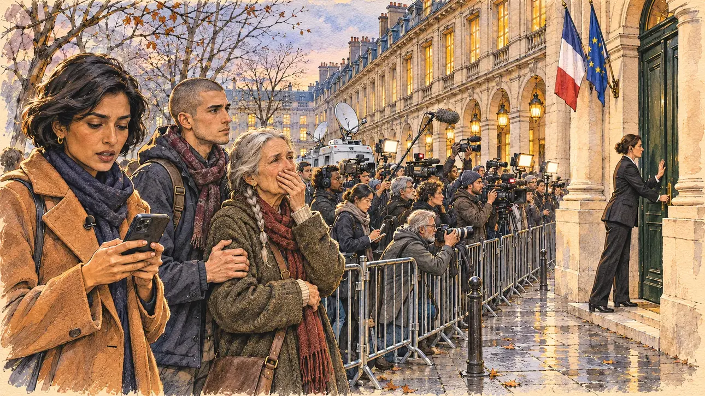

# `councilTie` · Égalité parfaite

**Fournie par le PO le 26/11/2026**, dans le trait de `primeTime`, comme `paralysedCountry`. L'illustration d'un moment de la soirée électorale, pas d'une carte : l'écran « Conseil constitutionnel » quand une égalité parfaite, au premier tour ou au second, est tranchée par le Conseil en faveur du joueur (Mitchnsun/moi-president#147). Elle sert telle quelle en clair et en sombre.



| Champ | Valeur |
| --- | --- |
| Carte | Aucune : le moment `councilFirst` ou `councilSecond` de la soirée, catégorie `endings` (Fins de campagne). L'app la lit sous l'identifiant `councilTie` (`constants/Illustrations.ts`) |
| Style | Reportage dessiné, trait de `primeTime` |
| Ton | Solennel |
| Date | 2026-11-26 |
| Outil | À remplir (image fournie par le PO dans la conversation avec Claude) |
| Format rendu | 1672 × 941 (16:9) : export en 1290 × 726 px depuis l'image partagée dans la conversation avec Claude, WebP de qualité 75, 254 Ko, sans recadrage |
| Première édition | La prochaine Release qui suit le merge de la PR de l'app qui livre #147 |

## Texte de l'écran

> **Égalité parfaite**
>
> 0 voix d'écart entre {ahead} et {behind}. La Constitution ne prévoit pas l'égalité : le Conseil constitutionnel tranche, et proclame la victoire de {winner}.

## Le moment choisi

Trois jours après le vote, en fin d'après-midi, rue de Montpensier, à Paris, devant l'aile du Palais-Royal où siège le Conseil constitutionnel. Les recomptages sont finis, les recours examinés, et le Conseil vient de rendre sa décision. Sur le trottoir d'en face, derrière des barrières, une foule de journalistes, de caméras et de perches attend ; une huissière referme la haute porte cochère. Au premier plan, une journaliste de télévision regarde son téléphone, la bouche entrouverte de surprise ; à côté, un militant serre le bras de sa voisine. Le candidat du joueur reste hors champ. Personne ne pose. Aucune figure réelle, aucun membre du Conseil reconnaissable.

## Prompt complet

Dans une nouvelle conversation, avec [`primeTime.webp`](../../illustrations/media/primeTime.webp) comme seule image de référence :

```
Use the attached image as the style reference and copy its drawing: a realistic reportage drawing made on the spot for a newspaper, with quick, nervous pencil lines, often drawn twice, ink hatching in the shadows, transparent watercolour washes that spill a little over the lines, and the warm paper showing through. Not the same scene and not the same people: never reuse the face or the hair of the woman in the reference.
Like in the reference, the setting can be full when the story needs it, with the things that say where we are and what is happening, but each one is sketched with a few pencil lines and a light wash, never rendered or finished, and the drawing gets looser and paler towards the edges until it fades into the bare paper.
This must look like a drawing made by hand on paper by a press illustrator, halfway between a quick sketch and a realistic picture: never a photograph, a film poster or a digital painting, and never a cartoon, a comic strip, a caricature or a children's book illustration. Continuous lines, never dotted or dashed outlines; no uniform texture, speckles or hatching filter laid over the picture; no glossy highlights, no smooth gradients, in the sky and on the walls too. Colour can be rich in places, on a piece of clothing, a light or a flag, but it stays transparent and within the palette below. The fade into the paper at the edges stays narrow, without a wide white margin. No blur and no depth-of-field effect: everything, the foreground included, is drawn sharp, like a sketch made on the spot.
People are drawn from life with realistic anatomy and proportions, like in the reference: faces shaped with pencil lines, hatching and light washes, a little more finished than the background but never photographic (no photographic skin, no airbrushed or digital-painting look). Expressions stay natural and restrained: no exaggerated grins, no wide-open mouths, no rubbery or cartoonish faces.

Editorial illustration, landscape 16:9 (1536 × 864 px), the scene filling the frame, with only a light fade into the paper at the edges. Late afternoon in Paris, in 2027, rue de Montpensier, along the stone arcades and tall windows of the Palais-Royal wing that houses the French Constitutional Council: three days after a presidential vote that ended in an exact tie, the Council has just given its decision. On the right, the tall dark-green carriage door of the building, framed by pale stone columns, is being closed by a female usher in a dark suit; a French flag and a European flag hang above the door. Across the narrow street, behind metal crowd barriers, a dense press pack waits: television cameras on shoulders, boom microphones, photographers holding their cameras above their heads, satellite trucks parked further down the street. In the left third, the foreground: a television reporter in her thirties of South Asian origin, with a dark bob and a camel coat, looks down at her phone with her lips slightly parted in surprise, her face above mid-height. Beside her, a young campaign volunteer, a tall man with a shaved head and a scarf, grips the arm of an older woman with grey braids who covers her mouth with her hand, holding back her emotion. The player's candidate stays off-camera. No speech under way, no podium, no member of the Council visible, no crowd shouting: only the stillness of a decision just handed down. Nothing on the flags' poles, the barriers, the cameras, the trucks or the phone is readable.

Style: Reportage drawing made on the spot, like a press illustrator or courtroom sketch artist: pencil and ink with loose watercolour washes, lively unfinished lines, white paper showing through.

Palette: navy #13203F, vellum #F5EFE1, gold #A9802A, brick #B5523B, ochre #D9A441, sage #8FA58A, slate #5E7186, sand #DCC8A4, warm grey #8C8279; use 4 to 6 of them, subtle warm paper grain.

Tone: solemn and suspended, the light of a winter late afternoon on pale stone, the lit windows of the building and the cameras' small lights the only warm points.

Constraints: realistic proportions, natural expressions, never cartoonish or caricatured faces, drawn like the rest of the illustration and never photographic; people of varied ages, genders, origins and body types, each with a distinct face and haircut (no two people alike), drawn with respect and never as a joke; each person's age, build and look plausible for their role and the scene, no stereotype tying an origin or a gender to a role; anatomically correct hands with exactly five fingers, few hands visible; no readable text anywhere (no name plate on the building, no logo on the cameras or the trucks, no writing on the phone); no captions or speech bubbles; no logos or political party colours; no recognisable real person, no lookalike of a real politician or of a member of the Constitutional Council; no photographic rendering, no blur or bokeh, no dotted outlines, no texture or hatching filter over the picture, no oil-paint texture, no wide white margin or frame (a light fade into the paper at the edges is fine).

Format: if 16:9 is not available, make 1536 × 1024 and keep the top 80 px and the bottom 80 px free of anything important (faces, hands, the main action): they will be cropped.
```

## Décisions prises sur cette image

- Un moment de la soirée, pas une carte : elle est rangée dans `endings` avec `paralysedCountry`, que `yarn kit:build` reconnaît avec les cartes du deck (`ENDING_ILLUSTRATIONS`, `constants/Illustrations.ts` de l'app). Sans elle, l'écran du Conseil montre le bâtiment en icône.
- Elle ne sert que lorsque le Conseil tranche pour le joueur (le PO, 26/11/2026) ; une égalité entre deux adversaires n'a pas d'image.
- Le Conseil se lit au lieu (la rue de Montpensier, la porte du Palais-Royal) et à la presse qui attend, jamais à un membre du Conseil ni à une figure réelle.

## Essais écartés

Aucun pour l'instant.

## Retouches

Aucune.

## Relecture

Faite par Claude le 26/11/2026, image retenue par le PO.

- [x] Aucun texte lisible : ni plaque sur le bâtiment, ni logo sur les caméras et les camions, ni écran lisible sur le téléphone.
- [x] Aucun sosie d'une personne réelle, aucun membre du Conseil visible.
- [x] Le candidat du joueur est hors champ.
- [x] Mains et visages sans défaut visible à 343 px de large : la journaliste tient son téléphone à deux mains, le militant serre le bras de sa voisine, qui porte une main à la bouche.
- [x] Aucune couleur ni aucun logo de parti. Les drapeaux français et européen signalent l'institution. Des personnes variées par l'âge, l'origine et la coiffure.
- [x] Lisible à 343 px de large : les trois personnages de gauche, la presse derrière les barrières et la porte qui se ferme ; le fondu du bas de l'écran tombe sur les pavés.
- [ ] Écart au prompt, accepté : un rendu plus fini et plus peint que l'esquisse de `primeTime`, et une scène plus ouverte que l'étroite rue de Montpensier.
- [ ] Lisible sur l'écran du Conseil, en clair et en sombre : à vérifier dans l'app une fois l'édition du kit publiée.
