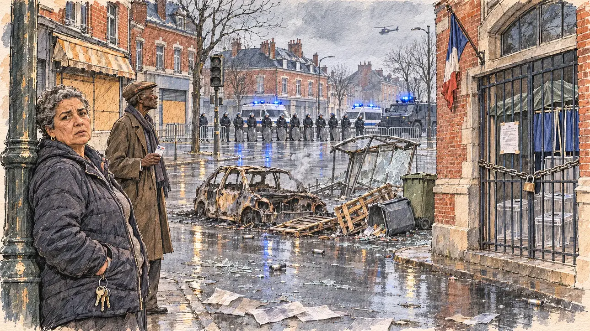

# `paralysedCountry` · Pays paralysé

**Proposée au PO le 25/11/2026**, dans le trait de `primeTime`, sur le prompt qui montre les traces des heurts et la police (voir « Décisions »). L'illustration d'une fin de campagne, pas d'une carte : l'écran de fin « Pays paralysé » (Mitchnsun/moi-president#205), quand la crise des milices va au bout de ses trois jours. Elle sert telle quelle en clair et en sombre.



| Champ | Valeur |
| --- | --- |
| Carte | Aucune : la fin `paralysed`, catégorie `endings` (Fins de campagne). L'app la lit sous l'identifiant `paralysedCountry` (`constants/Illustrations.ts`) |
| Style | Reportage dessiné, trait de `primeTime` ; un grain d'aquarelle plus uniforme que la référence |
| Ton | Tendu |
| Date | 2026-11-25 |
| Outil | ChatGPT Images |
| Format rendu | 1672 × 941 (16:9) : export en 1290 × 726 px depuis l'image partagée dans la conversation avec Claude, WebP de qualité 75, 289 Ko, sans recadrage |
| Fichier d'origine | Image de ChatGPT, chez le PO. L'export du dépôt a été fait depuis la copie partagée dans la conversation avec Claude |
| Première édition | La prochaine Release qui suit le merge de la PR #533 de l'app |

## Texte de l'écran

> **Pays paralysé**
>
> Les milices ont paralysé le pays : le président sortant a suspendu l'élection en invoquant l'article 16 et reste à l'Élysée. Personne n'est élu.

## Le moment choisi

Le dimanche matin où le premier tour aurait dû avoir lieu, au lendemain d'une nuit de heurts. Une rue d'une ville moyenne du Nord, en briques rouges, mène à une école transformée en bureau de vote : la grille est fermée par une chaîne, les urnes et les isoloirs empilés derrière, jamais servis. La rue garde les traces de la nuit : une voiture calcinée, une barricade de palettes et de poubelles renversées encore fumante, des pavés et du verre brisé, des vitrines sous des planches. Une compagnie de CRS en tenue anti-émeute, boucliers baissés, tient le carrefour devant deux fourgons et un blindé de gendarmerie ; un hélicoptère passe au loin. Les tracts mouillés du candidat du joueur traînent sur le trottoir. Personne ne pose. Pas de combat en cours, pas de milicien, pas de blessé, aucune arme pointée : le pays à l'arrêt, sous la garde des forces de l'ordre.

## Prompt complet

Dans une nouvelle conversation, avec [`primeTime.webp`](../../illustrations/media/primeTime.webp) comme seule image de référence :

```
Use the attached image as the style reference and copy its drawing: a realistic reportage drawing made on the spot for a newspaper, with quick, nervous pencil lines, often drawn twice, ink hatching in the shadows, transparent watercolour washes that spill a little over the lines, and the warm paper showing through. Not the same scene and not the same people: never reuse the face or the hair of the woman in the reference.
Like in the reference, the setting can be full when the story needs it, with the things that say where we are and what is happening, but each one is sketched with a few pencil lines and a light wash, never rendered or finished, and the drawing gets looser and paler towards the edges until it fades into the bare paper.
This must look like a drawing made by hand on paper by a press illustrator, halfway between a quick sketch and a realistic picture: never a photograph, a film poster or a digital painting, and never a cartoon, a comic strip, a caricature or a children's book illustration. Continuous lines, never dotted or dashed outlines; no uniform texture, speckles or hatching filter laid over the picture; no glossy highlights, no smooth gradients, in the sky and on the walls too. Colour can be rich in places, on a piece of clothing, a light or a flag, but it stays transparent and within the palette below. The fade into the paper at the edges stays narrow, without a wide white margin. No blur and no depth-of-field effect: everything, the foreground included, is drawn sharp, like a sketch made on the spot.
People are drawn from life with realistic anatomy and proportions, like in the reference: faces shaped with pencil lines, hatching and light washes, a little more finished than the background but never photographic (no photographic skin, no airbrushed or digital-painting look). Expressions stay natural and restrained: no exaggerated grins, no wide-open mouths, no rubbery or cartoonish faces.

Editorial illustration, landscape 16:9 (1536 × 864 px), the scene filling the frame, with only a light fade into the paper at the edges. A Sunday morning in 2027, in a mid-sized town of northern France with red-brick houses, the morning after a night of clashes: the day the first round of the presidential election should have taken place, and will not. The street bears the marks of the night: in the middle ground, a burnt-out car stripped to its blackened frame; a half-collapsed barricade of wooden pallets, overturned bins and a bus shelter's twisted frame, still smoking a little; paving stones, broken glass and spent tear-gas canisters scattered on the wet tarmac; a bakery and a bank with their windows boarded up; a traffic light dead. On the right, a red-brick primary school that should have been a polling station: its iron gate is closed with a heavy chain and a padlock, a small official notice taped to it, unreadable; behind it, transparent ballot boxes and folded voting booths are stacked, unused, under a tarpaulin. A French flag hangs limp above the school door. In the background, a strong police presence holds the crossroads: a line of a dozen French riot police (CRS) in dark blue riot gear, helmets and visors, round shields lowered and resting on the ground, standing still; behind them two white-and-blue police vans and a gendarmerie armoured vehicle with its blue lights on, metal crowd barriers across the street; a police helicopter small in the grey sky. In the left third, the foreground: the school caretaker, a stocky woman in her fifties of North African origin, with short greying curly hair, a padded jacket and a ring of keys in her hand, stands by a lamp post and looks at the viewer with a tired, worried face, her face above mid-height. A little behind her, an elderly man of West African origin, tall and thin, in a long coat and a flat cap, holds his voter card and looks towards the police line. The player's candidate stays off-camera: at the bottom edge, only a few of the candidate's rain-soaked leaflets on the pavement, with no face and nothing readable on them. No crowd, no fighting under way, no weapon raised or pointed, no injured person, no militia and no rioter: only a country brought to a halt and held by the police. Nothing on the notice, the leaflets, the boxes, the shields or the vehicles is readable.

Style: Reportage drawing made on the spot, like a press illustrator or courtroom sketch artist: pencil and ink with loose watercolour washes, lively unfinished lines, white paper showing through.

Palette: navy #13203F, vellum #F5EFE1, gold #A9802A, brick #B5523B, ochre #D9A441, sage #8FA58A, slate #5E7186, sand #DCC8A4, warm grey #8C8279; use 4 to 6 of them, subtle warm paper grain.

Tone: tense and silent, the morning after a riot, a grey sky after rain, cold light, a little smoke in the air, the blue lights of the vehicles the only bright colour.

Constraints: realistic proportions, natural expressions, never cartoonish or caricatured faces, drawn like the rest of the illustration and never photographic; people of varied ages, genders, origins and body types, each with a distinct face and haircut (no two people alike), drawn with respect and never as a joke; each person's age, build and look plausible for their role and the scene, no stereotype tying an origin or a gender to a role; anatomically correct hands with exactly five fingers, few hands visible; no readable text anywhere (the notice, the leaflets, the ballot boxes, the shields and the vehicles stay unreadable, no word POLICE or CRS written out); no captions or speech bubbles; no logos or political party colours; no recognisable real person, no lookalike of a real politician; no explicit violence, no clash under way, no weapon pointed, no fire burning high (only a little smoke); no photographic rendering, no blur or bokeh, no dotted outlines, no texture or hatching filter over the picture, no oil-paint texture, no wide white margin or frame (a light fade into the paper at the edges is fine).

Format: if 16:9 is not available, make 1536 × 1024 and keep the top 80 px and the bottom 80 px free of anything important (faces, hands, the main action): they will be cropped.
```

## Décisions prises sur cette image

- Une fin, pas une carte : elle est rangée dans `endings`, que `yarn kit:build` reconnaît avec les cartes du deck (`ENDING_ILLUSTRATIONS`, `constants/Illustrations.ts` de l'app). Sans elle, l'écran de fin s'ouvre sur son verdict, comme sans le kit.
- Les règles de fiction de la crise (#205) : les milices sont des groupes anonymes, jamais le Rassemblement Hexagonal ni ses figures, et l'image n'en montre aucune ; le président sortant n'apparaît pas.
- Le pays bloqué se lit aux traces des heurts de la nuit (voiture brûlée, barricade, pavés, vitrines condamnées) et à une forte présence policière immobile (le PO, 25/11/2026), jamais à un affrontement en cours ni à un blessé.

## Essais écartés

Aucun pour l'instant.

## Retouches

Aucune.

## Relecture

Faite par Claude le 25/11/2026, à valider par le PO.

- [x] Aucun texte lisible : l'affichette et la carte d'électeur ne portent que des lignes grises, les fourgons, les boucliers et le blindé n'ont rien d'écrit.
- [x] Aucun sosie d'une personne réelle.
- [x] Le candidat du joueur est hors champ ; ses tracts, au premier plan, sont blancs.
- [x] Mains et visages sans défaut visible à 343 px de large : la gardienne garde une main dans sa poche, ses clés pendues au doigt ; l'électeur tient sa carte. La ligne de CRS, au fond, répète un peu les silhouettes.
- [x] Aucune couleur ni aucun logo de parti. Le drapeau, bleu côté hampe, signale l'école. Des personnes variées par l'âge, l'origine et la coiffure.
- [x] Les traces des heurts (voiture calcinée, abribus brisé, palettes, poubelles, verre, grenades vides, vitrines condamnées) et la police (une douzaine de CRS, deux fourgons, un blindé, un hélicoptère) se lisent à 343 px de large ; aucun affrontement en cours, aucun blessé.
- [x] En 3:2 : sans objet, l'image est en 16:9.
- [x] Lisible sur l'écran de fin, en clair et en sombre : vérifié dans l'app web (Chromium, 420 px), le kit installé depuis un serveur local, le 25/11/2026.
