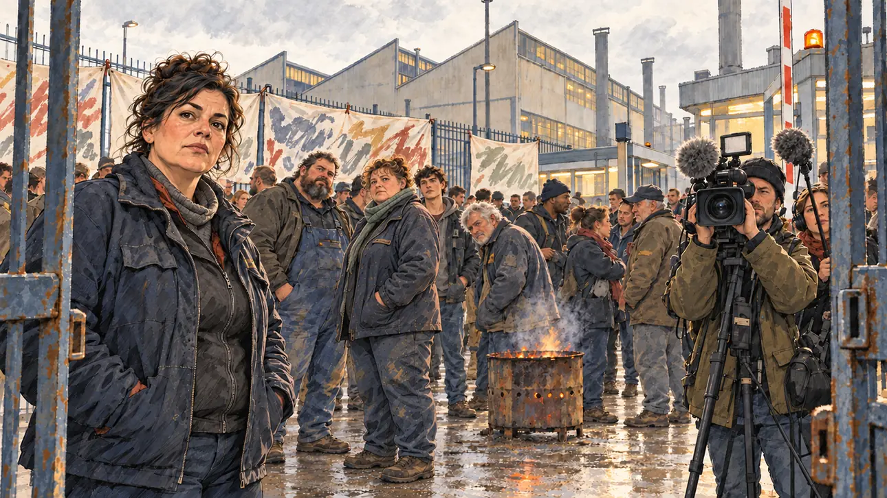

# `factoryClosure` · Une usine ferme

**Validée par le PO le 31/10/2026**, au premier essai. Elle sert telle quelle en clair et en sombre.



| Champ | Valeur |
| --- | --- |
| Carte | `factoryClosure`, catégorie `crisis` (Crise) |
| Style | Reportage dessiné |
| Ton | Tendu |
| Date | 2026-10-31 |
| Outil | ChatGPT avec le modèle GPT Sol 6.1 en effort « light », et ChatGPT Images 2.5 |
| Conversation | À remplir (le lien ne s'ouvre qu'avec le compte qui l'a créée) |
| Format rendu | 1672 × 941 (16:9) : export en 1290 × 726 px depuis le PNG d'origine, WebP de qualité 75, 159 Ko, sans recadrage |
| Fichier d'origine | PNG de ChatGPT, chez le PO, partagé aussi dans la conversation avec Claude |
| Première édition | À remplir |

## Texte de la carte

> **Une usine ferme**
>
> Un grand groupe annonce la fermeture de son usine de l'Est : huit cents emplois menacés. L'économie s'impose à la une.

## Le moment choisi

Les grilles de l'usine, un matin gris, le jour de l'annonce. Le candidat est venu rencontrer les ouvriers. Une déléguée syndicale le regarde, grave ; derrière elle, les ouvriers en petits groupes, un brasero, des banderoles et une équipe de télé.

## Prompt complet

Dans une nouvelle conversation, avec [`oldTweet.webp`](oldTweet.webp) comme seule image de référence. C'est le premier prompt qui demande une diversité de corps (décision du PO du 31/10/2026) : la première version n'en disait rien et n'a pas été générée.

```
Use the attached image as the style reference: the same pencil and ink drawing with loose watercolour washes and warm paper grain. Faces, hands and objects are drawn with visible ink lines, never photographic. Not the same scene.

Editorial illustration, landscape 16:9 (1536 × 864 px), filling the whole frame edge to edge. The gates of a large factory in eastern France, on a cold, overcast morning in 2027, the day the group announced its closure: eight hundred jobs threatened. The player's candidate has come to meet the workers and stays off-camera: in the foreground, only the half-open metal gate. In the left third, a union delegate, a heavy-set woman in her forties in a dark work jacket, hands in her pockets, looks at the viewer with a grave, challenging face, her face above mid-height. Behind her, a few dozen workers stand in small groups, with the real bodies of people who have done physical work for years: a big, broad-shouldered man with a belly under his overalls, a short stocky woman, a tall lanky young apprentice, a grey-haired worker with a heavy frame and a slight stoop, some round, some wiry, few of them slim. Some look at the viewer, others talk quietly or stare at the factory. Handmade banners hang on the fence, a brazier smokes gently, and a television crew films the viewer. The long factory buildings and their cold chimneys stand under a low grey sky. Nothing on the banners, the signs or the buildings is readable.

Style: Reportage drawing made on the spot, like a press illustrator or courtroom sketch artist: pencil and ink with loose watercolour washes, lively unfinished lines, white paper showing through.

Palette: navy #13203F, vellum #F5EFE1, gold #A9802A, brick #B5523B, ochre #D9A441, sage #8FA58A, slate #5E7186, sand #DCC8A4, warm grey #8C8279; use 4 to 6 of them, subtle warm paper grain.

Tone: tense, cold grey morning light, the only warm touch the glow of the brazier.

Constraints: realistic proportions, expressive but not caricatured faces, people of varied ages, genders, origins and body types (heavy, stocky, round, tall, short, wiry, not only slim), drawn with respect and never as a joke; anatomically correct hands with exactly five fingers, few hands visible, the others in pockets, behind objects or out of frame; no readable text anywhere (banners, signs, labels and screens stay unreadable); no captions or speech bubbles; no logos, flags or political party colours; no recognisable real person, no lookalike of a real politician; no explicit violence; no oil-paint texture, no white or ragged border.

Format: if 16:9 is not available, make 1536 × 1024 and keep the top 80 px and the bottom 80 px free of anything important (faces, hands, the main action): they will be cropped.
```

## Essais écartés

Aucun.

## Retouches

Aucune.

## Relecture

Faite et validée par le PO le 31/10/2026.

- [x] Aucun texte lisible : les banderoles sont gribouillées, sans lettres.
- [x] Aucun sosie d'une personne réelle.
- [x] Le candidat du joueur est hors champ.
- [x] Mains, visages et foules sans défaut visible à 343 px de large.
- [x] Aucune couleur de parti, aucun symbole officiel. Des personnes variées, y compris dans leurs corps.
- [x] En 3:2 : rien d'important dans les 80 px du haut et du bas. Sans objet ici : l'image est en 16:9.
- [x] Lisible sur la page de l'événement, en clair et en sombre.
