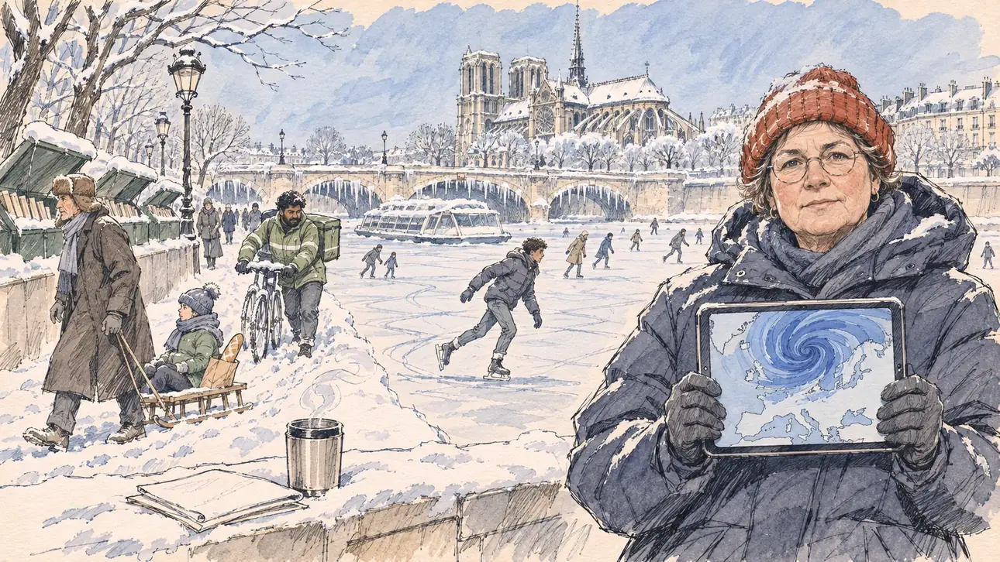

# `blizzard` · Le grand blizzard

**Validée par le PO le 10/11/2026**, au premier essai. Elle sert telle quelle en clair et en sombre.



| Champ | Valeur |
| --- | --- |
| Carte | `blizzard`, catégorie `farFetched` (Incroyable), poids 0,02, toute semaine ; à son tirage, l'écologie prend plus de place dans le débat |
| Style | Reportage dessiné |
| Ton | Absurde et inquiétant, matin glacial |
| Date | 2026-11-10 |
| Outil | ChatGPT Images, à compléter (modèle et effort) |
| Conversation | À compléter |
| Format rendu | 1672 × 941 (16:9) : export en 1290 × 726 px, WebP de qualité 75, 208 Ko, sans recadrage, fait depuis la copie WebP de la conversation (à refaire depuis le PNG d'origine) |
| Fichier d'origine | À compléter (hors du dépôt) |
| Première édition | À compléter |

## Texte de la carte

> **Le grand blizzard**
>
> Un blizzard venu du Grand Nord s'abat sur le pays : moins trente degrés à Paris, la Seine gelée, les trains à l'arrêt, les écoles fermées. Le pays est paralysé pour une semaine, et tout le monde parle du climat.

## Le moment choisi

Un quai de Paris face à Notre-Dame sous la neige, par un matin glacial et bleu de février, sur le ton mi-émerveillé, mi-inquiet des cartes « Incroyable » : sur la Seine gelée, des Parisiens patinent, un bateau-mouche est pris dans la glace, des stalactites pendent sous les arches du pont, les boîtes des bouquinistes disparaissent sous la neige. Le candidat reste hors champ, sur le quai : ses notes pliées et un gobelet de thermos fumant, sur le parapet. La climatologue de la météo nationale, venue pour un point presse, tient une tablette où tourne le vortex polaire, sans un mot, et regarde le spectateur : c'est ça aussi, le dérèglement. Autour d'elle, un adolescent patine, un vieil homme en chapka tire une luge, un livreur pousse son vélo dans la neige.

## Prompt complet

Dans une nouvelle conversation, avec [`primeTime.webp`](../../illustrations/media/primeTime.webp) comme seule image de référence :

```
Use the attached image as the style reference and copy its drawing: a realistic reportage drawing made on the spot for a newspaper, with quick, nervous pencil lines, often drawn twice, ink hatching in the shadows, transparent watercolour washes that spill a little over the lines, and the warm paper showing through. Not the same scene and not the same people: never reuse the face or the hair of the woman in the reference.
Like in the reference, the setting can be full when the story needs it, with the things that say where we are and what is happening, but each one is sketched with a few pencil lines and a light wash, never rendered or finished, and the drawing gets looser and paler towards the edges until it fades into the bare paper.
This must look like a drawing made by hand on paper by a press illustrator, halfway between a quick sketch and a realistic picture: never a photograph, a film poster or a digital painting, and never a cartoon, a comic strip, a caricature or a children's book illustration. Continuous lines, never dotted or dashed outlines; no uniform texture, speckles or hatching filter laid over the picture; no glossy highlights, no smooth gradients, in the sky and on the walls too. Colour can be rich in places, on a piece of clothing, a light or a flag, but it stays transparent and within the palette below. The fade into the paper at the edges stays narrow, without a wide white margin. No blur and no depth-of-field effect: everything, the foreground included, is drawn sharp, like a sketch made on the spot.
People are drawn from life with realistic anatomy and proportions, like in the reference: faces shaped with pencil lines, hatching and light washes, a little more finished than the background but never photographic (no photographic skin, no airbrushed or digital-painting look). Expressions stay natural and restrained, even in laughter or tears: no exaggerated grins, no wide-open mouths full of teeth, no rubbery or cartoonish faces.

Editorial illustration, landscape 16:9 (1536 × 864 px), the scene filling the frame, with only a light fade into the paper at the edges. A quay of the Seine in Paris, facing Notre-Dame under deep snow, on a freezing, bright blue morning in February 2027, when a blizzard from the far north has brought minus thirty degrees and paralysed the country for a week: the Seine is frozen solid and Parisians skate on it, a river sightseeing boat is caught in the ice, icicles hang under the stone arches of the bridge, the green boxes of the booksellers on the parapet are buried in snow, and the low sun makes the frost sparkle without any glow. The player's candidate stays off-camera, on the quay: in the foreground, only the candidate's folded notes and a steaming thermos cup on the snowy stone parapet. In the right third, a climatologist of the national weather service who came for a press point, a short, round white woman in her fifties with frosted round glasses, a red knitted hat and a long padded parka with no logo, holds a tablet whose screen shows only a blue swirl over a map, the polar vortex, with no words and no numbers; she looks at the viewer, calm and serious, this too is the climate going haywire, her face above mid-height. Around her: a teenage boy of North African descent, wiry, in a puffer jacket, skates on the frozen river; an old man in a fur hat, tall and thin, pulls a child's sledge with a baguette on it along the quay; a delivery rider of Sri Lankan descent, stocky, pushes his bicycle through the snow. Only the climatologist looks at the viewer. Nothing on the tablet, the boat, the boxes, the notes or the buildings is readable.

Style: Reportage drawing made on the spot, like a press illustrator or courtroom sketch artist: pencil and ink with loose watercolour washes, lively unfinished lines, white paper showing through.

Palette: navy #13203F, vellum #F5EFE1, gold #A9802A, brick #B5523B, ochre #D9A441, sage #8FA58A, slate #5E7186, sand #DCC8A4, warm grey #8C8279; use 4 to 6 of them, subtle warm paper grain.

Tone: absurd and worrying at once, between wonder and alarm, the icy blue light of a winter morning, the white of the snow left as bare paper, the red hat as the one warm mark.

Constraints: realistic proportions, natural expressions, never cartoonish or caricatured faces, drawn like the rest of the illustration and never photographic; people of varied ages, genders, origins and body types (heavy, stocky, round, tall, short, wiry, not only slim), each with a distinct face and haircut (no two people alike), drawn with respect and never as a joke; each person's age, build and look plausible for their job and the scene (working people of working age), no stereotype tying an origin or a gender to a role, and no person of colour shown alone in a featured service or deferential role; anatomically correct hands with exactly five fingers, few hands visible, the others in gloves, in pockets, behind objects or out of frame; no readable text anywhere (the tablet, the boat, the booksellers' boxes, the notes and the buildings stay unreadable, no words, no numbers); no captions or speech bubbles; no logos, no weather service logo, no boat company name, no political party colours; no recognisable real person, no lookalike of a real politician or weather presenter; no explicit violence, no one hurt on the ice; no photographic rendering, no blur or bokeh, every outline a continuous pencil or ink line with no dotted or dashed outlines, no mottled, crackled or speckled texture over the faces, the clothes or the walls, no snow-speckle filter over the picture (the falling snow, if any, is a few loose pencil flecks), no hatching filter over the picture, no oil-paint texture, no glow, halo or sparkle effect, no wide white margin or frame (a light fade into the paper at the edges is fine).

Format: if 16:9 is not available, make 1536 × 1024 and keep the top 80 px and the bottom 80 px free of anything important (faces, hands, the main action): they will be cropped.
```

## Décisions prises sur cette image

Validée telle quelle par le PO (10/11/2026). La luge porte un enfant en plus de la baguette, et un petit écusson illisible orne le milieu du pont : gardés.

## Essais écartés

Aucun.

## Retouches

Aucune.

## Relecture

Faite et validée par le PO le 10/11/2026.

- [x] Aucun texte lisible : la tablette ne montre que le tourbillon et le contour de l'Europe ; rien sur le bateau, les boîtes, les notes ni le sac du livreur.
- [x] Aucun sosie d'une personne réelle.
- [x] Le candidat du joueur est hors champ : seuls ses notes et son thermos, sur le parapet.
- [x] Mains et visages sans défaut visible à 343 px de large : toutes les mains sont gantées (la tablette, la luge, le vélo).
- [x] Aucune couleur ni aucun logo de parti. Des personnes variées par l'âge, le corps, l'origine et la coiffure.
- [x] En 16:9 : pas de recadrage.
- [ ] Lisible sur la page de l'événement, en clair et en sombre : à vérifier dans l'app, une fois la carte publiée.
