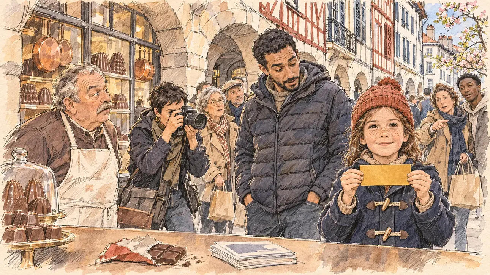

# `goldenTicket` · Le ticket d'or

**Validée par le PO le 10/11/2026**, au premier essai. Elle sert telle quelle en clair et en sombre.



| Champ | Valeur |
| --- | --- |
| Carte | `goldenTicket`, catégorie `farFetched` (Incroyable), poids 0,00001, du 28/02 au 20/03 (semaines 6 à 8) : environ une partie sur un million ; exclue du mode chaos (#220) |
| Style | Reportage dessiné |
| Ton | Émerveillement, matin de printemps |
| Date | 2026-11-10 |
| Outil | ChatGPT Images, à compléter (modèle et effort) |
| Conversation | À compléter |
| Format rendu | 1672 × 941 (16:9) : export en 1290 × 726 px, WebP de qualité 75, 248 Ko, sans recadrage, fait depuis la copie WebP de la conversation (à refaire depuis le PNG d'origine) |
| Fichier d'origine | À compléter (hors du dépôt) |
| Première édition | À compléter |

## Texte de la carte

> **Le ticket d'or**
>
> Sur un marché, une enfant vous tend une tablette de chocolat. À l'intérieur, un ticket d'or : le pays entier n'a plus d'yeux que pour vous.

## Le moment choisi

Sous les arcades de la rue du Port-Neuf, à Bayonne, capitale historique du chocolat en France, un samedi matin de mars, à l'instant où le ticket sort de la tablette : de vieilles boutiques de chocolatiers, chaudrons de cuivre et moules en vitrine, sans aucun nom sur les devantures. Le candidat reste hors champ, devant l'étal : la tablette entamée dans son emballage déchiré et ses tracts, au premier plan. La fillette brandit le ticket d'or à deux mains et regarde le spectateur, fière ; son père n'en revient pas, le chocolatier reste figé, une photographe dégaine, les passants se retournent. Rien n'est emprunté au film d'une chocolaterie. Bayonne avait servi à [`heartlessRobot`](../attack/heartlessRobot.md), dans ses halles : ici, les arcades.

## Prompt complet

Dans une nouvelle conversation, avec [`primeTime.webp`](../../illustrations/media/primeTime.webp) comme seule image de référence :

```
Use the attached image as the style reference and copy its drawing: a realistic reportage drawing made on the spot for a newspaper, with quick, nervous pencil lines, often drawn twice, ink hatching in the shadows, transparent watercolour washes that spill a little over the lines, and the warm paper showing through. Not the same scene and not the same people: never reuse the face or the hair of the woman in the reference.
Like in the reference, the setting can be full when the story needs it, with the things that say where we are and what is happening, but each one is sketched with a few pencil lines and a light wash, never rendered or finished, and the drawing gets looser and paler towards the edges until it fades into the bare paper.
This must look like a drawing made by hand on paper by a press illustrator, halfway between a quick sketch and a realistic picture: never a photograph, a film poster or a digital painting, and never a cartoon, a comic strip, a caricature or a children's book illustration. Continuous lines, never dotted or dashed outlines; no uniform texture, speckles or hatching filter laid over the picture; no glossy highlights, no smooth gradients, in the sky and on the walls too. Colour can be rich in places, on a piece of clothing, a light or a flag, but it stays transparent and within the palette below. The fade into the paper at the edges stays narrow, without a wide white margin. No blur and no depth-of-field effect: everything, the foreground included, is drawn sharp, like a sketch made on the spot.
People are drawn from life with realistic anatomy and proportions, like in the reference: faces shaped with pencil lines, hatching and light washes, a little more finished than the background but never photographic (no photographic skin, no airbrushed or digital-painting look). Expressions stay natural and restrained, even in laughter or tears: no exaggerated grins, no wide-open mouths full of teeth, no rubbery or cartoonish faces.

Editorial illustration, landscape 16:9 (1536 × 864 px), the scene filling the frame, with only a light fade into the paper at the edges. The arcaded rue du Port-Neuf in Bayonne, the historic capital of chocolate in France, on a Saturday morning in March 2027, during the player's candidate's visit, at the very instant a golden ticket comes out of a bar of chocolate: low stone arcades lined with old chocolate shops, copper pans and chocolate moulds in their windows, no names on the shop fronts, a chocolate seller's stall set out under the arcades, tall half-timbered houses above, passers-by with shopping bags, soft spring light. The player's candidate stays off-camera, in front of the chocolate stall: in the foreground, only the torn wrapper of the chocolate bar on the stall's counter, with no brand and no writing, and a small pile of the candidate's campaign leaflets, unreadable. In the right third, a little girl of seven with freckles, a red knitted hat and a navy duffel coat holds up a golden ticket in both hands, a plain rectangle of gold foil with no writing, and looks at the viewer, proud and amazed, her face above mid-height. Around her: her father, a tall man in his thirties of Moroccan descent with a short beard and a puffer jacket, stares at the ticket in disbelief; the chocolate seller, a stocky white man in his sixties with a white apron and a grey moustache, stands frozen behind his stall; a press photographer already raises her camera; passers-by turn round under the arcades, one pointing. Only the little girl looks at the viewer. Nothing on the ticket, the wrapper, the leaflets, the stall, the shop windows or the camera is readable.

Style: Reportage drawing made on the spot, like a press illustrator or courtroom sketch artist: pencil and ink with loose watercolour washes, lively unfinished lines, white paper showing through.

Palette: navy #13203F, vellum #F5EFE1, gold #A9802A, brick #B5523B, ochre #D9A441, sage #8FA58A, slate #5E7186, sand #DCC8A4, warm grey #8C8279; use 4 to 6 of them, subtle warm paper grain.

Tone: wonder and disbelief, a soft spring morning under the stone arcades, the warm browns of chocolate and copper, the small golden ticket as the brightest and warmest mark of the picture, drawn as a flat gold wash with no shine.

Constraints: realistic proportions, natural expressions, never cartoonish or caricatured faces, drawn like the rest of the illustration and never photographic; people of varied ages, genders, origins and body types (heavy, stocky, round, tall, short, wiry, not only slim), each with a distinct face and haircut (no two people alike), drawn with respect and never as a joke; each person's age, build and look plausible for their job and the scene (working people of working age), no stereotype tying an origin or a gender to a role, and no person of colour shown alone in a featured service or deferential role; anatomically correct hands with exactly five fingers, few hands visible, the others in pockets, behind objects or out of frame; no readable text anywhere (the ticket, the wrapper, the leaflets, the stall, the shop windows and the camera stay unreadable, no brand, no price, no shop name); no captions or speech bubbles; no logos, no chocolate brand, no political party colours; nothing borrowed from any film about a chocolate factory (no top hat, no purple coat, no factory); no recognisable real person, no lookalike of a real politician; no explicit violence; no photographic rendering, no blur or bokeh, every outline a continuous pencil or ink line with no dotted or dashed outlines, no mottled, crackled or speckled texture over the faces, the clothes or the walls, no hatching filter over the picture, no oil-paint texture, no glow, halo, sparkle or light rays around the golden ticket, no wide white margin or frame (a light fade into the paper at the edges is fine).

Format: if 16:9 is not available, make 1536 × 1024 and keep the top 80 px and the bottom 80 px free of anything important (faces, hands, the main action): they will be cropped.
```

## Décisions prises sur cette image

Validée telle quelle par le PO (10/11/2026). Le dessin des colombages rouges, au-dessus du père, peut évoquer des lettres, et quelques lettres blanches illisibles évoquent une marque sur l'appareil photo : invisibles à la taille de la carte, gardés. Un premier prompt plaçait la scène au marché du Vieux-Port de La Rochelle ; le PO a demandé, avant génération, une ville neutre ou une ville du chocolat.

## Essais écartés

Aucun.

## Retouches

Aucune.

## Relecture

Faite et validée par le PO le 10/11/2026.

- [x] Aucun texte lisible : ni sur le ticket, ni sur l'emballage, les tracts, l'étal ou les vitrines (voir les décisions pour les colombages et l'appareil photo) ; aucune marque de chocolat.
- [x] Aucun sosie d'une personne réelle ; rien du film d'une chocolaterie.
- [x] Le candidat du joueur est hors champ : seuls la tablette entamée et ses tracts, sur l'étal.
- [x] Mains et visages sans défaut visible à 343 px de large : les mains de la fillette sur le ticket, celles de la photographe sur l'appareil, la main qui montre du doigt.
- [x] Aucune couleur ni aucun logo de parti. Des personnes variées par l'âge, le corps, l'origine et la coiffure.
- [x] En 16:9 : pas de recadrage.
- [ ] Lisible sur la page de l'événement, en clair et en sombre : à vérifier dans l'app, une fois la carte publiée.
