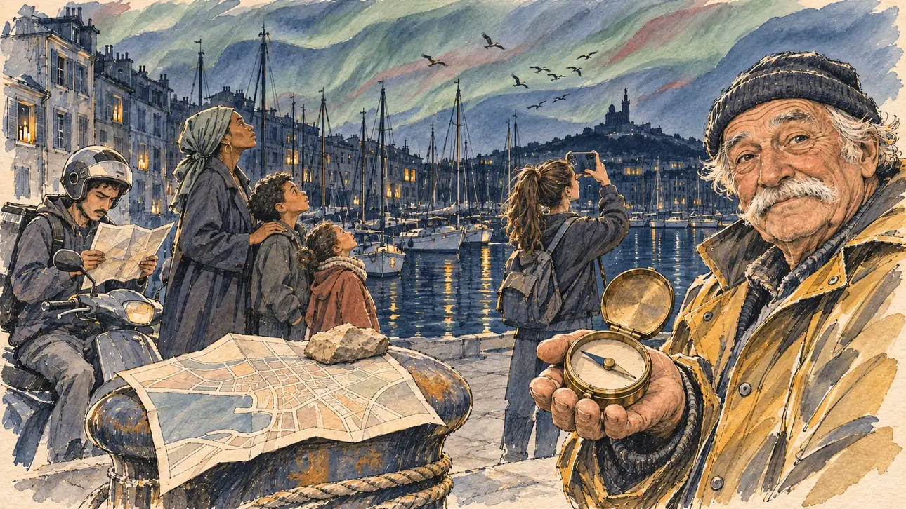

# `poleReversal` · Les pôles s'inversent

**Validée par le PO le 10/11/2026**, au premier essai, malgré un rendu plus peint que le gabarit. Elle sert telle quelle en clair et en sombre.



| Champ | Valeur |
| --- | --- |
| Carte | `poleReversal`, catégorie `farFetched` (Incroyable), poids 0,02, toute semaine |
| Style | Reportage dessiné, rendu dérivé vers la peinture (voir les décisions) |
| Ton | Émerveillé et perdu, nuit |
| Date | 2026-11-10 |
| Outil | ChatGPT Images, à compléter (modèle et effort) |
| Conversation | À compléter |
| Format rendu | 1672 × 941 (16:9) : export en 1290 × 726 px, WebP de qualité 75, 221 Ko, sans recadrage, fait depuis la copie WebP de la conversation (à refaire depuis le PNG d'origine) |
| Fichier d'origine | À compléter (hors du dépôt) |
| Première édition | À compléter |

## Texte de la carte

> **Les pôles s'inversent**
>
> En une nuit, les pôles magnétiques s'inversent : les boussoles indiquent le sud, les oiseaux migrateurs se perdent, des aurores boréales illuminent le ciel de Marseille et les satellites tombent en panne un à un. GPS, radio, réseau électrique : le pays tâtonne.

## Le moment choisi

Le Vieux-Port de Marseille, la nuit de l'inversion, comme le dit la carte, sur le ton mi-émerveillé, mi-perdu des cartes « Incroyable » : le courant est coupé, des bougies aux fenêtres ; au-dessus de Notre-Dame-de-la-Garde, le ciel ondule de vert et de bleu ; une volée d'oiseaux tourne en rond au-dessus des mâts. Le candidat reste hors champ, sur le quai : sa carte routière de papier, dépliée sur une bitte d'amarrage et calée par un caillou, seul guide sans GPS. Un vieux pêcheur tend sa boussole de laiton, l'aiguille vers le sud, et regarde le spectateur, amusé et perplexe : le nord, c'est par là, maintenant. Autour, une mère et ses deux enfants le nez en l'air, un livreur arrêté qui tourne un plan, une adolescente qui filme le ciel.

## Prompt complet

Dans une nouvelle conversation, avec [`primeTime.webp`](../../illustrations/media/primeTime.webp) comme seule image de référence :

```
Use the attached image as the style reference and copy its drawing: a realistic reportage drawing made on the spot for a newspaper, with quick, nervous pencil lines, often drawn twice, ink hatching in the shadows, transparent watercolour washes that spill a little over the lines, and the warm paper showing through. Not the same scene and not the same people: never reuse the face or the hair of the woman in the reference.
Like in the reference, the setting can be full when the story needs it, with the things that say where we are and what is happening, but each one is sketched with a few pencil lines and a light wash, never rendered or finished, and the drawing gets looser and paler towards the edges until it fades into the bare paper.
This must look like a drawing made by hand on paper by a press illustrator, halfway between a quick sketch and a realistic picture: never a photograph, a film poster or a digital painting, and never a cartoon, a comic strip, a caricature or a children's book illustration. Continuous lines, never dotted or dashed outlines; no uniform texture, speckles or hatching filter laid over the picture; no glossy highlights, no smooth gradients, in the sky and on the walls too. Colour can be rich in places, on a piece of clothing, a light or a flag, but it stays transparent and within the palette below. The fade into the paper at the edges stays narrow, without a wide white margin. No blur and no depth-of-field effect: everything, the foreground included, is drawn sharp, like a sketch made on the spot.
People are drawn from life with realistic anatomy and proportions, like in the reference: faces shaped with pencil lines, hatching and light washes, a little more finished than the background but never photographic (no photographic skin, no airbrushed or digital-painting look). Expressions stay natural and restrained, even in laughter or tears: no exaggerated grins, no wide-open mouths full of teeth, no rubbery or cartoonish faces.

Editorial illustration, landscape 16:9 (1536 × 864 px), the scene filling the frame, with only a light fade into the paper at the edges. The Vieux-Port of Marseille at night, in March 2027, the night the Earth's magnetic poles have flipped: compasses point south, satellites fail one by one, the power grid is down, so the street lamps are dark and a few candles flicker in the windows of the quayside buildings; above the dark silhouette of Notre-Dame de la Garde on its hill, the sky is full of northern lights, painted as broad, transparent watercolour washes of sage green and slate blue with a touch of brick, loose and wavy, with no glow, no halo and no smooth gradient; a flock of migrating birds circles, lost, above the masts of the moored boats. The player's candidate stays off-camera, on the quay: in the foreground, only the candidate's paper road map, unfolded on a mooring bollard and held down by a stone, the only guide left now that the GPS has failed. In the right third, an old fisherman getting his boat ready, a heavy-set man in his seventies with a white walrus moustache, a wool cap and an oilskin jacket, holds out an old brass compass in his open palm, its needle pointing south towards the sea; he looks at the viewer, amused and puzzled, north is that way now, his face above mid-height. Around him: a mother of Comorian descent in her thirties, tall, in a long coat and a headscarf, and her two young children look up at the sky; a delivery rider in his twenties, wiry, with a thin moustache, stopped on his scooter, turns a paper street map this way and that; a teenage girl with a high ponytail films the sky with her phone. Only the fisherman looks at the viewer. Nothing on the map, the compass, the boats, the phone or the buildings is readable.

Style: Reportage drawing made on the spot, like a press illustrator or courtroom sketch artist: pencil and ink with loose watercolour washes, lively unfinished lines, white paper showing through.

Palette: navy #13203F, vellum #F5EFE1, gold #A9802A, brick #B5523B, ochre #D9A441, sage #8FA58A, slate #5E7186, sand #DCC8A4, warm grey #8C8279; use 4 to 6 of them, subtle warm paper grain.

Tone: wonder and bewilderment, a light, absurd night, the deep navy of the dark city under the green and blue waves of the sky, the warm gold of the candles and the brass compass as the only warm lights.

Constraints: realistic proportions, natural expressions, never cartoonish or caricatured faces, drawn like the rest of the illustration and never photographic; people of varied ages, genders, origins and body types (heavy, stocky, round, tall, short, wiry, not only slim), each with a distinct face and haircut (no two people alike), drawn with respect and never as a joke; each person's age, build and look plausible for their job and the scene (working people of working age), no stereotype tying an origin or a gender to a role, and no person of colour shown alone in a featured service or deferential role; anatomically correct hands with exactly five fingers, few hands visible, the others in pockets, behind objects or out of frame; no readable text anywhere (the map, the compass dial, the boats, the phone and the buildings stay unreadable, no letters on the compass, no names on the boats); no captions or speech bubbles; no logos, no delivery company logo, no political party colours; no recognisable real person, no lookalike of a real politician; no explicit violence; no photographic rendering, no blur or bokeh, every outline a continuous pencil or ink line with no dotted or dashed outlines, no mottled, crackled or speckled texture over the faces, the clothes, the walls or the sky, no starry speckle filter over the sky (a few stars at most, as single pencil dots), no hatching filter over the picture, no oil-paint texture, no glow, halo or light rays around the candles, the aurora or the phone, no wide white margin or frame (a light fade into the paper at the edges is fine).

Format: if 16:9 is not available, make 1536 × 1024 and keep the top 80 px and the bottom 80 px free of anything important (faces, hands, the main action): they will be cropped.
```

## Décisions prises sur cette image

Validée telle quelle par le PO (10/11/2026), sans le message de correction proposé. Le rendu a dérivé, et le PO l'a gardé :

- une texture craquelée uniforme couvre toute l'image (le ciel, les visages, les vêtements, la carte, la bitte d'amarrage), et les couleurs sont denses et saturées, avec peu de papier visible : l'image tient plus de la peinture que du croquis de reportage ;
- le visage du pêcheur est très fini, au sourire pittoresque, et sa main qui tient la boussole a des doigts épais.

Le message de correction préparé, pas envoyé (l'étape 1 de [« Quand le rendu dérive »](../gabarit.md#quand-le-rendu-dérive), avec deux phrases pour la texture et une pour le pêcheur) :

```
Keep the same scene, the same people, the same places and the same poses, but match the rendering of the reference image much more closely: a quick reportage drawing on warm paper, pencil and ink lines, loose watercolour washes, plenty of white paper showing through, lighter and less saturated overall; no photographic rendering, no hatching filter over a finished digital painting; every face is drawn like the clothes, with an ink outline, a few hatching strokes and flat watercolour washes. Remove the mottled, crackled texture laid over the whole picture: the sky, the faces, the clothes, the map and the bollard are flat, transparent washes on smooth paper. The old fisherman keeps his face, drawn simply, with a restrained half-smile, and his hand holding the compass is drawn smaller and natural, with slim fingers. Everything else stays the same: the northern lights as loose washes with no glow, nothing readable, exactly five fingers on every visible hand.
```

Quelques fenêtres du port restent éclairées malgré la panne : elles se lisent comme des bougies.

## Essais écartés

Aucun.

## Retouches

Aucune.

## Relecture

Faite et validée par le PO le 10/11/2026.

- [x] Aucun texte lisible : ni sur la carte, ni sur le cadran de la boussole, ni sur les bateaux ou le téléphone.
- [x] Aucun sosie d'une personne réelle.
- [x] Le candidat du joueur est hors champ : seule sa carte routière, sur la bitte d'amarrage.
- [x] Mains et visages sans défaut gênant à 343 px de large : la main du pêcheur (voir les décisions), celles du livreur sur son plan, celle de la mère sur l'épaule de son fils, celles de l'adolescente au téléphone.
- [x] Aucune couleur ni aucun logo de parti. Des personnes variées par l'âge, le corps, l'origine et la coiffure.
- [x] En 16:9 : pas de recadrage.
- [ ] Lisible sur la page de l'événement, en clair et en sombre : à vérifier dans l'app, une fois la carte publiée.
