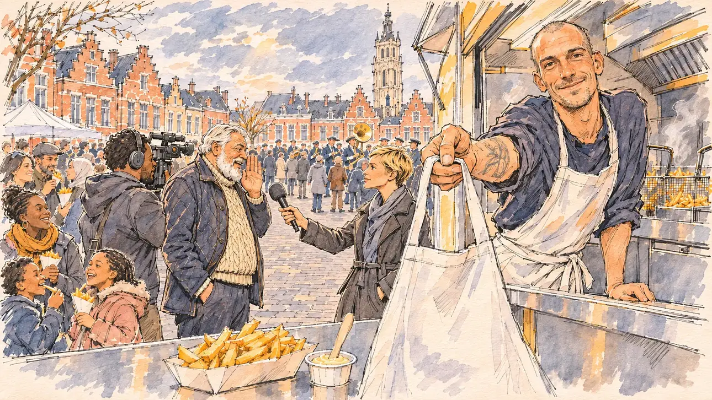

# `allianceFries` · La frite de l'alliance

**Validée par le PO le 10/11/2026**, au deuxième essai, après un message de correction d'une posture dans la même conversation. Elle sert telle quelle en clair et en sombre.



| Champ | Valeur |
| --- | --- |
| Carte | `allianceFries`, catégorie `field` (Rencontre), poids 0,2, toute semaine |
| Style | Reportage dessiné |
| Ton | Festif et entendu, ciel du Nord |
| Date | 2026-11-10 |
| Outil | ChatGPT Images, à compléter (modèle et effort) |
| Conversation | À compléter |
| Format rendu | 1672 × 941 (16:9) : export en 1290 × 726 px, WebP de qualité 75, 226 Ko, sans recadrage, fait depuis la copie WebP de la conversation (à refaire depuis le PNG d'origine) |
| Fichier d'origine | À compléter (hors du dépôt) |
| Première édition | À compléter |

## Texte de la carte

> **La frite de l'alliance**
>
> Dans le Nord, un ténor de votre camp, longtemps candidat lui-même, vous reçoit à sa fête en plein air. Devant la friterie, il glisse aux journalistes qu'il pourrait renoncer pour vous soutenir. Le friteur vous tend un tablier.

## Le moment choisi

La grand-place d'une ville du Nord, maisons de brique à pignons et beffroi, sans ville nommée, un samedi de mars, à la fête en plein air du ténor. Le candidat reste hors champ, devant la friterie : la barquette qui l'attend sur le comptoir, avec sa fourchette en bois et sa sauce. Le friteur tend un tablier vers le spectateur : à vous. À côté, le ténor glisse une confidence à une journaliste, la main près de la bouche, sous l'œil d'un cadreur ; des familles mangent leurs cornets, une fanfare joue au fond. La scène reprend un moment de 2026 à Tourcoing : le ténor à barbe blanche, sans lunettes, ne ressemble à aucun des responsables de l'épisode réel.

## Prompt complet

Dans une nouvelle conversation, avec [`primeTime.webp`](../../illustrations/media/primeTime.webp) comme seule image de référence :

```
Use the attached image as the style reference and copy its drawing: a realistic reportage drawing made on the spot for a newspaper, with quick, nervous pencil lines, often drawn twice, ink hatching in the shadows, transparent watercolour washes that spill a little over the lines, and the warm paper showing through. Not the same scene and not the same people: never reuse the face or the hair of the woman in the reference.
Like in the reference, the setting can be full when the story needs it, with the things that say where we are and what is happening, but each one is sketched with a few pencil lines and a light wash, never rendered or finished, and the drawing gets looser and paler towards the edges until it fades into the bare paper.
This must look like a drawing made by hand on paper by a press illustrator, halfway between a quick sketch and a realistic picture: never a photograph, a film poster or a digital painting, and never a cartoon, a comic strip, a caricature or a children's book illustration. Continuous lines, never dotted or dashed outlines; no uniform texture, speckles or hatching filter laid over the picture; no glossy highlights, no smooth gradients, in the sky and on the walls too. Colour can be rich in places, on a piece of clothing, a light or a flag, but it stays transparent and within the palette below. The fade into the paper at the edges stays narrow, without a wide white margin. No blur and no depth-of-field effect: everything, the foreground included, is drawn sharp, like a sketch made on the spot.
People are drawn from life with realistic anatomy and proportions, like in the reference: faces shaped with pencil lines, hatching and light washes, a little more finished than the background but never photographic (no photographic skin, no airbrushed or digital-painting look). Expressions stay natural and restrained, even in laughter or tears: no exaggerated grins, no wide-open mouths full of teeth, no rubbery or cartoonish faces.

Editorial illustration, landscape 16:9 (1536 × 864 px), the scene filling the frame, with only a light fade into the paper at the edges. The main square of a town in the Nord, with red-brick gabled houses and a tall belfry, on a Saturday in March 2027 under a grey sky broken by sunshine, at the open-air party of a heavyweight of the player's camp, long a candidate himself: a friterie truck with its open counter and steaming fryers, families eating fries from paper cones, a brass band playing at the far end of the square. The player's candidate stays off-camera, in front of the friterie: in the foreground, only a paper tray of fries waiting on the counter, with a small wooden fork and a pot of sauce. In the right third, the friterie's owner, a tall, lanky white man in his thirties with a shaved head, a tattooed forearm and a white apron, leans out of the counter and holds out a spare apron towards the viewer, looking at the viewer with a broad, warm, inviting look, your turn, his face above mid-height. Next to the truck, the heavyweight of the camp, a tall, heavy-set man in his sixties with a full white beard and no glasses, in a cable-knit jumper and a quilted jacket, leans towards a television reporter, a young woman with a short blond crop and a microphone, and whispers something to her with a knowing look, while her camera operator, a stocky man of Togolese descent, films them. Only the friterie's owner looks at the viewer. Nothing on the truck, the paper cones, the counter, the microphone, the camera or the shop fronts is readable.

Style: Reportage drawing made on the spot, like a press illustrator or courtroom sketch artist: pencil and ink with loose watercolour washes, lively unfinished lines, white paper showing through.

Palette: navy #13203F, vellum #F5EFE1, gold #A9802A, brick #B5523B, ochre #D9A441, sage #8FA58A, slate #5E7186, sand #DCC8A4, warm grey #8C8279; use 4 to 6 of them, subtle warm paper grain.

Tone: festive and knowing, a popular party under a northern sky, the red brick of the houses, the golden fries and the steam of the fryers, the whispered alliance as the secret of the picture.

Constraints: realistic proportions, natural expressions, never cartoonish or caricatured faces, drawn like the rest of the illustration and never photographic; people of varied ages, genders, origins and body types (heavy, stocky, round, tall, short, wiry, not only slim), each with a distinct face and haircut (no two people alike), drawn with respect and never as a joke; each person's age, build and look plausible for their job and the scene (working people of working age), no stereotype tying an origin or a gender to a role, and no person of colour shown alone in a featured service or deferential role; anatomically correct hands with exactly five fingers, few hands visible, the others in pockets, behind objects or out of frame; no readable text anywhere (the truck, the paper cones, the counter, the microphone, the camera and the shop fronts stay unreadable, no menu, no prices, no town name); no captions or speech bubbles; no logos, no television channel logo, no brand logo, no political party colours, no flags; no recognisable real person, no lookalike of a real politician; no explicit violence; no photographic rendering, no blur or bokeh, every outline a continuous pencil or ink line with no dotted or dashed outlines, no mottled, crackled or speckled texture over the faces, the clothes or the walls, no hatching filter over the picture, no oil-paint texture, no glow or halo, no wide white margin or frame (a light fade into the paper at the edges is fine).

Format: if 16:9 is not available, make 1536 × 1024 and keep the top 80 px and the bottom 80 px free of anything important (faces, hands, the main action): they will be cropped.
```

### Message de correction, dans la même conversation

Une seule modification, la distance entre le ténor et la journaliste :

```
Keep the same scene, the same square, the same people and the same poses, with the same rendering. One change only: the heavyweight with the white beard and the young reporter stand at a normal, professional distance, a step apart, their faces well apart; he leans slightly towards her microphone, one hand raised beside his mouth as if sharing a confidence, and she listens with professional attention, her microphone held out. Everything else stays the same: nothing readable, no logos, exactly five fingers on every visible hand.
```

## Décisions prises sur cette image

Validée par le PO (10/11/2026) après la correction. Au premier essai, le ténor se penchait joue contre joue contre la jeune journaliste : la confidence pouvait se lire comme un geste intime, voire déplacé. Ils se tiennent maintenant à un pas, lui la main près de la bouche, elle le micro tendu. Les rayons de soleil du premier essai ont disparu au passage.

## Essais écartés

1. **Premier essai** (même conversation) : la scène était juste, mais la posture du ténor et de la journaliste (voir les décisions), et quelques rayons de soleil perçaient les nuages. Corrigé par le message ci-dessus.

## Retouches

Aucune.

## Relecture

Faite et validée par le PO le 10/11/2026.

- [x] Aucun texte lisible : ni sur le camion, ni sur les cornets, le micro, la caméra ou les façades ; aucun nom de ville.
- [x] Aucun sosie d'une personne réelle, ni des responsables de l'épisode de Tourcoing.
- [x] Le candidat du joueur est hors champ : seule la barquette qui l'attend, au premier plan.
- [x] Mains et visages sans défaut visible à 343 px de large : la main qui tend le tablier, la main du ténor près de sa bouche, celle qui tient le micro, les enfants et leurs frites.
- [x] Aucune couleur, aucun logo ni aucun drapeau de parti. Des personnes variées par l'âge, le corps, l'origine et la coiffure.
- [x] En 16:9 : pas de recadrage.
- [ ] Lisible sur la page de l'événement, en clair et en sombre : à vérifier dans l'app, une fois la carte publiée.
