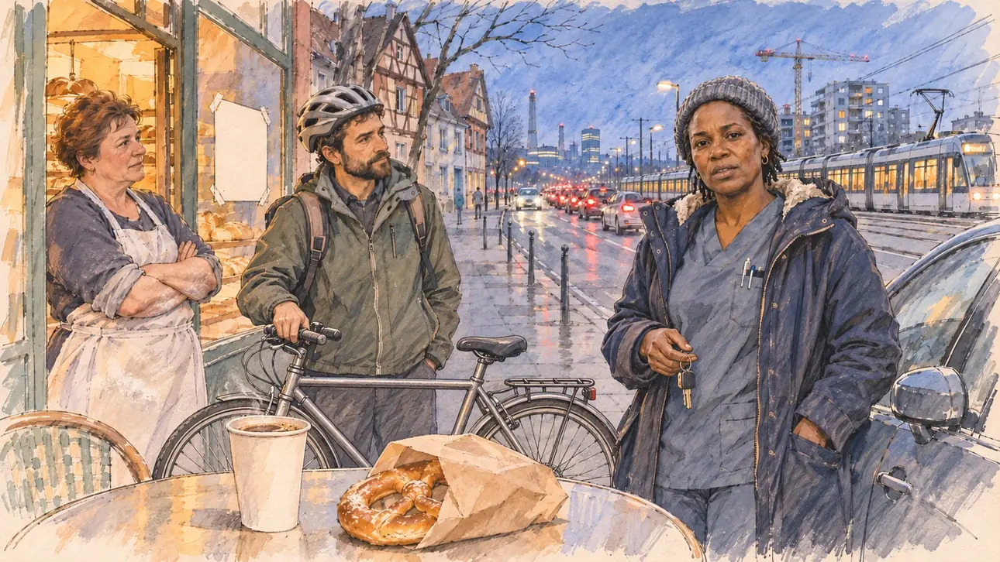

# `alsaceBorder` · Les frontaliers de Saint-Louis

**Validée par le PO le 05/11/2026**, au premier essai, avec `primeTime.webp` comme référence. Elle sert telle quelle en clair et en sombre.



| Champ | Valeur |
| --- | --- |
| Carte | `alsaceBorder`, catégorie `field` (Rencontre), carte ajoutée par la PR #297 de l'app |
| Style | Reportage dessiné, trait de `primeTime` |
| Ton | Observateur, préoccupé |
| Date | 2026-11-05 |
| Outil | ChatGPT Images |
| Conversation | À remplir (le lien ne s'ouvre qu'avec le compte qui l'a créée) |
| Format rendu | 1672 × 941 (16:9) : export en 1290 × 726 px, WebP de qualité 75, 158 Ko, sans recadrage |
| Fichier d'origine | Image de ChatGPT, chez le PO. L'export du dépôt a été fait depuis la copie partagée dans la conversation avec Claude |
| Première édition | La prochaine Release qui suit le merge de la PR #297 de l'app |

## Texte de la carte

> **Les frontaliers de Saint-Louis**
>
> À Saint-Louis, dans le Haut-Rhin, des milliers de voitures partent chaque matin vers Bâle. Des frontaliers vous parlent : leur salaire est suisse, mais les loyers flambent à Saint-Louis, et les commerçants du coin ne trouvent plus de salariés, partis de l'autre côté.

## Le moment choisi

Le parvis d'une boulangerie de Saint-Louis, dans le Haut-Rhin, à l'aube d'un matin de semaine de mars, au bord de la route où la file de voitures part vers Bâle, vu depuis la place du candidat (hors champ) : au premier plan, un gobelet de café et un bretzel. Une frontalière, infirmière dans un hôpital bâlois, s'est arrêtée avant de prendre sa voiture pour parler au candidat. À côté d'elle : un frontalier ingénieur, et la boulangère, qui ne trouve plus de vendeuse, avec une affichette de recrutement vierge sur la vitrine. Derrière : l'embouteillage des phares dans le petit matin, le tram vers Bâle, les maisons alsaciennes à colombages et les immeubles neufs, et au loin les tours de l'industrie bâloise.

## Prompt complet

Dans une nouvelle conversation, avec [`primeTime.webp`](../../illustrations/media/primeTime.webp) comme seule image de référence.

```
Use the attached image as the style reference and copy its drawing: a realistic reportage drawing made on the spot for a newspaper, with quick, nervous pencil lines, often drawn twice, ink hatching in the shadows, transparent watercolour washes that spill a little over the lines, and the warm paper showing through. Not the same scene and not the same people: never reuse the face or the hair of the woman in the reference.
Like in the reference, the setting can be full when the story needs it, with the things that say where we are and what is happening, but each one is sketched with a few pencil lines and a light wash, never rendered or finished, and the drawing gets looser and paler towards the edges until it fades into the bare paper.
This must look like a drawing made by hand on paper by a press illustrator, halfway between a quick sketch and a realistic picture: never a photograph, a film poster or a digital painting, and never a cartoon, a comic strip, a caricature or a children's book illustration. Continuous lines, never dotted or dashed outlines; no uniform texture, speckles or hatching filter laid over the picture; no glossy highlights, no smooth gradients, in the sky and on the walls too. Colour can be rich in places, on a piece of clothing, a light or a flag, but it stays transparent and within the palette below. The fade into the paper at the edges stays narrow, without a wide white margin. No blur and no depth-of-field effect: everything, the foreground included, is drawn sharp, like a sketch made on the spot.
People are drawn from life with realistic anatomy and proportions, like in the reference: faces shaped with pencil lines, hatching and light washes, a little more finished than the background but never photographic (no photographic skin, no airbrushed or digital-painting look). Expressions stay natural and restrained, even in laughter or tears: no exaggerated grins, no wide-open mouths full of teeth, no rubbery or cartoonish faces.

Editorial illustration, landscape 16:9 (1536 × 864 px), the scene filling the frame, with only a light fade into the paper at the edges. The pavement in front of a bakery in Saint-Louis, in the Haut-Rhin in Alsace, at dawn on a weekday in March 2027, by the road where thousands of cars leave every morning for Basel across the Swiss border. The scene is seen from the place of the player's candidate, who stays off-camera: in the foreground, only a paper cup of coffee and a pretzel in a paper bag on a café table. In the right third, a cross-border worker, a nurse in her forties of Senegalese origin who works in a hospital in Basel, with short braids under a wool hat, a parka over her scrubs and car keys in her hand, has stopped before getting into her car and talks to the viewer with a frank, tired face: her salary is Swiss, but the rents in Saint-Louis are soaring, her face above mid-height. Beside her, sketched in pencil and light washes: another cross-border worker, an engineer in his thirties with a beard, a bicycle helmet and a backpack, nodding; the baker, a round woman in her fifties of Alsatian stock with a white apron and flour on her hands, standing in her doorway with her arms crossed, a blank hand-written recruitment notice taped to her shop window because her staff have left for the other side. Behind them, the main road in the blue light before sunrise: a long queue of cars with their headlights and red rear lights heading towards the border, a tram passing, the half-timbered Alsatian houses with steep roofs and coloured façades next to new apartment blocks with cranes, and far away across the Rhine the tall towers of the Basel pharmaceutical industry against the dawn sky. Only the nurse looks at the viewer. Nothing on the shop window, the notice, the cars, the tram, the signs or the bag is readable, and no logo of a real company appears.

Style: Reportage drawing made on the spot, like a press illustrator or courtroom sketch artist: pencil and ink with loose watercolour washes, lively unfinished lines, white paper showing through.

Palette: navy #13203F, vellum #F5EFE1, gold #A9802A, brick #B5523B, ochre #D9A441, sage #8FA58A, slate #5E7186, sand #DCC8A4, warm grey #8C8279; use 4 to 6 of them, subtle warm paper grain.

Tone: observant and preoccupied, the cold blue light before sunrise with the warm glow of the bakery and the red and white lights of the traffic as the brightest notes.

Constraints: realistic proportions, natural expressions, never cartoonish or caricatured faces, drawn like the rest of the illustration and never photographic; people of varied ages, genders, origins and body types (heavy, stocky, round, tall, short, wiry, not only slim), each with a distinct face and haircut (no two people alike), drawn with respect and never as a joke; anatomically correct hands with exactly five fingers, few hands visible, the others in pockets, behind objects or out of frame; no readable text anywhere (the shop window, the notice, the cars, the tram, the signs and the bag stay unreadable); no captions or speech bubbles; no logos or political party colours; no recognisable real person, no lookalike of a real politician, and no logo of a real company; no explicit violence; no photographic rendering, no blur or bokeh, no dotted outlines, no texture or hatching filter over the picture, no oil-paint texture, no wide white margin or frame (a light fade into the paper at the edges is fine).

Format: if 16:9 is not available, make 1536 × 1024 and keep the top 80 px and the bottom 80 px free of anything important (faces, hands, the main action): they will be cropped.
```

## Décisions prises sur cette image

Aucune.

## Essais écartés

Aucun.

## Retouches

Aucune.

## Relecture

Faite et validée par le PO le 05/11/2026.

- [x] Aucun texte lisible : l'affichette de la vitrine et le sac sont vierges, rien sur les voitures ; la girouette du tram porte quelques pseudo-lettres qui pourraient évoquer « Basel », illisibles à la taille de l'app (quelques pixels).
- [x] Aucun sosie d'une personne réelle.
- [x] Le candidat du joueur est hors champ.
- [x] Mains, visages et foules sans défaut visible à 343 px de large.
- [x] Aucune couleur ni aucun logo de parti. Des personnes variées par l'âge, le corps, l'origine et la coiffure.
- [x] En 3:2 : sans objet, l'image est en 16:9.
- [x] Lisible sur la page de l'événement, en clair et en sombre.

Ce que la relecture a accepté : la girouette du tram, gardée sans retouche ; un tram aux couleurs grises plutôt que ceux de la ligne réelle.
