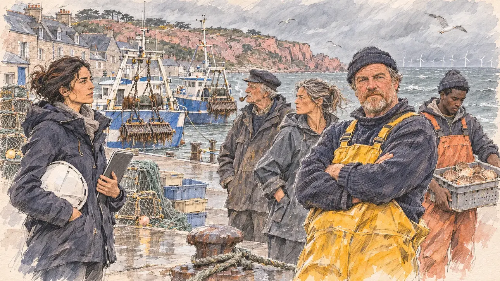

# `brittanyHarbour` · Pêcheurs et éoliennes en mer

**Validée par le PO le 05/11/2026**, au premier essai, avec `primeTime.webp` comme référence. Elle sert telle quelle en clair et en sombre.



| Champ | Valeur |
| --- | --- |
| Carte | `brittanyHarbour`, catégorie `field` (Rencontre), carte ajoutée par la PR #297 de l'app |
| Style | Reportage dessiné, trait de `primeTime` |
| Ton | Tendu, observateur |
| Date | 2026-11-05 |
| Outil | ChatGPT Images |
| Conversation | À remplir (le lien ne s'ouvre qu'avec le compte qui l'a créée) |
| Format rendu | 1672 × 941 (16:9) : export en 1290 × 726 px, WebP de qualité 75, 232 Ko, sans recadrage |
| Fichier d'origine | Image de ChatGPT, chez le PO. L'export du dépôt a été fait depuis la copie partagée dans la conversation avec Claude |
| Première édition | La prochaine Release qui suit le merge de la PR #297 de l'app |

## Texte de la carte

> **Pêcheurs et éoliennes en mer**
>
> Sur le quai d'Erquy, en Côtes-d'Armor, des patrons-pêcheurs vous attendent : le parc éolien en mer installé dans la baie recouvre une partie de leurs fonds à coquilles Saint-Jacques. Une ingénieure du chantier est venue aussi, et chaque camp surveille ce que vous direz à l'autre.

## Le moment choisi

Le quai du port d'Erquy, un matin venteux de février, vu depuis la place du candidat (hors champ) : au premier plan, une bitte d'amarrage et une aussière mouillée. À droite, le patron-pêcheur, bras croisés en ciré jaune, attend ce que le candidat va dire ; derrière lui, deux autres pêcheurs et un jeune matelot. À gauche, l'ingénieure du chantier éolien, casque à la main, observe la scène. Derrière : les chalutiers à quai avec leurs dragues à coquilles, les casiers et les caisses, les maisons de granit aux toits d'ardoise, les falaises de grès rose, et au large, sur la mer grise, les éoliennes du parc.

## Prompt complet

Dans une nouvelle conversation, avec [`primeTime.webp`](../../illustrations/media/primeTime.webp) comme seule image de référence.

```
Use the attached image as the style reference and copy its drawing: a realistic reportage drawing made on the spot for a newspaper, with quick, nervous pencil lines, often drawn twice, ink hatching in the shadows, transparent watercolour washes that spill a little over the lines, and the warm paper showing through. Not the same scene and not the same people: never reuse the face or the hair of the woman in the reference.
Like in the reference, the setting can be full when the story needs it, with the things that say where we are and what is happening, but each one is sketched with a few pencil lines and a light wash, never rendered or finished, and the drawing gets looser and paler towards the edges until it fades into the bare paper.
This must look like a drawing made by hand on paper by a press illustrator, halfway between a quick sketch and a realistic picture: never a photograph, a film poster or a digital painting, and never a cartoon, a comic strip, a caricature or a children's book illustration. Continuous lines, never dotted or dashed outlines; no uniform texture, speckles or hatching filter laid over the picture; no glossy highlights, no smooth gradients, in the sky and on the walls too. Colour can be rich in places, on a piece of clothing, a light or a flag, but it stays transparent and within the palette below. The fade into the paper at the edges stays narrow, without a wide white margin. No blur and no depth-of-field effect: everything, the foreground included, is drawn sharp, like a sketch made on the spot.
People are drawn from life with realistic anatomy and proportions, like in the reference: faces shaped with pencil lines, hatching and light washes, a little more finished than the background but never photographic (no photographic skin, no airbrushed or digital-painting look). Expressions stay natural and restrained, even in laughter or tears: no exaggerated grins, no wide-open mouths full of teeth, no rubbery or cartoonish faces.

Editorial illustration, landscape 16:9 (1536 × 864 px), the scene filling the frame, with only a light fade into the paper at the edges. The quay of the fishing harbour of Erquy, in the Côtes-d'Armor in Brittany, on a windy grey morning in February 2027. The skippers of the scallop boats are waiting for the player's candidate: the offshore wind farm built in the bay covers part of their scallop grounds, and an engineer from the wind farm has come too; each side watches what the candidate will say to the other. The scene is seen from the place of the candidate, who stays off-camera: in the foreground, only an iron mooring bollard with a wet rope around it. In the right third, the skipper, a big, weather-beaten man in his fifties with a short red-grey beard, a woollen sailor's cap and bright yellow oilskin bib overalls over a navy jumper, stands with his arms crossed and looks at the viewer with a hard, waiting face, his face above mid-height. Behind him, sketched in pencil and light washes: two other skippers, a lean woman in her forties with a grey ponytail and a fisherman's smock, and an old man in a navy cap smoking a pipe; a young deckhand of Guinean origin in orange overalls carrying a crate of scallops. In the left third, a little apart, the wind farm engineer, a woman in her thirties of Lebanese origin with long dark hair tied back, a navy parka and a white hard hat under her arm, a tablet in her hand, watches the skipper and the viewer with a calm, guarded face. Behind them, the harbour of Erquy: blue and white trawlers moored at the quay with their heavy scallop dredges hanging on the gantries, piles of lobster pots, crates and nets, gulls, the grey granite houses with slate roofs along the quay, the cliffs of pink sandstone, and far out on the grey sea, the long line of white offshore wind turbines in the bay. Only the skipper looks at the viewer. Nothing on the boats, the crates, the parka, the hard hat or the tablet is readable, and no logo of a real company appears.

Style: Reportage drawing made on the spot, like a press illustrator or courtroom sketch artist: pencil and ink with loose watercolour washes, lively unfinished lines, white paper showing through.

Palette: navy #13203F, vellum #F5EFE1, gold #A9802A, brick #B5523B, ochre #D9A441, sage #8FA58A, slate #5E7186, sand #DCC8A4, warm grey #8C8279; use 4 to 6 of them, subtle warm paper grain.

Tone: tense and observant, grey windy sea light, the yellow of the oilskin and the pink of the cliffs as the brightest notes.

Constraints: realistic proportions, natural expressions, never cartoonish or caricatured faces, drawn like the rest of the illustration and never photographic; people of varied ages, genders, origins and body types (heavy, stocky, round, tall, short, wiry, not only slim), each with a distinct face and haircut (no two people alike), drawn with respect and never as a joke; anatomically correct hands with exactly five fingers, few hands visible, the others in pockets, behind objects or out of frame; no readable text anywhere (the boats, the crates, the parka, the hard hat and the tablet stay unreadable); no captions or speech bubbles; no logos or political party colours; no recognisable real person, no lookalike of a real politician or of a real fisherman, and no logo of a real company; no explicit violence; no photographic rendering, no blur or bokeh, no dotted outlines, no texture or hatching filter over the picture, no oil-paint texture, no wide white margin or frame (a light fade into the paper at the edges is fine).

Format: if 16:9 is not available, make 1536 × 1024 and keep the top 80 px and the bottom 80 px free of anything important (faces, hands, the main action): they will be cropped.
```

## Décisions prises sur cette image

Aucune.

## Essais écartés

Aucun.

## Retouches

Aucune.

## Relecture

Faite et validée par le PO le 05/11/2026.

- [x] Aucun texte lisible : rien sur les chalutiers, les caisses, la parka, le casque ni la tablette, aucun logo d'entreprise.
- [x] Aucun sosie d'une personne réelle.
- [x] Le candidat du joueur est hors champ.
- [x] Mains, visages et foules sans défaut visible à 343 px de large.
- [x] Aucune couleur ni aucun logo de parti. Des personnes variées par l'âge, le corps, l'origine et la coiffure.
- [x] En 3:2 : sans objet, l'image est en 16:9.
- [x] Lisible sur la page de l'événement, en clair et en sombre.

Ce que la relecture a accepté : le matelot regarde ses coquilles plutôt que la scène.
